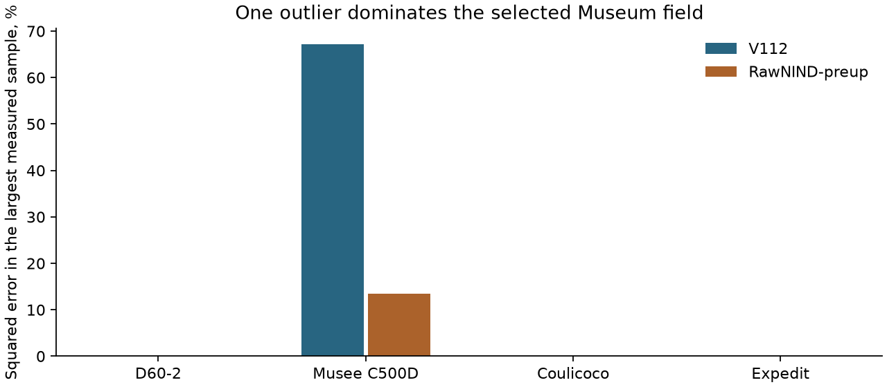
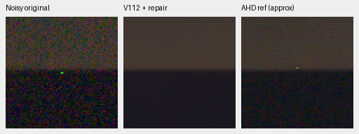
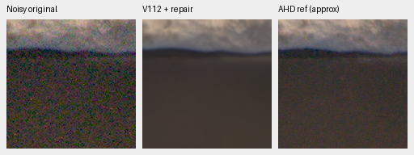
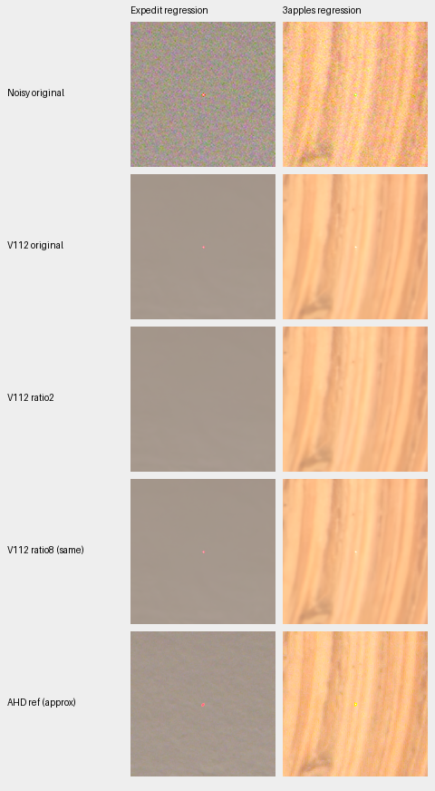

# Camera outliers, reference contamination and isolated repair

**One bright sample explains 67% of V112's squared error in its worst selected
museum field.** Existing isolated-pixel repair raises that crop from
51.87167 to 56.75084 dB. Stronger RawNIND, given the same repaired input, reaches
56.82213 dB: the gap shrinks from 4.70361 to .07129 dB without changing either
network's weights.

The complete camera panels show a more limited result. Repair improves the
known-camera mean, mainly through the museum scene; unseen-camera changes are
small and mixed. Some numerical regressions remove points that also recur at
fixed sensor coordinates across unrelated scenes. Those reference-supported
points are not reliable evidence of genuine scene detail.
Repair remains optional, and original benchmark scores/defaults are unchanged.

[Complete executions, independent rescoring, source/weights and native pixels](results/v112-camera-outlier-repair-v1.json).

## Localized error and native repair examples

The four adverse fields were fixed as the worst V112-minus-strong-reference
crop in each of the four scenes with a negative scene mean. These are
deliberately adverse development examples, not representative samples.

In the museum field, global channel means account for only .66% of error.
The largest sample is instead a green outlier at crop [x272, y293], with
input .98562 and same-phase median .00204. The unchanged isolated defaults
correct 57 of the 512² sites. The earlier source/scene comparison alone could
not identify this cause. [Figure data and independent energy checks](images/v112-camera-hot-repair/manifest.json).

Noisy original → **V112 with existing isolated repair** → independently
demosaiced low-ISO AHD reference, **approximate RGB, not exact GT**:

Both use native 160×160 crops centered on the two largest input-detected outliers,
ROIs [192,213,160,160] and [320,102,160,160], with common +2 EV display, WB/matrix
and no resizing. The original noisy preview is shared across methods; the
restoration inputs differ by the declared preprocessing. Conditioning remains
the original input-only shot/read estimate.
[First source/ROI/checkpoint/noise/display receipt](images/v112-camera-hot-repair/V112-repaired-outlier-1.json) ·
[Second receipt](images/v112-camera-hot-repair/V112-repaired-outlier-2.json) ·
[Both networks before/after repair, native comparison](images/v112-camera-hot-repair/comparison.png).
V112 checkpoint SHA256 is
`21c3cca8370df21e3412f9ccbf441c35afcfad8fd03174c7727f4f88874783b1`.

## Complete development camera panels

All 72 known / 90 unseen native 512×512 crops retain their registered low-ISO
measured-CFA references/masks and 448-pixel scoring interiors. Means average
nine crops per capture, two captures per scene, then four/five scenes.
Both methods receive identical repaired inputs under each profile.

| Input handling | V112 known | RawNIND pre-up known | V112 unseen | RawNIND pre-up unseen |
| --- | ---: | ---: | ---: | ---: |
| Original, no repair | 54.26914 | 54.26068 | 53.95378 | 53.86528 |
| Existing isolated defaults, ratio 2 | 54.40640 | 54.26665 | 53.95404 | 53.86557 |
| Development follow-up, ratio 8 | 54.39509 | 54.26579 | 53.95563 | 53.86572 |

The existing defaults use sigma 6, ratio 2 and minimum excess .005. They change
63 crops/973 sites. V112 gains +.13726 dB known and +.00026 unseen; its
museum scene mean gains +.52715 dB. Two of four known and two of five unseen
scene means improve. Four scene means still favor stronger RawNIND when both
use repaired inputs. This is a preprocessing comparison, not a trained
architecture improvement or a broad real-camera winner.

Ratio 8 was a single exploratory follow-up after inspecting default-repair
regressions, not independent validation or a threshold sweep. It changes
27 crops/104 sites while retaining sigma 6/minimum excess .005. The smaller
activation count does not establish better image quality. The largest crop
score drops remain −.334 dB with ratio 2 and −.297 with ratio 8. Source-resampling
intervals and all per-scene/crop values are in the linked receipt; they describe
this fixed small scene set, not training-seed uncertainty.

## Why a lower score need not mean lost scene detail

The two largest default-repair regressions remove isolated points visible in
the low-ISO reference too. For one red sample, input .47038 is close to the
measured reference .49797; repair replaces it with .09430. Initially this suggested
loss of real bright detail. Native views and a cross-scene check contradict
that simple interpretation.

At full-sensor [2886,354], the point is an outlier in **all five unrelated
Canon EOS M100 scenes at ISO 1600**, but is near its local background in their
higher-ISO captures. A second point at [5509,2116] shows a similar pattern.

| Fixed sensor coordinate | ISO 1600 excess over same-phase median, five scenes | Higher-ISO excess, five scenes |
| --- | ---: | ---: |
| [2886,354] | .15755–.82787 | −.00842–.02071 |
| [5509,2116] | .03186–.37160 | .00732–.04426 |

These compare original noisy Bayer samples at the same sensor coordinates,
without using reference images to identify recurrence. This strongly supports
capture/sensor/preprocessing artifacts rather than scene-specific detail;
the physical mechanism is not identified. Low-ISO reference support alone is
therefore insufficient to call these points genuine detail. Keeping a
reference-contaminating point can raise PSNR while retaining a visible speck.
[Coordinates, all ten captures per point and source audit](results/v112-camera-outlier-repair-v1.json).

This does not prove every detected point is a defect. Unresolved single-color
scene lights remain ambiguous in one capture, as documented for the existing
optional detector. Neither ratio is made a new default or preferred solely
from these development scores. Original references/masks and historical
results are preserved; the 16-scene reserve remains unscored.

## Training-reference follow-up

The [paired training-reference audit](paired-reference-quality.md) checks the
separate train32 cohort across all 576 cached crops. Many bright-isolation flags
occur on useful fine-detail surfaces. One fixed Nikon Z6 red speck contaminates
two low-ISO references; a separate reviewed mask revision excludes only those
neighborhoods. No active recipe, held-out reference or benchmark score changes.

## Execution and practical scope

All new neural work is CPU FP32 using the original V112 inference archive.
Changed inputs/predictions are retained; unchanged inputs and existing repaired
outputs are reused. Independent NumPy64 checks rebuild 180 changed-input
prediction cases / 900 metric fields. Maximum primary discrepancy is
5.72e-6 dB; SSIM is not independently rebuilt. Four adverse controls and two
additional baseline captures match original scalar scores within the declared
CPU/GPU tolerance. That does not bound every unretained original GPU float.

The first residual-analysis draft assumed reference CFA phases matched input
phases. Registration invalidates that assumption; its nonfinite diagnostic
failed strict serialization. Failed source/log/partial assets remain preserved;
corrected analysis reuses saved predictions without neural reruns.
The default full-panel worker wrote complete 162-crop/count/guard receipts before
its shell handle later returned 143, with unknown cause. All 126 resulting
changed-input predictions independently rescore; no learned work was retried.

Use the existing [hot-pixel/DNG options](dng-export.md#hot-pixel-correction)
when deliberately repairing isolated bright outliers. No model, CLI default,
training data or active Tiny/Small recipe is changed here. Fine photographic
detail, dark-field smoothing and the 100MP/10s goal remain open.

Data: Benoit Brummer and Christophe De Vleeschouwer, *Raw Natural Image Noise
Dataset (2025)*, [CC BY-SA 4.0](https://creativecommons.org/licenses/by-sa/4.0/);
see the dataset's `permissions.txt` for individual scene credits and CC0 grants.
Modifications: cached cropping/registration, optional isolated-site replacement,
neural restoration and common display conversion. Originals remain read-only.
