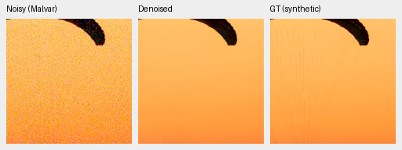
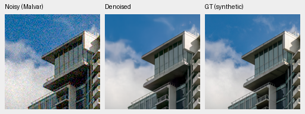
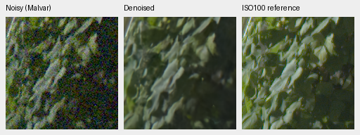
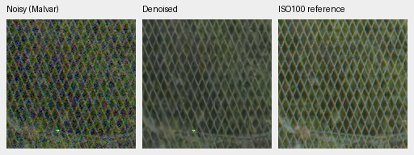

# V46: camera projection omission has mixed global results

Current architecture and recommendations: [current model guide](current-model.md).
The versioned study below retains its measured results and original protocol.

**V46 is not promoted.** It repairs the selected pattern color bias and improves
photographic PSNR, but loses real-camera primary accuracy and photographic SSIM.
The current V43 step2000 photographic comparator was fixed for this study.
[Complete measurements, export provenance and ten native triplets](results/camera-projection-v46-review.json).

This is an inference-only intervention, not another trained model: take the
immutable V43 step2000 EMA and zero only columns 9:21 of its 21→64 measurement
projection. Those columns consume log2 WB and the 3×3 camera matrix. The first 9
columns, bias and every other tensor remain exact after serialization. Physical
WB/matrix rendering, CFA data/masks, black/white/noise-family anchors and genuine
DINO remain active. There are zero new training updates. See the
[selected-failure diagnosis](native-low-noise-camera-diagnosis.md).

| Panel | Model | Measured-CFA PSNR | AHD RGB PSNR | AHD SSIM |
| --- | --- | ---: | ---: | ---: |
| Known4 | V43 step2000 | 54.23332 | 40.05105 | 0.930848 |
| Known4 | V46 camera projection off | 54.07672 | 39.92432 | 0.928245 |
| Unseen5 | V43 step2000 | 53.80606 | 38.59078 | 0.921579 |
| Unseen5 | V46 camera projection off | 53.74494 | 38.49500 | 0.922120 |

V46−parent primary PSNR: known **-0.15660 [-0.25273, -0.01690]**;
unseen **-0.06112 [-0.14254, +0.01410]** dB.
Known4 has 8 pairs/72 crops; unseen5 has 10 pairs/90 crops, balanced within scenes.
Registered low-noise measured CFA is primary. Independent AHD RGB is auxiliary,
**not exact RGB GT**. Protected-final model scoring remains untouched.

| Model | 427-photo PSNR | SSIM | 16-procedural PSNR | SSIM |
| --- | ---: | ---: | ---: | ---: |
| V43 step2000 | 34.89934 | 0.957126 | 33.28537 | 0.966604 |
| V46 camera projection off | 34.94790 | 0.956582 | 34.23655 | 0.968622 |

V46−parent photo PSNR **+0.04855 [+0.01186, +0.09280]** dB;
procedural PSNR **+0.95118 [+0.24838, +2.06778]** dB. Brackets are 95%
source-bootstrap intervals, not training-seed uncertainty. The complete suite
uses 443 sources, seven conditions and four CFAs. Only the changed model is
recomputed; cached parent reuse requires identical protocol/data/render/metric
metadata and exact equality of 24 known / 30 unseen classical pair summaries and
all 37,212 individual classical synthetic records. The combined comparison has
62,020 cases: two neural methods and three classical methods. Original reports,
case files and hashes remain in the receipt. Earlier RawNIND comparisons remain
in the [parent review](native-corpus-2k-review.md).

Parent SHA256 `0d74cf31fb1c7e3f97fc692c855a2ca0ee3ebf562b454e4f8b135c28fc0aa5c5`.
V46 SHA256 `b0b4be3d83d69e1f20459d972b72a0fe13ffff9f4ad903024ea89b6a790c9c68`. Original frozen807d929 evaluator
code and full-resolution/original-precision policy remain fixed; no hidden
autocast or low-rank adapter change. This export is for inference; initializing
training from zeroed weights alone would allow those columns to learn again.
A training repair must explicitly define the desired camera representation.

## Native exact-GT and real-reference crops

Noisy Malvar → restored → exact synthetic GT. Each panel is native 160×160 with
no resizing. Same two protocol photographs, RGGB/ISO12800 prior
`shot=.00256`, `read=.0000262144`, ROI[48,48,160,160], display×1, WB[2,1,1.5]
and fixed protocol matrix. All source/cache/checkpoint/conditioning/display
identities are recorded. PNGs are 8-bit previews; metrics use unquantized output.

Sources: [Roy Egloff](https://commons.wikimedia.org/wiki/File:CH.VD.Villeneuve_2007-08-25_Vertigo-Swiss-Riviera_2392_3x2-R_4K.jpg)
and [Dietmar Rabich](https://commons.wikimedia.org/wiki/File:Vancouver_(BC,_Canada),_Coal_Harbour_Seaside_Park,_Blick_in_den_Himmel_--_2022_--_2158.jpg),
[CC BY-SA 4.0](https://creativecommons.org/licenses/by-sa/4.0/). Modified by linear
binning, crop, synthetic noise, restoration and rendering; previews retain that
license. Paired data by Benoit Brummer and Christophe De Vleeschouwer,
[RawNIND](https://doi.org/10.14428/DVN/DEQCIM), per-scene CC BY-SA 4.0/CC0 attribution
in the source receipts. GFX by the project owner.

Full 102 MP GFX DSCF3879 ISO6400 → restored → separate DSCF3880 ISO100 f/5.6.
Native160px foliage[8890,5570] and fence[2240,6000], reference fence x2241.
Shared +2 EV/WB/matrix, input-only prior `shot=.0014635775921166604`,
`read=.0000010715704128646712`. Time/aperture/motion differ: final panel is a
qualitative reference, **not GT**. No pixelwise GFX reference score.

Selected crops look close to the parent: fabric threads remain missing, cloud
texture and foliage soft, and fence structure irregular with an isolated colored
point. No decisive visual gain offsets the known-camera accuracy loss. The
selected-pattern color repair does not establish globally better restoration.

All ten triplets verify SHA/dimensions, source/ROI/noise/display metadata and
identical noisy/reference panel bytes against the parent. Both complete
8746×11662×3 uint16 TIFFs verify SHA/size/dtype/shape/16-bit tags and >256 sampled
codes; the sRGB TIFF carries an ICC profile. Full restoration took 34.63s
with 512px tiles/64px overlap/batch4, excluding decode/load/render/encoding.
This successive shared-machine observation is not a repeated speed benchmark
or a 10-second result. Outputs remain in
`/mnt/external/demosaic/evaluation/gfx-3879-3880-camera-projection-off-v46-full/`.
No source-image modification, protected training or real-reference fitting.
