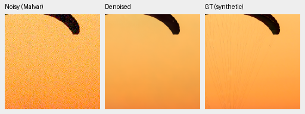
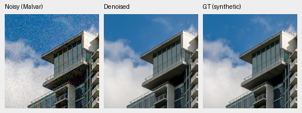
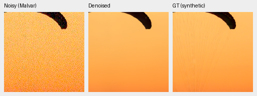
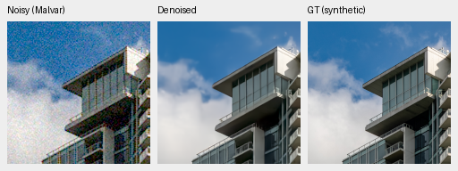

# V76/V77 first1000: completed camera interim, full review running

Both fresh arms completed their original first1,000-update boundary. Sensor-valid
V77 gains on unseen cameras but loses on known cameras, failing the
[predeclared continuation requirement](camera-supervision-v76-v77.md). Neither
arm will extend beyond1k or replace V43. The already frozen full427, fixed418/416,
color, analytic and standing-GFX review continues; those results are pending.

The [interim registry](results/camera-supervision-camera-interim-v1.json) binds
both actual checkpoints, source/data/training receipts, independent camera
audits, all crop metadata/PNG hashes and the actual native-view receipt.
The [publication audit](results/camera-supervision-interim-publication-v1.json)
checks517 path/SHA bindings and every native board cell against its original
pixels, including four camera NPZ paths resolved against their actual manifests.
Training controller and final child have both exited successfully. Independent
full-state checks find91 model/91 EMA/89 AdamW states finite at step1000, with
exact genuine parent EMA initialization and the unchanged official DINO hash.
All56 sampled legacy/input observations and41 logged domains/LRs match between
arms. The new target field intentionally changes complete nonpaired batch hashes.

| Development panel | V76 camera-CFA PSNR | V77 camera-CFA PSNR | V77 − V76 | Scene-bootstrap95% interval |
| --- | ---: | ---: | ---: | --- |
| Known4 scenes | 54.20499 | 54.17786 | **−.02714dB** | [−.05157,+.01487] |
| Unseen5 scenes | 53.84358 | 53.92456 | **+.08098dB** | [+.04737,+.10824] |

Each mean balances crops within noisy captures, captures within scenes, then
scenes. Registered low-noise measured CFAs are the primary physical targets;
the displayed AHD RGB references are independently demosaiced, not exact RGB GT.
Both panels pass independent coverage/protocol/summary checks. The original
gate requires at least+.05dB and a positive interval on **both** panels. Known4
fails; the positive unseen result does not override it. These are one training
seed and nine development scenes, not training-seed uncertainty or a final test.

## Matched native100% photographs

Each PNG contains three unchanged160×160 pixel squares: noisy Malvar, denoised,
exact synthetic GT. Open the original at100%; no crop pixels were resized.
The [matched native board](images/camera-supervision-first1k-full427-native.png)
also includes the genuine V63 original20k parent on the same observations.
All six photographic triplets/ten unique cells were actually viewed.

V76 control, checkpoint SHA256
`10f179cb9134fe537806add4b8470ca3961e3ef0b6ad7a9732b68b589fa0800a`:

V77 sensor-valid, checkpoint SHA256
`785cf617158ff3232b7cd165f3bfd1bea557caa77775764ce0f0644cff8df15c`:

V77 moves the canopy toward the GT orange; fine cords remain absent in both
arms. Building crops are close between new arms, with smoother clouds and fine
window/railing detail than GT. These selected examples do not establish a
population improvement or decisive real-photo superiority.

Shared photographic metadata: original full427 **CUDA-generated** ISO12800-prior
observation, shot .00256, read variance .0000262144, RGGB, WB [2,1,1.5], display
exposure1. Protocol matrix has diagonal1.1176470588 and off-diagonal−.0588235294.
Inference is fresh B2/native256 IEEE FP32; previews are RGB8 sRGB. These are not
the earlier two-photo CPU-noise fixtures. First saved native crops are read from
the active producer with their exact original PNG/JSON hashes; no unfinished
population summary is treated as complete.

| Source | Native256 context in8× cache | Displayed160px ROI in cache |
| --- | --- | --- |
| `0014aa4e075b1827f91ef8a02069e1e318f040ba` | [189,3,256,256] | [237,51,160,160] |
| `002fc6eeadf637e81d5a327f117b79abb86becd9` | [195,89,256,256] | [243,137,160,160] |

Coordinates are derived from the actual fixed loader seed/index; the decoded
native slice is checked exactly. The raw synthetic summary omitted explicit
camera/cache-coordinate fields present in the retained parent report. The new
composition helper derives them from the actual protocol/loader and checks
existing values; it preserves every pixel and retains the richer metadata.
An actual historical-data preflight checks22 triplets/34 native cells and both
native cache slices before the new review boards are built.

Sources: [Swiss Riviera by Roy Egloff](https://commons.wikimedia.org/wiki/File:CH.VD.Villeneuve_2007-08-25_Vertigo-Swiss-Riviera_2392_3x2-R_4K.jpg)
and [Vancouver by Dietmar Rabich](https://commons.wikimedia.org/wiki/File:Vancouver_(BC,_Canada),_Coal_Harbour_Seaside_Park,_Blick_in_den_Himmel_--_2022_--_2158.jpg),
[CC BY-SA4.0](https://creativecommons.org/licenses/by-sa/4.0/), modified by
binning, crop, simulated noise and restoration. Registry entries retain original
source identities, cache hashes and complete model/noise/display metadata.

## Camera crops and remaining work

The [known-camera board](images/camera-supervision-first1k-known-native.png) and
[unseen-camera board](images/camera-supervision-first1k-unseen-native.png) compare
both new arms with saved, hash-verified parent and publisher RawNIND-channel
outputs. Sixteen triplets/24 unique cells were actually viewed. New arms and
parent are visually close on plate/line and flat geometric examples; the new
mode does not repair the soft detail on apple/material crops. These selected
views cannot establish overall architectural or real-photo superiority.
Their AHD reference labels explicitly distinguish them from exact RGB GT.

The earlier default CPU replay is exact, but a separate V76-versus-older-V74
GPU trajectory check finds different trained tensors despite all41 logged
observation/domain/LR hashes and first16 observations matching. EMA RMS
difference is2.18461e-5, maximum4.11276e-4. The cause is not isolated; this is not
a general determinism claim or an estimate of training-seed variation. We keep
the planned fresh evaluations rather than substituting older V74 predictions.

The full CPU suite passes **1021 tests,9 skipped,110.76s**, with CUDA hidden.
Genuine CUDA execution is checked separately by the preflights and both completed
training runs. The owned CPU closure waits for the exact successful full-review
owner/child exit and all ten stages before independently auditing saved color
arrays/analytic summaries and building the remaining native boards. Four fixed
additional palettes were declared before this trial's hue outputs existed.

All22 early triplets/34 native cells were actually viewed, but they do not close
the remaining photographic/color/analytic/GFX review. Early image/source hashes
must be revalidated after successful producer exit. No new full102MP export or
timing is justified by this failed continuation screen. Working V43 and README
crop examples remain; project quality and speed requirements remain outstanding.
