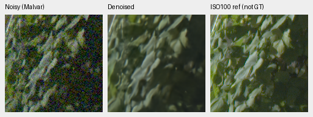
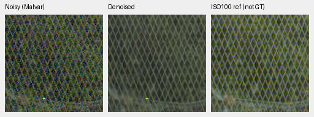

# V76/V77: completed first1000 camera-supervision review

Sensor-valid V77 improves rendered photo PSNR by **.16011dB** over matched V76,
95% source interval[.09818,.23936], and greatly reduces bright uniform-field
color bias. Its known-camera mean loses.02714dB, failing the original requirement
that both known/unseen camera panels improve by at least.05dB with positive
intervals. **Both arms stop at1k; no extension or promotion. V43 stays the working
reference.** Fine cords, foliage texture and weak stripes remain missing.

[Complete source, score, sensitivity, array, native-view and state registry](results/camera-supervision-first1k-complete-v1.json).
[Frozen recipe and original criteria](camera-supervision-v76-v77.md).
[Earlier camera-only interim, retained unchanged](camera-supervision-first1k-camera-interim.md).

Both actual first1000 boundaries, all ten inference/review stages and CPU closure
finished successfully; exact owners/children have exited. All67 native triplets/
111 cells were actually viewed:66 early cells were revalidated by method/case/
source/pixel identity after exit, and45 remaining color/highlight cells viewed
separately. Reordering photo columns does not create new reviewed pixels.
The [publication audit](results/camera-supervision-complete-publication-v1.json)
verifies627 path/SHA bindings, all111 original cell pixels and all new PNG copies.

## Primary results

Means balance photographs or registered scenes.427 photographs have exact
synthetic targets;16 procedural sources remain separate. Real development has
four known/five unseen scenes. Its primary target is registered measured CFA;
independently demosaiced AHD RGB is auxiliary, not exact RGB GT. Intervals use
1,000 paired source/scene resamples, seed42, not training-seed uncertainty.

| Model | Photo sRGB PSNR | Known CFA PSNR | Unseen CFA PSNR |
| --- | ---: | ---: | ---: |
| V43 working | 34.89933 | 54.23334 | 53.80629 |
| Genuine V63 original20k parent | 35.93298 | 54.20368 | 53.84318 |
| V76 reference-white control | 35.94163 | 54.20499 | 53.84358 |
| V77 sensor-valid | **36.10174** | 54.17786 | **53.92456** |
| RawNIND global-CFA gain | 26.69578 | 54.06860 | 53.56220 |
| RawNIND channel-CFA gain | 26.68357 | 54.08474 | 53.76822 |

Historical parent/V43/RawNIND records retain their original training and transfer
limitations; reuse requires exact protocol/coverage/nullable support and classical
control witnesses. The large synthetic RawNIND gap does not establish comparable
real-camera superiority. Actual real-camera differences are much smaller.

| Metric | V76 | V77 | Matched change [95% interval] |
| --- | ---: | ---: | --- |
| Photo sRGB PSNR | 35.94163 | 36.10174 | +.16011dB [.09818,.23936] |
| Photo sRGB SSIM | .963249922 | .963587768 | +.00033785 [.00024629,.00045648] |
| Known CFA PSNR | 54.20499 | 54.17786 | −.02714dB [−.05157,.01487] |
| Unseen CFA PSNR | 53.84358 | 53.92456 | +.08098dB [.04737,.10824] |
| Auxiliary unseen AHD PSNR | 38.82322 | 38.78563 | −.03759dB [−.05589,−.01391] |
| Canonical camera-linear photo PSNR | 41.36650 | 39.23469 | −2.13181dB [−2.23866,−2.00333] |

The original camera-linear benchmark target applies reference-white clipping in
linear sRGB before inverse camera transport. It differs from V77's physical
camera training target. Keep this unchanged score and its interpretation: the
highlight condition loses16.91614dB in canonical camera-linear PSNR while gaining
.20485dB in rendered PSNR. Other camera-linear conditions improve except shadows.
This is not a replacement metric, a claim that every difference is semantic,
or permission to discard an unfavorable result.

Full427 rendered changes by condition: ADC+.03937, ISO100+.31053,
ISO1600+.23320, ISO12800+.11011, shadows−.01673, highlights+.20485,
original-noise+.23941dB. These condition means are descriptive, without new
condition-specific intervals. Procedural16 gains.75339dB rendered PSNR and
.00326866 SSIM, while canonical camera-linear PSNR loses1.16475dB.

Fixed418/416-source sensitivities retain+.16072/+.16114dB rendered gains, with
positive intervals. They do not prove scene independence or remove related-series
ancestry already present in the parent. The new84,867-source corpus is shared
by both arms; own-parent differences also change optimizer state and horizon.

## Native160px photographic GT triplets

Each PNG is noisy Malvar → restored → exact synthetic GT, using identical ROI
and display transforms across methods. Pixels are never resized; open the
original at100%. These RGB8 sRGB previews use the original full427 CUDA noise,
not earlier CPU-noise fixtures. Scores use unquantized fresh IEEE FP32 predictions.

V76 control, SHA256
`10f179cb9134fe537806add4b8470ca3961e3ef0b6ad7a9732b68b589fa0800a`:

V77 sensor-valid, SHA256
`785cf617158ff3232b7cd165f3bfd1bea557caa77775764ce0f0644cff8df15c`:

Shared RGGB, shot.00256/read variance.0000262144, WB[2,1,1.5], exposure/display1,
protocol matrix diagonal1.1176470588/off-diagonal−.0588235294. Native256 contexts
in the8× cache are [189,3,256,256] and[195,89,256,256]; displayed160px cache ROIs
are [237,51,160,160] and[243,137,160,160]. Actual loader/native slices, source
hashes, camera matrices and all crop rectangles are checked in the linked receipts.

V77's canopy is closer to the GT orange, but fine cords remain absent. Building
detail is similar between arms and remains softer than GT. Sources:
[Swiss Riviera, Roy Egloff](https://commons.wikimedia.org/wiki/File:CH.VD.Villeneuve_2007-08-25_Vertigo-Swiss-Riviera_2392_3x2-R_4K.jpg)
and [Vancouver, Dietmar Rabich](https://commons.wikimedia.org/wiki/File:Vancouver_(BC,_Canada),_Coal_Harbour_Seaside_Park,_Blick_in_den_Himmel_--_2022_--_2158.jpg),
[CC BY-SA4.0](https://creativecommons.org/licenses/by-sa/4.0/), modified by binning,
crop, simulated noise and restoration. Full IDs and attribution remain in the
[interim crop registry](results/camera-supervision-camera-interim-v1.json).

## Color and weak detail

The fixed147-color × two-condition × four-CFA panel has1,176 observations and
3,528 fresh saved F32 predictions including the genuine parent. At high noise,
peak.9, mean maximum-channel bias / per-case camera-RGB RMSE over96 hue/CFA cases:

| Saturation | V76 bias / RMSE | V77 bias / RMSE | Parent bias / RMSE |
| ---: | --- | --- | --- |
| .50 | .020206 / .014614 | **.002080 / .002204** | .014350 / .010289 |
| .98 | .014495 / .010203 | **.001552 / .001930** | .005739 / .004512 |

The [base color board](images/camera-supervision-complete-hue-native.png) and
[four previously fixed extra palettes](images/camera-supervision-complete-hue-extra-native.png)
show more uniform orange/pink/magenta near GT under V77. Neutral and lower-peak
examples stay close, without a new obvious large color failure. These are
descriptive fixed-grid results, not photographic confidence intervals.

The [weak-carrier board](images/camera-supervision-complete-analytic-native.png)
still loses detail. High-noise in-phase gain for dark level.01/contrast.1/period8
is.004425→.006369 (Malvar1.02913): nearly erased. Level.18/contrast.02/period16
improves.311386→.362291 (Malvar.99177), still strongly attenuated. Noncarrier RMS
changes.000205→.000214 and.001050→.001067; Malvar retains much larger noise.
Higher average quality and lower color bias do not repair the missing texture.

## Standing GFX references

Fresh B4/native512 IEEE FP32 contexts compare both arms with verified parent
PNGs. This is not a new full102MP restore. All four regions are in the
[matched GFX board](images/camera-supervision-complete-gfx-native.png).

Cached DSCF3879 ISO6400/f1.7/1/240 and DSCF3880 ISO100/f5.6/3s differ in aperture,
time, motion and possibly LED state. The ISO100 panel is independently demosaiced,
**not exact GT**. Both originals and siblings remain outside training and read-only;
no original source drives were read. Shared display×4/+2EV, shot.0014635775921166604,
read variance1.0715704128646712e-6, WB[1.5132450331,1,2.2152317881]. Native160px
noisy/reference origins: foliage[8890,5570]/[8890,5570],
fence[2240,6000]/[2241,6000]. Full matrix/RAW/context/checkpoint hashes are recorded.

New arms and parent retain similar gray sky, soft building/foliage and fence
mesh. An isolated bright point persists; no clear large fine-detail repair is
visible. The [neon/platform board](images/camera-supervision-complete-highlights-native.png)
retains clipped/simplified blue sign interiors and soft boundaries in all three.
The camera/AHD and separate low-ISO references cannot support exact RGB scores
or a decisive real-photo superiority claim.

## Verification and decision

Independent primary coverage includes62,830 fresh score rows. The sensitivity
audit reaggregates215,208 raw metrics/7,686 source scalars and81 comparisons;
maximum source difference0, comparison difference3.55e-15. Saved hue arrays
independently reproduce21,168 metric fields within4.44e-16;54 group/648 scalar
summary fields agree within3.47e-18. Analytic coverage checks1,344 cases,
84 groups/2,256 fields within2.22e-16. All native cells retain original pixels.

Actual parent/frozen DINO, both finite91/91/89 checkpoint state sets and original4k
LR schedules are verified. All56 legacy/input samples match between arms. Full CPU tests
passed1021/9 skips before the separate mathematical prototype; no bitwise CUDA
cross-run trajectory guarantee is inferred. The earlier V76/V74 comparison and
fresh-evaluation rationale remain in the interim report.

Known-camera eligibility fails, while unseen/photo/SSIM safety gates pass.
Both arms remain at their original1k boundary without the remaining3k updates.
No new full102MP RGB16 export/timing or default change follows. The separate
[censored-highlight CPU counterexamples](censored-highlight-gradients.md) motivate
a new hypothesis; they do not explain these scores or reopen this trial.
SOTA, decisive real-photo superiority and100MP/10s remain unmet/unproven.
