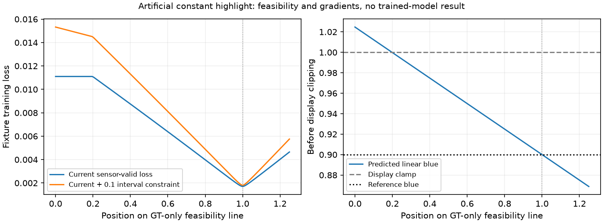

# Censored highlights: representation and display-gradient counterexamples

A CPU fixture finds two separate obstacles to highlight recovery: the centered
RAW head cannot change a constant sensor-clipped field, and even an additional
correction on censored channels can receive zero current-loss gradient while
its displayed color is wrong. A pre-clipping interval constraint removes the
second obstacle in the fixture. This is mathematical evidence, not a trained
model improvement or an explanation of V77's measured performance.

The [executed source,48 cases,64 independent replays and plot receipt](results/censored-highlight-gradient-CPU-v1.json)
record actual CPU FP32/NumPy FP64 arithmetic. No optimizer, pretrained restoration
model, DINO backbone, photograph or CUDA operation is used. The actual randomly
initialized phase-aware RAW head executes48 forwards and its state stays unchanged.
The [completed V76/V77 review](camera-supervision-first1k-review.md), failed
continuation gate and production implementation remain unchanged.

## Concrete stationary error

Use exposed linear-sRGB [3.6,1.8,.9], WB [2,1,1.5], and the existing coupled
protocol matrix. Physical camera RGB is [1.6875,1.845,.7200]. Ideal sensor
clipping observes [1,1,.7200]. The rendered reference is [1,1,sRGB(.9)].
The diagnostic allows a channel correction only where the observed ADC code is
maximum. This preserves the added correction at zero on valid measured positions;
it does not claim that the existing denoiser itself reproduces noisy samples.

Consider camera prediction [1,1.1,.7200]. It transports to approximately
[2.107059,1.048235,1.024706] before display clipping. All three display components
become white, although the reference blue is below white. Current sensor-valid
training loss is .01110120 and rendered MSE .0006844154, but its gradient with
respect to all three diagnostic correction coefficients is **exactly zero**.
The valid physical blue channel already matches; red/green camera supervision is
masked because their clean signals exceed the sensor range. Every rendered
term uses the already clipped prediction.

This differs from the earlier [target-convention audit](camera-supervision-v76-v77.md):
valid physical camera supervision fixes its sensor-unclipped example, but it
does not alone remove this display-gradient barrier for sensor-clipped colors.
The identity-matrix controls do not have the same cross-channel color error.

## A feasible estimate and an informative constraint

For a predicted linear-sRGB component `p` and canonical reference component `r`,
the prototype error is:

| Reference component | Error before Charbonnier |
| --- | --- |
| At white, `r >= 1 - 1e-6` | `min(p - 1, 0)` |
| At black, `r <= 1e-6` | `max(p, 0)` |
| Otherwise | `p - r` |

It accepts exposed white above1 and negative values at the black display bound,
while retaining a gradient for a wrongly over-white component whose reference
lies below white. It does not require an exact, unobservable latent intensity
for clipped reference components. Normal display/export clipping remains needed;
this prototype operates on the training signal before that clipping.

At the stationary example, interval gradients for the red/green correction are
−.03921441/−.01960720, with zero blue correction. A **GT-only feasibility witness**
changes the prediction to approximately [1.848,1.524,.7200]. Its rendered MSE is0
in the ideal example and the valid physical camera error remains0. The true
latent red/green values are not recovered or identifiable from this fixture;
the witness establishes a compatible rendering, not a deployable calibration.

The current loss is flat near the starting point until predicted blue drops
below the display clamp, near `t=.2`. Adding .1 times the interval term supplies
a slope there. That coefficient illustrates the barrier; it is not selected
from photographic performance. The line uses GT only for the mathematical
witness and must never be used to correct inference outputs.

## Coverage and limits

The fixed expansion covers three constant scenes, identity/coupled matrices,
four CFAs and ideal/actual16-bit-ADC observations,48 cases. The actual ADC path
uses zero Poisson/read coefficients and black level.03. Quantization leaves a
small error in the valid blue value; the added correction preserves that value
exactly. All eight coupled/sensor-clipped cases have the same zero-gradient
barrier and admit a witness with rendered MSE below1e-12 without increasing
valid camera error. All48 centered-head coefficient/feature gradients are zero
on constant fields, including cases where their output is already correct.

Independent NumPy FP64 replay reconstructs camera transport, CFA gathering,
valid masks, sRGB, spatial/highlight penalties, complete loss and interval
gradients for64 estimates. Maximum loss-part discrepancy is3.99e-8; maximum
interval-gradient discrepancy is2.26e-6. Seven targeted tests pass, covering
all four spatial CFA gates, both ADC formats, the actual stationary error and
feasible witness, and black/white interval semantics. Ruff passes.

The initial one-off counterexample motivated this frozen expansion; this is
not a preregistered photographic performance study. It does not establish how
often actual networks reach the plateau, explain existing benchmark changes,
repair fine texture or prove a boundary advantage. A context-predicted correction
on censored channels and an informative interval term warrant a separate
engineering/model study. Neither prototype is integrated into production,
and no current checkpoint, target, evaluation gate or inference default changes.
