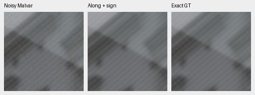
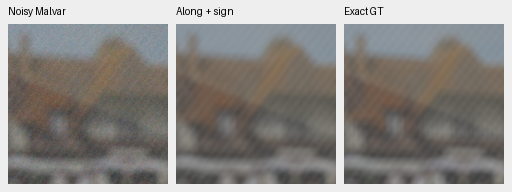
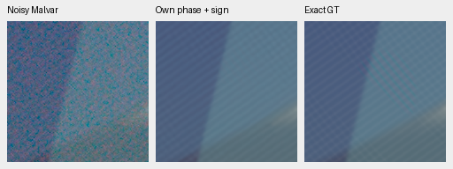
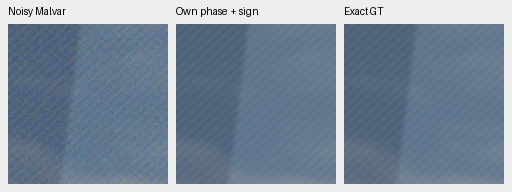

# Pooling signed color evidence along a Bayer strand

Wider RAW support alone did not recover the missing signed color.
The along-strand and isotropic fits left all 80 suppressed weak-color
windows in the optical photo panels at the local conditional output.
Supplying the exact color waveform passed the same held checks in
10 of 30 suppressed ISO1600 windows and 16 of 48 on the retained
ISO6400 panel. This is evidence of a waveform-estimation limit on
part of the panel. Fitting independent red/blue phase recovers two
red windows on the fresh ISO1600 panel, for a mean gain of 0.083
signed-response points. Fine crossings remain incomplete on the real cab.

The [spatial color field follow-up](cfa-relative-phase.md) recovers more
when chroma is stronger, with limited transfer to the earlier weaker panels.

## Fit and tests

The [local conditional fit](cfa-signed-color-delivery.md) comes first.
Its green reconstruction, carrier nomination and neutral-color
contradiction decisions are fixed. The new candidates address
red or blue windows where neutral was contradicted and the local
signed fit supplied no correction.

Each 192-pixel query has 64 disjoint 24 × 24 nodes. Within each red
or blue node, one checkerboard subset fits the cosine background and
the competing carrier. The complementary subset tests the residual
prediction. Each orientation pools the sufficient statistics for a
signed amplitude on the common green-derived waveform. The Gaussian
standard deviations are 28 pixels along the strand and 10 across,
versus 16.73 pixels isotropically for the same nominal area. Weighted
held error reductions use a noise proxy that accounts for the squared
weights and the fitted background transferred between checkerboards.

The delivery window is 32 × 32. Both folds still require a broad score
over 6 and a central score over 1.5. The sign-only controls require
positive central support on the same samples. The shorter square
control retains the original 48-pixel amplitude fit with this
relaxed central check. The parent projection and amplitude cap follow
the preceding study. Eight probes across the CFA positions show that
replacing held samples changes the held scores and leaves the pooled
fit statistics bit-identical.

A follow-up uses the fitting checkerboard's negative signed estimate
to downweight positive or uninformative color nodes. It keeps the
same pool widths and tests both central thresholds.

A second follow-up gives each red or blue checkerboard its own sine
and cosine coefficients at the same nominated frequency. The two
48-pixel fits must agree in phase within 90°. The 48/32-pixel held
checks and parent-deficit cap otherwise follow the same rules.

## Photo replay

The 24 retained signed photographs use the previous ISO6400 captures.
The separate confirmation panel has 16 new validation photographs,
two draws per noise profile and all four Bayer layouts. Twelve scenes
contain a local sign reversal in one or both colors. Four have aligned
color. In the fresh panel, the reversal region uses semiaxes 37 and
47 native pixels before blur. Both panels use σ 0.85 pre-Bayer blur,
exposure 0.33 and black offset 0.03. ISO1600 shot/read are
`0.00032 / 4.096e-7`, and ISO6400 uses `0.00128 / 6.5536e-6`.
The fresh backgrounds are disjoint from the prior optical fixtures and
559,808 recorded Local 50k photographic training visits. Both parent
exports are IEEE FP32 CUDA EMA.

| Signed-color panel | Suppressed color windows tested | Recovered by any green-guided pool | Recovered with own R/B phase, strict / sign-only |
| --- | ---: | ---: | ---: |
| Retained ISO6400, 24 photos | 48 | 0 | 1 / 1 |
| Fresh ISO1600, 12 photos | 30 | 0 | 1 / 2 |
| Fresh ISO6400, 12 photos | 2 | 0 | 0 / 0 |

The wider pools and the relaxed central checks keep flat, edge-only,
uniform and exact post-optics gap measurements equal to the local
conditional fit. They also reproduce its aligned photo results. Mean
red/blue signed response is defined by projecting the present-minus-
strong-only output onto the exact red/blue increment inside the edited
ellipse where weak support is at least 0.35.

| Mean signed R/B response, percent | V120 Small | Local 50k | Conditional and pooled fits |
| --- | ---: | ---: | ---: |
| Retained ISO6400 | −5.02 | −5.15 | −7.44 |
| Fresh ISO1600 | −8.84 | −7.82 | −11.34 |
| Fresh ISO6400 | −1.86 | −1.20 | −1.89 |

Negative response indicates a mean projection opposite to the known
increment. Fitting each color's phase with the sign-only central check
raises the fresh ISO1600 mean from −11.345% to −11.261%, a paired change
of 0.083 points [0.000, 0.207]. Local RGB RMS changes by −0.0046 DN16,
and exact-gap red/blue increment RMS rises 0.00002 DN16. Aligned and
flat scores stay equal. On retained ISO6400 the response rises by
0.025 points [0.000, 0.076] and local RGB RMS falls 0.010 DN16.
The conditional fit lowers whole-crop RGB error relative to both
parents, while local signed-color reconstruction remains poorer on
these targets. Fixed photo and camera scores retain their current coverage.

## Diagnostic with supplied color contrast

The diagnostic supplies the full post-optics weak red or blue
increment to the fit-side and held-side residual model in place of
the green-based unit phase. It keeps all color noise, local
background estimation, and the same directional weights and held
thresholds. The table covers suppressed windows in the planted weak
family with a central exact contrast RMS of at least 8 DN16.

| Panel | Windows tested | Both held checks with exact contrast | Both held checks with exact shape and fitted amplitude |
| --- | ---: | ---: | ---: |
| Retained ISO6400 | 48 | 16 | 17 |
| Fresh ISO1600 | 30 | 10 | 6 |
| Fresh ISO6400 | 2 | 0 | 0 |

The diagnostic uses clean targets to define the waveform and does
not deliver a correction. It shows that a better waveform could pass
the existing checks on some suppressed windows. The remaining
failures under supplied contrast include the effects of noise and
the fitted nuisance model.

## Native exact crops

Each triplet is noisy Malvar, along-strand pooling with a positive
central check, and exact GT after optics and before Bayer sampling.
Each is a native 160 × 160 crop at `(48,48)` in the 256-pixel
recipient at `(128,128)`, with draw zero at ISO1600 and ×2 display
exposure followed by sRGB. The composed parent is Local 50k EMA
`62f4e9ce84075c8df1a254a1889033b5787133e8c98c63e0ec3d174a94734959`.
Weak color is still considerably softer than the exact target.

The strip uses Krzysztof Golik's Bydgoszcz façade photo with RGGB and
bin-four source crop `(48,270,512,512)`. Adapted by binning, planting
colored wires and simulating optics and capture noise.
[Full comparison](assets/cfa-directional-chroma-v1/directional-color-00-comparison.png) ·
[Source](https://commons.wikimedia.org/wiki/File:Dluga_31_in_Bydgoszcz.jpg) ·
[CC BY-SA 4.0](https://creativecommons.org/licenses/by-sa/4.0/).

The elliptical gap uses Gzen92's Place du Marché photo with GRBG and
bin-four source crop `(344,30,512,512)` with the same adaptation.
[Full comparison](assets/cfa-directional-chroma-v1/directional-color-05-comparison.png) ·
[Source](https://commons.wikimedia.org/wiki/File:Place_du_March%C3%A9_(Deauville).jpg) ·
[CC BY-SA 4.0](https://creativecommons.org/licenses/by-sa/4.0/).

### The two changed ISO1600 crops

The same native coordinates and draw zero apply. The independently
fitted red changes peak at 2.76 DN16 in crop box `(64,48,32,32)`
and 14.51 DN16 in `(80,48,32,32)`. Both remain subtle at ×2.

The strip uses MaedaAkihiko's Series N700a photo with BGGR and bin-four
data at `(20,128,512,512)`, adapted by binning, planting wires and
simulating the capture.
[Full comparison](assets/cfa-directional-chroma-v1/directional-color-04-comparison.png) ·
[Source](https://commons.wikimedia.org/wiki/File:Series-N700a-Mt.Fuji.jpg) ·
[CC BY-SA 4.0](https://creativecommons.org/licenses/by-sa/4.0/).

The smooth dip uses Dominicus Johannes Bergsma's Joure balloon photo,
RGGB and bin-four crop `(24,74,512,512)` with the same adaptation.
[Full comparison](assets/cfa-directional-chroma-v1/directional-color-10-comparison.png) ·
[Source](https://commons.wikimedia.org/wiki/File:Meerdere_ballonnen_gelijktijdig_in_de_lucht_tijdens_de_Jaarlijkse_Friese_ballonfeesten_in_Joure_08.jpg) ·
[CC BY-SA 4.0](https://creativecommons.org/licenses/by-sa/4.0/).

## Standing GFX100S comparisons

All methods reproduce the local conditional crop in the four main
regions and four cab views. The DSCF3879 sky stays smooth, the coarse
fence retains visible intersections and the building and foliage
remain soft. All main boards use nominal shot/read
`0.00128 / 6.5536e-6`, ×4 display and the independently demosaiced
DSCF3880 ISO100 AHD reference.
[Sky](assets/cfa-directional-chroma-v1/main-overcast-sky-main-overcast-sky-x4.png) ·
[Building](assets/cfa-directional-chroma-v1/main-building-detail-main-building-detail-x4.png) ·
[Foliage](assets/cfa-directional-chroma-v1/main-foliage-main-foliage-x4.png) ·
[Coarse fence](assets/cfa-directional-chroma-v1/main-chain-link-fence-main-chain-link-fence-x4.png).

The DSCF3842 cab crops use the nominal prior and the transferred
DSCF3879 shot/read `0.0014635775921166604 / 1.0715704128646712e-6`.
DSCF3835 ISO100 AHD and the two camera JPEGs are qualitative
references. The native colors and incomplete crossings near the left
post match the previous review.

| Native cab ROI | Nominal display | Transferred display |
| --- | --- | --- |
| Left `(806,6489)` | [×4](assets/cfa-directional-chroma-v1/mesh-nominal-fine-green-mesh-left-x4.png) · [×16](assets/cfa-directional-chroma-v1/mesh-nominal-fine-green-mesh-left-x16.png) | [×4](assets/cfa-directional-chroma-v1/mesh-profile3879-fine-green-mesh-left-x4.png) · [×16](assets/cfa-directional-chroma-v1/mesh-profile3879-fine-green-mesh-left-x16.png) |
| Right `(1026,6449)` | [×4](assets/cfa-directional-chroma-v1/mesh-nominal-fine-green-mesh-right-x4.png) · [×16](assets/cfa-directional-chroma-v1/mesh-nominal-fine-green-mesh-right-x16.png) | [×4](assets/cfa-directional-chroma-v1/mesh-profile3879-fine-green-mesh-right-x4.png) · [×16](assets/cfa-directional-chroma-v1/mesh-profile3879-fine-green-mesh-right-x16.png) |

[Publication manifest](results/cfa-directional-chroma-v1/publication.json) ·
[Receipts and replay code](results/cfa-directional-chroma-v1/evidence.tar.xz).
