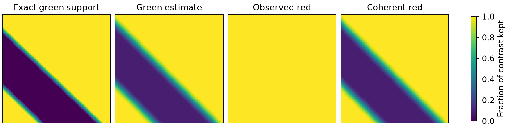
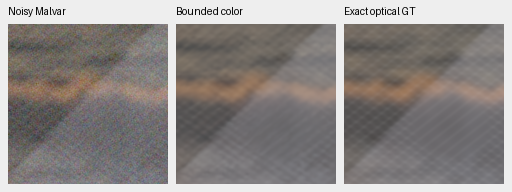
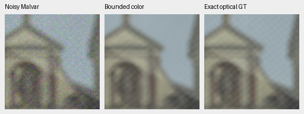

# Red and blue evidence for gaps in weak wire crossings

Red and blue Bayer samples can locate a shared gap, but they
can also displace a good green estimate when a colored strand
continues across the gap. On 24 new variable-phase photos,
bounded color recovers **0.315 fewer contrast points** than
the green-only connected refit at equal added gap luma.
It still gains **0.195 points** over the unlocalized pool at
that same gap cost. The green-only fit has the better tradeoff
on the mixed-color panel.

A matched replay changed only the red samples in the gap search.
When a continuing red strand was replaced with a matching break,
added luma in one green gap fell from **1.246 to 0.159 DN16**.
Both real cab profiles still have incomplete fine crossings.

## Keep the green phase check

The [connected gap fit](junction-occlusion.md) uses a
192-pixel region to look for a loss of fundamental wire
strength. One Bayer fold nominates a direction and one of 651
tapered strips and ovals. A separate fold checks that nomination.
The last two green folds still test both fundamentals and the
signed crossing waveform. These phase checks and the synthesis
path are shared across all variants.

The color fit estimates a separate amplitude, phase offset and
shot-plus-read variance on each red or blue lattice. A direction
can contribute if its offset is within ±60° of the fitted green
phase and its discovery signal-to-noise ratio is at least 2.25.
It contributes evidence for a fractional loss relative to its
own amplitude. The search still uses the same shape library.

- **Color proposes, green checks** caps red and blue's combined
  information at the green information for each candidate.
  Green supplies the entire second-fold check.
- **Bounded color** uses the same information cap in both folds,
  with minimum green support of 1.0 and 0.65 SD in the first
  and second folds. Green also caps the delivered taper depth.
- **Unbounded color** retains each site's phase and amplitude
  requirements while lifting the local green floors and combined
  information cap. It is a diagnostic.

The green-only branch reproduces the prior refit's exact
measurements on the calibration inputs. Across all four Bayer
layouts at an odd crop origin, replacing Q1 through Q3 leaves
the color eligibility and every Q0 nomination bit-identical.
Replacing Q2 and Q3 also leaves the replicated gap estimate
bit-identical. On a high-SNR red-only break, both green-constrained
variants reject red's proposed location. The unbounded version
attenuates intact green there. Some green-constrained proposals
still attenuate other parts of the controlled crop.

## Independent colored fixtures

The 32 source-disjoint backgrounds have four equally sized
color cases. They have a shared support region, a red strand
that continues through a green break, a red-only break with
intact green and blue, or a reversed blue rear strand.
Twelve fixtures have affine difference phase, 12 have
curvature and eight have a stationary interaction. These are
known targets built over validation backgrounds from Commons.
The two draws use σ 0.85 pre-Bayer blur, exposure ×0.33,
black 0.03, ADC16 and ISO6400 shot/read `0.00128/6.5536e-6`.
Present and matched additive roles share Poisson counts at the
lower site rate and share read noise.

Calibration on the 32 earlier displaced-gap photos selects
40% strength for the green refit and whole-region pool and
45% for each color fit, all using the curved phase. Its mean
added gap luma limit is 0.150 DN16. Mean gap luma below is
measured on exact green gaps, including the case where red
continues, while response and junction error use the 24
variable-phase photos.

| Method at locked strength | Interaction response | Junction increment RMS, DN16 | Mean added gap luma, DN16 | Peak added gap luma, DN16 |
| --- | ---: | ---: | ---: | ---: |
| Regional RAW refit | 19.232% | 42.822 | 0.000 | 0.000 |
| Whole-region pool | 20.387% | 42.239 | 0.198 | 1.692 |
| Green connected refit | 20.418% | 42.216 | 0.140 | 1.269 |
| Color proposes, green checks | 20.541% | 42.156 | 0.188 | 1.971 |
| Bounded color | 20.560% | 42.150 | 0.194 | 2.000 |
| Unbounded color | 20.560% | 42.150 | 0.194 | 2.000 |

At equal mean added gap luma the bounded fit loses **0.315
points** `[−0.514,−0.135]` against the green refit and adds
**0.147 DN16** junction error `[+0.061,+0.238]`. It gains
**0.195 points** `[+0.091,+0.305]` against the dose-matched
whole-region pool and lowers junction error by **0.099 DN16**
`[−0.172,−0.038]`. These dose comparisons use the measured
gap cost from the held data. Intervals resample whole photos
within fixture geometry.

At the same 40% blend, bounded color drops the mean added gap
luma from **0.182 to 0.082 DN16** on the shared case and
increases it from **0.196 to 0.380 DN16** where red continues.
Response respectively changes by **+0.035** and **−0.072**
points versus green. The small shared subgroup has three
admitted draws out of 12. These group means describe the tested
sources. The matched red intervention isolates the effect in
the two active examples below.

All methods reproduce the regional RAW refit on stationary,
matched additive, continuous additive, strong-only, flat-core,
edge-only and uniform controls. They also reproduce the refit
on 48 ordinary photos with both authentic and incompatible
exterior guidance.

## Change the red samples while holding green fixed

Eight gapped backgrounds with conflicting red support supply
16 replayed draws. The diagnostic re-renders a coherent red
strand with the same capture recipe and seeds. It replaces
only the red sites inside the recipient. The green and blue
observations, the original neural prediction and the original
regional RAW refit stay fixed. The green-only correction is
bit-identical in every pair.

In `cfa-gap-01`, draw zero, the continuing red moves the
nomination away from the green strip. The new candidate fails
the replication check, so no connected taper is applied.
A red strand with the same break restores the strip estimate
and reduces added gap luma from **1.246 to 0.159 DN16**,
close to green-only **0.141**. In `cfa-gap-12`, draw zero,
coherent red moves the estimated support and reduces the
bounded fit's added gap luma from **2.000 to 1.662 DN16**.
The red-only replacement isolates the support decision and
uses the same fixed restoration throughout.

The figure shows the fraction of local crossing amplitude
retained by the taper in `cfa-gap-01`. The uniform observed-red
map applies the pooled correction without a gap taper.

## Native exact comparisons

Both triplets show noisy Malvar, bounded color over
`weak-junction-refit` and exact optical GT. Each tile uses the
same native `[48,48,160,160]` crop from the 256-pixel query at
`[128,128]`, display exposure ×2 and sRGB transform. The
underlying Local 50k EMA SHA256 is
`62f4e9ce84075c8df1a254a1889033b5787133e8c98c63e0ec3d174a94734959`.
The source photos were binned, overlaid with simulated wires
and rendered through the same camera observation.

Another Believer, *Puerto Vallarta, March 2023 — 134*,
bin-four crop `[464,150,512,512]`, BGGR, draw one.
Color and green both support the ellipse proposed by the
color fit. It gives the largest junction error reduction over
locked green in the featured group. The exact gap is still
more distinct in the target.
[All methods](assets/cfa-gap-support-v1/cfa-gap-09-comparison.png) ·
[Source photo](https://commons.wikimedia.org/wiki/File:Puerto_Vallarta,_March_2023_-_134.jpg) ·
[CC BY-SA 4.0](https://creativecommons.org/licenses/by-sa/4.0/).

Gzen92, *Église Saint-Maurice (Ebersmunster)*, bin-four crop
`[98,504,512,512]`, GRBG, draw one. The signed interaction
fails held green validation before the gap search. The
regional refit keeps the church profile and still misses
some of the faint crossings.
[All methods](assets/cfa-gap-support-v1/cfa-gap-02-comparison.png) ·
[Source photo](https://commons.wikimedia.org/wiki/File:%C3%89glise_Saint-Maurice_(Ebersmunster)_(1).jpg) ·
[CC BY-SA 4.0](https://creativecommons.org/licenses/by-sa/4.0/).

## Standing GFX100S comparisons

The sky, building and foliage match the regional RAW refit.
The locked color fit changes the coarse fence by **1.432
DN16 RGB RMS** versus **1.272** for locked green. Both retain
continuous intersections. The full affine green and color
fits are also close on the coarse fence.

Both locked curved fits return the regional refit in both
fine cab ROIs and profiles. The exploratory affine fit
changes the right cab by **0.900 and 0.944 DN16 RGB RMS**.
Red and blue produce the same affine output as green there.
At ×16 the texture stays uneven, with incomplete crossings
and existing mottle. The left crop remains at the regional
refit.

Native main crop origins for sky, building, foliage and
coarse fence are `[5800,1400]`, `[5790,2690]`, `[8890,5570]`
and `[2240,6000]`. Cab origins are `[806,6489]` and
`[1026,6449]`. The nominal shot/read setting is
`0.00128/6.5536e-6`, with transferred
`0.0014635775921166604/1.0715704128646712e-6`.
V120 Small EMA SHA256
`a9d9b6b4f974e24a6b11e5e740aab32314233a7f53c056cf37c7d2aac1c589fb`
appears on every board. ISO100 AHD and the camera JPEGs are
independent qualitative references, with different aperture,
exposure and subject motion between RAW captures.

| RAW and conditioning | Native comparisons |
| --- | --- |
| DSCF3879 nominal ×4 | [Sky](assets/cfa-gap-support-v1/main-overcast-sky-main-overcast-sky-x4.png) · [Building](assets/cfa-gap-support-v1/main-building-detail-main-building-detail-x4.png) · [Foliage](assets/cfa-gap-support-v1/main-foliage-main-foliage-x4.png) · [Coarse fence](assets/cfa-gap-support-v1/main-chain-link-fence-main-chain-link-fence-x4.png) |
| DSCF3842 nominal | [Left ×4](assets/cfa-gap-support-v1/mesh-nominal-fine-green-mesh-left-x4.png) · [Right ×4](assets/cfa-gap-support-v1/mesh-nominal-fine-green-mesh-right-x4.png) · [Left ×16](assets/cfa-gap-support-v1/mesh-nominal-fine-green-mesh-left-x16.png) · [Right ×16](assets/cfa-gap-support-v1/mesh-nominal-fine-green-mesh-right-x16.png) |
| DSCF3842 transferred | [Left ×4](assets/cfa-gap-support-v1/mesh-profile3879-fine-green-mesh-left-x4.png) · [Right ×4](assets/cfa-gap-support-v1/mesh-profile3879-fine-green-mesh-right-x4.png) · [Left ×16](assets/cfa-gap-support-v1/mesh-profile3879-fine-green-mesh-left-x16.png) · [Right ×16](assets/cfa-gap-support-v1/mesh-profile3879-fine-green-mesh-right-x16.png) |

The numeric and visual review is complete for this frozen-model
crop study. The full 427-photo and measured-camera panels
measure the underlying models.
[Summary](results/cfa-gap-support-v1/summary.json) ·
[Native provenance](assets/cfa-gap-support-v1/manifest.json) ·
[Publication hashes](results/cfa-gap-support-v1/publication.json) ·
[Source and receipts](results/cfa-gap-support-v1/evidence.tar.xz).
