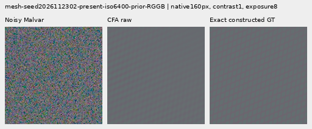
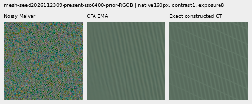
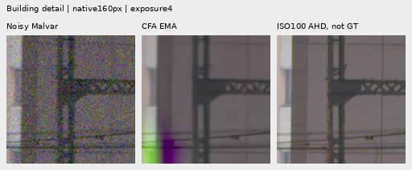
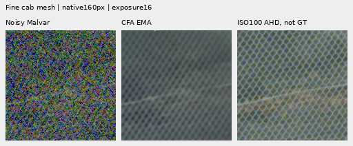

# CFA innovation waves: stronger response, persistent artifacts (V198)

**V198 CFA EMA raises constructed-mesh response to 11.158% of exact GT amplitude,
+22.72% relative to V197 innovation EMA and +100.15% over frozen V195 Whole EMA.**
Mesh2302 has more faithful red/green modulation than V197's largely gray lattice,
and the real cab shows stronger repeating modulation. **The new head also creates
pronounced green/magenta building-edge artifacts and stronger false flat-field
waves.** Quiet spatial RMS rises **1.151–1.648% versus V195**, worsening all 32
inputs. Measuring each color directly and bounding its gain did not solve the
combined fine-detail/clean-flat goal.

V198 is a useful stronger-response experiment, with clear costs. V197 retains
lower off-signal and quiet error; V195 avoids the new colored building failures
in these views; V187 is quieter. V120 Small remains the general recommendation.
All new raw/EMA endpoints, 822 cases each, full audits, two strict exports,
**60 actually viewed native figures / 12 triplets** and **1,440 actual browser
captures** are complete. [Six-state native viewer](images/v198-cfa-innovation-wave-v1/native-viewer.html) ·
[Final evidence](results/v198-cfa-innovation-wave-final-v1.json) ·
[Independent publication verification](results/v198-cfa-innovation-wave-publication-verification-v1.json).

## What changed

[The architecture](cfa-innovation-wave.md) retains every one of the **193 trained
V195 Whole EMA tensors** and trains a fresh **451-parameter, four-tensor head**.
The existing V197 head has 508 parameters and also starts above that same anchor.
Both use the same eight innovation-selected bins in the native 1/64…1/3 band and
65/33/17px packed contexts. Across all 750 noisy observations, the residual field,
selector, smaller support and projected green powers match the saved V197
innovation measurements exactly.

V198 fits a local affine plane plus real cosine/sine at **all four actual CFA
phases**, converts these to physical camera-linear complex amplitudes, removes
CFA offsets, interpolates and transports phase to native pixels. Red/blue use
their own measured waves; green averages its two phases. A 24->16->3 head supplies
one real `tanh` gain per color/bin, bounded to [-1,1]. Negative gains can invert
sign; there is no learned arbitrary quadrature rotation or cross-color wave
mixing. Contributions sum across bins, replacing V197's normalized-wave average
and output-sigma scaling.

Additional color measurements, least-squares units, real bounded gains, summation
and capacity change together. **This tests the combined architecture, not the
isolated cause of V197's artifact.** The own-color identity is conditional on the
measured residual: that residual includes the frozen anchor and remains
correlated across noise samples and colors. Finite-window leakage, aliasing and
spatially varying gates can still produce false pattern. Nominal RAW variance
normalizes features; it is not calibrated innovation confidence. No target enters
inference. Local zero-variance routing remains exact.

Both stages use the same 1,000 cached rows, 900 noisy updates/3,600 images,
100 ADC skips, Whole ten-term objective with total coherent coefficient 0.50,
clean-target masks, pair units, LR schedule, decay and clipping. V198 uses fresh
Adam/EMA clocks and seed 202611080198; its anchor separately retains the V187 900
and V195 900 training history. Row-eight restoration continues at row 9 without
replaying the prefix. Probe weights are never training initializers.

## Complete paired measurements

RMS values are unclipped camera-RGB DN16. Mesh response is a projection onto the
known constructed target; 100% is full template amplitude. Every method sees
identical observations. Present/absent mesh each has 256 inputs; quiet regions
have 16 per ISO; fresh noisy flats have 24 per ISO; natural cohorts/variants
have 32 each. Exact targets come from constructed observations of clean synthetic
or binned photographic sources. The real ISO100/AHD/JPEG views are not scored.

| Metric | Cases | V183 EMA | V187 EMA | V195 Whole EMA | V197 RAW raw | V197 RAW EMA | V197 innovation raw | V197 innovation EMA | CFA raw | CFA EMA |
| --- | ---: | ---: | ---: | ---: | ---: | ---: | ---: | ---: | ---: | ---: |
| Mesh response (% GT) ↑ | 256 | 4.43900551 | 5.35911027 | 5.57480435 | 6.28904762 | 6.44906902 | 8.88238926 | 9.09218788 | 11.0750296 | 11.1579857 |
| Mesh full RMS ↓ | 256 | 8.87658208 | 8.77626519 | 8.74994784 | 8.68491411 | 8.67378254 | 8.50171719 | 8.49795148 | 8.24140961 | 8.23799614 |
| Present-case blank RMS ↓ | 256 | 5.61243198 | 5.61352478 | 5.61460516 | 5.61907447 | 5.62005314 | 5.62204239 | 5.62361296 | 5.6668851 | 5.66906384 |
| Absent-case full RMS ↓ | 256 | 5.30864483 | 5.31014343 | 5.31117581 | 5.31538414 | 5.31616104 | 5.32973714 | 5.33303257 | 5.37212991 | 5.37451352 |
| Quiet spatial RMS, ISO6400 ↓ | 16 | 3.46222047 | 3.47664374 | 3.48972317 | 3.50143703 | 3.51765479 | 3.49910973 | 3.50110283 | 3.52823567 | 3.52990498 |
| Quiet spatial RMS, ISO12800 ↓ | 16 | 5.5949994 | 5.62164923 | 5.64043344 | 5.67321933 | 5.70397426 | 5.64775448 | 5.65033341 | 5.72927949 | 5.73339232 |
| Fresh flat full RMS, ISO6400 ↓ | 24 | 18.6119521 | 18.61468 | 18.6164384 | 18.6235882 | 18.6247815 | 18.6472584 | 18.6526174 | 18.7296049 | 18.7339912 |
| Fresh flat full RMS, ISO12800 ↓ | 24 | 24.181174 | 24.1857465 | 24.1891129 | 24.2023686 | 24.2047806 | 24.244943 | 24.2547879 | 24.3734983 | 24.3807656 |
| Fresh flat block32 RMS, ISO6400 ↓ | 24 | 13.4337585 | 13.4337869 | 13.4338005 | 13.4338378 | 13.4338453 | 13.4341904 | 13.4342049 | 13.4348089 | 13.4348527 |
| Fresh flat block32 RMS, ISO12800 ↓ | 24 | 17.9217798 | 17.9217305 | 17.9216853 | 17.921641 | 17.9216084 | 17.9216138 | 17.9216759 | 17.9220106 | 17.9220162 |
| Retained photo faint band gain ↑ | 32 | 0.297015316 | 0.298461921 | 0.298812854 | 0.299260123 | 0.29936948 | 0.299128046 | 0.299175975 | 0.299401385 | 0.299423533 |
| Retained photo dark band gain ↑ | 32 | 0.528282161 | 0.529753504 | 0.530045786 | 0.530400453 | 0.530525432 | 0.530176351 | 0.530198669 | 0.53021463 | 0.530222336 |
| Organic photo faint band gain ↑ | 32 | 0.148382301 | 0.148564768 | 0.148652643 | 0.148814259 | 0.148845456 | 0.148967645 | 0.149021997 | 0.14914338 | 0.14916748 |
| Organic photo dark band gain ↑ | 32 | 0.395579733 | 0.395914385 | 0.396009713 | 0.396175063 | 0.396222229 | 0.396108518 | 0.396129867 | 0.396149365 | 0.396158073 |

[All 122 metric rows / 1,098 numeric cells as CSV](results/v198-cfa-innovation-wave-v1/metrics-table-v1.csv) ·
[Individual paired changes](results/v198-cfa-innovation-wave-v1/paired-comparisons-v1.json.gz).

Against V195, EMA response rises on **181/256** present inputs and falls on 75.
Mean present full RMS falls **5.851%**, but only **99/256** inputs improve and 157
worsen: the mean advantage is concentrated. Present-case blank RMS rises
**0.9699%** on all 256, and absent-mesh full RMS rises **1.1925%** on all 256.
Fresh-flat full RMS rises **0.6314% /0.7923%** at ISO6400/12800 on all 48.
Quiet spatial RMS rises **1.1514% /1.6481%**, and quiet total RMS rises
**0.8747% /1.3096%**, on all 32. Whole mixed-scene RMS falls 0.1058% /5.8800%
while its actual quiet regions worsen; the whole-scene norm is not flat safety.

Against same-state V197 innovation EMA, response rises on **172/256** inputs,
with **22.72%** higher mean response. Present full RMS falls 3.059%, but only
**95/256** improve and 161 worsen. Present blank RMS rises 0.8082%, absent full
RMS 0.7778%, fresh-flat full RMS 0.4363% /0.5194%, and quiet spatial RMS
**0.8227% /1.4700%**. All corresponding blank/absent/quiet/fresh-flat inputs worsen.

Raw CFA reaches **11.075% of GT**, +98.66% over V195 and +24.69% over V197
innovation raw. It has slightly smaller flat/quiet costs than CFA EMA, but both
show the new building color failure. Its quiet spatial RMS is 1.1036% /1.5752%
above V195. Neither endpoint supplies a clean-flat improvement.

All four natural-photo response means rise versus V195, with 102/128 individual
response gains. All four relative-band-error means also worsen,
**+0.0488–0.2124%**, and full-RMS means worsen **+0.0114–0.0318%** on 125/128 inputs.
Against V197 innovation EMA, relative-band-error means rise 0.0127–0.0367% and
full-RMS means rise 0.0074–0.0226%, with 126/128 full-RMS regressions. More response
is not general photographic sharpening. ADC-only outputs remain bit-exact.

## Directional response and native synthetic triplets

These are the same two predeclared examples as earlier studies. Regions A/B are
unweighted affine-detrended Fourier regions nearest the recipe normals, **not
isolated wire families or confidence**; envelope, harmonic and intersection
leakage remain. Independent real-spatial projectors check every new scalar.

| Example | State | Whole (% GT) | Region A (% GT) | Region B (% GT) |
| --- | --- | ---: | ---: | ---: |
| 2026112302 | V187 EMA | 5.1222526 | 6.4775008 | 3.7102210 |
| 2026112302 | V195 Whole EMA | 6.0830978 | 7.7759249 | 4.3193437 |
| 2026112302 | V197 RAW raw | 8.3992643 | 10.8804417 | 5.8141296 |
| 2026112302 | V197 RAW EMA | 8.7931831 | 11.3991207 | 6.0780609 |
| 2026112302 | V197 innovation raw | 38.3070767 | 49.6366770 | 26.5027911 |
| 2026112302 | V197 innovation EMA | 39.5850517 | 51.3487012 | 27.3285313 |
| 2026112302 | CFA raw | 43.3263008 | 57.6847514 | 28.3662608 |
| 2026112302 | CFA EMA | 43.8054198 | 58.3528826 | 28.6484484 |
| 2026112309 | V187 EMA | 79.2443248 | 4.8230067 | 91.6903348 |
| 2026112309 | V195 Whole EMA | 79.5137222 | 4.8213863 | 92.0050560 |
| 2026112309 | V197 RAW raw | 83.4893558 | 4.7621111 | 96.6554753 |
| 2026112309 | V197 RAW EMA | 84.7731678 | 4.7426974 | 98.1572347 |
| 2026112309 | V197 innovation raw | 80.5871795 | 12.4701390 | 91.9788857 |
| 2026112309 | V197 innovation EMA | 80.6778100 | 13.1063470 | 91.9782759 |
| 2026112309 | CFA raw | 81.2953950 | 17.2561683 | 92.0051437 |
| 2026112309 | CFA EMA | 81.3231308 | 17.4497690 | 92.0051408 |

Mesh2302 EMA whole response rises 39.585% ->43.805% of GT; both angular regions
increase. Mesh2309's weak region A rises 13.106% ->17.450%, while dominant region B
stays near 92.005%. That measured weak-region gain coexists with visually
incomplete crossings; the dominant structure still determines most of the image.

Each triplet below is **noisy -> new restored output -> exact GT**. Source 512px
RGGB, native ROI `[176,176,160,160]`, shot 0.00128/read6.5536e-6,
exposure 8(+3EV), contrast1. All cells are 160x160 original pixels; no resizing.
Checkpoint/noise/source metadata are in the [manifest](images/v198-cfa-innovation-wave-v1/manifest-v1.json).

Mesh2302 has more target-like red/green coloration than V197's gray checker-like
modulation, though it is still rounded and incomplete. Stress40 shows strong
colored nodes rather than the exact thin wires. Mesh2309's dominant nearvertical
wave remains strong; its weak oblique crossing remains difficult to distinguish
at ordinary display. Absent mesh and flat controls gain non-GT corrugations.

## Real fine cab and building failure

The main scene is **DSCF3879 ISO6400 f/1.7 1/240s**, with **DSCF3880 ISO100 f/5.6
3s** as an independently demosaiced qualitative reference. Main sky, building,
foliage and coarse-fence crops use exposure 4. Sky looks smooth at that ordinary
display; foliage remains soft and coarse-fence geometry stays aligned. Both CFA
states introduce a pronounced **green/magenta fringe at the lower-left building
pillar/wires**, where V197 innovation had a red/cyan failure. Own-color synthesis
and bounded gains did not prevent the artifact.

The fine cab test is **DSCF3842 ISO6400 f/1.7 1/300s** versus **DSCF3835 ISO100
f/5.6 2.5s**, cached native context sensor ROI `[600,6260,768,768]`. Both
`[206,229,160,160]` and `[426,189,160,160]` crop ROIs and both nominal/profile3879
noise conditions are included at exposure 16. The right ROI is below. Main
building uses the central`[176,176,160,160]` ROI in its 512px cached context.
The nominal condition is the shot 0.00128/read6.5536e-6 prior, not measured camera
calibration; the second condition is inherited profile3879 metadata.

CFA adds stronger repeating/color modulation in both cab ROIs/profiles, while
thin crossings remain softer and less complete than the ISO100 reference. The
false-pattern controls prevent certifying every added ripple as recovered wire.
The ISO100 AHD references differ in aperture, exposure time and moving subjects;
**they are not exact GT**. Both straight-out-of-camera JPEGs are retained in the
full cab boards; their camera rendering differs from the shared RAW display.
Both capture families, JPEGs and siblings stay out of training. Original media
are read-only, and this experiment only reads existing cached arrays.

[Exact two-triplet pixel provenance](results/v198-cfa-innovation-wave-v1/representative-figures-v1.json).

## Flat fields, photos and verification

Stress40 gray and colored flat/quiet views show stronger directional ribbing
and hatching over persistent broad colored mottle. Bird stress8 backgrounds,
feathers and branches acquire extra periodic texture; butterfly and wood stay
soft. Ordinary synthetic steps, bars and striped patches preserve their geometry,
but amplified quiet crops remain contaminated. Their whole-scene gains do not
excuse the real building failure. ADC bark, fur and four planes are unchanged.

All 60 figures / 12 triplets were actually viewed in 15 original-detail sheets;
the browser first screen and both small real triplets were also inspected.
The browser verifies all six methods in both selectors over 48 boards,
**1,440 native captures /110,592,000 exact source RGB channels**, state/checkpoint
text, flipping and navigation. The independent quality audit checks 1,644 rows,
6,576 input fingerprints, three exact inherited replays per row, 750 input-only
measurement groups, 72 RGB + 72 wave encodings, 53,772,288 native addition channels,
510 native metric scalars,72 wave RMS values and 278 Decimal means. In-process
anchor-plus-wave closure covers 1,186,725,888 RGB channels. Nine-method reduction
retains 7,398 rows and 122 metric rows; historical reports and receipts survive.

The quality run's peak CUDA allocation is 2,991,625,728 bytes, **not a 100MP
benchmark**. Two standalone CPU exports match the evaluated states:

| State | Export SHA256 | Module-state SHA256 |
| --- | --- | --- |
| Raw | `7b4b17cfd0b2d79460d97c577a964f9d8fa02c5491a4c5f4ed734c4bfe14f27e` | `7592da3681590c6b7c311281eef5504915662ff611d70a57f8c45ab9e05dc067` |
| EMA | `5a0964710f7ca842c4f4c06b6e957bb3ed2ed802b036458dea5b098ad9189923` | `1480f2763745a1b77980218d174a11c918fa891fed8fdff3897433042eacb78e` |

Both derive from source checkpoint
`b957cd7363d026d19131722f6d23ed4e3735cec1fae7dcb828094f4ba782d331`.
[Exports and explicit separate head/anchor history](results/v198-cfa-innovation-wave-v1/exports-v1.json) ·
[Training audit](results/v198-cfa-innovation-wave-v1/training-audit-v1.json) ·
[Quality audit](results/v198-cfa-innovation-wave-v1/quality-audit-v1.json) ·
[Completed execution and source hashes](results/v198-completed-execution-v1.json).

The full faint-detail/flat-region goal remains unresolved. Stronger constructed-mesh response is measured, and the real cab visibly
gains modulation. Error and visual costs remain explicit. The next architecture must distinguish useful local wave support
from edge leakage and noisy flat residuals; this experiment does not identify
one proven cause of the remaining artifacts. No new source/noise draws,
parent/DINO inference, RAW decode, original/dataz access or external writes occur.
