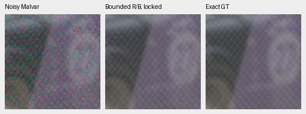
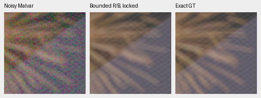

# Red and blue Bayer evidence for weak crossings

Red and blue support both wire directions in the right GFX100S cab crop.
Using that support to place the difference-frequency correction recovers
**0.118 percentage points** more interaction contrast on 24 new photo
fixtures at the dose fixed on calibration, with **0.009 DN16 less** mean
added luma in known green gaps. The native right-cab change is slight and
fine crossings remain uneven. The red/blue gate stays experimental. The
packaged [green-only junction fit](local-junction-support.md) now batches
its local checks and reproduces the earlier crop pixels on the parity panel.

## Bayer evidence at two scales

The four exterior patches nominate the same frequencies as the packaged
fit. The first Bayer fold supplies green phase and sideband sign. The two
held green folds must still confirm both fundamentals and the sideband
across the 192-pixel interior. The experiment changes the subsequent
16×16 local wire gate. In the second Bayer fold, a red or blue plane
qualifies if each fixed-phase fundamental has a score of at least two
and exceeds its own quarter-cycle score in magnitude. Its local terms
use the third and fourth folds and condition on a smooth quadratic and
the competing wire. The gate pools signed moments and noise information
across eligible CFA phases. Two greens still bound the result, and the
spatial cap keeps each station's correction within its own score.

The bounded rule only boosts positive green evidence, by at most its
original score. The unconstrained pool can also reduce it. Two further
controls require a signed difference-band score of one in the partner
plane before allowing it to vote. All rules use the same green-derived
sideband, amplitude estimate, and display-neutral correction. Selection
on the previous 24 calibration sources favored bounded support at
**86.67%** dose among these four rules under the green-only mean gap
cost. At that cost it lost 0.049 points on calibration versus green-only.

A per-plane camera diagnostic held the green-derived phase fixed and
projected out the background, fundamentals, and other nonoverlapping
bands. In the nominal right cab the two held green planes had
difference-band magnitudes of **22.0–34.4 DN16** across the two scoring
folds. The red plane registered **5.1 and 7.1 DN16**, and blue **9.4
and 14.6 DN16**, all with the same sign. The nominal left cab has weaker
red/blue support for the two fundamentals. The partner check abstains
in both planes there. All diagnostic fits use the ISO6400 capture.

## Exact-target holdout

The 24 new Commons backgrounds are disjoint by source ID and bin-four
cache hash from both earlier junction cohorts and were checked against
559,808 photographic training visits. Eight photos retain aligned
strands, eight allow red to continue where the rear strand breaks in
green, and eight reverse the rear strand in blue. The chromatic offset
is identical in the interaction and matched additive exposures. They
share Poisson counts at the lower site rate, with independent excess
counts and common read noise. Two ISO6400 draws per source use optical
σ 0.85, exposure 0.33, ADC16, black 0.03 and shot/read
`0.00128 / 6.5536e-6`.

| 24 new photos | Interaction contrast | Junction increment RMS, DN16 | Added green-gap luma, DN16 |
| --- | ---: | ---: | ---: |
| Green wire check | 15.665% | 31.427 | 0.1733 |
| Bounded red/blue, calibration dose | 15.783% | 31.399 | 0.1639 |
| Bounded red/blue, full dose | 16.096% | 31.297 | 0.1891 |
| Bounded red/blue, matched on held gap luma | 15.900% | 31.360 | 0.1733 |
| Full four-plane pool | 16.095% | 31.300 | 0.1530 |

The preselected dose gains **0.118 points** `[+0.024, +0.270]` and
lowers junction increment RMS **0.028 DN16** `[−0.044, −0.012]`.
The gap difference is **−0.009 DN16** `[−0.028, 0.000]`. Intervals
resample photos within geometry, keeping both draws together. Matching
the held gap mean after the fact raises the contrast gain to **0.235
points** `[+0.089, +0.438]`. At equal held contrast the gap change is
−0.019 DN16 `[−0.056, 0.000]`. These matched comparisons use the held
targets for dose selection. The full pool adds more gap luma than the
green check on calibration (0.338 versus 0.262 DN16), and less on this
holdout. The bounded full-dose rule raises the worst gap from 2.811
to 3.152 DN16 on the ellipse with a continuing red strand.

Fifteen of 48 held interaction draws pass the shared green detector.
Red can vote in 14 and blue in 12. Matched additive, continuous additive,
one-direction, central-flat, edge-only and uniform controls reproduce
the green fit. The 48 retained ordinary photos reproduce their
green-only inputs with either authentic or deliberately incompatible
exterior Bayer context. In this setup the red/blue rule modifies delivery
only after the green detector accepts.

### Native exact crops

Both triplets show noisy Malvar, bounded red/blue at the calibration
dose and exact post-optics GT. The 160×160 pixels come from
`[48,48,160,160]` within the 256×256 recipient at `[128,128]`, with
display exposure ×2 and the same sRGB transform. The fit composes
Local 50k EMA SHA256
`62f4e9ce84075c8df1a254a1889033b5787133e8c98c63e0ec3d174a94734959`
and the checked Bayer correction above.

Aligned smooth dip, draw zero RGGB, Reinhold Möller's *Würgauer Bergrennen 2022 Riley 12-4 TT Sprite*, bin-four source `[206,14,512,512]`. The crossing modulation looks slightly stronger in the darker area, with less definition in the light area than in the exact target. Adapted by binning, adding the carriers and simulating capture. [All methods](assets/cfa-junction-phase-v1/cfa-junction-16-comparison.png) · [Source](https://commons.wikimedia.org/wiki/File:W%C3%BCrgauer_Bergrennen_2022_Riley_12-4_TT_Sprite-20220911-RM-113114.jpg) · [CC BY-SA 4.0](https://creativecommons.org/licenses/by-sa/4.0/).

Continuing red strand, draw zero GRBG, Thomas Bresson's *Feux d’artifices Belfort*, bin-four source `[542,86,512,512]`. The native restored ellipse is less distinct than in the exact target, with some texture carried through the green break at full dose. Same adaptation. [All methods](assets/cfa-junction-phase-v1/cfa-junction-06-comparison.png) · [Source](https://commons.wikimedia.org/wiki/File:2014-01-01_00-11-24_feux-artifices-belfort.jpg) · [CC BY 3.0](https://creativecommons.org/licenses/by/3.0/).

## Standing GFX100S comparisons

Sky, building and foliage reproduce the green-only check pixel for
pixel. The coarse fence keeps its crossings. The fixed dose changes
the right cab by 0.507 DN16 RGB RMS under nominal noise conditioning
and 0.525 under transferred conditioning. The full pool changes those
crops by 1.370 and 1.491 DN16. Some diagonals strengthen slightly below
the rail in the full pool, with little improvement in crossing continuity.
The left crops retain weak diagonal fragments. The boards show no clear
new color ripple. Mottle remains visible at ×16.

The native crop origins for sky, building, foliage and coarse wire are
`[5800,1400]`, `[5790,2690]`, `[8890,5570]` and `[2240,6000]`.
The cab origins are `[806,6489]` and `[1026,6449]`. The transferred
shot/read conditioning is `0.0014635775921166604 / 1.0715704128646712e-6`.
The V120 Small comparison uses EMA SHA256
`a9d9b6b4f974e24a6b11e5e740aab32314233a7f53c056cf37c7d2aac1c589fb`.
The independent ISO100 AHD and camera JPEGs are qualitative references
with different apertures, exposure times and subject positions.

| RAW and profile | Native boards |
| --- | --- |
| DSCF3879 nominal ×4 | [Sky](assets/cfa-junction-phase-v1/main-overcast-sky-main-overcast-sky-x4.png) · [Building](assets/cfa-junction-phase-v1/main-building-detail-main-building-detail-x4.png) · [Foliage](assets/cfa-junction-phase-v1/main-foliage-main-foliage-x4.png) · [Coarse fence](assets/cfa-junction-phase-v1/main-chain-link-fence-main-chain-link-fence-x4.png) |
| DSCF3842 nominal | [Left ×4](assets/cfa-junction-phase-v1/mesh-nominal-fine-green-mesh-left-x4.png) · [Right ×4](assets/cfa-junction-phase-v1/mesh-nominal-fine-green-mesh-right-x4.png) · [Left ×16](assets/cfa-junction-phase-v1/mesh-nominal-fine-green-mesh-left-x16.png) · [Right ×16](assets/cfa-junction-phase-v1/mesh-nominal-fine-green-mesh-right-x16.png) |
| DSCF3842 transferred | [Left ×4](assets/cfa-junction-phase-v1/mesh-profile3879-fine-green-mesh-left-x4.png) · [Right ×4](assets/cfa-junction-phase-v1/mesh-profile3879-fine-green-mesh-right-x4.png) · [Left ×16](assets/cfa-junction-phase-v1/mesh-profile3879-fine-green-mesh-left-x16.png) · [Right ×16](assets/cfa-junction-phase-v1/mesh-profile3879-fine-green-mesh-right-x16.png) |

## Faster green-only junction fit

The packaged projection gathers the 32 held samples per green plane and
station once and uses batched QR with the existing least-squares solver
for poorly conditioned stations. All pixels match the previous operator
bit for bit on **672 synthetic role crops and eight standing views**.
Median single-thread CPU time for the 44 crops reaching the local fit
falls from **124.60 to 99.45 ms** after the parent forward, with the
station pass falling from 28.40 to 2.11 ms. Across all 680 crops,
median time changes from 46.20 to 45.32 ms and the 95th percentile
falls from 115.27 to 89.01 ms. Measurements alternate the two operators
on the same inputs. All 97 focused tests pass.

The study uses frozen weights and crop inference. Numerical and native
reviews are complete for this panel. The fixed full427 and known/unseen
camera panels are outside its scope. [Summary](results/cfa-junction-phase-v1/summary.json) ·
[Native provenance](assets/cfa-junction-phase-v1/manifest.json) ·
[Publication hashes](results/cfa-junction-phase-v1/publication.json) ·
[Executed source and receipts](results/cfa-junction-phase-v1/evidence.tar.xz).
