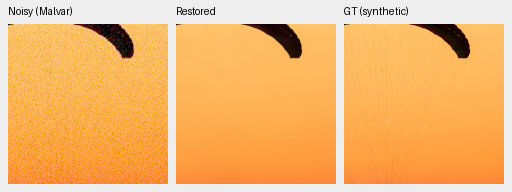
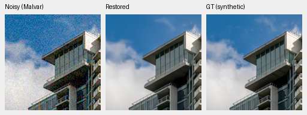
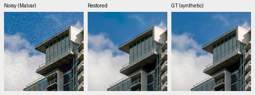
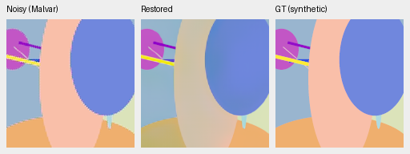
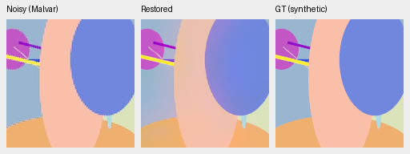

# Local measured-CFA mean correction is rejected

**Do not integrate this operator into the model.** It improves the selected
low-noise pattern color biases but loses1.20045dB on the eight-photo development
sample (95% source-bootstrap interval[−1.72494,−.78036]). All16 procedural
sources average−.14281dB[−.36282,+.13041], with lower SSIM. This is a development
probe, not a full427-photo review or a trained architecture comparison.
[Complete results and eight native triplets](results/cfa-mean-consistency-probe-v2.json).

The [standalone diagnostic](../scripts/probe_cfa_mean_consistency.py) samples
the parent prediction at the actual CFA phases, computes local per-color mean
residuals over a fixed63×63 sensor window, and soft-thresholds them by three
times the supplied independent input-noise mean scale. Actual sample counts
handle borders; FP64 integral sums avoid FP32 prefix cancellation. Samples near
clipping are excluded using observation and prediction; predicted HDR regions
receive no correction. The residuals correlate with model output, so this
threshold is a heuristic, not a statistical confidence interval. No target or
real reference is available to the operator.

Window63/threshold3 were fixed before scoring. The sample uses the first8
protocol photographs and all16 procedural sources, seven conditions/four CFAs,
two methods and1,344 case records. Original full-suite batch companions and
source seeds are retained. Parent SHA256
`0d74cf31fb1c7e3f97fc692c855a2ca0ee3ebf562b454e4f8b135c28fc0aa5c5`.
No learned tensor changes, training updates, parameter sweep, real-reference
fitting or protected-final model scoring. V1 archives the initial packaging;
V2 reruns the same fixed operator from the committed standalone script. Small
GPU numerical differences do not change the rejection.

Ten targeted tests pass: independent FP64 convolution oracle, all CFA layouts,
constant-bias recovery without a checkerboard, actual border/color counts,
zero-residual identity, noise threshold, clipped/empty/HDR cases, native16-bit
variation under autocast and invalid settings. The genuine CUDA probe completes.
The production source and checkpoint format remain unchanged.

Native160×160 panels: noisy Malvar → restored → exact synthetic GT, no resizing.
All crops use ROI[48,48,160,160], RGGB, display×1, WB[2,1,1.5] and the same fixed
protocol matrix. Noisy/reference panel pixels and metadata verify equal between
methods. Photographs use ISO12800 prior `shot=.00256`, `read=.0000262144`;
procedural examples use ADC-only conditioning. Exact source/generation seed,
checkpoint/noise/display identities are in the receipt. PNGs are8-bit previews;
metrics use unquantized output.

The building sky develops a visible rectangular color discontinuity. Inspection
also finds that fabric strands remain smoothed. Recovering a broad mean does
not establish better reconstruction around clipped structures or texture.

The selected pattern's large color bias improves, with residual hue error.
That selected success does not offset the photographic regressions. All eight
distinct source/method crops are retained in the repository and receipt.

Photographic sources: [Roy Egloff](https://commons.wikimedia.org/wiki/File:CH.VD.Villeneuve_2007-08-25_Vertigo-Swiss-Riviera_2392_3x2-R_4K.jpg)
and [Dietmar Rabich](https://commons.wikimedia.org/wiki/File:Vancouver_(BC,_Canada),_Coal_Harbour_Seaside_Park,_Blick_in_den_Himmel_--_2022_--_2158.jpg),
[CC BY-SA4.0](https://creativecommons.org/licenses/by-sa/4.0/), modified by binning,
cropping, noise, restoration and rendering; previews retain that license.
