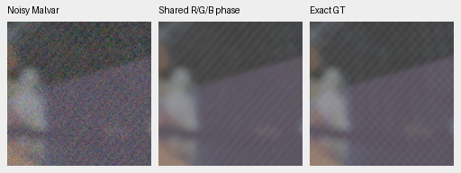
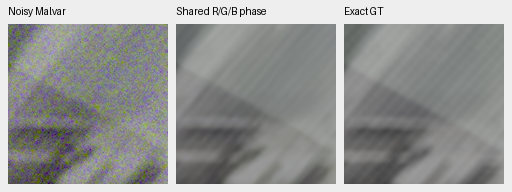

# Sharing measured Bayer phase across colors

Red and blue samples slightly improve weak green-wire phase when
the strands agree across colors. On 20 retained warped photo
backgrounds, the shared fit gains **0.100 weak-response points**
and lowers intact fundamental error **0.069 DN16** versus the
[packaged green-only fit](local-pooled-carrier.md#packaged-crop-fit).
On 32 straight backgrounds the difference is uncertain. A local
phase reversal across colors defeats the crop-wide agreement check.
The real cab changes are subtle and fine crossings remain incomplete.

The [regional follow-up](cfa-regional-phase.md) reduces the phase error
from medium and wide local color reversals and tests a fresh photo panel.

## Fit and controls

The four exterior RAW patches nominate the same frequency pair in all
arms. The 192-pixel query fits the two carriers on each Bayer phase
in 64 blocks of 24 × 24 pixels, accounting for smooth background
and the competing carrier. The three arms share the same 64/32-pixel
held-green checks and the same limit on delivered amplitude.

| Arm | Phase proposal |
| --- | --- |
| Green weak-only | Pooled phase for the weaker direction when both greens agree on its rank. Planar phase for both when they disagree |
| Green rank open | As above, with each direction eligible for pooling when the rank is ambiguous |
| Shared R/G/B phase | Same eligibility as rank open, with red and blue informing the phase proposed by each fitting green |

Within each fold, green-to-color coefficient ratios use weighted
quadrature cross products divided by noise-subtracted green power.
A color phase contributes if the cross product clears twice the
estimated null noise scale and green power is positive. This is an
empirical screen. The fit caps each amplitude ratio at 2 and the
combined auxiliary precision at the green precision per node. After
phase pooling, the fitting green supplies amplitude and the other
green tests the result against its planar prediction. RGB delivery
uses the same neutral correction as the baseline.

Replacing all samples on the held green leaves the fixed-direction
guide and its color ratios bit-identical in eight tests across the
four CFA layouts. The overall direction-selection and acceptance
procedure uses both greens. The green weak-only arm reproduces all
528 earlier crop fingerprints, including the standing scenes.

## Retained optical replay

The replay uses the same Local 50k EMA parent
`62f4e9ce84075c8df1a254a1889033b5787133e8c98c63e0ec3d174a94734959`
and IEEE FP32 parent predictions as the earlier report. Both panels
use two independent RAW draws, with σ 0.85 optical blur and the same
present, strong-only, flat-core, edge-only and uniform roles. They
reuse earlier fixtures. The parent predictions were already cached.

| Shared color phase minus green weak-only | Warped, 20 backgrounds | Straight, 32 backgrounds |
| --- | ---: | ---: |
| Weak response, percentage points | +0.100 [+0.038, +0.171] | +0.023 [−0.037, +0.095] |
| Intact fundamental RMS, DN16 | −0.069 [−0.119, −0.025] | −0.016 [−0.065, +0.023] |
| Continuing-strand RMS in gaps, DN16 | +0.00004 | <0.00001 absolute change |
| False weak-band RMS in gaps, DN16 | −0.00031 | <0.00001 absolute change |
| Flat-core RMS, DN16 | 0.000 | 0.000 |

Intervals resample backgrounds with both draws together, stratified
by shape family. The green rank-open arm exactly reproduces the
weak-only scores on both panels. Exact-flat, edge-only and uniform
scores are identical across all three arms. The optical and GFX
replay, including rendering, took 30.36 seconds on the CPU. This
inference experiment has crop coverage. Fixed photo and camera
scores still refer to the parent.

### When color phase disagrees

Forty-eight additional procedural fixtures with known carrier geometry
cover all four Bayer layouts. The noise variance is
`0.00128 × signal + 6.5536e-6`. The phase metric is signed correlation
with the clean green carrier, averaged across reciprocally fitted greens.
It measures candidate accuracy before held-green acceptance. Each role
reuses the same green realization.

| Auxiliary weak pattern in red and blue | Folds with auxiliary weight | Change in phase correlation across central 128 × 128 |
| --- | ---: | ---: |
| Same phase | 96/96 | +0.00426 [+0.00311, +0.00559] |
| Absent | 7/96 | +0.00003 |
| Reversed throughout | 0/96 | 0 |
| Nearby unrelated frequency | 14/96 | −0.00002 |
| Reversed inside one ellipse | 96/96 | −0.01015 [−0.01364, −0.00678] |

Inside the phase-reversed ellipse, correlation falls from **0.98857 to
0.95097**. The crop-wide ratio misses the local conflict. In a separate
control with an exact flat green query, strong carriers on both red and
blue and supplied donor frequencies, all 48 RGB crops remain equal to
the parent after held-green acceptance.

## Native exact comparisons

Both triplets show noisy Malvar, shared RGB phase on Local 50k,
and the exact aligned target after optics and before Bayer sampling.
Each panel is 160 × 160 native pixels at `(48,48)` in its
256-pixel recipient at `(128,128)`. Both use draw zero, exposure
0.33 at capture, shot/read `0.00128 / 6.5536e-6`, black offset 0.03,
and a linear display exposure of ×2 followed by sRGB. The
planted weak diagonals remain fainter in the reconstruction.

The ellipse uses King of Hearts' Liberty Science Center photo, RGGB,
and bin-four source crop `(372,30,512,512)`. Adapted by binning,
planting wires and simulating optics and capture noise.
[Comparison](assets/cfa-phase-sharing-v1/envelope-13-comparison.png) ·
[Source](https://commons.wikimedia.org/wiki/File:Liberty_Science_Center_Jersey_City_July_2013_001.jpg) ·
[CC BY-SA 4.0](https://creativecommons.org/licenses/by-sa/4.0/).

The smooth dip uses mattbuck's Bristol Temple Meads photo, BGGR,
and bin-four source crop `(28,110,512,512)` with the same adaptation.
[Comparison](assets/cfa-phase-sharing-v1/envelope-14-comparison.png) ·
[Source](https://commons.wikimedia.org/wiki/File:Bristol_Temple_Meads_railway_station_MMB_45_220003.jpg) ·
[CC BY-SA 3.0](https://creativecommons.org/licenses/by-sa/3.0/).

## Standing GFX100S comparisons

On DSCF3879 the sky, building and foliage match the packaged fit
pixel for pixel. Shared phase changes the coarse fence by 0.680 DN16
RGB RMS and preserves the connected intersections. These ×4 views
use shot/read `0.00128 / 6.5536e-6` and include independently
demosaiced DSCF3880 ISO100 references.
[Sky](assets/cfa-phase-sharing-v1/main-overcast-sky-main-overcast-sky-x4.png) ·
[Building](assets/cfa-phase-sharing-v1/main-building-detail-main-building-detail-x4.png) ·
[Foliage](assets/cfa-phase-sharing-v1/main-foliage-main-foliage-x4.png) ·
[Coarse fence](assets/cfa-phase-sharing-v1/main-chain-link-fence-main-chain-link-fence-x4.png).

Both DSCF3842 cab ROIs use the established nominal and transferred
DSCF3879 shot/read profiles, respectively
`0.00128 / 6.5536e-6` and
`0.0014635775921166604 / 1.0715704128646712e-6`. The independent
DSCF3835 AHD and camera JPEGs are qualitative references. All boards
use native 160 × 160 crops, with linear display exposure followed by sRGB.

| Cab ROI | Nominal | Transferred |
| --- | --- | --- |
| Left `(806,6489)` | [×4](assets/cfa-phase-sharing-v1/mesh-nominal-fine-green-mesh-left-x4.png) · [×16](assets/cfa-phase-sharing-v1/mesh-nominal-fine-green-mesh-left-x16.png) | [×4](assets/cfa-phase-sharing-v1/mesh-profile3879-fine-green-mesh-left-x4.png) · [×16](assets/cfa-phase-sharing-v1/mesh-profile3879-fine-green-mesh-left-x16.png) |
| Right `(1026,6449)` | [×4](assets/cfa-phase-sharing-v1/mesh-nominal-fine-green-mesh-right-x4.png) · [×16](assets/cfa-phase-sharing-v1/mesh-nominal-fine-green-mesh-right-x16.png) | [×4](assets/cfa-phase-sharing-v1/mesh-profile3879-fine-green-mesh-right-x4.png) · [×16](assets/cfa-phase-sharing-v1/mesh-profile3879-fine-green-mesh-right-x16.png) |

Opening the rank increases low-contrast diagonal structure below the
horizontal wire on the left. Shared color phase differs from green
weak-only by 0.77–0.99 DN16 RGB RMS on the left and 0.23–0.31 DN16
on the right. Both left panels retain incomplete crossings near the
post. Neither arm shows a clear new set of crossings on the right.
The crops show no visible new periodic color tint or splotches.
[Figures and source manifest](results/cfa-phase-sharing-v1/publication.json) ·
[Machine receipts and replay code](results/cfa-phase-sharing-v1/evidence.tar.xz).
