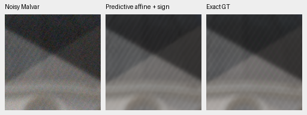
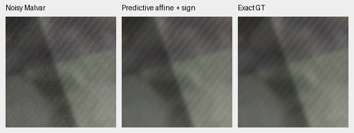

# Noise-weighted Bayer validation for weak color detail

Weighting Bayer samples by their predicted noise variance helped an affine color fit on a fresh mixed-illumination panel at ISO1600. The change was small and source-dependent. Modeling the correlation induced by the fitted background added only **0.004 signed-response points** over per-pixel weighting. At ISO6400 the new methods recovered no color on the fresh panel. All standing GFX100S crops reproduced the local conditional result.

## Matched color checks

This inference replay keeps the [spatial color study](cfa-relative-phase.md)'s green carrier and eligibility decisions fixed. It offers signed red or blue corrections where the local conditional fit suppresses unsupported neutral color. The local affine basis uses two green-aligned quadratures and four linear spatial slopes. The alternative color field keeps the prior fit-side field and changes only its local amplitude fit and validation score.

Fit and validation use reciprocal checkerboards of the relevant Bayer color. A fit-side smooth background and competing carrier predict the expected RAW level at both sets of sites. Per-pixel weighting uses shot × predicted level plus read variance, with a floor of one quarter of the existing patch variance estimate. With weight matrix (W_A), fit-side nuisance design (A) and held nuisance design (B), estimating that nuisance adds (B(A^T W_A A)^{-1}B^T) to the held residual covariance. The full score uses this covariance and the held sensor variance. The diagonal score uses only the held sensor variance. Both use the same weighted fit. This construction approximates uncertainty in the nuisance fit under the estimated weights.

All variants use 48-pixel fits and 32-pixel centers, broad held gain above 6 and a comparison with either a positive or a 1.5-unit central held margin. The positive-center variants are matched across weighting methods. The measured-amplitude cap, parent subtraction and tapers are shared. Green stays fixed. The precision calculation agrees with direct dense inversion to 2.9e-14 in the arithmetic check. Replacing held RAW values changes the held scores but preserves the fitted coefficients bit for bit for both folds at all four Bayer positions.

## Exact-target photo results

The fresh panel uses 16 distinct validation photographs, 12 with local red/blue reversals or missing color components and four with aligned color. Two independent RAW draws per photo use four Bayer layouts, exposure 0.33 and σ 0.85 pre-Bayer optical blur. A shared illumination step leaves 22–45% of the bright-side signal on the dark side. The 16 source identities and cache hashes were checked against earlier evaluation sources and 559,808 recorded training visits. ISO1600 uses shot/read `0.00032 / 4.096e-7` and ISO6400 uses `0.00128 / 6.5536e-6`. Parent predictions use the existing Local 50k and V120 EMAs with CUDA IEEE FP32.

| Method with positive held center | ISO1600 signed response | Local RGB RMS (DN16) | Weak R/B increment RMS (DN16) | Windows corrected |
| --- | ---: | ---: | ---: | ---: |
| Local 50k EMA | −2.847% | 72.9923 | 79.6293 | — |
| V120 EMA | −4.275% | 75.4641 | 79.5091 | — |
| Local conditional | −3.222% | 72.1222 | 79.9285 | — |
| Affine, common variance | −3.079% | 72.0888 | 79.8871 | 6 |
| Affine, per-pixel variance | −3.010% | 72.0874 | 79.8831 | 6 |
| Affine, full predictive covariance | −3.006% | 72.0869 | 79.8823 | 6 |
| Color field, common variance | −3.188% | 72.1128 | 79.9177 | 1 |

The affine covariance score gains **0.073 points** `[−0.063, +0.217]` over the equally permissive affine fit and lowers local RGB RMS by **0.0019 DN16** `[−0.0224, +0.0223]`. Intervals resample photos with both draws together, stratified by shape family. Its signed response remains negative, and weak-increment error remains above the untouched parent. The exact-gap, flat, edge-only, uniform and strong-only metrics agree with local conditional. At ISO6400 and on the aligned controls none of the new arms deliver new corrections.

The retained stronger-chroma ISO1600 panel gives per-pixel weighting a **+0.061-point** gain over the unweighted color field, with an interval of `[−0.022, +0.157]`. The full covariance score gives +0.059 points there. On the stronger retained ISO6400 panel, weighting the color field loses **0.093 points**. The remaining, weaker-color panels give negligible or zero improvement.

## Controlled variance sweep

With exact carrier frequencies and a known smooth background, the measurements isolate per-pixel weighting from guide errors and changing chroma. The strongest variance contrast uses a 0.06 dark-to-bright ratio. Each cell below is weak-target RMS / null-region correction RMS in DN16 for the diagonal carrier at ISO6400. The sweep scales both broad and central score cutoffs. Each row uses the same 96 draws per lattice position, with four positions. The individual positions are checks on sampling phase.

| Cutoff multiplier | Common variance | Per-pixel variance | Predictive covariance |
| --- | ---: | ---: | ---: |
| 0.125 | 91.51 / 8.87 | 87.28 / 7.68 | 87.19 / 8.52 |
| 0.25 | 93.51 / 2.84 | 89.31 / 3.17 | 89.46 / 3.17 |
| 0.5 | 97.14 / 2.84 | 93.10 / 0.00 | 92.81 / 0.00 |
| 1.0 | 102.16 / 0.00 | 98.37 / 0.00 | 98.39 / 0.00 |

At the nominal cutoff, weighting passes 66/384 weak targets versus 34/384 for common variance, with zero null passes in both arms. Under uniform illumination, per-pixel weighting and common variance each pass 6/384 at ISO6400. In the much darker, mixed-illumination control the weighting gain is real, but it barely transfers to the fresh photo replay with estimated carrier shape. The sweep uses a Gaussian shot/read approximation with 16-bit quantization and an exact affine carrier. It does not calibrate the complete RAW selection procedure on photos.

## Native exact comparisons

Both examples use the first draw, the retained ISO1600 conditioning above, a native `[48,48,160,160]` crop in the `[128,128,256,256]` query, and display exposure ×2 followed by sRGB. The denoised panels compose the affine covariance check with Local 50k EMA SHA256 `62f4e9ce84075c8df1a254a1889033b5787133e8c98c63e0ec3d174a94734959`. The exact target is post-optics and pre-Bayer. These are two selected changed crops. The fitted RGB differences are subtle at native display exposure and the fine color contrast remains weak.

The smooth-dip crop uses Diego Delso's Gniezno photo, RGGB, with bin-four crop `[96,50,512,512]`. It was adapted by binning, adding the illumination step and wires, and simulating optics and sensor noise. Peak change from local conditional is 13.46 DN16. [Full native comparison](assets/cfa-predictive-covariance-v1/lightstep-10-comparison.png) · [Source](https://commons.wikimedia.org/wiki/File:Edificio_en_el_prado_de_la_catedral,_Gniezno,_Polonia,_2012-04-06,_DD_01.JPG) · [CC BY-SA 3.0](https://creativecommons.org/licenses/by-sa/3.0/).

The contrast-step crop uses Ltshears' wallaroo photo, BGGR, with bin-four crop `[62,8,512,512]` and the same adaptation. Peak change is 26.37 DN16. [Full native comparison](assets/cfa-predictive-covariance-v1/lightstep-11-comparison.png) · [Source](https://commons.wikimedia.org/wiki/File:Wallaroo2010_3.jpg) · [CC BY-SA 3.0](https://creativecommons.org/licenses/by-sa/3.0/).

## Standing GFX100S comparisons

The new red/blue checks reproduce all eight local conditional crops. The main sky stays smooth and the coarse fence retains connected intersections. The building retains soft small cables and the foliage retains soft leaf edges. Right-cab diagonals keep the same overly regular patches, and crossings remain incomplete near the left post. The checks add no new splotches or repeated color, with the same background mottle as the local conditional fit.

All boards compose the same Local 50k EMA above and include V120 EMA SHA256 `a9d9b6b4f974e24a6b11e5e740aab32314233a7f53c056cf37c7d2aac1c589fb`. DSCF3879 and the nominal cab use shot/read `0.00128 / 6.5536e-6`, and the transferred cab uses `0.0014635775921166604 / 1.0715704128646712e-6`. DSCF3880 and DSCF3835 AHD renders and both cab JPEGs are qualitative references from separate imaging conditions. Native coordinates and exposure are stored with each board.

| Capture and prior | Native comparison boards |
| --- | --- |
| DSCF3879 nominal ×4 | [Sky](assets/cfa-predictive-covariance-v1/main-overcast-sky-main-overcast-sky-x4.png) · [Building](assets/cfa-predictive-covariance-v1/main-building-detail-main-building-detail-x4.png) · [Foliage](assets/cfa-predictive-covariance-v1/main-foliage-main-foliage-x4.png) · [Coarse fence](assets/cfa-predictive-covariance-v1/main-chain-link-fence-main-chain-link-fence-x4.png) |
| DSCF3842 nominal | [Left ×4](assets/cfa-predictive-covariance-v1/mesh-nominal-fine-green-mesh-left-x4.png) · [Right ×4](assets/cfa-predictive-covariance-v1/mesh-nominal-fine-green-mesh-right-x4.png) · [Left ×16](assets/cfa-predictive-covariance-v1/mesh-nominal-fine-green-mesh-left-x16.png) · [Right ×16](assets/cfa-predictive-covariance-v1/mesh-nominal-fine-green-mesh-right-x16.png) |
| DSCF3842 transferred | [Left ×4](assets/cfa-predictive-covariance-v1/mesh-profile3879-fine-green-mesh-left-x4.png) · [Right ×4](assets/cfa-predictive-covariance-v1/mesh-profile3879-fine-green-mesh-right-x4.png) · [Left ×16](assets/cfa-predictive-covariance-v1/mesh-profile3879-fine-green-mesh-left-x16.png) · [Right ×16](assets/cfa-predictive-covariance-v1/mesh-profile3879-fine-green-mesh-right-x16.png) |

## Coverage

Numerical evaluation and native viewing are complete. This component replay reused frozen weights. Full427 and the known/unseen camera panels are outside its scope. Fresh capture and network inference took 31.00 and 26.31 seconds for the two ISO profiles. The retained CPU matched replay took 74.88 seconds across all arms and views. Per-pixel weighting remains promising for scenes with genuinely large noise differences and known carrier shapes. The evidence leaves the spatial color field as the stronger overall comparison on the retained panel.

[Matched metrics](results/cfa-predictive-covariance-v1/summary.json) · [Native manifest](assets/cfa-predictive-covariance-v1/manifest.json) · [Publication hashes](results/cfa-predictive-covariance-v1/publication.json) · [Frozen receipts and source](results/cfa-predictive-covariance-v1/evidence.tar.xz).
