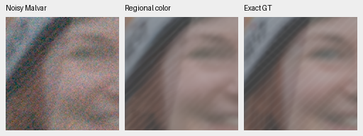
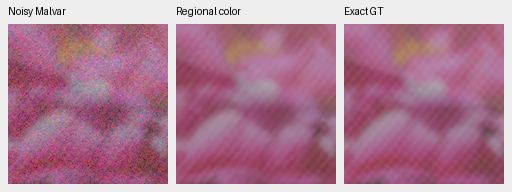

# Regional agreement for Bayer phase

Red and blue now contribute to the experimental `pooled-color` crop fit
in proportion to nearby agreement with the measured green phase. On
24 fresh warped photo backgrounds, this gains **0.504 weak-response
points** and lowers intact fundamental error **0.546 DN16** versus the
green-only pooled fit. Flat-region error stays equal. Fine crossings
on the standing real cab remain incomplete.

## Regional check

The [crop-wide fit](cfa-phase-sharing.md) estimates a red/blue amplitude
ratio from weighted quadrature dot products across all 64 phase nodes.
The new fit retains that screen and downweights each color observation
using a second dot product over its 3 × 3 node neighborhood. A 24-pixel
node gets weight 1, its orthogonal neighbors ½ and diagonal neighbors ¼.
The auxiliary precision ramps from zero at nonpositive local agreement
to full weight at twice the estimated null noise scale. A common cap
keeps auxiliary precision at or below the green precision. This is an
empirical agreement score.

The phase neighborhood uses the fitting green and red/blue samples.
Replacing the held green leaves the fixed-direction template and its
color weights identical in eight tests across the four Bayer layouts.
Reciprocal green checks still set acceptance and amplitude. If the two
greens disagree on rank, each direction can qualify on its held evidence.
Delivery still uses a neutral RGB correction.

## Fresh optical panel

The 24 Commons validation photographs exclude the earlier optical
fixtures and the 559,808 recorded photographic visits of the Local 50k
parent. The locked split has 12 clear directional amplitude differences
and 12 competitive pairs. Each background has paired straight and smoothly
warped targets with a shared straight exterior, two independent noise draws
and five roles. The pre-Bayer Gaussian blur is σ 0.85 pixels. Noise uses
shot/read `0.00128 / 6.5536e-6`, exposure 0.33 and black offset 0.03.
Both parents use IEEE FP32 CUDA inference with EMA weights.

| Comparator | Checkpoint SHA256 |
| --- | --- |
| Local 50k | `62f4e9ce84075c8df1a254a1889033b5787133e8c98c63e0ec3d174a94734959` |
| V120 Small | `a9d9b6b4f974e24a6b11e5e740aab32314233a7f53c056cf37c7d2aac1c589fb` |

| Regional minus green-only pooled | Warped | Straight |
| --- | ---: | ---: |
| Weak response, percentage points | +0.504 [+0.149, +0.895] | +0.068 [+0.002, +0.138] |
| Intact fundamental RMS, DN16 | −0.546 [−0.934, −0.220] | −0.077 [−0.160, −0.007] |
| Continuing-strand RMS in gaps, DN16 | −0.0001 | −0.0006 |
| False weak-band RMS in gaps, DN16 | −0.0016 | −0.0110 |
| Flat-core RMS, DN16 | 0.000 | 0.000 |

Both draws are resampled together by photo, stratified by shape family.
The warped weak-response change is +0.173 points on the clear half and
+0.836 on the competitive half. Against crop-wide color pooling, regional
changes weak response by +0.035 [−0.068, +0.135] on warped targets and
−0.043 [−0.095, −0.004] on straight targets. Opening the direction rank
alone leaves intact responses equal. It also adds 0.413 DN16 in one
edge-only draw, the same draw that changes with both color methods.
Uniform and flat-core scores stay equal.

On the warped cohort, regional gains 7.015 weak-response points over
Local 50k and 8.855 over V120, and lowers intact fundamental RMS by
7.463 and 9.037 DN16 respectively. Mean false weak-band RMS rises by
0.147 and 0.213 DN16 in those comparisons, with intervals spanning zero.
The results are for planted native crops. Fixed photo and camera scores
remain bound to their existing endpoints.

Capture and both parent predictions took 76.30 seconds. Matched crop
scoring and rendering took 60.57 seconds. The native photos and
camera RAW inputs were read from existing caches.

## Local color reversal

The earlier 48 known-phase procedural fixtures were replayed with
the original noise variance and with twice that variance at the same
signal. At original variance, signed correlation inside the changed
part of the template is as follows.

| Red/blue weak phase | Green only | Crop-wide color | Regional color |
| --- | ---: | ---: | ---: |
| Aligned throughout | 0.98857 | 0.99214 | 0.99216 |
| Reversed within 16 × 22 pixel semiaxes | 0.98861 | 0.98709 | 0.98717 |
| Reversed within 32 × 43 pixel semiaxes | 0.98857 | 0.95097 | 0.98345 |
| Reversed within 48 × 58 pixel semiaxes | 0.98874 | 0.90501 | 0.98531 |

For the medium reversal at twice the variance, regional improves
correlation from 0.94258 to 0.97942. The smallest reversal remains
below the regional check's spatial resolution. Globally reversed
color is rejected by both fits. All 96 exact-flat green fixtures
with a strong chromatic carrier and supplied frequencies reproduce
the parent.

After held-green acceptance, the medium reversal's green RMS at
original variance is 55.23 DN16 with green-only pooling, 56.22
with crop-wide color and 55.30 with regional color. These controlled
outputs use a synthetic parent with full-strength strong strands
and 30% of the exact weak signal. Neutral delivery can still put the
wrong phase into red and blue. The regional RGB RMS on that reversal
is 136.31 DN16, above the synthetic parent's 105.74 DN16.

The [channel-delivery follow-up](cfa-signed-color-delivery.md) reduces
this error by checking the neutral assumption on held red/blue samples.

## Native exact crops

Each triplet shows noisy Malvar, Local 50k plus regional phase, and the
exact target after optics and before Bayer sampling. Each panel is
160 × 160 native pixels, at `(48,48)` in the 256 × 256
recipient at `(128,128)`. Draw zero uses the noise, optics and
checkpoint above. Display uses ×2 linear exposure and sRGB.
The weak direction remains softer than the exact targets.

The strip uses Steffen Prößdorf's Oberhof luge photo with RGGB and
bin-four source crop `(14,2,512,512)`. Adapted by binning, planting
wires and simulating optics and capture noise.
[Comparison](assets/cfa-regional-phase-v1/regional-phase-00-comparison.png) ·
[Source](https://commons.wikimedia.org/wiki/File:2022-12-30_Deutsche_Meisterschaften_Rodeln_Oberhof_1DX_7664_by_Stepro.jpg) ·
[CC BY-SA 4.0](https://creativecommons.org/licenses/by-sa/4.0/).

The smooth dip uses Diego Delso's bumblebee photo with GBRG and
bin-four source crop `(12,4,512,512)` with the same adaptation.
[Comparison](assets/cfa-regional-phase-v1/regional-phase-06-comparison.png) ·
[Source](https://commons.wikimedia.org/wiki/File:Abejorro_com%C3%BAn_(Bombus_terrestris),_M%C3%BAnich,_Alemania,_2012-06-07,_DD_02.jpg) ·
[CC BY-SA 3.0](https://creativecommons.org/licenses/by-sa/3.0/).

## Standing GFX100S comparisons

The DSCF3879 sky, building and foliage are pixel-identical to green-only
pooling. The coarse fence retains its continuous intersections and
differs from crop-wide color by 0.002 DN16 RGB RMS. These ×4 pictures
use the nominal shot/read `0.00128 / 6.5536e-6` and the DSCF3880
ISO100 AHD qualitative reference.
[Sky](assets/cfa-regional-phase-v1/main-overcast-sky-main-overcast-sky-x4.png) ·
[Building](assets/cfa-regional-phase-v1/main-building-detail-main-building-detail-x4.png) ·
[Foliage](assets/cfa-regional-phase-v1/main-foliage-main-foliage-x4.png) ·
[Coarse fence](assets/cfa-regional-phase-v1/main-chain-link-fence-main-chain-link-fence-x4.png).

The DSCF3842 cab views use nominal and transferred DSCF3879 priors,
respectively `0.00128 / 6.5536e-6` and
`0.0014635775921166604 / 1.0715704128646712e-6`. DSCF3835
ISO100 AHD and the two in-camera JPEGs are qualitative references.
Exposure in the table is a display multiplier before sRGB.

| Native cab ROI | Nominal | Transferred |
| --- | --- | --- |
| Left `(806,6489)` | [×4](assets/cfa-regional-phase-v1/mesh-nominal-fine-green-mesh-left-x4.png) · [×16](assets/cfa-regional-phase-v1/mesh-nominal-fine-green-mesh-left-x16.png) | [×4](assets/cfa-regional-phase-v1/mesh-profile3879-fine-green-mesh-left-x4.png) · [×16](assets/cfa-regional-phase-v1/mesh-profile3879-fine-green-mesh-left-x16.png) |
| Right `(1026,6449)` | [×4](assets/cfa-regional-phase-v1/mesh-nominal-fine-green-mesh-right-x4.png) · [×16](assets/cfa-regional-phase-v1/mesh-nominal-fine-green-mesh-right-x16.png) | [×4](assets/cfa-regional-phase-v1/mesh-profile3879-fine-green-mesh-right-x4.png) · [×16](assets/cfa-regional-phase-v1/mesh-profile3879-fine-green-mesh-right-x16.png) |

On the left, both color methods add faint diagonals along the
bottom of the patch. Intersections near the post are incomplete.
On the right, the openings and irregular strand contrast are
nearly identical across the pooled variants. Relative to crop-wide
color, RGB changes across both cab ROIs and profiles are 0.014–0.334
DN16 RMS. No visible new chroma grids or flat-region splotches appear.

## Packaged crop fit

Set `method="pooled-color"` with the 192 × 192 restored RGB context.
Across 480 new optical crops and eight standing crops, both packaged
pooled methods match their replay outputs bit for bit. This checks
37,478,400 RGB values per method. `local64` is still the API default.
[Usage](usage.md#repeating-mesh-crops).

On the GB10 host, median warm CPU time at one BLAS and one OpenMP
thread includes the donor search and crop fit. There are 15 interleaved
measurements per method and crop. The input and parent are preloaded.

| Crop | Green-only pooled, ms | Regional color, ms |
| --- | ---: | ---: |
| Sky, building and foliage | 8.4–9.2 | 8.4–9.2 |
| Coarse fence | 36.65 | 38.90 |
| Left cab, nominal | 25.43 | 46.58 |
| Left cab, transferred | 25.83 | 48.58 |
| Right cab, nominal | 35.54 | 38.59 |
| Right cab, transferred | 35.85 | 38.56 |

The higher cost on the left comes with testing both ambiguous directions.
[Publication manifest](results/cfa-regional-phase-v1/publication.json) ·
[Machine receipts and source](results/cfa-regional-phase-v1/evidence.tar.xz).
