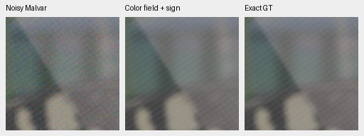
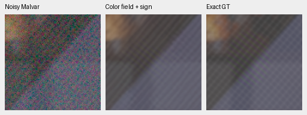

# Estimating spatially varying color phase from Bayer RAW

A spatially varying color field improves recovery on a fresh
stronger-chroma panel. At ISO1600 it adds **1.117 signed-response
points** and reduces local RGB error **0.474 DN16** over
[local conditional delivery](cfa-signed-color-delivery.md), with
equal measured gap error. The high-noise improvement comes from
one photo. On the earlier, weaker panels the benefit remains
small and the real fine cab crops remain incomplete.

## Estimate the color waveform before checking it

The [preceding experiment](cfa-directional-chroma.md) found windows
where the exact signed waveform passed both held checks and the
estimated alternatives failed. This replay leaves the exterior
frequency nomination, green reconstruction, and local red/blue
contradiction decisions fixed. New candidates apply to color
windows that the conditional fit suppresses without a signed
correction.

The two green lattices supply a shared normalized carrier field
with both quadratures. The red/blue amplitudes and relative phase
come from actual samples of the corresponding CFA color. A
checkerboard split within each packed lattice supplies reciprocal
fit and holdout subsets.

| Candidate | Color waveform |
| --- | --- |
| Planar | Same independent color sine and cosine from the preceding replay |
| Transported | Two constant quadrature coefficients relative to the locally varying green phase |
| Affine | Both quadrature coefficients vary linearly in x and y. The 48-pixel fit uses a ridge on the four slopes, scaled by 0.35 of mean constant-quadrature energy |
| Color field | Each fit-side checkerboard estimates two local coefficients per 24-pixel node in the 192-pixel RAW footprint. A noise-weighted 8-neighbor graph smooths them with strength 0.35 times the median precision. Bilinear interpolation retains the signed spatial amplitudes |

Each color field admits a nonnegative scale fit over 48 pixels.
The reference background includes cosine terms and the competing
carrier. Both folds must agree in the delivered 32-pixel region.
Gain requires held scores above 6 over 48 pixels and 1.5 in the
center. The `field + sign` arm requires positive central support.
Delivery subtracts the parent projection and caps each correction
at the measured waveform norm. Replacing all held color samples
leaves the field bit-identical in eight checks across four CFA
positions and both folds.

## Matched photo results

The 24 new validation photographs include 18 signed-color scenes
and six aligned controls. Each source has two independent draws
at each noise profile. The signed R/B contrast inside the central
ellipse has a multiplier of −1.8 on one or both colors, with zero
on any absent channel. The earlier panels use −1.0 for reversals.
The new panel has stronger chroma by design. Green geometry,
blur σ 0.85, exposure 0.33 and black offset 0.03 follow the
previous pipeline. Shot/read are `0.00032 / 4.096e-7` at ISO1600
and `0.00128 / 6.5536e-6` at ISO6400. The new source IDs and cache
hashes avoid the earlier optical panels and the parent's 559,808
recorded photographic training visits. The two EMA parents use
IEEE FP32 CUDA inference. The V120 Small checkpoint is
`a9d9b6b4f974e24a6b11e5e740aab32314233a7f53c056cf37c7d2aac1c589fb`.

| Signed-color panel | Suppressed windows | Planar, sign-only | Transported | Affine | Color field | Color field + sign |
| --- | ---: | ---: | ---: | ---: | ---: | ---: |
| Earlier ISO6400, 24 photos | 48 | 1 | 2 | 3 | 0 | 1 |
| Earlier ISO1600, 12 photos | 30 | 2 | 0 | 0 | 0 | 0 |
| Earlier ISO6400, 12 photos | 2 | 0 | 0 | 0 | 0 | 0 |
| Stronger ISO1600, 18 photos | 208 | 13 | 8 | 83 | 67 | 78 |
| Stronger ISO6400, 18 photos | 33 | 5 | 1 | 9 | 7 | 8 |

Counts indicate windows receiving a nonzero signed color
correction. On the new ISO1600 panel the field with positive
central support changes seven photos. Signed response projects
the predicted present-minus-strong-only image onto the exact
red/blue increment inside the reversal ellipse. The local and
gap errors are camera-linear DN16. Intervals resample photos
with both draws together, stratified by shape family.

| Stronger panel, color field + sign minus local conditional | ISO1600 | ISO6400 |
| --- | ---: | ---: |
| Signed red/blue response, points | +1.117 [+0.522, +1.701] | +0.296 [0.000, +0.887] |
| Local RGB RMS, DN16 | −0.474 [−0.819, −0.157] | −0.182 [−0.545, 0.000] |
| Local red/blue increment RMS, DN16 | −0.624 [−1.061, −0.227] | −0.231 [−0.693, 0.000] |
| Exact-gap red/blue increment RMS, DN16 | 0.000 | 0.000 |

At ISO1600, the planar fit with positive central support adds
0.108 signed-response points. Affine adds 0.815 points and the
strict color field adds 1.009. The signed mean with the
positive-center color field is 4.528%, versus 3.411% for local
conditional, 1.039% for Local 50k and 0.162% for V120. At ISO6400
the field improves the local conditional red/blue increment RMS
to 149.352 DN16, compared with 147.915 for Local 50k and 148.835
for V120. All fresh ISO6400 field gains occur in two draws of one
scene. Flat, edge-only, uniform and strong-only controls match
local conditional. The earlier ISO1600 phase result is reproduced,
with no new gain from the spatially varying fits.

Capture and both parent predictions took 38.31 seconds at ISO1600
and 40.22 seconds at ISO6400. The matched replay across all photo
panels and the standing views took 66.35 seconds. This experiment
covers native crops on existing checkpoints.

## Where the waveform still fails

A target-assisted diagnostic projects the exact post-optics
present-minus-strong-only contrast onto each basis over 48 pixels
and measures explained energy in the 32-pixel center. The color
field bases are still estimated from noisy half-lattices. Their
diagnostic amplitude is fitted against clean contrast. The table
includes suppressed windows in the planted weak family with at
least 8 DN16 RMS of exact center contrast.

| Panel | Windows | Planar | Transported | Affine | Noisy-fit color field |
| --- | ---: | ---: | ---: | ---: | ---: |
| Earlier ISO1600 | 30 | 35.6% | 38.0% | 67.1% | 27.3% |
| Stronger ISO1600 | 200 | 20.3% | 19.4% | 69.4% | 50.6% |
| Stronger ISO6400 | 33 | 40.7% | 36.3% | 70.9% | 42.9% |

Values are medians. The affine basis can represent a much larger
fraction of the exact waveform, including in the earlier ISO1600
windows where the noisy fit fails. The gap between that capacity
and the noisy-fit result limits weak-signal recovery.

## Native exact comparisons

The two changed crops show noisy Malvar, the color field with a
positive central check on Local 50k EMA
`62f4e9ce84075c8df1a254a1889033b5787133e8c98c63e0ec3d174a94734959`,
and exact post-optics, pre-Bayer GT. Both use GRBG and draw zero.
Each is a 160 × 160 native crop at `(48,48)` in the 256-pixel
recipient at `(128,128)`. Display uses ×2 linear exposure followed
by sRGB. Both use the same camera and blur path as their matching
ISO panel above.

The ISO1600 smooth dip uses Miraceti's swallowtail photo, bin-four
crop `(62,38,512,512)`, adapted by binning, planting colored wires
and simulating the capture. Peak color correction is 72.13 DN16.
The weak diagonals remain muted relative to the exact target.
[Full comparison](assets/cfa-relative-phase-v1/iso1600-relative-color-18-comparison.png) ·
[Source](https://commons.wikimedia.org/wiki/File:Otak%C3%A1rek_fenyklov%C3%BD,_Lovo%C5%A1,_2009-07-12.jpg) ·
[CC BY-SA 3.0 Czech Republic](https://creativecommons.org/licenses/by-sa/3.0/cz/deed.en).

The ISO6400 contrast step uses Friedrich Haag's flame photo with
bin-four crop `(362,324,512,512)` and the same adaptation.
Peak color correction is 95.62 DN16. Fine diagonal contrast is
still weaker than the exact target.
[Full comparison](assets/cfa-relative-phase-v1/iso6400-relative-color-15-comparison.png) ·
[Source](https://commons.wikimedia.org/wiki/File:Flamme_001_2012_12_01.jpg) ·
[CC BY-SA 4.0](https://creativecommons.org/licenses/by-sa/4.0/).

The preselected ISO1600 panels show the same exposure, geometry
and processing with RGGB for the strip at `(74,2,512,512)` and
GRBG for the ellipse at `(30,62,512,512)`. The strip uses Hans
Hillewaert's Adenium photo, adapted by binning and simulating
colored wires, optics and Bayer capture.
[Strip triplet](assets/cfa-relative-phase-v1/relative-color-00-triplet.png) ·
[Strip comparison](assets/cfa-relative-phase-v1/relative-color-00-comparison.png) ·
[Source](https://commons.wikimedia.org/wiki/File:Adenium_multiflorum.jpg) ·
[CC BY-SA 3.0](https://creativecommons.org/licenses/by-sa/3.0/).

The ellipse uses Екатерина Борисова's Yelagin Palace photo
with the same adaptation.
[Ellipse triplet](assets/cfa-relative-phase-v1/relative-color-05-triplet.png) ·
[Ellipse comparison](assets/cfa-relative-phase-v1/relative-color-05-comparison.png) ·
[Source](https://commons.wikimedia.org/wiki/File:%D0%95%D0%BB%D0%B0%D0%B3%D0%B8%D0%BD_%D0%B4%D0%B2%D0%BE%D1%80%D0%B5%D1%8611.jpg) ·
[CC BY-SA 4.0](https://creativecommons.org/licenses/by-sa/4.0/).

## Standing GFX100S comparisons

Under the suppression-only rule, all methods reproduce the local
conditional pixels in both standing families. The main DSCF3879
views use shot/read `0.00128 / 6.5536e-6`, ×4 display exposure
and the independently demosaiced DSCF3880 ISO100 reference.
The sky remains smooth and coarse intersections remain visible.
[Sky](assets/cfa-relative-phase-v1/main-overcast-sky-main-overcast-sky-x4.png) ·
[Building](assets/cfa-relative-phase-v1/main-building-detail-main-building-detail-x4.png) ·
[Foliage](assets/cfa-relative-phase-v1/main-foliage-main-foliage-x4.png) ·
[Coarse fence](assets/cfa-relative-phase-v1/main-chain-link-fence-main-chain-link-fence-x4.png).

A wider comparison allows the field to replace neutral
delivery on other green-supported windows after both held
folds show gains of more than 1 broad unit and 0.2 central
units over the neutral prediction. It retains the absolute
6/1.5 checks. This adds 134 red/blue windows over the new
ISO1600 present crops, including the aligned photos. It
adds 0.059 signed-response points and lowers the signed
local RGB error by another 0.044 DN16. It adds four windows
at ISO6400, with a signed-response change of 0.0003 points.
Strong-only, edge-only, flat and uniform scores match the
suppression-only field.

On the coarse fence this comparison changes ten red and nine
blue windows, for 2.28 DN16 RGB RMS from local conditional.
Visible intersections and the soft reference difference remain.
The sky, building and foliage are unchanged.
[Coarse fence with the wider comparison](assets/cfa-relative-phase-v1/main-chain-link-fence-main-chain-link-fence-x4-changed.png).

Both variants leave the four DSCF3842 cab outputs equal to local
conditional. Fine crossings remain incomplete near the post.
All cab boards show the independent DSCF3835 AHD and camera
JPEG references at ×4 and ×16. Nominal shot/read match the main
case. The transferred DSCF3879 shot/read are
`0.0014635775921166604 / 1.0715704128646712e-6`.

| Native cab ROI | Nominal display | Transferred display |
| --- | --- | --- |
| Left `(806,6489)` | [×4](assets/cfa-relative-phase-v1/mesh-nominal-fine-green-mesh-left-x4.png) · [×16](assets/cfa-relative-phase-v1/mesh-nominal-fine-green-mesh-left-x16.png) | [×4](assets/cfa-relative-phase-v1/mesh-profile3879-fine-green-mesh-left-x4.png) · [×16](assets/cfa-relative-phase-v1/mesh-profile3879-fine-green-mesh-left-x16.png) |
| Right `(1026,6449)` | [×4](assets/cfa-relative-phase-v1/mesh-nominal-fine-green-mesh-right-x4.png) · [×16](assets/cfa-relative-phase-v1/mesh-nominal-fine-green-mesh-right-x16.png) | [×4](assets/cfa-relative-phase-v1/mesh-profile3879-fine-green-mesh-right-x4.png) · [×16](assets/cfa-relative-phase-v1/mesh-profile3879-fine-green-mesh-right-x16.png) |

The protected real references remain qualitative. The new
methods stay experimental because the gains so far depend on
stronger color and a limited set of sources.
[Evidence manifest](results/cfa-relative-phase-v1/publication.json) ·
[Receipts and replay source](results/cfa-relative-phase-v1/evidence.tar.xz).
