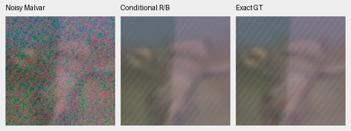
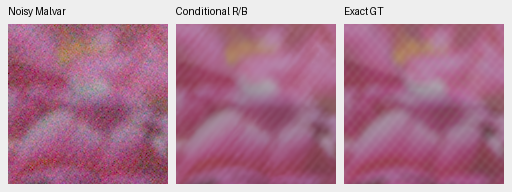

# Checking neutral wire corrections against red and blue RAW

A held-sample check reduces wrong-color transfer when a weak strand
reverses phase across colors. It preserves the green reconstruction
from [regional pooling](cfa-regional-phase.md) bit for bit. In an exact
procedural reversal it reduces RGB error from **136.31 to 93.40 DN16**.
On 24 photo backgrounds with planted color reversals, the local gain
is **0.47 DN16**. The photo gain comes from suppressing a contradicted
correction. Fine cab crossings remain incomplete and this fit stays
experimental.

## Channel fit and conditional delivery

The same four exterior patches nominate the carrier pair, and the
packaged `pooled-color` fit supplies the green correction and eligible
directions. Each alternative changes only red and blue for those
directions with a green correction.

Both green lattices supply a pooled unit-phase template. One
checkerboard parity within each packed red or blue plane fits a
signed amplitude over 48 native pixels. Its complement scores the
result over 48 pixels and a central 32 pixels. Folds swap roles.
The background model includes cosine terms and the competing
carrier. The template uses exclusively green samples. Each color
fit subtracts the parent projection for delivery after the check. Across
eight parity/fold probes, replacing all held samples changes the score
and leaves the fitted amplitude bit-identical.

| Arm | Weak-direction red and blue |
| --- | --- |
| Neutral | Packaged regional color fit, with the green correction transported through the white balance and camera matrix |
| Green delivery | Keep the red and blue parent values for the tested direction |
| Signed R/B | Use separately fitted amplitudes when both folds agree on the sign and their held scores exceed 6 and 1.5. Otherwise keep the parent value |
| Conditional R/B | Test the green-derived neutral prediction on each held red/blue subset. Replace it with the signed choice only if both folds score below −6 over 48 pixels and −1.5 in the center |

The neutral prediction for this check uses only green samples to
estimate the amplitude and phase. Direction eligibility and the
delivered green already depend on the regional fit. The held scores
are empirical criteria for the compared red and blue predictions.

## Synthetic reversal test

The test replays the prior 48 procedural fixtures across all four CFA
layouts at both the original sensor variance and twice that variance.
The original variance is `0.00128 × signal + 6.5536e-6`.
The synthetic parent contains the exact strong direction and 30% of
the weak signal. RGB values below are RMS in the interior of the
32 × 43 pixel semiaxis ellipse, in camera-linear DN16.

| Method | Aligned, original | Reversal, original | Aligned, double variance | Reversal, double variance |
| --- | ---: | ---: | ---: | ---: |
| Synthetic parent | 105.74 | 105.74 | 105.74 | 105.74 |
| Neutral | 55.72 | 136.31 | 76.20 | 125.55 |
| Green delivery | 93.06 | 93.12 | 98.32 | 98.42 |
| Signed R/B | 73.72 | 89.26 | 91.95 | 97.51 |
| Conditional R/B | 55.72 | 93.40 | 76.23 | 102.57 |

Conditional minus neutral reversal error is −42.91 DN16
[−48.69, −36.99] at original variance and −22.98 DN16 at twice
the variance. It retains more aligned contrast than the
unconditional signed fit. All 96 exact-flat green controls with
strong red/blue carriers remain pixel-identical to their parents.

## Planted color on photo backgrounds

The signed panel reuses the 24 validation backgrounds and warped weak
geometry from the regional study. It adds two new physical sensor
draws per background with red and blue altered in camera coordinates
before optical blur and Bayer sampling. Eight photos have both color
signals reversed in the ellipse, eight have red reversed and blue
absent, and eight have blue reversed and red absent. The green signal
and the exterior geometry are retained. The matched aligned panel
reuses the previous warped captures. Noise uses shot/read
`0.00128 / 6.5536e-6`, exposure 0.33, black offset 0.03 and pre-Bayer
blur σ 0.85. Parent predictions are CUDA IEEE FP32 EMA.

| Method | Signed local RGB RMS | Signed local weak-increment RGB RMS | Aligned full RGB RMS |
| --- | ---: | ---: | ---: |
| V120 Small | 140.850 | 146.953 | 137.695 |
| Local 50k | 140.363 | 147.881 | 135.385 |
| Neutral | 132.990 | 149.787 | 127.025 |
| Green delivery | 131.962 | 148.910 | 127.669 |
| Signed R/B | 131.962 | 148.910 | 127.569 |
| Conditional R/B | 132.519 | 149.386 | 127.027 |

Errors are camera-linear DN16. Local pixels lie within the reversal
ellipse where the weak support is at least 0.35. Increment error uses
the present minus strong-only observation and its corresponding exact
contrast. Conditional minus neutral local RGB is −0.471 DN16
[−1.214, −0.038] across signed photos, with both draws resampled
together by source. Full-crop RGB RMS also falls 0.087 DN16 on
signed photos. Weak-increment error remains higher than either
unrefined parent on the signed panel. Conditional flat, edge-only and
uniform metrics reproduce the neutral fit.

The audit counts 48 contradicted red/blue windows in signed present
crops and one on the aligned panel. None of these windows passes
the signed delivery check. A version that only withholds the disputed
channel reproduces the conditional photo scores. New RAW capture and
both parent predictions took 38.56 seconds. Crop scoring and native
rendering took 47.95 seconds. These are crop experiments on existing
endpoints. The fixed photo and camera panels retain their current
checkpoint coverage.

## Native exact comparisons

Both triplets show noisy Malvar, conditional R/B on Local 50k EMA
`62f4e9ce84075c8df1a254a1889033b5787133e8c98c63e0ec3d174a94734959`,
and exact post-optics, pre-Bayer GT. Both use GBRG, draw zero and the
noise and blur above. Each panel is 160 × 160 native pixels at
`(48,48)` in the 256-pixel recipient at `(128,128)`. The display is ×2
linear exposure followed by sRGB. The weak color bands remain less
distinct than in the exact targets.

The contrast step uses Tisha Mukherjee's Pacific golden plover photo,
bin-four source crop `(136,8,512,512)`. Adapted by binning, planting
colored carriers and simulating optics and capture noise.
[Full comparison](assets/cfa-color-delivery-v1/color-03-comparison.png) ·
[Source](https://commons.wikimedia.org/wiki/File:Pacific_Golden-Plover_in_Bakkhali_September_2025_by_Tisha_Mukherjee_01.jpg) ·
[CC BY-SA 4.0](https://creativecommons.org/licenses/by-sa/4.0/).

The smooth dip uses Diego Delso's bumblebee photo, bin-four source
crop `(12,4,512,512)` with the same adaptation.
[Full comparison](assets/cfa-color-delivery-v1/color-06-comparison.png) ·
[Source](https://commons.wikimedia.org/wiki/File:Abejorro_com%C3%BAn_(Bombus_terrestris),_M%C3%BAnich,_Alemania,_2012-06-07,_DD_02.jpg) ·
[CC BY-SA 3.0](https://creativecommons.org/licenses/by-sa/3.0/).

## Standing GFX100S comparisons

On DSCF3879, conditional agrees pixel for pixel with neutral pooling
in all four regions. The coarse fence retains connected intersections.
The sky stays smooth, with the same soft building and foliage details.
All main views use ×4 display and the nominal shot/read
`0.00128 / 6.5536e-6`. DSCF3880 ISO100 AHD is an independent
qualitative reference. [Sky](assets/cfa-color-delivery-v1/main-overcast-sky-main-overcast-sky-x4.png) ·
[Building](assets/cfa-color-delivery-v1/main-building-detail-main-building-detail-x4.png) ·
[Foliage](assets/cfa-color-delivery-v1/main-foliage-main-foliage-x4.png) ·
[Coarse fence](assets/cfa-color-delivery-v1/main-chain-link-fence-main-chain-link-fence-x4.png).

In the DSCF3842 cab crops, the same conditional check changes a single
red window in the left patch with the transferred prior, by 0.085 DN16
RGB RMS across that crop. Both right views and the nominal left
are identical to the packaged result. The unconditional signed method
admits no red or blue correction in either nominal crop, leaving a
more green-tinted weak-strand correction. Fine crossings stay incomplete.
The independent DSCF3835 ISO100 AHD and both camera JPEGs are
qualitative references. The nominal prior uses the main values above.
The transferred prior uses shot/read
`0.0014635775921166604 / 1.0715704128646712e-6`.

| Native cab ROI | Nominal display | Transferred display |
| --- | --- | --- |
| Left `(806,6489)` | [×4](assets/cfa-color-delivery-v1/mesh-nominal-fine-green-mesh-left-x4.png) · [×16](assets/cfa-color-delivery-v1/mesh-nominal-fine-green-mesh-left-x16.png) | [×4](assets/cfa-color-delivery-v1/mesh-profile3879-fine-green-mesh-left-x4.png) · [×16](assets/cfa-color-delivery-v1/mesh-profile3879-fine-green-mesh-left-x16.png) |
| Right `(1026,6449)` | [×4](assets/cfa-color-delivery-v1/mesh-nominal-fine-green-mesh-right-x4.png) · [×16](assets/cfa-color-delivery-v1/mesh-nominal-fine-green-mesh-right-x16.png) | [×4](assets/cfa-color-delivery-v1/mesh-profile3879-fine-green-mesh-right-x4.png) · [×16](assets/cfa-color-delivery-v1/mesh-profile3879-fine-green-mesh-right-x16.png) |

All 16 native figures were inspected. The controls diagnose an error
in transferring green phase to red and blue. The strength of actual
red/blue recovery at camera noise remains limited.
[Publication manifest](results/cfa-color-delivery-v1/publication.json) ·
[Receipts and executable replay](results/cfa-color-delivery-v1/evidence.tar.xz).
