# V199 native gate diagnostic gallery

[Findings and method](cfa-wave-gate-diagnostic.md). These are fixed-head interventions, not newly trained models. All panels retain 160×160 native pixels. Open the linked PNG at 100% to inspect pixels. ISO100/AHD/JPEG references are independent captures, not exact GT. RMS-matched controls can exceed the trained gate bound and are diagnostic only.

[Full checkpoint, noise, source, ROI and transform metadata](images/v199-cfa-gate-diagnostic-v1/manifest-v1.json). Each board uses noisy → V195 → actual → shared spatial → shared spatial RMS → color constant → shared constant → shared constant RMS → positive-only → reference(s).

## 00: mesh-seed2026112302-present-iso6400-prior-RGGB / raw

ROI `[176, 176, 160, 160]`, exposure 8, contrast 1; all seven gate policies.

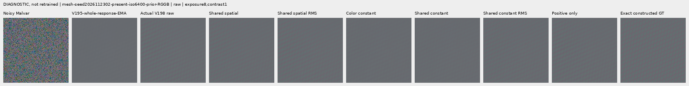

## 01: mesh-seed2026112302-present-iso6400-prior-RGGB / raw

ROI `[176, 176, 160, 160]`, exposure 8, contrast 1; noisy/restored/reference triplet.

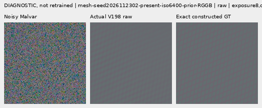

## 02: mesh-seed2026112302-present-iso6400-prior-RGGB / raw

ROI `[176, 176, 160, 160]`, exposure 8, contrast 1; noisy/restored/reference triplet.

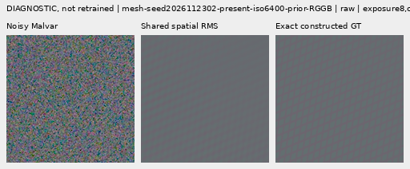

## 03: mesh-seed2026112302-present-iso6400-prior-RGGB / EMA

ROI `[176, 176, 160, 160]`, exposure 8, contrast 1; all seven gate policies.

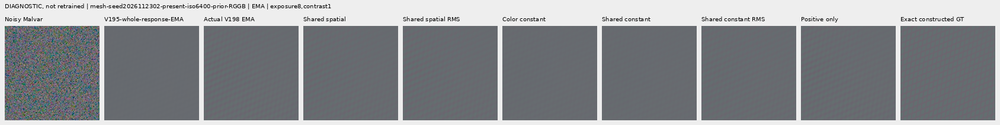

## 04: mesh-seed2026112302-present-iso6400-prior-RGGB / EMA

ROI `[176, 176, 160, 160]`, exposure 8, contrast 1; noisy/restored/reference triplet.

## 05: mesh-seed2026112302-present-iso6400-prior-RGGB / EMA

ROI `[176, 176, 160, 160]`, exposure 8, contrast 1; noisy/restored/reference triplet.

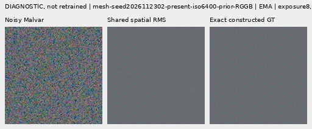

## 06: mesh-seed2026112302-present-iso6400-prior-RGGB / raw

ROI `[176, 176, 160, 160]`, exposure 8, contrast 40; all seven gate policies.

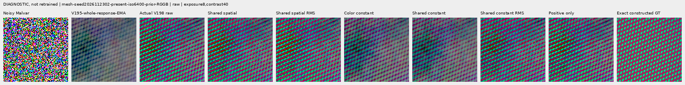

## 07: mesh-seed2026112302-present-iso6400-prior-RGGB / EMA

ROI `[176, 176, 160, 160]`, exposure 8, contrast 40; all seven gate policies.

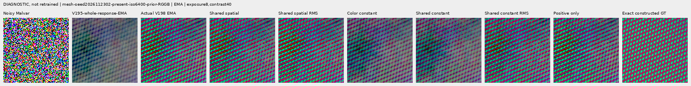

## 08: mesh-seed2026112309-present-iso6400-prior-RGGB / raw

ROI `[176, 176, 160, 160]`, exposure 8, contrast 1; all seven gate policies.

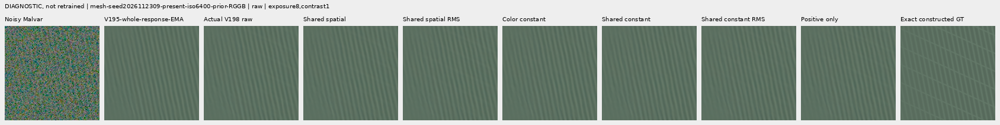

## 09: mesh-seed2026112309-present-iso6400-prior-RGGB / raw

ROI `[176, 176, 160, 160]`, exposure 8, contrast 1; noisy/restored/reference triplet.

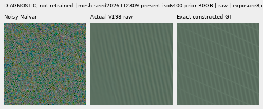

## 10: mesh-seed2026112309-present-iso6400-prior-RGGB / raw

ROI `[176, 176, 160, 160]`, exposure 8, contrast 1; noisy/restored/reference triplet.

## 11: mesh-seed2026112309-present-iso6400-prior-RGGB / EMA

ROI `[176, 176, 160, 160]`, exposure 8, contrast 1; all seven gate policies.

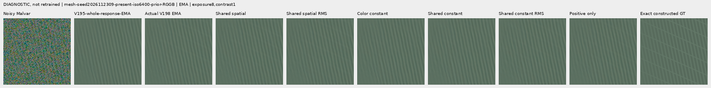

## 12: mesh-seed2026112309-present-iso6400-prior-RGGB / EMA

ROI `[176, 176, 160, 160]`, exposure 8, contrast 1; noisy/restored/reference triplet.

## 13: mesh-seed2026112309-present-iso6400-prior-RGGB / EMA

ROI `[176, 176, 160, 160]`, exposure 8, contrast 1; noisy/restored/reference triplet.

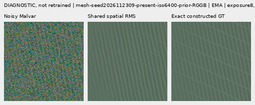

## 14: mesh-seed2026112309-present-iso6400-prior-RGGB / raw

ROI `[176, 176, 160, 160]`, exposure 8, contrast 40; all seven gate policies.

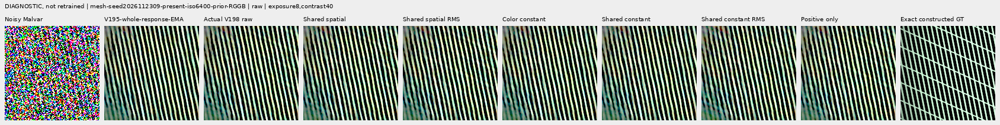

## 15: mesh-seed2026112309-present-iso6400-prior-RGGB / EMA

ROI `[176, 176, 160, 160]`, exposure 8, contrast 40; all seven gate policies.

## 16: mesh-seed2026112304-absent-iso6400-prior-RGGB / raw

ROI `[165, 0, 160, 160]`, exposure 8, contrast 40; all seven gate policies.

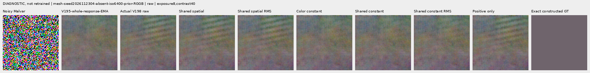

## 17: mesh-seed2026112304-absent-iso6400-prior-RGGB / EMA

ROI `[165, 0, 160, 160]`, exposure 8, contrast 40; all seven gate policies.

## 18: main-overcast-sky / raw

ROI `[176, 176, 160, 160]`, exposure 4, contrast 1; all seven gate policies.

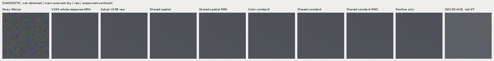

## 19: main-overcast-sky / EMA

ROI `[176, 176, 160, 160]`, exposure 4, contrast 1; all seven gate policies.

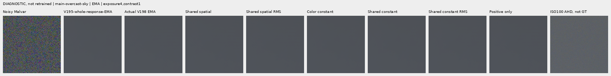

## 20: main-building-detail / raw

ROI `[176, 176, 160, 160]`, exposure 4, contrast 1; all seven gate policies.

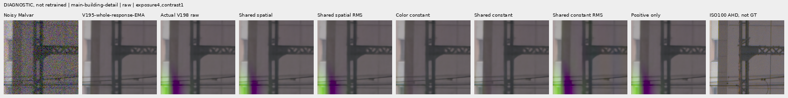

## 21: main-building-detail / EMA

ROI `[176, 176, 160, 160]`, exposure 4, contrast 1; all seven gate policies.

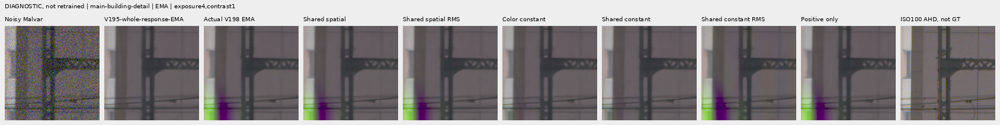

## 22: main-foliage / raw

ROI `[176, 176, 160, 160]`, exposure 4, contrast 1; all seven gate policies.

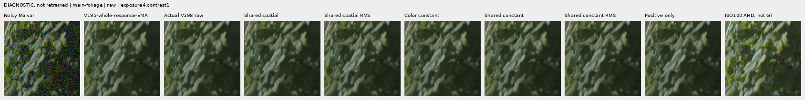

## 23: main-foliage / EMA

ROI `[176, 176, 160, 160]`, exposure 4, contrast 1; all seven gate policies.

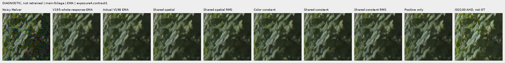

## 24: main-chain-link-fence / raw

ROI `[176, 176, 160, 160]`, exposure 4, contrast 1; all seven gate policies.

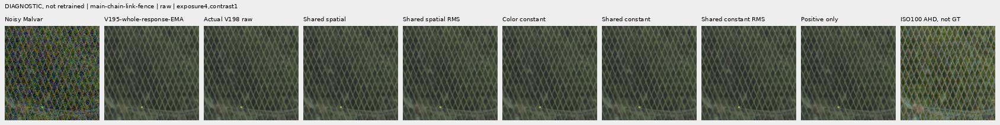

## 25: main-chain-link-fence / EMA

ROI `[176, 176, 160, 160]`, exposure 4, contrast 1; all seven gate policies.

## 26: mesh-nominal / raw

ROI `[206, 229, 160, 160]`, exposure 16, contrast 1; all seven gate policies.

## 27: mesh-nominal / EMA

ROI `[206, 229, 160, 160]`, exposure 16, contrast 1; all seven gate policies.

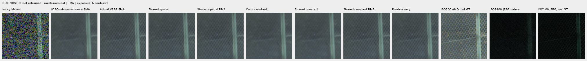

## 28: mesh-nominal / raw

ROI `[426, 189, 160, 160]`, exposure 16, contrast 1; all seven gate policies.

## 29: mesh-nominal / EMA

ROI `[426, 189, 160, 160]`, exposure 16, contrast 1; all seven gate policies.

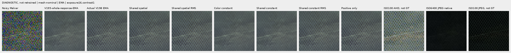

## 30: mesh-profile3879 / raw

ROI `[206, 229, 160, 160]`, exposure 16, contrast 1; all seven gate policies.

## 31: mesh-profile3879 / EMA

ROI `[206, 229, 160, 160]`, exposure 16, contrast 1; all seven gate policies.

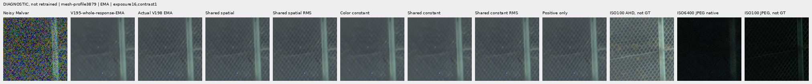

## 32: mesh-profile3879 / raw

ROI `[426, 189, 160, 160]`, exposure 16, contrast 1; all seven gate policies.

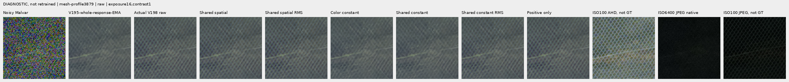

## 33: mesh-profile3879 / EMA

ROI `[426, 189, 160, 160]`, exposure 16, contrast 1; all seven gate policies.

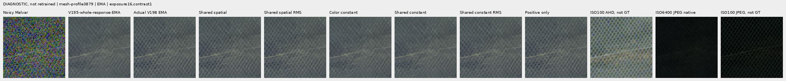

## 34: flat512-gray-l0.02-iso6400-prior-RGGB / raw

ROI `[176, 176, 160, 160]`, exposure 4, contrast 40; all seven gate policies.

## 35: flat512-gray-l0.02-iso6400-prior-RGGB / EMA

ROI `[176, 176, 160, 160]`, exposure 4, contrast 40; all seven gate policies.

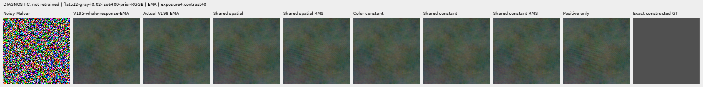

## 36: flat512-gray-l0.02-iso12800-prior-RGGB / raw

ROI `[176, 176, 160, 160]`, exposure 4, contrast 40; all seven gate policies.

## 37: flat512-gray-l0.02-iso12800-prior-RGGB / EMA

ROI `[176, 176, 160, 160]`, exposure 4, contrast 40; all seven gate policies.

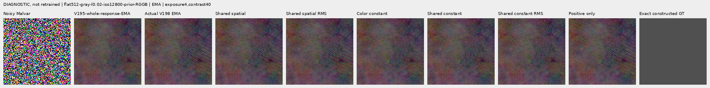

## 38: photo-3e638bbb56ed80abc88939468783e3bf9b92ee77-photo-faint-RGGB / raw

ROI `[176, 176, 160, 160]`, exposure 12.1493876, contrast 8; all seven gate policies.

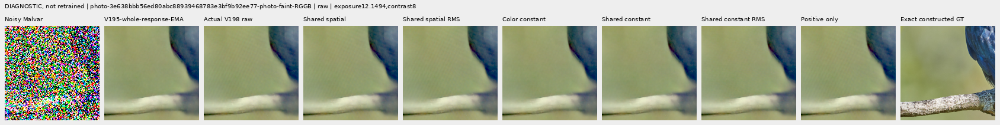

## 39: photo-3e638bbb56ed80abc88939468783e3bf9b92ee77-photo-faint-RGGB / EMA

ROI `[176, 176, 160, 160]`, exposure 12.1493876, contrast 8; all seven gate policies.

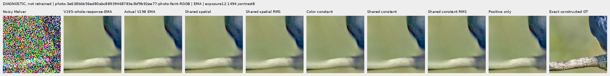

## 40: photo-3e638bbb56ed80abc88939468783e3bf9b92ee77-photo-dark-RGGB / raw

ROI `[176, 176, 160, 160]`, exposure 80.9959173, contrast 1; all seven gate policies.

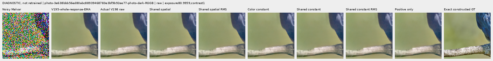

## 41: photo-3e638bbb56ed80abc88939468783e3bf9b92ee77-photo-dark-RGGB / EMA

ROI `[176, 176, 160, 160]`, exposure 80.9959173, contrast 1; all seven gate policies.

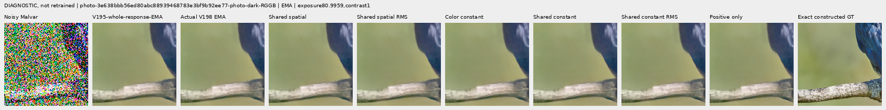

## 42: mixed-vertical-step-iso6400-prior-RGGB / raw

ROI `[80, 176, 160, 160]`, exposure 8, contrast 40; all seven gate policies.

## 43: mixed-vertical-step-iso6400-prior-RGGB / EMA

ROI `[80, 176, 160, 160]`, exposure 8, contrast 40; all seven gate policies.

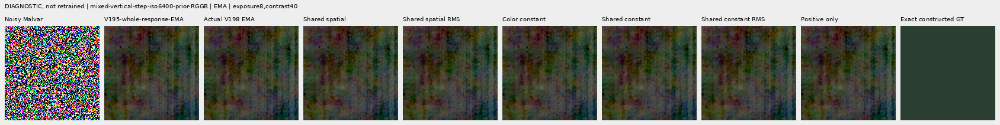

## 44: mixed-vertical-step-iso6400-prior-RGGB / raw

ROI `[240, 176, 160, 160]`, exposure 8, contrast 1; all seven gate policies.

## 45: mixed-vertical-step-iso6400-prior-RGGB / EMA

ROI `[240, 176, 160, 160]`, exposure 8, contrast 1; all seven gate policies.

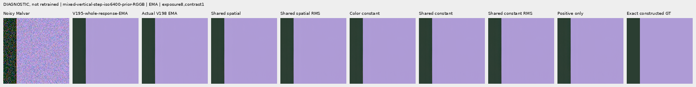
