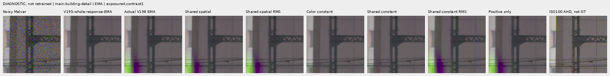
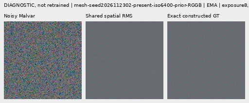
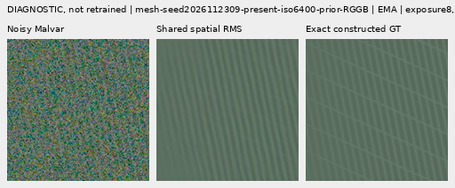
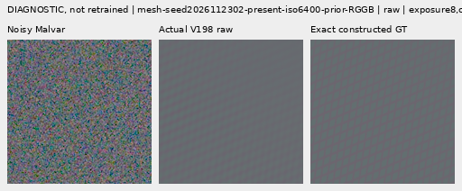
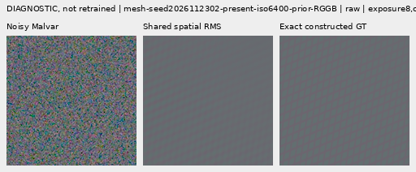
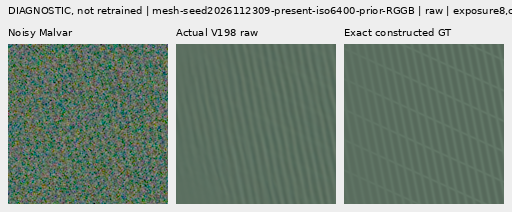
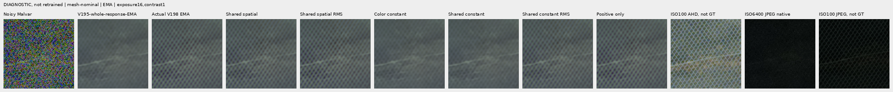
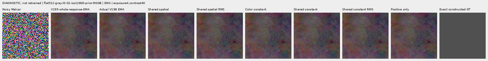

# Can simpler gates remove false detail? (V199)

**Sharing the RGB gates or clipping negative gates does not remove V198's
building fringe or false flat-field ripples in these fixed examples.** Constant
gates make the images look cleaner while greatly shrinking the correction;
matching their correction RMS brings artifacts back. This rules out these
posthoc changes as a sufficient fix, and makes better local measurement/support
features the next priority. It does not establish that a newly trained shared
gate could never improve quality.

This is a **diagnostic, not a new trained model or quality promotion**. The
[V198 stronger-response result and its costs](cfa-innovation-wave-comparison.md)
remain current. Real fine cab crossings and clean flat regions are still
unresolved. [All 46 native figures](cfa-wave-gate-diagnostic-gallery.md) ·
[Source-bound evidence](results/v199-cfa-gate-diagnostic-completed-v1.json) ·
[Independent saved-panel verification](results/v199-cfa-gate-diagnostic-publication-verification-v1.json).

## What changes, and what stays fixed

Fourteen previously selected V198 development contexts provide nineteen display
settings: two constructed meshes, an absent mesh, main-scene sky/building/foliage/
coarse fence, the cab under both noise profiles and both ROIs, two fresh gray
flats, faint/dark versions of one photographic bird, and a mixed vertical-step
scene's quiet/edge ROIs. These selected failures and controls are **not a random
or blind population quality test**.

Both trained V198 raw and EMA readouts use the same saved input-derived bins,
the same measured CFA wave basis, and the same cached V195 Whole EMA anchor.
The diagnostic changes only the real scalar gains applied to those measured
waves. The input field is RAW minus the CFA samples of the anchor; targets are
read only after input features and head outputs, for metric measurement.

| Policy | Intervention |
| --- | --- |
| Actual | Original evaluated V198 output |
| Shared spatial | Average the three RGB gates at each location and bin |
| Shared spatial RMS | Shared spatial, scaled to actual whole-context correction RMS |
| Color constant | Each color/bin gate's whole-context spatial mean |
| Shared constant | Each bin's whole-context mean across RGB and space |
| Shared constant RMS | Shared constant, scaled to actual whole-context correction RMS |
| Positive only | Clip original gates to [0, 1] |

Constant means use the **entire context**, not the displayed crop. RMS matching
uses no target or reference: its one scalar is actual correction RMS divided by
intervened correction RMS. It is an amplitude control, **not a trained bounded
architecture**; effective gains can exceed the trained bound in principle.
Every case's actual scale and maximum effective gain are recorded in the
[196-row table](results/v199-cfa-gate-diagnostic-v1/metrics-v1.csv).

## Strength matching changes the interpretation

These are **EMA, individual-context** measurements. Building correction RMS is
camera-RGB amplitude in DN16, not GT error. Mesh response is the existing
whole-template projection, not isolated crossing-wire recovery.

| Policy | Building correction RMS (DN16) | Mesh2302 correction RMS (DN16) | Mesh2302 response (% GT) | Mesh2302 full error RMS (DN16) |
| --- | ---: | ---: | ---: | ---: |
| Actual | 355.460796 | 11.849851 | 43.805420 | 17.161926 |
| Shared spatial | 324.982540 | 10.557500 | 39.458713 | 17.544967 |
| Shared spatial RMS | 355.460810 | 11.849851 | 43.544244 | 17.073918 |
| Color constant | 22.339196 | 4.294824 | 19.059554 | 21.043154 |
| Shared constant | 22.087765 | 4.003189 | 17.893129 | 21.248562 |
| Shared constant RMS | 355.460813 | 11.849851 | 41.042007 | 17.881956 |
| Positive only | 355.460218 | 11.848835 | 43.833111 | 17.152617 |

The cleaner constant-gate building view has roughly **one sixteenth** of the
original correction amplitude. The shared-constant RMS control scales it by
16.093108; its maximum effective gate is 0.967081 on this context. The
green/magenta fringe remains after matching, as it does under shared spatial
RMS and positive-only gates in both states. Removing per-color gain freedom is
therefore insufficient for this fixed measured basis.

This does not make negative gates irrelevant in general. Many building gates
are slightly negative, but clipping them changes whole correction RMS by less
than 0.001 DN16 here; their count alone does not explain the fringe. The saved
equal-camera-RGB orthogonal correction norm is descriptive amplitude, **not
perceptual chroma, GT error, or a color-quality score**.

## Native mesh triplets

Every crop is **160×160 native pixels**, with identical coordinates and display
transforms across policies. Open PNGs at 100% for pixel inspection; no crop
pixels are resized. Constructed examples use seeds 2026112302 and 2026112309,
RGGB, ROI `[176,176,160,160]` in the 512px context, shot 0.00128/read
6.5536e−6, display exposure 8 and contrast 1. GT is the exact constructed
camera-RGB target. Complete checkpoint bindings and per-panel metadata are in
the [native manifest](images/v199-cfa-gate-diagnostic-v1/manifest-v1.json).

EMA: noisy → actual V198 → exact constructed GT, followed by noisy → shared
spatial RMS intervention → the same GT.

Shared spatial RMS preserves similar colored lattice and rounded-node errors
on 2302. Its small individual-case error reduction is real but does not fix the
failure set. Mesh2309 still has a dominant near-vertical family and incomplete
weak crossings: actual/shared-RMS whole response is 81.323131%/81.280693% GT.
Positive-only is visually close to actual. Unmatched constants weaken useful
response, while matched constants restore modulation without complete wires.

Raw counterparts, with the same noisy/GT pixels and transforms:

## Real cab, flat and photographic controls

Both cab ROIs and both noise profiles retain stronger diagonal modulation under
shared spatial RMS and positive-only gates, but fine crossings remain soft and
incomplete. Unmatched constants weaken the added modulation. No reference here
can certify that every restored ripple is real.

The cab is DSCF3842 ISO6400 f/1.7, 1/300s; its independently captured DSCF3835
ISO100 f/5.6, 2.5s reference differs in aperture, exposure time and moving
subjects. Both SOOC JPEGs are retained. Context sensor ROI is
`[600,6260,768,768]`; left/right local ROIs are `[206,229,160,160]` and
`[426,189,160,160]`, display exposure 16, contrast 1. Nominal conditioning is
shot 0.00128/read 6.5536e−6, a disclosed prior rather than measured calibration;
the alternate DSCF3879 profile is fully recorded in the manifest.

Main-scene DSCF3879 ISO6400 f/1.7, 1/240s is compared with DSCF3880 ISO100 f/5.6,
3s. Main crops use `[176,176,160,160]`, exposure 4, contrast 1 and the nominal
prior. Sky stays smooth at this display exposure, foliage remains soft and
coarse fence alignment persists. Both families' AHD/JPEG references are
**qualitative independent references, not exact GT**. Both capture families,
their JPEGs and siblings remain excluded from training; originals are read-only.

Fresh flat, absent mesh and mixed quiet crops use contrast 40 about the same
fixed camera-RGB anchor for every method, with shared exposure/WB/matrix/sRGB
conversion. These stress views reveal corrugation that shared spatial RMS,
shared constant RMS and positive-only do not remove. The ISO6400 flat's full
error is 6.190289 DN16 actual, 6.188651 shared spatial RMS and 6.180844 shared
constant RMS; these tiny single-case changes do not demonstrate flat safety.

The faint bird background also retains false periodic ribbing under the shared,
RMS-matched and positive-only controls. Unmatched constants reduce it together
with correction strength. Faint-photo contrast is 8, exposure 12.149387598;
the dark variant uses contrast 1, exposure 80.995917320. Their constructed
camera-RGB targets derive from native-bin8 Commons RGB16 and are not exact GT
of a physical RAW scene. The ordinary mixed vertical edge remains visually
similar across policies. The gallery retains these examples beside all main
and cab crops rather than selecting only the small metric gains.

## Evidence and next test

Twenty-one CPU contracts pass, including independent non-square native phase
transport, original-head agreement, odd-coordinate crop reconstruction, global
constant means, masks, bounds and zero-amplitude controls. The registered
diagnostic owner is terminal. Its only neural execution is 28 isolated CPU
readouts and their 28 context/28 gate Conv children; there are no full anchor,
matching, parent or DINO forwards, training updates, optimizer steps, new
source/noise draws, RAW decodes, original/dataz reads or external writes.
CPU RNG and head weights remain unchanged, and CUDA is uninitialized.

The runner independently reconstructs **25,952,256 native channels** and replays
158 original V198 metric scalars. The saved-crop audit checks nineteen bundles,
2,918,400 reconstruction channels, 798 ROI energy/variance identities and 76
RMS controls. Whole-context counterfactual metrics are source-bound single-pass
measurements, **not independently rerun**. All 46 figures, including eight
small triplets, were actually viewed in twelve original-detail sheets. The
publication check reconstructs every saved counterfactual PNG panel and checks
all source panels and sheets after saving: **32,256,000 native RGB channel
values** across 420 panels. All 105 neural source files retain their hashes.

No checkpoint is trained by V199. The diagnostic uses V198 exports:

| State | Export SHA256 | Module SHA256 |
| --- | --- | --- |
| Raw | `7b4b17cfd0b2d79460d97c577a964f9d8fa02c5491a4c5f4ed734c4bfe14f27e` | `7592da3681590c6b7c311281eef5504915662ff611d70a57f8c45ab9e05dc067` |
| EMA | `5a0964710f7ca842c4f4c06b6e957bb3ed2ed802b036458dea5b098ad9189923` | `1480f2763745a1b77980218d174a11c918fa891fed8fdff3897433042eacb78e` |

These interventions leave selection, finite windows, native alias ambiguity
and correlation with anchor errors fixed; they do not isolate which causes the
fringe. Next, test input-only physical amplitude/phase agreement across local
scales and evidence that distinguishes a periodic signal from an edge or noise.
RAW variance remains nominal normalization, not calibrated innovation
confidence. Any trained follow-up still needs full detail/quiet/flat/photo
evaluation and both protected real scenes. Better learned gating and training
distribution remain open options; a simple gain constraint alone has not met
the goal.
