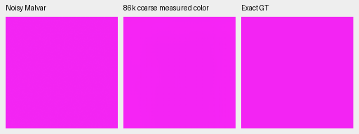
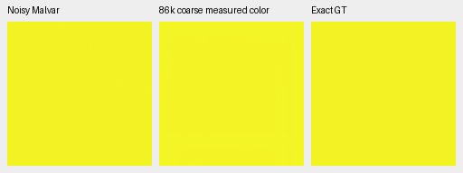

# Coarse color correction at intermediate simulated noise

The bounded near-ADC correction handles the very smallest positive
profiles. At the next tested noise prior, the 86k model still has large
mean color errors. A separate coarse measured-residual correction
lowers the reserved palette's worst bias from **6,703 to 810 DN16**.
It returns the original prediction for every input in the fixed
16-photo faint-detail panel, including the intermediate-noise cases.
[Complete measurements and native evidence](results/coarse-adc-color-v1/publication.json).

## Method

`coarse_adc_color_projection` is an opt-in 16-bit treatment for
full-signal noise above eight and at most 160 ADC codes RMS. It compares
RAW with the corresponding measured color in the reconstruction.
Each same-phase 7×7 packed neighborhood estimates a mean difference
from usable, nonclipped measurements. With at least 80% support, the
correction keeps only the mean excess over the larger of eight local
sensor standard deviations and three residual-scatter standard
deviations. The two green phases share their coarse offset. Bilinear
same-color interpolation transfers it to the missing colors.

The rule lifts only the coarse offset supported by the local
measurements. Large residual color error can remain.
[Implementation](../src/demosaic/adc_bins.py).

## Intermediate-noise results

The evaluated shot/read pair is `3.2e-7 / 1e-10`, about 36 codes RMS
at full signal with black fraction 0.03. The 86k EMA SHA256 is
`17a93ce546ee1c3282374b4a020c713251becbf919414966bb7a58f306b5c555`.
Both panels use independently generated Bayer observations, four CFA
layouts and exact synthetic targets. The reserved palette contains four
colors and 16 cases at this prior. The original controls contain three
flats and a blurred slanted edge.

| 86k evaluation at the intermediate prior | Raw DN16 | Coarse correction DN16 |
| --- | ---: | ---: |
| Reserved palette, worst absolute mean bias | 6,702.67 | 809.64 |
| Reserved palette, worst centered RMS | 1,066.22 | 286.14 |
| Original controls, worst absolute mean bias | 7,879.99 | 596.02 |
| Original controls, worst centered RMS | 514.56 | 202.32 |

The 16-photo panel spans this intermediate prior and three other noise
conditions. The library path matches the prototype exactly. Every one
of the 128 saved V120 and 86k photo prediction batches returns the
original object, including all 32 intermediate-noise batches.
In this panel it neither improves nor harms weak-band error. Both
standing GFX scenes and both cab profiles return the 18 original
saved predictions exactly. The previously viewed images retain their
soft fine crossings and foliage.

## Native comparisons

The triplets show noisy Malvar, 86k with the coarse correction and
exact synthetic targets. The magenta and yellow cases both use GBRG,
native 160×160 at `[48,48,160,160]`, exposure ×1 and shared clipped
sRGB display. The magenta becomes less pink and the yellow loses
some of its tint. Both retain some color error in the linear score.
The selected photo comparisons are identical before and after the
coarse correction.
[Crop provenance](images/coarse-adc-color-v1/manifest.json).

[Roof and branch crop](images/coarse-adc-color-v1/034fe53d538446fdc93f2e4d926aae0eb32afc3b-comparison.png) ·
[Steeple crop](images/coarse-adc-color-v1/03768ece408913d3c727b3e29b8ece77a57e5d9c-comparison.png) ·
[Standing GFX comparisons](noisy-cfa-residual.md#both-standing-gfx100s-comparisons).

The [near-ADC training experiment](near-adc-bridge-training.md) tests
the missing noise interval in the learned model. Both measurement
corrections are opt-in. V120 is the general inference recommendation.
