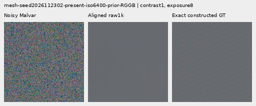
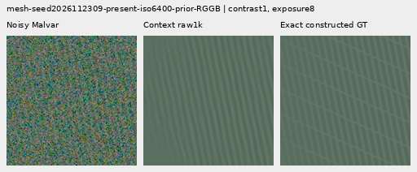
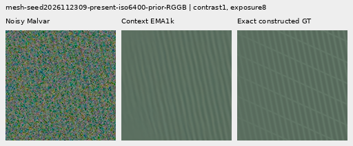
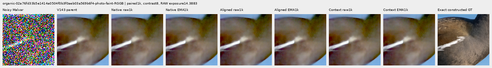
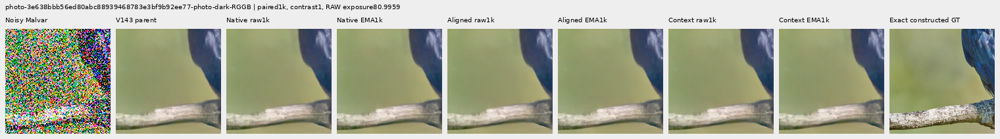
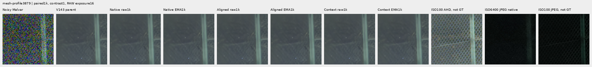

# V149 coherent CFA estimation: completed matched review

Explicit CFA phase alignment and added green-coherence context do not recover
useful new weak detail after 1,000 matched updates. Alignment raises mesh response
2.05–2.68% over the native matrix control, yet both new arms remain 6.03–6.88%
below V143. No convincing new fine cab mesh, crossing wires, feathers or bark
appear in the native comparisons. Small strong-edge whole-image gains coexist
with worse exact quiet regions and noisy flats. These components remain available
for research; [V120/general and V143/explicit periodic detail](current-model.md)
retain their measured strengths and remaining weaknesses.

All three fresh heads completed the fixed horizon, and all six final raw/EMA
endpoints were evaluated on all 798 retained cases. The native control reproduces
V148's complete training trace, raw/EMA/Adam states and **all 1,596 predictions
exactly**. This isolates the tested coordinate/context changes at the same data,
loss, initialization of shared weights and training budget. It does not rule out
other learned estimators, better supervision or longer training.

## Detail and actual blank error

Errors are means of per-observation RMS in unclipped camera RGB ×65535.
Mesh response projects onto exact plane-detrended procedural texture; ideal is 1.
The 256 present observations reuse 64 recipes across four CFAs, not 256 independent
scenes. All endpoints and comparison coordinates were fixed before review.

| Method | Present full RMS | Mesh response | Actual blank RMS | Blank spatial RMS | Added blank RMS |
| --- | ---: | ---: | ---: | ---: | ---: |
|V143|9.11124|0.0220209|5.52332|5.34311|0.000000|
|Native raw|9.14391|0.0200224|5.55579|5.37668|0.638666|
|Native EMA|9.14421|0.0202779|5.56090|5.38196|0.673863|
|Aligned raw|9.13860|0.0205599|5.55886|5.37985|0.673782|
|Aligned EMA|9.13927|0.0206927|5.56293|5.38406|0.704126|
|Context raw|9.14178|0.0205060|5.56335|5.38449|0.709218|
|Context EMA|9.14282|0.0206111|5.56765|5.38894|0.740585|
|Existing periodic detail|8.58613|0.0708975|5.52333|5.34312|0.000636|

The new arms slightly reduce present-mesh image error versus the native control,
but both image and actual blank errors stay above V143. Added context does not
improve alignment's mesh response and increases its blank error. Correction
energy alone is a footprint, not proof of invented detail: the
[target-informed diagnostic](spectral-capacity-oracle.md) can lower actual blank
error while adding more energy. Here actual blank and spatial errors also rise.
The existing periodic option remains stronger on selected meshes, while missing
orientations, support seams, spill and nonperiodic texture remain weaknesses.

| Flat test | V143 | Native raw / EMA | Aligned raw / EMA | Context raw / EMA |
| --- | ---: | ---: | ---: | ---: |
|Absent mesh full RMS; 256 cases|5.23791|5.26616 / 5.26982|5.26857 / 5.27176|5.27224 / 5.27565|
|Native 512 ISO6400 full RMS; 24 cases|18.54681|18.57179 / 18.58100|18.57516 / 18.58119|18.58279 / 18.58899|
|Native 512 ISO6400 block32 RMS|13.44056|13.44226 / 13.44271|13.44188 / 13.44214|13.44206 / 13.44234|
|Native 512 ISO12800 full RMS; 24 cases|24.07189|24.11647 / 24.13017|24.12344 / 24.13280|24.13479 / 24.14430|
|Native 512 ISO12800 block32 RMS|17.93254|17.93239 / 17.93232|17.93270 / 17.93277|17.93280 / 17.93289|
|Older native 256 ISO12800 full RMS; 24 cases|27.23355|27.21444 / 27.21728|27.21760 / 27.21781|27.22728 / 27.22677|
|Older native 256 ISO12800 block32 RMS|19.53988|19.54382 / 19.54334|19.54541 / 19.54521|19.54644 / 19.54622|

Native 512 noisy-flat full RMS rises .153–.301% in the new arms versus V143,
and is higher than the native control. Coarse block32 changes are much smaller;
they do not replace the wider-field error check. There is a real but tiny gain
on the older native 256 ISO12800 cohort: alignment lowers full RMS about .058%,
context .023–.025%. Coarse block32 error rises and the gain does not transfer to
native 512. All 48 ADC-only cases across both sizes remain exactly at their parent
values under all six endpoints. This is not a noisy-flat safety guarantee.

## Faint and dark photographic detail

Each group has 32 observations. The native DCT16 luma annulus is 1/8–1/3 cycles/pixel;
lower relative band error is better. Full group metrics, spatial errors and luma
gains are retained in the [score receipt](results/v149-coherent-phase-v1/scores.json).

| Photo group | V143 band error | Native raw / EMA | Aligned raw / EMA | Context raw / EMA |
| --- | ---: | ---: | ---: | ---: |
|Retained512 faint|0.824639|0.825033 / 0.824991|0.825033 / 0.825018|0.825030 / 0.825021|
|Retained512 dark|0.661447|0.661510 / 0.661497|0.661478 / 0.661473|0.661472 / 0.661468|
|Organic384 faint|0.924117|0.924888 / 0.924829|0.924920 / 0.924909|0.924929 / 0.924928|
|Organic384 dark|0.781612|0.781709 / 0.781699|0.781698 / 0.781697|0.781701 / 0.781703|

All four photographic groups have higher band error and lower luma-band response
than V143. Faint full-image RMS also rises. Alignment lowers retained-dark full
RMS from 29.097715 to 29.097415/29.097449; context reaches 29.097689/29.097784.
Organic-dark RMS becomes 33.685097/33.684928 aligned and 33.684880/33.684768 context,
versus 33.685796 parent. These small full-image gains do not restore the missing
native feather, moth, grass or bark detail, and do not reverse the band regression.

## Strong edges and quiet regions

These 32 constructed observations pair an exact flat 160px ROI with a strong step,
narrow bar, slanted step or striped patch. Whole-scene RMS improves .449–.735%
in the new arms versus V143, more than the native control. Exact quiet RMS and
spatial error still increase. Alignment modestly improves quiet errors over the
native control; added context usually worsens alignment's quiet behavior.

| Prior; 16 cases each | Method | Whole RMS | Quiet160 RMS | Quiet spatial RMS |
| --- | --- | ---: | ---: | ---: |
|ISO6400|V143|27.10563|3.89885|3.26850|
|ISO6400|Native raw/EMA|27.01160 / 27.00909|3.93960 / 3.94348|3.31411 / 3.31845|
|ISO6400|Aligned raw/EMA|26.98403 / 26.98144|3.93468 / 3.93718|3.30887 / 3.31169|
|ISO6400|Context raw/EMA|26.97804 / 26.97516|3.94162 / 3.94458|3.31678 / 3.32013|
|ISO12800|V143|36.74747|6.15265|5.34183|
|ISO12800|Native raw/EMA|36.58945 / 36.57498|6.20589 / 6.20733|5.40200 / 5.40362|
|ISO12800|Aligned raw/EMA|36.50120 / 36.49136|6.19955 / 6.20159|5.39530 / 5.39761|
|ISO12800|Context raw/EMA|36.48682 / 36.47730|6.20554 / 6.20831|5.40209 / 5.40522|

Native viewing shows retained colored mottle and subtle added fine grain at
diagnostic contrast 40. Unboosted strong edges stay visually close across methods.
Main real sky also stays near V143: descriptive block32 variation is 9.97264
parent, 9.97333/9.97339 aligned and 9.97333/9.97342 context. These are variation
descriptors, not GT errors; no real reference is pixelwise scored.

## Native 100% comparisons

All 66 primary figures were actually viewed in 17 unscaled sheets. Every crop cell
is 160×160 original pixels. The [manifest](images/v149-coherent-phase-v1/manifest-v1.json)
records source/ROI, exact conditioning, common exposure/contrast/anchor, all six
checkpoint hashes and byte-exact image bindings. Twenty-four triplets repeat
existing comparison pixels; they are not additional observations.

The two mesh examples use native 512 contexts, RGGB, ROI `[176,176,160,160]`,
shot .00128/read6.5536e-6, exposure 8 and contrast 1. Observation seeds end 2302/2309;
full procedural source recipes are in the manifest. The first stays nearly flat;
the second retains a dominant line family but misses crossings. The following
triplets show **noisy → restored → exact constructed GT**, with identical pixels
and display transforms across methods:

The matched native control's two cases are also available for
[raw 2302](images/v149-coherent-phase-v1/comparison-00-native-matrix-raw-step1000-triplet.png),
[raw 2309](images/v149-coherent-phase-v1/comparison-02-native-matrix-raw-step1000-triplet.png),
[EMA 2302](images/v149-coherent-phase-v1/comparison-00-native-matrix-EMA-step1000-triplet.png) and
[EMA 2309](images/v149-coherent-phase-v1/comparison-02-native-matrix-EMA-step1000-triplet.png).

Faint moorhen feathers remain soft. Commons source: Alexis Lours, CC BY4.0,
SHA1 `02a76fd33b5e1414a0504f0b3f0aeb03a569b6f4`; native 384 context,
ROI `[112,112,160,160]`, exposure 14.388348, contrast 8 about common target means.
Photo noise is shot .00128/read6.5536e-6. These targets are constructed from
binned free images, not exact GT for the physical scene.

The dark bird/branch uses a native 512 context, ROI `[176,176,160,160]`,
exposure 80.995917 and contrast 1 with the same noise prior. Source: Andrew Mercer,
CC BY-SA4.0, SHA1 `3e638bbb56ed80abc88939468783e3bf9b92ee77`.

Standing DSCF3879 ISO6400/DSCF3880 ISO100 boards include native
[sky](images/v149-coherent-phase-v1/comparison-05.png),
[building](images/v149-coherent-phase-v1/comparison-06.png),
[foliage](images/v149-coherent-phase-v1/comparison-07.png) and
[chain-link fence](images/v149-coherent-phase-v1/comparison-08.png), exposure 4.
Foliage stays painterly and building detail soft. DSCF3842/3835 cab-mesh boards
use native 768 context, left/right ROIs `[206,229,160,160]` / `[426,189,160,160]`,
exposure 16 and contrast 1:
[nominal left](images/v149-coherent-phase-v1/comparison-09.png),
[nominal right](images/v149-coherent-phase-v1/comparison-10.png),
[profile3879 left](images/v149-coherent-phase-v1/comparison-11.png) and
[profile3879 right](images/v149-coherent-phase-v1/comparison-12.png).
Neither prior reveals useful new fine wires. Both camera JPEGs are included at
native unboosted sRGB8. ISO100/AHD/JPEG references differ in aperture, shutter,
processing and moving subjects: they are **qualitative references, not exact GT**.

The [vertical quiet ROI](images/v149-coherent-phase-v1/comparison-26.png) uses
contrast 40, its [whole-edge view](images/v149-coherent-phase-v1/comparison-27.png)
contrast 1. [Quiet beside stripes,ISO6400](images/v149-coherent-phase-v1/comparison-38.png)
and [ISO12800](images/v149-coherent-phase-v1/comparison-40.png) expose the remaining
mottle. All use exposure 8 and fixed native coordinates across methods.

## Implementation and matched protocol

| Arm | Parameters | Change |
| --- | ---: | --- |
| Native matrix control |31,409|V148 estimator/support and unchanged native-coordinate bound|
| Aligned matrix |31,409|Estimate in known CFA-transported R/Gsum/Gdiff/B coordinates; return to physical slots before applying the original conjugate/norm bound|
| Aligned with coherence context |33,353|Same aligned estimator; append nine raw-derived energy/contrast summaries to support, at packed scales 9/33/129|

For a packed frequency f, native site offsets are `(0,0),(0,1),(1,0),(1,1)`.
Multiplication by `exp(-i*pi*(fy*dy+fx*dx))` aligns the physical sampling offsets.
A real orthogonal rotation orders red/blue and forms the sum/difference of the
two green sites. An ideal periodic carrier then occupies the green-common
channel. This is an exact coordinate statement before windowing; tapering,
affine removal and boundaries make finite-frame alignment approximate.
Packed Nyquist fractional shifts need not have real-image symmetry, but the
existing output band is zero there and final native conjugate pairing remains
explicit.

The estimated complex matrix is transformed back to native CFA coordinates
before the original `sqrt(norm1*normInf)` projection. That gauge is not invariant
to a basis change, so applying it in the new basis would change the native
budget. The native per-bin bound and scalar diagonal family are retained, up to
FP32 rounding. This is not a global nonlinear/RGB or noisy-flat guarantee.
The shared neural function still changes through the input coordinates.

The contextual arm synthesizes band-limited observed green common/difference
fields with the existing overlap geometry. Each packed scale provides
`log1p(common_energy/raw_variance)`, `log1p(difference_energy/raw_variance)` and a
signed energy contrast. Separable averages provide local and wider summaries
without quadratic large-kernel cost. These are uncalibrated features, not signal
probabilities or noise whitening. Basis noise diagonals are transformed; the
unequal-green off-diagonal covariance is not a calibrated full-noise model.
No target, ISO100 reference, JPEG or parent pixel enters the nine added features.
The original support inputs still include the supplied frozen parent.

Both estimators and support networks train together. All twelve native/aligned
initial parameter tensors match exactly. The context arm copies all existing
weights, preserves the first 28 local-input columns and initializes the new nine
columns to zero. All frequency outputs start zero, preserving the parent at the
first update. Constants remain inactive under learned finite arithmetic.

## Engineering and fixed evaluation

All 53 scalar/matrix/coherent component tests passed. The new tests independently
check physical carrier phase, unitary matrices, native-coordinate gain math,
local overlap synthesis and spatial averages in NumPy. They cover all four CFAs,
constants, CPU RNG/meta-device behavior, CPU FP32/BF16 optimizer continuation,
CUDA parity and all twelve parameter gradients.

The local-feature hook is a refactor of the old support concatenation. The
trained V148 matrix's old forward, the new forward and the archived pixels match
exactly on 28 cases covering all CFAs and native 256/384/512/768 contexts. All three
heads then pass ten discarded CUDA updates with genuine8+2 optimizer reload.
Every tensor and the new context-input columns receive nonzero finite gradients;
peak allocated CUDA is 4.50GiB. Smoke weights are discarded before production.

The [recipe](../configs/quality-v143-coherent-phase-v149.yaml) inherits V147/V148's
loss, source distribution, seed, geometry, schedule, clipping, EMA and 1k horizon.
It adopts the existing 1,000 batches/4,000 observation-parent-target arrays
without new noise construction, parent or DINO calls. Native control is the
matched comparison, with the older V148 raw/EMA states available for exact
replay checks. No photograph is stretched or tiled to create more context.
The inherited source pool/region eligibility remains 90,782/27; the sixteen
reviewed validation photos and protected captures/siblings remain excluded.

The completed review uses 798 cases: 512 present/absent meshes, 128 photos,
120 flats, 6 real contexts and 32 mixed quiet controls. All six final endpoints
are reported, with no early-epoch choice. This is an adaptive reused cohort,
not fresh independent validation. The 42 fixed old native ROI/display templates
produce 42 boards plus 24 repeated-cell triplets. Actual blank/DC/spatial error is
reported alongside correction energy. A 40-parent preflight independently checks
the old quiet/blank formulas before quality inference. Original media remains
read only, with no RAW decoding or `/mnt/dataz` access.

## Audits and reproducibility

The [final evidence](results/v149-coherent-phase-final-v1.json) preserves 16
byte-exact public receipts, all 66 PNGs, 85 frozen neural source hashes and full
fixed endpoint/checkpoint bindings. Independent training checks confirm all 1000
batch/domain/trace bindings, 36 finite final Adam states, exact native control
weights/optimizer and 1,596 control predictions. All 1,944 additional context
weights become nonzero. Independent metric recomputation passes 52,902 scalar
checks and 579 Decimal reductions, maximum difference5.12e-13. Rendering verifies
35,558,400 RGB channels against independent display calculations and PNG readback.
All nine primary process owners have exited; no experiment jobs remain live.

The [preparation snapshot](results/v149-coherent-phase-preparation-v1.json) retains
its original active step 380 state. An initial preparer assumed optional
`output_shape` metadata and stopped before creating the trial or doing GPU work.
The corrected storage estimate reads cached NPY headers; failed source/receipt
are preserved. No model, input, loss, endpoint or running worker was replaced.
The earlier [state-only audit](results/v149-coherent-phase-training-state-v1.json)
is also preserved unchanged alongside the later full pixel audit.

Tracked work includes 56 compatibility forward-function evaluations, 30 discarded
smoke updates, 3,000 production updates and 4,788 quality component calls: 7,874
in total, excluding unit tests. All 4,000 training observations and cached parents
are adopted; there are zero new parent/DINO calls or noise draws.

Paired 1k checkpoint SHA256:
`1b9edebbe394c7ebd701983292f33320a38046c50151508864393e5d6ad38b74`.
All six export hashes are in the manifest; byte serialization differs from V148
while the native tensor states and all control predictions are exact.
The [publication check](results/v149-coherent-phase-final-verification-v1.json)
also rechecks every public copy, native repeated pixel and rounded table value.

This finite result weakens the case for coordinate alignment or these nine
context features alone. The next useful test should examine supervision and
allocation of gradient to rare weak structure while retaining actual quiet and
blank losses; this cause has not yet been measured. Blindly opening the current
gate already failed in V147. The broader fine-detail/clean-sky objective remains
active and unmet. See the [diary](../diary/2026-11-03-13-36-40-v149-coherent-phase-trial.md).
