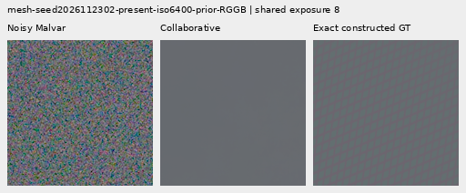
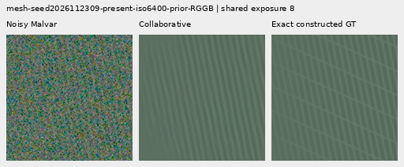
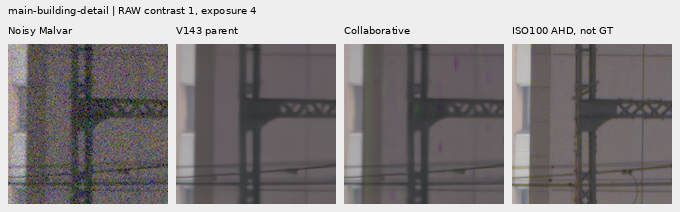
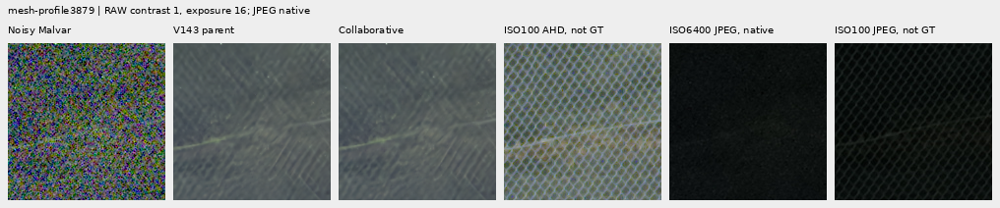

# Reject noise-scaled patch return: weak detail and new color blocks

**Noise-scaled DCT rejection fixes the earlier uniform-flat regression but
does not recover useful weak detail. It also adds visible purple/green blocks
to the real building crop.** The operator remains outside inference. V120 stays
the general baseline; V143 and its optional periodic `detail` stage remain the
useful faint/periodic research choices.

[Numerical implementation](../src/demosaic/collaborative_detail.py) ·
[694-case comparison](results/collaborative-detail-transfer-result-v1.json) ·
[Independent reductions](results/collaborative-detail-transfer-audit-v1.json) ·
[17 native figures and metadata](images/collaborative-detail-v1/manifest.json) ·
[Independent pixel audit](results/collaborative-detail-figures-audit-v1.json).

## Mechanism and scope

The [first whole-patch probe](cross-phase-patch-return.md) adds noise because
normalized matching alone supplies no rejection of unsupported values. This
version separates grouping from filtering. That distinction also appears in
[DeepBM3D, revised October 22, 2026](https://arxiv.org/html/2609.29334v2), which
uses learned grouping features and transform-domain weights. Our independently
implemented fixed RAW probe is not a reproduction of its trained model.

Each packed CFA phase uses centered 8×8 patches from the other three phases as
cosine matching keys. Candidate value patches have stride 8 and do not overlap;
four origins preserve the phase of stride-4 queries. A query averages up to 64
whole value patches. The DCT coefficient variance propagates the supplied
independent pixel variances through squared transform weights and averaging.
Weights are `max(1 − T * variance / coefficient², 0)`, with
`T = 2 log(4 * queries * 63 / .01)`. DC stays zero. The same weights filter
observed-minus-grouped-parent coefficients. Positive Hann aggregation and
fixed FP32 Malvar return a signed camera-RGB correction at gain 1.

The parent is the cached V143 5k EMA, SHA256
`96d146d017c54196288c585f8b7eddcf030e8a235061049c31e985b9380b7ce4`.
No learned weights, target or ISO100 reference enter matching or filtering.
Targets only enter scoring and common display anchors. Known independent
Gaussian variances motivate the threshold; observed Poisson variance, ADC and
mixed image content do not establish calibrated camera confidence.

Settings were fixed before the first 17 reused development outputs. The
unchanged policy then ran on 694 cached contexts: 64 mesh recipes × four CFAs ×
present/absent = 512, 128 photo observations from 16 sources, 48 analytic flats
and six protected real contexts. The first 17 are a subset of this panel and
are not additional independent observations. These are reused development
data, not fresh held-out validation. No training or new noise draw is added by
these comparisons.

## Weak mesh remains missing

All three methods below share the exact retained RAW and V143 parent. The
periodic comparison reuses the saved [supported-amplitude](supported-wave-amplitude.md)
outputs. Means describe 64 scene recipes, not 256 independent scenes.

| Present mesh, 256 observations | V143 | Collaborative | Periodic `detail` |
| --- | ---: | ---: | ---: |
| Full 512 template response, ideal 1 | .02202090 | .02202201 | .07089755 |
| Full 512 image RMS, DN16 | 9.111243 | 9.111251 | 8.586126 |
| Central 160 spatial RMS, DN16 | 13.258681 | 13.258692 | 12.187164 |
| Changed outputs | 0 | 4 | 55 |

The four changed present inputs are four CFA layouts of **one recipe** that
already has strong parent response. This does not recover the weak cases.
All but one of 256 absent inputs retain their parents. The exception adds
.00865 DN16 full-field RMS; mean/worst added blank RMS on present cases are
.000170/.03122 DN16. Small blank changes are not useful when the corresponding
detail gain is negligible.

Noisy Malvar → collaborative result → **exact procedural GT**, two native
160-pixel triplets at ROI [176,176,160,160] inside 512 contexts. Seeds 2026112302
and 2026112309, RGGB, mean scene level .02, shot .00128/read 6.5536e−6,
ADC16/black .03, common exposure ×8, contrast 1. Continuous geometry precedes
twofold area sampling; no optical blur or crop resizing. These extract 460,800
channels exactly from audited comparison boards.

The corresponding five-way comparisons and common 40× contrast displays are
in the manifest. They show the existing periodic method's partial recovery and
the new method's near-parent output. The rare absent activation is also shown,
with its native ROI centered on the maximum added pixel, without fitting or
altering inference.

## Photographic and flat results

Photo targets are exact for construction from native bin8 linear-sRGB16,
not exact physical-scene GT. The [photographic supplement](spatial-photo-supplement.md)
defines the shared sources, faint/dark variants, noise, CFA and native crops.

| Mean full-context RMS, DN16; 32 observations each | V143 | Collaborative |
| --- | ---: | ---: |
| Retained 512, faint | 33.963754 | 33.965220 |
| Retained 512, dark | 29.097715 | 29.103542 |
| Organic 384, faint | 37.469061 | 37.469195 |
| Organic 384, dark | 33.685796 | 33.686754 |

All four means worsen slightly. Detail-band errors have tiny mixed changes;
feathers, grass and moth hairs remain soft. This is not an improved photo model.
Both photographic comparisons are included in the figure manifest.

All 48 analytic flat outputs retain every parent pixel. Half are ADC-only and
use an explicit bypass; the 24 noisy fields actually pass the coefficient
rejection step. Noisy spatial RMS therefore remains 19.97560 DN16, and ADC
spatial RMS remains 1.39658 DN16. Thirty-two fixed Gaussian null draws also
return zero in the unit checks. These tests do not cover quiet regions embedded
in a strongly structured image.

## Real building failure and both standing scenes

The building crop acquires new purple/green blocks. The added field's full-512
RMS is 85.55 DN16; that measures **change**, not error against ISO100. The gate
tests the matched source group's energy without requiring local query agreement.
This missing condition is consistent with transferring confident source detail
to an unsuitable location. The current experiment does not isolate every cause
of the color error.

Main DSCF3879 ISO6400 uses four native 160 crops in 512 contexts, common +2EV,
and independently demosaiced DSCF3880 ISO100 f/5.6 as **not exact GT**. Sky retains
every parent pixel; foliage remains painterly and the larger fence stays soft.
[Sky](images/collaborative-detail-v1/main-overcast-sky-crop-contrast1.png) ·
[Foliage](images/collaborative-detail-v1/main-foliage-crop-contrast1.png) ·
[Chain-link fence](images/collaborative-detail-v1/main-chain-link-fence-crop-contrast1.png).

The extra DSCF3842/3835 fine green mesh includes both fixed priors, both native
160 windows in 768 contexts, RAW display +4EV and both camera JPEGs. **These new
probe boards show JPEGs at native sRGB8 exposure**, unlike the earlier
V144/V145 JPEG-plus4EV boards. No resizing or warping is applied. Neither prior
shows clear new lattice recovery. ISO100/AHD/JPEG references differ in aperture,
exposure time and moving subjects; they are not exact GT and receive no scores.

The manifest preserves every source/ROI, parent/module hash, shot/read condition,
display transform and reference role. Both protected captures, JPEGs and siblings
remain outside training.

## Verification and next work

Independent NumPy64 reductions reproduce all 10,208 scored values in 1,964 rows,
maximum difference 1.67e−16; Decimal group means agree within 7.11e−15. Twelve
real-reference rows are explicitly unscored. All 6,067,200 transfer-figure
channels, including two extracted triplets, pass independent checks. Actual
viewing covers all 23 development boards in six unresized sheets and all 17
transfer figures in five sheets. The latter include repeated photographic
examples and the two triplet extractions.

All input/parent hashes and Python/NumPy/Torch CPU/CUDA RNG states remain
unchanged. There are 17 development, 12 constant-probe and 694 transfer calls to
the fixed operator, zero model/DINO forwards, training updates or noise draws
in these cached comparisons. The focused physical/DCT/CFA/CUDA/archive suites
pass 33 tests. [Preserved evidence](results/collaborative-detail-publication-v1.json).
No source drive or `/mnt/dataz` is opened.

The result rejects this fixed patch-return design as a quality improvement.
Future matching needs evidence that a proposed pattern belongs at the query,
alongside noise rejection. A separate [V138 learned-branch run](raw-global-only-training.md)
has now completed its original 1,000 updates and all 150 endpoint reviews. It
has tiny faint/flat gains and no clear new mesh recovery; the
[completed report](v138-quality.md) preserves those strengths and limits. The
current fine-detail goal remains open.
