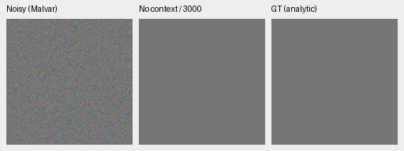
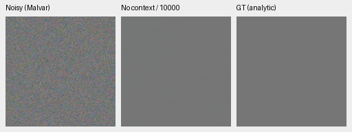
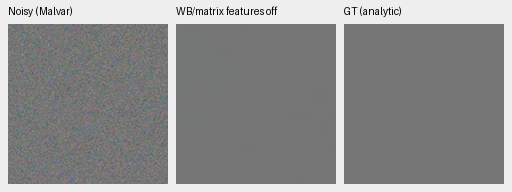
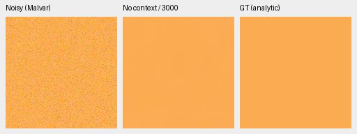
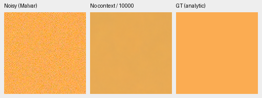
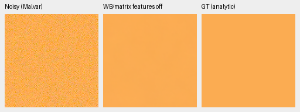

# Colored flat fields expose a late color error

The original fresh no-context model's 10k checkpoint shifts a uniform warm field
and one channel-permuted field, although its neutral flat remains accurate. The error is
also present with ADC-only input: this selected failure does not require texture,
geometric augmentation at inference, or substantial sensor noise. It does not
identify the training cause or establish a general photographic regression.
[Complete observations, float predictions, checkpoint hashes and native crops](results/colored-flat-camera-diagnostic.json).

This follows the [matched fabric color diagnosis](fresh-color-mean-diagnostic.md).
It compares two boundaries on the same original seed 48 training trajectory, with
EMA inference in CPU FP32. No image correction or new training is performed.

## Unclipped camera RGB errors

Values are prediction-minus-exact-target means in normalized camera RGB,
averaged across RGGB/BGGR/GRBG/GBRG. Each has one fixed noise observation;
these are descriptive means, not confidence intervals or independent training
replicates. Camera fields are native 256px, measured on ROI[48,48,160,160].

ADC-only, shot=read=0 with 16-bit quantization/black.03:

| Uniform camera color | Original 3k | Original 10k | 10k, camera-feature slice zero |
| --- | --- | --- | --- |
| neutral | [+0.000416, +0.000171, +0.000117] | [-0.000106, +0.000017, -0.000174] | [-0.000161, +0.000115, -0.000290] |
| fabric-mean | [+0.000513, -0.001384, -0.000390] | [-0.051225, -0.014462, -0.002420] | [+0.000890, -0.000074, +0.000648] |
| fabric-cyclic-gbr | [-0.003801, -0.002597, -0.001271] | [-0.046307, -0.020275, -0.048522] | [-0.007779, -0.006589, -0.009767] |
| fabric-cyclic-brg | [+0.001108, +0.000339, -0.002032] | [-0.000787, -0.001416, -0.001282] | [-0.000458, -0.000456, +0.000369] |

ISO12800 protocol prior, shot=.00256, read variance=.0000262144:

| Uniform camera color | Original 3k | Original 10k | 10k, camera-feature slice zero |
| --- | --- | --- | --- |
| neutral | [+0.000304, +0.000204, +0.000280] | [+0.000292, +0.000565, +0.000301] | [+0.000281, +0.000903, +0.000280] |
| fabric-mean | [-0.000922, -0.001372, +0.001495] | [-0.075393, -0.016876, -0.004066] | [+0.000125, +0.000065, +0.000292] |
| fabric-cyclic-gbr | [-0.004061, -0.003829, +0.009870] | [-0.085437, -0.016481, -0.066515] | [-0.024805, -0.004849, -0.014551] |
| fabric-cyclic-brg | [+0.000058, -0.000056, -0.002220] | [-0.000851, +0.002110, -0.001914] | [-0.001209, +0.003710, +0.000468] |

The realized observed-minus-GT CFA means are much smaller: maximum absolute
phase mean across the warm field's four patterns is about .000647 under the
high-noise prior. ADC-only observed phase errors for all fields are below
.0000073. All targets lie strictly inside the camera and rendered linear-sRGB
range. There are no fine lines, texture or target clipping in these fields.
The two cyclic colors permute the warm camera RGB channels; they are not a
representative color-space sweep.

## Inference counterfactual

For the last table column, only
`pretrained_rgb.measurement_adapter.weight[:,9:21]` is zeroed in memory on the
same 10k EMA. Those inputs encode WB and the camera matrix. Exactly 704 nonzero
scalars change; the first nine columns, bias and every other tensor remain
exact. Physical WB/matrix reconstruction, CFA/noise conditioning and anchors
remain active. No output gains, target fitting or checkpoint rewrite occur.

This largely repairs the warm field, while the cyclic-GBR high-noise field
retains a substantial error. It shows sensitivity to this learned input path,
without identifying why training learned that behavior. The earlier
[V46 full review](camera-projection-v46-review.md) of the same intervention on
V43 lost known/unseen primary means despite photo/procedural PSNR gains.
The evidence does not justify disabling camera features by default.

## Native 100% noisy / restored / exact-GT crops

Each panel is 160×160 at one image pixel per PNG pixel. Same source/ROI and common
WB[2,1,1.5], protocol matrix and display exposure×1 across methods; no resizing,
sharpening or per-method transforms. All six displayed observations are RGGB
under the ISO12800 prior above. These are exact uniform analytic targets,
**not real-photo references**. PNGs are 8-bit sRGB previews; statistics use the
unquantized float32 predictions.

Neutral 3k:

Neutral 10k:

Neutral 10k with the camera-feature slice zeroed:

Warm 3k:

Warm 10k:

Warm 10k with the camera-feature slice zeroed:

The warm palette is the exact target camera-RGB mean
[.446082647,.422442681,.096908472] of the earlier saved fabric ROI. Only this
three-number mean is reused; these generated fields contain no photographic
pixels. The parent source and its attribution remain in the linked diagnosis.

## Provenance and checks

| Original no-context checkpoint | SHA256 |
| --- | --- |
| Step 3000 | `6f9948c361cda74a294ad0cc9db4718dfb3fe0a9cc5a4c1cc867e986e0a7eedf` |
| Step 10000 | `0df4ff404c38b8f4b42f6451486e91c97631544b1c817c126f371195942f3af4` |

All 32 saved NPZ observations and 96 float predictions pass complete SHA/dtype/
shape/finite checks. Independent NumPy64 reconstruction of 576 metric fields
differs by at most 3.33e-16. All 18 native panels rerender byte exactly; all noisy
and GT panels agree across methods. All six PNGs were actually viewed.
[Audit driver](../scripts/audit_colored_flats.py); execution drivers and package
snapshots are retained beside the private artifacts recorded in the receipt.
No CUDA context, source-RAW decoding or active-environment change was needed.

Keep these colored fields in future quality reviews alongside neutral flats,
weak texture, full photographs and real captures. Existing optional pooled
sensor losses and prior camera-conditioning trials already have mixed results;
this finding alone is not evidence to promote one. The current V58 schedule,
V43 README reference and protected-final scoring policy remain unchanged.

## A testable smooth-color coverage gap

The procedural smooth branch already includes colored fields: half are neutral,
and half draw three tints uniformly from[.3,1.5], with common intensity/ramps.
Its direct linear-sRGB inputs therefore have a maximum-to-minimum channel ratio
of at most 5. Shared positive geometry/PSF averaging preserves that bound. This
describes the smooth branch before camera conversion, rather than every training
image or reconstructed highlight. The original fresh-training source 8580a4e
has the identical `smooth_scene` syntax tree.

The fixed diagnostic's camera colors convert to these linear-sRGB ratios:

| Palette | Maximum/minimum channel ratio | Within the direct smooth ratio bound? |
| --- | ---: | --- |
| Neutral | 1.00 | Yes |
| Warm fabric mean | 11.32 | No |
| Cyclic GBR | 46.71 | No |
| Cyclic BRG | 4.38 | Yes |

In this chosen four-color grid, the two large late errors occur outside that
bound. A deterministic check of 1,000 current smooth draws finds 511 neutral
samples and a largest ratio 4.78219, consistent with the analytic bound.
[Source confirmation, exact RGB values and finite-sample receipt](results/smooth-palette-coverage.json).

The palette was chosen after the fabric failure. Natural photos, shapes and
native/paired domains may contain these hues, and camera conversion has its own
behavior. This association does not identify the training cause or prove that
wider smooth tints improve quality. It supplies a concrete rationale for a
matched wider-palette experiment after the mature review, with color fidelity,
neutral false detail and photographic/real quality checked together.

The [five-checkpoint mature color review](mature-color-flat-review.md) confirms
that the selected saturated-field error also occurs in the completed ViT-S,
ViT-B and ConvNeXt schedules. ConvNeXt1k and retained V43 provide useful earlier
comparisons; neutral fields remain close. No architecture is promoted by that
small diagnostic.
