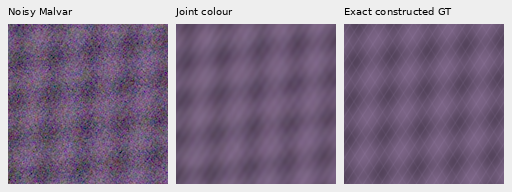
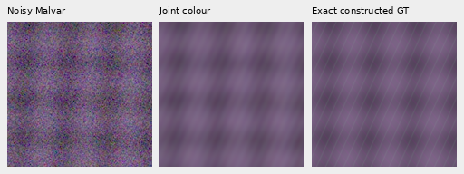
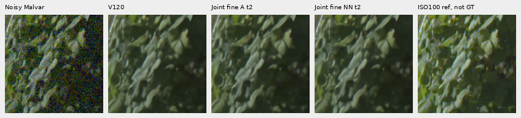
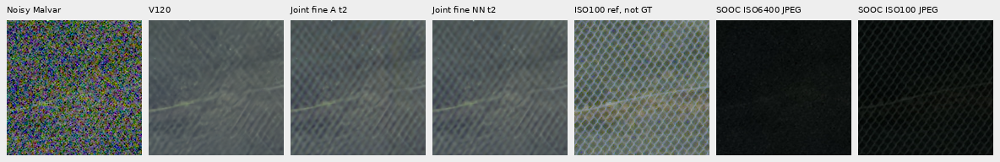

# Fresh coloured fine-wire benchmark

**Complete:192 corrections,400 metric rows,8400 independently checked fields
and40 actually viewed native figures.** Joint support has a small neutral-wire
gain but essentially no signed-colour weak-response gain. All-stage increment
and colour errors remain above V120. The real cab tint improvement does not
establish faithful coloured-wire reconstruction.
The [A-only innovation follow-up](parent-innovation-validation.md) compares
the same color observations and the standing GFX scenes with a different
validation target. The new gate weakens building fringing, with essentially
unchanged signed-color weak response.

[Native100% viewer](images/coloured-fine-wire-v1/native-viewer.html) ·
[131 exact archives,164 executed sources and viewing receipts](results/coloured-fine-wire-v1/publication.json) ·
[Final independent publication check](results/closed-detail-reviews-verification-v1.json).

## Measured quality

Primary analytic arm, averaging both sources and all four CFAs; errors in
sensor-linear DN16. Colour error is the per-pixel RGB increment component
orthogonal to the true RGB contrast, not an image saturation measure.

|Prior/method|Weak response|Quiet RMS|Weak-increment RMS|Weak colour-orthogonal RMS|
|---|---:|---:|---:|---:|
|1600 V120|22.9853%|21.14333|23.31588|13.12802|
|1600 independent fine H1|23.2170%|21.13264|24.33204|14.47137|
|1600 joint fine H1|24.0883%|21.13270|24.29659|14.40242|
|6400 V120|20.0522%|38.76326|34.33265|19.28682|
|6400 independent fine H1|20.0349%|38.97853|36.17596|21.61650|
|6400 joint fine H1|20.0343%|38.97849|36.20982|21.60706|

The1600 mean hides a clear source split. Neutral source0 weak response rises
21.0718%→22.8141%, increment25.66233→25.57474 and colour error
10.21604→10.06778. Signed source1 weak response is essentially unchanged,
25.362225%→25.362461%, while increment23.00174→23.01844 and colour
18.72669→18.73707 worsen. Every signed-source1600 CFA increment error rises,
by0.00327–0.02867 DN16; weak-response differences range only−0.000910 to
+0.000668 percentage points. Neutral-source response gain also varies across
CFAs:−0.00731 to+5.89903 points. These two-source development summaries do
not constitute camera-population evidence.

6400 has no useful weak-response gain. Neutral increment error worsens
37.05686→37.13465; signed increment improves35.29507→35.28499 but remains
above parent's33.04190. The secondary NN arm has the same overall limit:
1600 independent→joint weak23.2211%→24.1155%, increment24.15920→24.13645;
6400 weak20.1044%→20.1045%, increment37.07997→37.12535. Broad-only,
fine-phase, all global/local controls, per-colour gains and every adverse CFA
remain in the archived400 rows and paired-source summary.

All40 figures were inspected individually through10 exact contact sheets.
Fine phase visibly strengthens a diagonal at1600. Fine H1/joint are softer;
both still miss thin exact-GT crossings and signed colour.6400 mostly retains
broad parent structure. Subtle H1/joint differences do not establish accurate
fine-detail recovery.

Noisy Malvar → joint analytic fine H1 → exact constructed GT, source0 then
signed-colour source1 at1600/RGGB/role2:

Both use native ROI`[176,176,160,160]`, display exposure16/contrast1, WB
`[1.55,1,1.7]` and the same fixed fictional matrix. No crop pixels are resized.
Conditioning1600 shot/read`0.00032/4.096e-7`;6400`0.00128/6.5536e-6`.
V120 parent/A-only teacher SHA256
`a9d9b6b4f974e24a6b11e5e740aab32314233a7f53c056cf37c7d2aac1c589fb`;
DINO`691963f0f796aac860d818d59d9d14287a4675612829fbe9467c7f5df8ce5b14`.
Joint model/configuration SHA256
`bcfa4f9b59be5549848d30262569914a1dba4d43aad3a26c5afe02397a2dcb9e`.
Publication metadata binds each board to its input, parent, prediction and matrix.

The same model's completed [standing GFX review](joint-fine-colour-support.md)
retains main DSCF3879/3880 sky/building/foliage/coarse fence and cab
DSCF3842/3835 both ROIs/profiles/both JPEGs. Cab tint is reduced with an
incomplete lattice; building bands remain. Those independent ISO100/AHD/
JPEG references differ in aperture, exposure and motion, **not exact GT**.
They receive no pixel scoring. These saved comparisons accompany this report;
no protected capture is used by the new synthetic generator.

## Construction and preserved execution

This follows the observed colour improvement
and synthetic-response cost of [joint fine support](joint-fine-colour-support.md).
Its purpose is to measure true colour/detail recovery on known coloured
signals, including a negative green contrast. This is a new adaptive synthetic
development benchmark, not untouched camera validation or a training update.

Two new512-native procedural scenes contain a distant bright edge, two
dominant broad nuisance carriers and two finite Gaussian wire families with
unequal strengths. Source0 has neutral increments; source1 has a green strong
increment and magenta weak increment with sensor-RGB contrast`[1,-.3,.7]`.
Wire widths0.4–0.55 native pixels, independent phases/frequencies and a finite
envelope are integrated with8×8 subpixel area samples. There is no optical
blur. Broad structure is intentionally stronger than the fine families, so
the original two-candidate budget cannot be assumed sufficient.

The generator seed202611162200 is fixed before correction outcomes. Four CFAs,
RGGB/BGGR/GRBG/GBRG, and two declared priors,1600 shot/read`0.00032/4.096e-7`
and6400 `0.00128/6.5536e-6`, give16 groups × three independent-noise roles =
48 observations. Roles are background, strong direction, then both directions.
Poisson and signed Gaussian read draws use distinct source/CFA/prior/role
keys; there is no paired-noise coupling, clipping of negative read samples or
new seed selected from quality outcomes. True variance is retained for audit,
but inference receives the declared input-based variance proxy only.

Targets are sensor-linear FP32 with16-bit DN reporting. The fixed fictional
WB`[1.55,1,1.7]` and matrix are declared in the generator and archive. They are
not a fitted camera calibration. No photo, protected capture, RAF, JPEG or
source-drive access enters this cohort. All existing protected media/siblings
remain outside training. The current method's standing GFX comparisons remain
in its separate completed report, with independent references labelled not GT.

The new V120 full-input parents and96 genuine A-only fields are complete:
**48 parent +96 masked =144 root and144 DINO encoder calls**,43.57s excluding
initial model loading. Actual masked arguments are invariant to withheld NaNs;
fingerprints and declared masks are saved. All91 restoration tensors and the
DINO backbone match before/after; no optimizer update occurs. Parent and
masked inference load packed RAW/CFA/WB/matrix only, never targets or true
variance. This is fresh synthetic sensor evidence, separate from the zero-
replay48-case development pilots. All parents here are **V120**; earlier
procedural results used V143, so only within-cohort method contrasts are valid.

Four immutable variants reuse exactly those parents/fields and noise draws:
broad-only guided phase; additional fine phase; independent-colour fine H1;
joint-colour fine H1. Hann512/full-frame geometry, native129/stride32,
32 phase bins and all six global/local controls use fixed threshold2.
The primary contrast is joint versus independent **analytic** fine H1,
with NN secondary and raw-H1/broad/phase controls retained. No new neural
forwards are expected during correction. All192 corrections closed
before target scoring or viewing; no threshold was selected from outcomes.

The intended report pairs weaker sensor-RGB increment response with absolute
quiet/increment errors and colour-orthogonal/per-colour responses. It must
retain adverse cells and at least two native160 noisy/restored/exact-GT
triplets, ROI`[176,176,160,160]`, display exposure16/contrast1, identical WB/
matrix and coordinates across methods. Grey output or lower colour variation
alone is not a success criterion. Two reused constructed geometries are not
camera-population evidence; no calibrated uncertainty claim follows.

Generator checks pass for signed independent RGB increments, deterministic
area rendering, true CFA coordinates under all four layouts, empirical
Poisson/read means/variances, independent role keys and signed read samples.
Seven tests pass. An initial assertion missed one FP32 bright-edge rounding
element by2.5e-10 beyond its tolerance; the corrected bound is two native
FP32 ULPs, far below1 DN16. The original test source/log and initial import-
sorting lint result are preserved. The numerical generator did not change.

The first comparison-controller launch raced its still-running plan preparer
and terminated before its claim or any stage. After the preparer completed,
all four plans were validated before the replacement launch. Exact failure
log/receipt remain; no neural call or correction was repeated. Current owner
983443/create1794896133.83; CPU pairs8/9,10/11,12/13,16/17, two threads/low
priority. Start/runtime RAM48/32GiB, disk96GiB and two-hour per-predictor
deadlines. No automatic restart.

Root: `.cache/experiments/coloured-fine-wire-neural-v1/`.
Dataset/neural plan:
`9374d018157ec40e5d38ebba6738451684dd6ab00b0234a627302cf9d537810d`.
All four comparison plan identities, fresh neural receipts, source snapshots,
launch/early-failure evidence and physical inputs are retained under that root.
[103 exact admission/neural/failure archives and164 frozen sources](results/coloured-fine-wire-admission-v1/publication.json).

All four predictors subsequently completed normally, zero additional neural
calls.288 raw-H1 pair checks and48 input/parent fingerprints agree across
variants. Scoring source was frozen after two known-target tests (perfect
signed colour, and failure of neutralized/absent weak colour) and after all192
corrections closed.400 metric rows and40 fixed-ROI native figures are now
prepared, with19,046,400 crop channels checked by two independent display
functions and reread exactly. The subsequent independent audit recomputes8400
fields, maximum absolute discrepancy`1.1582e-11`, using direct L2/dot products
and a cross-product colour-error identity. It checks all40 figures and the same
19,046,400 channels. Its pixel check uses the audit display helper already
paired with the renderer, not a third independent display implementation.
Audit/view/publication perform zero new neural calls or training updates.
[14 exact completion/source/test/render addendum archives](results/coloured-fine-wire-completed-pre-review-v1/publication.json)
preserve this later state without rewriting admission receipts.
