# Common-error support routing: V166 final quality

V166's common-loss support routing gives a useful **6.10–15.27% lower mean quiet RMS and 17.52–31.30% lower quiet DC color bias versus V165**. The representative amplified crops show less magenta cast. **The spectral support path still nearly closes, mesh response stays near the parent, and standalone flat errors worsen modestly versus V165.** This does not achieve the requested fine dark detail and reliable flat regions together.

Quiet RMS falls from 4.812567/7.481974 to **4.077825/6.542553 DN16 raw** at ISO6400/12800, and from 4.287011/6.763055 to **3.992425/6.350538 EMA**. Against V165, 27/32 raw and 24/32 EMA inputs improve; five/eight worsen, with maximum increases 0.050672/0.339235 DN16. Against V143, **23/32 quiet inputs remain worse at both endpoints**: raw means are 4.59–6.34% higher and EMA 2.40–3.22% higher. Whole mixed-scene RMS remains 0.183–0.449% above V143. V158 retains stronger quiet accuracy.

The independent original-pixel decomposition attributes the useful change mainly to lower color bias. ISO6400 raw/EMA DC RMS becomes **2.305193/2.162425 DN16**, and ISO12800 **3.564040/3.240171**, versus V165's 3.355499/2.621823 and 4.992170/3.956646. These means remain 7.26–25.10% above V143. Quiet spatial changes versus V165 are small: raw −0.302%/−0.034%, EMA −0.051%/+0.066%. Only 18/32 raw and 15/32 EMA spatial errors improve versus control. Lower total quiet error does not imply a general grain improvement or absence of colored mottle.

Native512 full-flat means worsen **0.199–0.312% versus V165**, with 40/48 raw and 45/48 EMA inputs worse; maximum increases are 0.420338/0.319733 DN16. Coarse block32 means worsen **0.216–0.376%**, and **all 48 inputs worsen at both endpoints versus control**. Versus V143, 46/48 full errors and all 48 coarse errors still improve at both endpoints; means are 0.410–0.686% lower full and 0.302–0.373% lower coarse. V165 retains stronger full-flat accuracy and V157 stronger coarse accuracy. The broad residual flat patches remain visible under the fixed amplification.

Mesh response is **0.02198277 raw / 0.02201508 EMA**, about **2.198%/2.202% of exact constructed GT amplitude**, still slightly below V143's 0.02202090. Changes of +0.108%/+0.025% versus V165 do not recover the lost detail; V161 and V164 retain much stronger response. Present full RMS worsens 0.131%/0.078%, actual blank RMS 0.338%/0.185%, and exact-absence full RMS 0.299%/0.177% versus V165. No convincing new complete real cab crossings appear in either window or prior.

The predeclared archived-metadata reduction finds mean support below 1e-4 on all 256 present-mesh cases at both candidate endpoints. Median support is **6.98e-7 raw / 7.48e-7 EMA**, versus control 2.88e-6/2.96e-6. Pre-support coefficient RMS also falls. The common loss has zero direct support-parameter derivative by construction and by the saved-checkpoint probe, but other losses still train support and its inputs still change. These scalar means do not isolate why the gate closes; full support maps were not retained. A separate [post-hoc training trajectory](results/v166-training-support-trajectory-v1.json) identifies its pre-update batch-mean scope explicitly. [Original archived statistics and exact ADC checks](results/v166-archived-support-summary-v1.json).

Natural-photo changes remain tiny: six of eight full-RMS cohort means improve versus V165 and two worsen, ranging from −0.01594% to +0.01139%. All eight band-error means worsen slightly, although seven of eight band-response means rise; all eight response means remain below V143. Fine organic texture stays soft. All eight raw ADC-photo outputs and seven of eight EMA outputs equal V143 exactly. The remaining EMA output differs in one RGB value, by only **0.000244137 DN16**; its mean score change is negligible. All 192 ADC constants retain exact parent outputs. Sloped ADC full RMS worsens 0.0171–0.0176% versus V165, while coarse RMS improves 0.0413–0.0428%; V150's stronger ADC-photo result remains useful.

All **72 native figures / 24 triplets** were actually inspected in 18 original-detail sheets. Amplified quiet fields show a visible reduction in the strong V165 raw magenta casts, with persistent green/blue/pink broad patches. Standalone flat differences are small and do not remove the mottle. The main coarse fence is preserved; foliage and fine photographic textures stay softened. The fixed +2EV sky looks smooth, which is not a flat-safety proof. ISO100 f/5.6 and both camera JPEGs remain qualitative references rather than exact GT.

The candidate routes the common term through fixed support on all 691 paired batches, including 71 zero-weight ADC batches; 620 batches have nonzero total common supervision. Pre-clip norms exceed one on 460/900 candidate supervised batches versus 454/900 control batches. All 2,000 actual weighted FP32 loss totals reconstruct bit-exactly, and all 1,000 unit/mask records pass. These checks establish the intended implementation, not a causal explanation of the quality tradeoff. Both 1k heads, four endpoints, all 822 cases and independent metric/native audits are complete. The original telemetry failure, three discarded forwards and adopted parity remain preserved. One auxiliary copy kept an old version prefix; its [canonical naming record](results/v166-auxiliary-copy-naming-v1.json) preserves identical bytes without recomputation.

Retain this quiet-color option alongside V165's stronger total-flat/grain result, V161/V164 detail response, V157 coarse accuracy and V158 quiet accuracy. The routing change alone did not keep the recovery path open. [All machine comparisons and viewing evidence](results/v166-quality-claims-v1.json) retain gains, per-case costs and the remaining fence failure together. The user's fine dark detail and flat-region objective remains unresolved.

[Final evidence and immutable sources](results/v166-common-support-routing-final-v1.json) · [Native pixels, source ROIs, conditioning, exposure and checkpoint hashes](images/v166-common-support-routing-v1/manifest-v1.json).

## Response and actual blank error

RMS values are camera-RGB DN16. Response1 means the exact constructed mesh amplitude. Blank error measures actual target error; added blank RMS measures displacement from V143.

| Method | Present full RMS | Response | Actual blank RMS | Blank spatial RMS | Added blank RMS |
| --- | ---: | ---: | ---: | ---: | ---: |
|V143|9.111243|0.02202090|5.523323|5.343113|0.00000000|
|Common ctrl raw|9.074446|0.02195898|5.470216|5.295156|0.37809509|
|Common ctrl EMA|9.087227|0.02200951|5.488723|5.303904|0.35323757|
|Routed common raw|9.086327|0.02198277|5.488693|5.310917|0.33322959|
|Routed common EMA|9.094270|0.02201508|5.498850|5.314341|0.31587994|
|Existing periodic detail|8.586126|0.07089755|5.523328|5.343118|0.00063557|

## Quiet neighbors and coarse fields

| Prior | Method | Whole RMS | Quiet RMS | Quiet spatial RMS |
| --- | --- | ---: | ---: | ---: |
|ISO6400|V143|27.105631|3.898845|3.268502|
|ISO6400|Common ctrl raw|27.372595|4.812567|3.278449|
|ISO6400|Common ctrl EMA|27.241772|4.287011|3.265355|
|ISO6400|Routed common raw|27.227403|4.077825|3.268534|
|ISO6400|Routed common EMA|27.167656|3.992425|3.263686|
|ISO12800|V143|36.747466|6.152652|5.341833|
|ISO12800|Common ctrl raw|37.177695|7.481974|5.325421|
|ISO12800|Common ctrl EMA|36.939700|6.763055|5.318190|
|ISO12800|Routed common raw|36.909905|6.542553|5.323613|
|ISO12800|Routed common EMA|36.814849|6.350538|5.321692|

Quiet bias is averaged per RGB channel before its Euclidean RMS. The independent pixel audit verifies total squared = spatial squared + DC squared per case; means of RMS values do not share that identity.

| Prior | Method | Quiet DC RMS DN16 |
| --- | --- | ---: |
| iso6400-prior | parent | 2.016074 |
| iso6400-prior | common-control-raw-step1000 | 3.355499 |
| iso6400-prior | common-control-EMA-step1000 | 2.621823 |
| iso6400-prior | routed-common-raw-step1000 | 2.305193 |
| iso6400-prior | routed-common-EMA-step1000 | 2.162425 |
| iso12800-prior | parent | 2.849060 |
| iso12800-prior | common-control-raw-step1000 | 4.992170 |
| iso12800-prior | common-control-EMA-step1000 | 3.956646 |
| iso12800-prior | routed-common-raw-step1000 | 3.564040 |
| iso12800-prior | routed-common-EMA-step1000 | 3.240171 |

|Flat test|V143|Common ctrl raw|Common ctrl EMA|Routed common raw|Routed common EMA|
| --- | ---: | ---: | ---: | ---: | ---: |
|Native512 ISO6400 full RMS|18.546808|18.389322|18.433963|18.446607|18.470735|
|Native512 ISO6400 spatial RMS|18.235130|18.093024|18.128634|18.156755|18.168298|
|Native512 ISO6400 block32 RMS|13.440561|13.340227|13.368441|13.390446|13.399955|
|Native512 ISO12800 full RMS|24.071890|23.837530|23.870109|23.906790|23.939929|
|Native512 ISO12800 spatial RMS|23.596861|23.401662|23.446909|23.481979|23.497030|
|Native512 ISO12800 block32 RMS|17.932544|17.803392|17.837810|17.865669|17.876290|
|Older native256 ISO12800 full RMS|27.233548|27.014856|27.058890|27.091806|27.110646|
|Older native256 ISO12800 spatial RMS|26.017191|25.820092|25.862237|25.897830|25.912015|
|Older native256 ISO12800 block32 RMS|19.539875|19.413954|19.444776|19.470894|19.480622|

## Natural detail and ADC controls

|Photo test|V143|Common ctrl raw|Common ctrl EMA|Routed common raw|Routed common EMA|
| --- | ---: | ---: | ---: | ---: | ---: |
|Retained512 faint full RMS|33.963754|33.954970|33.958618|33.958839|33.961352|
|Retained512 faint band error|0.824639|0.824672|0.824662|0.824704|0.824694|
|Retained512 faint band response|0.298560|0.297790|0.297856|0.297886|0.297918|
|Retained512 dark full RMS|29.097715|29.101295|29.100958|29.100272|29.100222|
|Retained512 dark band error|0.661447|0.661438|0.661436|0.661448|0.661449|
|Retained512 dark band response|0.531446|0.530436|0.530482|0.530654|0.530644|
|Organic384 faint full RMS|37.469061|37.471409|37.474037|37.471202|37.471776|
|Organic384 faint band error|0.924117|0.924106|0.924099|0.924130|0.924123|
|Organic384 faint band response|0.150701|0.150263|0.150298|0.150274|0.150298|
|Organic384 dark full RMS|33.685796|33.700100|33.697031|33.694728|33.692042|
|Organic384 dark band error|0.781612|0.781583|0.781577|0.781589|0.781586|
|Organic384 dark band response|0.398945|0.398256|0.398272|0.398350|0.398339|

|ADC test|V143|Common ctrl raw|Common ctrl EMA|Routed common raw|Routed common EMA|
| --- | ---: | ---: | ---: | ---: | ---: |
|Photo full RMS|18.149871|18.149871|18.149871|18.149871|18.149871|
|Photo band error|0.101855|0.101855|0.101855|0.101855|0.101855|
|Photo band response|0.968329|0.968329|0.968329|0.968329|0.968329|
|Sloped512 full RMS|3.771369|3.770831|3.770815|3.771474|3.771478|
|Sloped512 spatial RMS|3.397249|3.396711|3.396696|3.397373|3.397378|
|Sloped512 block32 RMS|0.574652|0.574869|0.574877|0.574632|0.574631|
|Sloped512 crop block32 RMS|0.088145|0.088148|0.088148|0.088145|0.088145|
|Sloped512 worst absolute DC|11.176981|11.176846|11.176815|11.176578|11.176570|

## Fixed native comparisons

Every cell is native 160×160; crop pixels are never resized. All RAW methods within each board share source coordinates, camera display transform, exposure and contrast. JPEG cells retain native sRGB8 without exposure/contrast changes. Both final raw/EMA endpoints of both heads are shown, with eight retained V156/V157/V158/V159/V160 ordinary/V160 paired/V161/V162 columns.

The main scene is DSCF3879 ISO6400 versus DSCF3880 ISO100 f/5.6. The fine cab mesh uses DSCF3842 versus DSCF3835 and both camera JPEGs. Aperture, shutter, moving subjects and processing differ: ISO100 views are qualitative references, not exact GT. All30 real score rows stay unscored.

### Mesh and exact absence

mesh-seed2026112302-present-iso6400-prior-RGGB; ROI `[176, 176, 160, 160]`, RAW exposure 8, contrast 1.

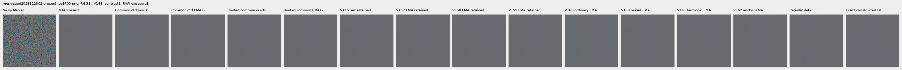

mesh-seed2026112302-present-iso6400-prior-RGGB; ROI `[176, 176, 160, 160]`, RAW exposure 8, contrast 40.

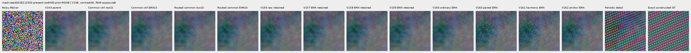

mesh-seed2026112309-present-iso6400-prior-RGGB; ROI `[176, 176, 160, 160]`, RAW exposure 8, contrast 1.

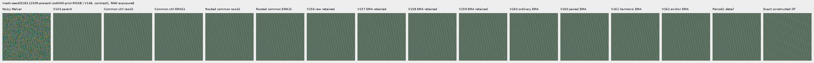

mesh-seed2026112309-present-iso6400-prior-RGGB; ROI `[176, 176, 160, 160]`, RAW exposure 8, contrast 40.

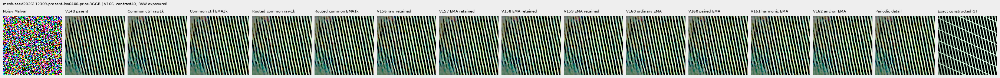

mesh-seed2026112304-absent-iso6400-prior-RGGB; ROI `[165, 0, 160, 160]`, RAW exposure 8, contrast 40.

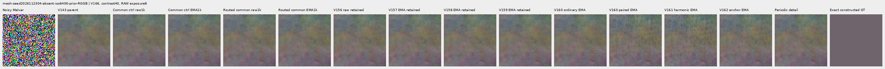

### Quiet neighbors beside edges

mixed-vertical-step-iso6400-prior-RGGB; ROI `[80, 176, 160, 160]`, RAW exposure 8, contrast 40.

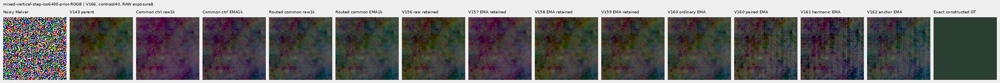

mixed-vertical-step-iso6400-prior-RGGB; ROI `[240, 176, 160, 160]`, RAW exposure 8, contrast 1.

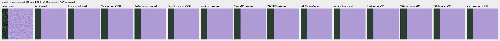

mixed-vertical-step-iso12800-prior-RGGB; ROI `[80, 176, 160, 160]`, RAW exposure 8, contrast 40.

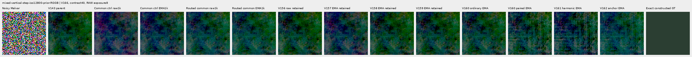

mixed-vertical-step-iso12800-prior-RGGB; ROI `[240, 176, 160, 160]`, RAW exposure 8, contrast 1.

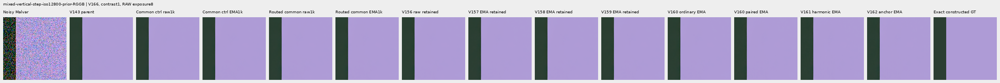

mixed-narrow-bar-iso6400-prior-RGGB; ROI `[80, 176, 160, 160]`, RAW exposure 8, contrast 40.

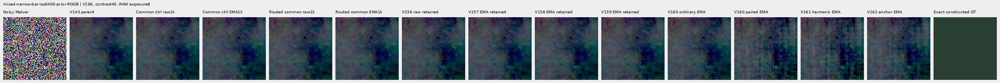

mixed-narrow-bar-iso6400-prior-RGGB; ROI `[240, 176, 160, 160]`, RAW exposure 8, contrast 1.

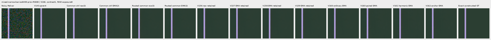

mixed-narrow-bar-iso12800-prior-RGGB; ROI `[80, 176, 160, 160]`, RAW exposure 8, contrast 40.

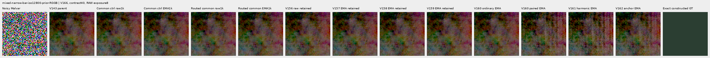

mixed-narrow-bar-iso12800-prior-RGGB; ROI `[240, 176, 160, 160]`, RAW exposure 8, contrast 1.

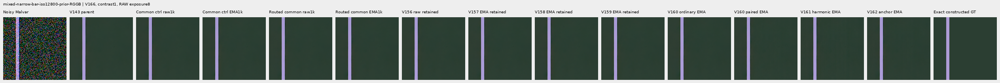

mixed-slanted-step-iso6400-prior-RGGB; ROI `[80, 176, 160, 160]`, RAW exposure 8, contrast 40.

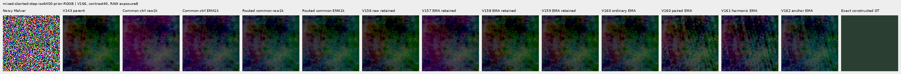

mixed-slanted-step-iso6400-prior-RGGB; ROI `[240, 176, 160, 160]`, RAW exposure 8, contrast 1.

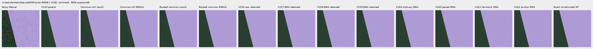

mixed-slanted-step-iso12800-prior-RGGB; ROI `[80, 176, 160, 160]`, RAW exposure 8, contrast 40.

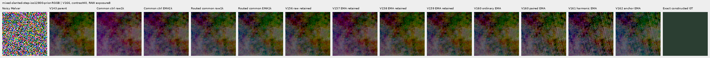

mixed-slanted-step-iso12800-prior-RGGB; ROI `[240, 176, 160, 160]`, RAW exposure 8, contrast 1.

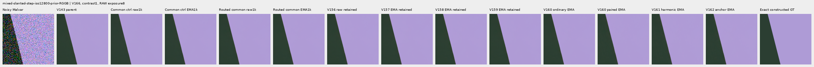

mixed-striped-patch-iso6400-prior-RGGB; ROI `[80, 176, 160, 160]`, RAW exposure 8, contrast 40.

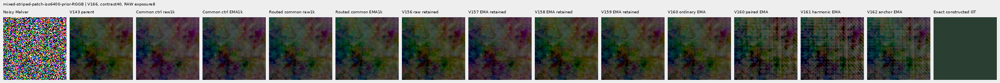

mixed-striped-patch-iso6400-prior-RGGB; ROI `[240, 176, 160, 160]`, RAW exposure 8, contrast 1.

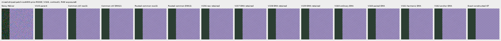

mixed-striped-patch-iso12800-prior-RGGB; ROI `[80, 176, 160, 160]`, RAW exposure 8, contrast 40.

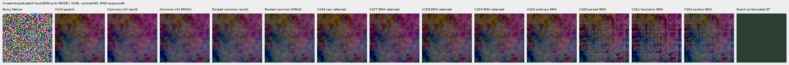

mixed-striped-patch-iso12800-prior-RGGB; ROI `[240, 176, 160, 160]`, RAW exposure 8, contrast 1.

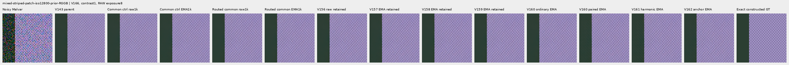

### Standalone flats and slopes

gray-l0.02-adc-only-RGGB; ROI `[48, 48, 160, 160]`, RAW exposure 4, contrast 40.

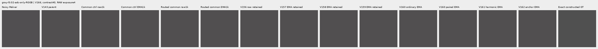

gray-l0.02-iso12800-prior-RGGB; ROI `[48, 48, 160, 160]`, RAW exposure 4, contrast 40.

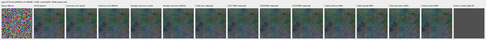

flat512-gray-l0.02-adc-only-RGGB; ROI `[176, 176, 160, 160]`, RAW exposure 4, contrast 40.

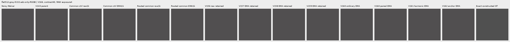

flat512-gray-l0.02-iso6400-prior-RGGB; ROI `[176, 176, 160, 160]`, RAW exposure 4, contrast 40.

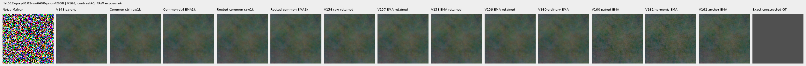

flat512-gray-l0.02-iso12800-prior-RGGB; ROI `[176, 176, 160, 160]`, RAW exposure 4, contrast 40.

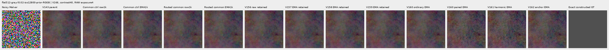

flat512-h210-s0.50-l0.02-iso6400-prior-RGGB; ROI `[176, 176, 160, 160]`, RAW exposure 4, contrast 40.

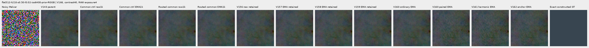

flat512-gray-l0.18-iso12800-prior-RGGB; ROI `[176, 176, 160, 160]`, RAW exposure 1, contrast 8.

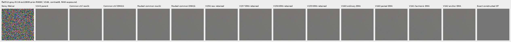

flat512-gray-l0.90-iso12800-prior-RGGB; ROI `[176, 176, 160, 160]`, RAW exposure 1, contrast 4.

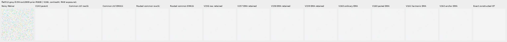

V150-control-ADC-plane0-RGGB; ROI `[176, 176, 160, 160]`, RAW exposure 45, contrast 8.

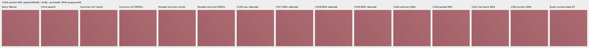

V150-control-ADC-plane1-RGGB; ROI `[176, 176, 160, 160]`, RAW exposure 9, contrast 8.

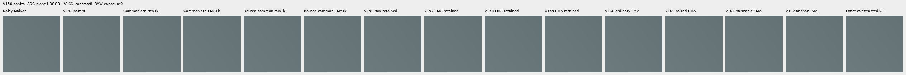

V150-control-ADC-plane2-RGGB; ROI `[176, 176, 160, 160]`, RAW exposure 1, contrast 8.

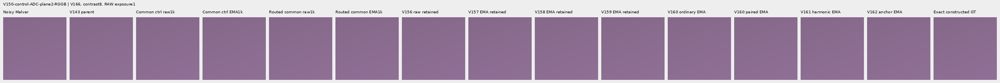

V150-control-ADC-plane3-RGGB; ROI `[176, 176, 160, 160]`, RAW exposure 0.24, contrast 8.

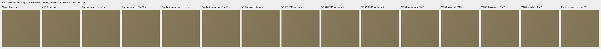

### Natural photographic detail

organic-02a76fd33b5e1414a0504f0b3f0aeb03a569b6f4-photo-faint-RGGB; ROI `[112, 112, 160, 160]`, RAW exposure 14.3883, contrast 8.

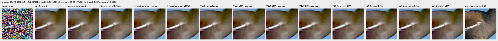

organic-dabacecd4780a1c230f8e9fce6ca1a604bdeab4c-photo-dark-RGGB; ROI `[112, 112, 160, 160]`, RAW exposure 102.758, contrast 1.

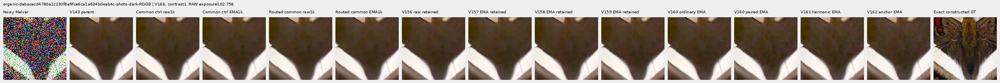

organic-6b3920bceba82d95ecf9351d47f6f94267694bd0-photo-dark-RGGB; ROI `[112, 112, 160, 160]`, RAW exposure 64.0491, contrast 1.

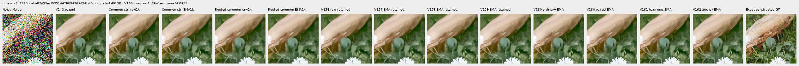

photo-3e638bbb56ed80abc88939468783e3bf9b92ee77-photo-faint-RGGB; ROI `[176, 176, 160, 160]`, RAW exposure 12.1494, contrast 8.

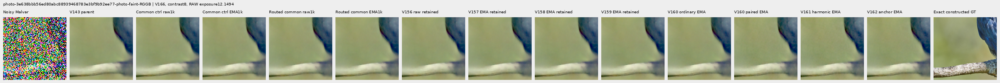

photo-3e638bbb56ed80abc88939468783e3bf9b92ee77-photo-dark-RGGB; ROI `[176, 176, 160, 160]`, RAW exposure 80.9959, contrast 1.

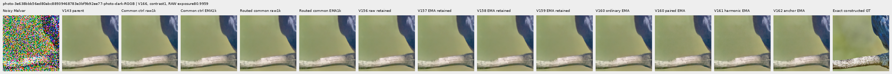

V150-control-bark-contrast0p025-adc-RGGB; ROI `[48, 48, 160, 160]`, RAW exposure 1, contrast 40.

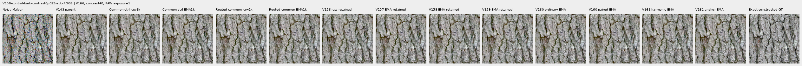

V150-control-raccoon-fur-contrast0p025-adc-RGGB; ROI `[48, 48, 160, 160]`, RAW exposure 1, contrast 40.

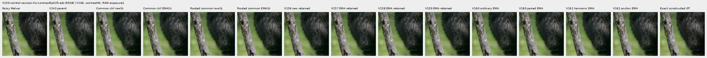

### Protected real GFX scenes

main-overcast-sky; ROI `[176, 176, 160, 160]`, RAW exposure 4, contrast 1.

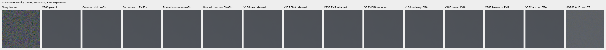

main-building-detail; ROI `[176, 176, 160, 160]`, RAW exposure 4, contrast 1.

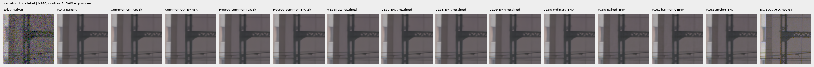

main-foliage; ROI `[176, 176, 160, 160]`, RAW exposure 4, contrast 1.

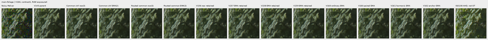

main-chain-link-fence; ROI `[176, 176, 160, 160]`, RAW exposure 4, contrast 1.

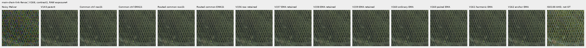

mesh-nominal; ROI `[206, 229, 160, 160]`, RAW exposure 16, contrast 1.

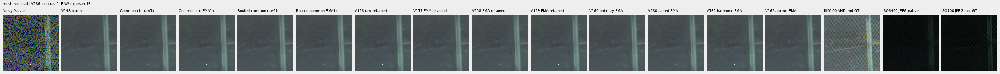

mesh-nominal; ROI `[426, 189, 160, 160]`, RAW exposure 16, contrast 1.

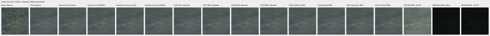

mesh-profile3879; ROI `[206, 229, 160, 160]`, RAW exposure 16, contrast 1.

mesh-profile3879; ROI `[426, 189, 160, 160]`, RAW exposure 16, contrast 1.

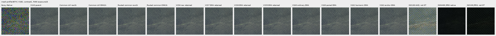

### Noisy, restored, exact constructed GT triplets

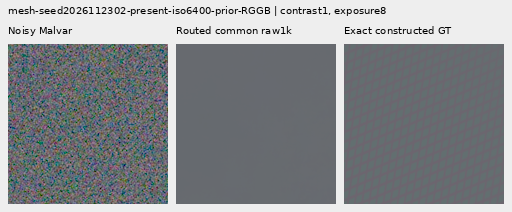

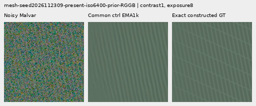

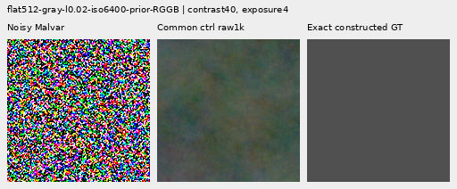

## Training, architecture and validation

Two fresh identical 124,909-parameter / 47-tensor V165 heads reuse the same 1,000 V160 batches. Both use common-error weight1/unit16 DN16, pair-difference weight1/floor2 DN16/epsilon .003 and flat-anchor .25. All base losses, numerical loss values, initialization, AdamW/LR/clip/EMA and inference are unchanged. All89 neural modules remain byte-identical.

Only the candidate common-loss derivative holds the actual support activation fixed. Direct spectral and spatial RGB derivatives remain; direct gate gradients and the indirect proposal-to-support route are removed for this term. Other losses still train support. This is deliberately a surrogate adjoint, not the finite-difference gradient of the numerical forward. Actual support still multiplies the correction; there is no forced gate floor. Target, pair and reference metadata never enter inference or the routing helper.

Candidate training replays FFT synthesis and fixed Malvar on691 paired batches, including71 zero-weight ADC batches. This adds computation without another neural root forward or inference parameter. The gate can still close due to other losses or changed inputs; the intervention does not guarantee detail or flat safety.

A fixed four-call/16-image training-prefix diagnostic used V164 open raw and V165 nearly closed raw checkpoints on the original first mesh512 and photo256 batches. Eight full-parameter adjoint evaluations and independent replay of376 saved parameter arrays confirm exact values/loss, zero routed local-support gradients, unchanged direct RGB gradients and surviving direct spectral gradients. These are training diagnostics, not held-out quality evidence. [Probe and sources](results/v166-common-support-routing-motivation-v1.json).

The control exactly reproduces all1,000 V165 pair-common trace rows and final raw/EMA/Adam states, plus1,644 actual predictions before storage adoption. The candidate keeps1,644 new external arrays. Historical comparisons mix interventions; CFA placements, reused procedural recipes and this adaptive cohort are related, not independent scene replications or blind generalization evidence.

The retained cache has4,000 frames:1,382 present/background pairs and1,236 ordinary frames from2,618 scene/patch instances. Its486 photo pairs visit268 free-photo IDs;234 reduce contrast and245 use reviewed ROIs. Geometry precedes area2 after bin4; optical blur is zero. All18 held-out IDs and protected captures/JPEGs/siblings remain excluded. No new scenes, noise or parent/DINO predictions are constructed. [V160 construction evidence](paired-response.md).

All238 CPU checks pass, including17 new independent routing checks across allCFAs, exact signed-zero forward values, intended Malvar adjoints, target detachment, zeroADC and ordinary gate-graph preservation. Corrected8+2 model/EMA/Adam/RNG restoration passes; first ten complete smoke/train rows match. The original completed28-context/56-root parity and20 CUDA leaf checks are adopted without rerunning. Four strict CPU endpoint loads and94 finite final Adam states pass.

The original smoke failed after three forwards because new telemetry tried converting a complex FFT RMS to float. No checkpoint or full training existed. Corrected v2 sources use magnitude RMS; all original bytes are retained. The corrected smoke starts fresh because no restorable checkpoint exists. A separate import preflight retained an old reviewer module name; a new v3 preparation corrected it before the review queue launched, with zero scientific calls. [Failure and correction](results/v166-telemetry-correction-v2.json).

`common-control`: 454/900 supervised batches clip; pre-clip norm median 1.015648, maximum 479.207886.

`routed-common`: 460/900 supervised batches clip; pre-clip norm median 1.071287, maximum 479.207886.

The 100 zero-gradient ADC batches advance Adam/EMA clocks. Gradient norms describe optimization pressure; they do not isolate the cause of a quality change.

The independent audit checks 40,210 scalars across 4,686 rows and 476 Decimal reductions; maximum scalar difference is 5.12e-13. All 72 native images / 24 triplets were actually viewed in 18 original-detail sheets; 61,824,000 RGB channels were independently checked.

Actual scientific work totals5,371 root calls /11,452 head images: successful main schedule5,364/11,424 (56 adopted parity,20 corrected smoke,2,000 training,3,288 review), plus three failed-prefix roots/12images and four motivation roots/16images. Twenty inherited CUDA leaf checks and eight probe parameter-adjoint evaluations are separate. All15 original/corrected/failed/probe owners are terminal. One scientific smoke failure is preserved; no full-training restart occurred. All1,644 new main arrays /4.421GiB and four diagnostic array files remain external. Local/external reserves are56/128GiB plus.5GiB projection margin and.25GiB remaininglocal artifact bound. Original RAW files and /mnt/dataz remain unused.

## Actual training objectives, units and inherited masks

Independent FP32 recombination of the recorded components reproduces all 2,000 actual weighted total losses bit-exactly, including zero ADC totals. This checks weights and conditional routing; it does not recompute training targets or losses from full training predictions, which were not retained. Output-level semantics are checked separately in the CPU/CUDA and retained-prefix diagnostic. The recorded common loss can be positive on ADC pairs even though its total supervision is zero.

| Domain | ADC only | Arm | Batches | Pairs | Common supervised batches | Mean recorded common loss |
| --- | --- | --- | ---: | ---: | ---: | ---: |
| mesh | False | common-control | 307 | 614 | 307 | 0.092403 |
| mesh | False | routed-common | 307 | 614 | 307 | 0.092407 |
| photo | False | common-control | 214 | 428 | 214 | 1.032940 |
| photo | False | routed-common | 214 | 428 | 214 | 1.033080 |
| flat | True | common-control | 12 | 0 | 0 | 0.000000 |
| flat | True | routed-common | 12 | 0 | 0 | 0.000000 |
| mixed | False | common-control | 139 | 0 | 0 | 0.000000 |
| mixed | False | routed-common | 139 | 0 | 0 | 0.000000 |
| weak | False | common-control | 99 | 198 | 99 | 0.152707 |
| weak | False | routed-common | 99 | 198 | 99 | 0.152790 |
| flat | False | common-control | 141 | 0 | 0 | 0.000000 |
| flat | False | routed-common | 141 | 0 | 0 | 0.000000 |
| mesh | True | common-control | 34 | 68 | 0 | 0.001152 |
| mesh | True | routed-common | 34 | 68 | 0 | 0.001152 |
| photo | True | common-control | 29 | 58 | 0 | 0.300848 |
| photo | True | routed-common | 29 | 58 | 0 | 0.300847 |
| mixed | True | common-control | 17 | 0 | 0 | 0.000000 |
| mixed | True | routed-common | 17 | 0 | 0 | 0.000000 |
| weak | True | common-control | 8 | 16 | 0 | 0.000619 |
| weak | True | routed-common | 8 | 16 | 0 | 0.000619 |

An independent NumPy reconstruction verifies all 1,000 actual records / 2,000 fingerprints: both arms use identical 2 DN16-floor pair-difference units derived from original retained mean shot-increment variances. The original 16 DN16 cached arrays are reconstructed separately. These are increment training proxies rather than post-ADC or restored-RGB covariance. All 1,000 actual masks replay the already independent V162 oracle on identical targets and unchanged mask code through V165; no new independent mask computation is claimed.

| Domain | ADC only | Pairs | Median difference unit DN16 | P90 unit | Maximum unit |
| --- | --- | ---: | ---: | ---: | ---: |
| mesh | False | 614 | 8.604690 | 25.789597 | 88.750217 |
| photo | False | 428 | 61.038446 | 270.123829 | 853.877535 |
| weak | False | 198 | 17.108980 | 58.000702 | 110.375437 |
| mesh | True | 68 | 2.000000 | 2.000000 | 2.000000 |
| photo | True | 58 | 2.000000 | 2.000000 | 2.000000 |
| weak | True | 16 | 2.000000 | 2.000000 | 2.000000 |

The unchanged detached flat-target mask requires per-channel truncated 17×17 range at most 1 DN16. Eligible weak gradients retain their actual targets. Its pseudo-Huber uses 16 DN16 units and a whole-image denominator, so coverage controls term weight. Mean batch fraction reflects that denominator; pixel-weighted fraction accounts for mixed context sizes. ADC masks remain recorded despite zero total supervision. Coverage does not establish inference flatness.

| Domain | ADC only | Batches | Mean batch eligible fraction | Pixel-weighted eligible fraction |
| --- | --- | ---: | ---: | ---: | ---: |
| mesh | False | 307 | 0.699702 | 0.699702 |
| mesh | True | 34 | 0.667894 | 0.667894 |
| weak | False | 99 | 0.502555 | 0.502555 |
| weak | True | 8 | 0.500000 | 0.500000 |
| photo | False | 214 | 0.522321 | 0.522321 |
| photo | True | 29 | 0.507665 | 0.507665 |
| flat | False | 141 | 0.688589 | 0.688589 |
| flat | True | 12 | 0.646564 | 0.646564 |
| mixed | False | 139 | 0.907641 | 0.907641 |
| mixed | True | 17 | 0.907094 | 0.907094 |

[Original protocol](results/v166-common-support-routing-v1/original-protocol.md) · [Immutable preparation](results/v166-common-support-routing-preparation-v1.json) · [Independent publication verification](results/v166-common-support-routing-publication-verification-v1.json).

## Photographic credits

Derived native targets/crops retain the respective source licenses; transformations include linearization, area binning and exposure/contrast changes. Source IDs and ROIs are in the manifest.

| Source | Author | License |
| --- | --- | --- |
| [File:Emamzadeh Esmaeil roof.jpg](https://commons.wikimedia.org/wiki/File:Emamzadeh_Esmaeil_roof.jpg) | مانفی | [CC BY-SA 4.0](https://creativecommons.org/licenses/by-sa/4.0) |
| [File:HP-85-IMG 0439.jpg](https://commons.wikimedia.org/wiki/File:HP-85-IMG_0439.jpg) | Rama & Musée Bolo | [CC BY-SA 2.0 fr](https://creativecommons.org/licenses/by-sa/2.0/fr/deed.en) |
| [File:Spangled Drongo - AndrewMercer - DSC00966.jpg](https://commons.wikimedia.org/wiki/File:Spangled_Drongo_-_AndrewMercer_-_DSC00966.jpg) | Andrew Mercer (www.baldwhiteguy.co.nz) | [CC BY-SA 4.0](https://creativecommons.org/licenses/by-sa/4.0) |
| [File:Naxos Chora 2025-06-14 0505.jpg](https://commons.wikimedia.org/wiki/File:Naxos_Chora_2025-06-14_0505.jpg) | Tsui | [CC BY-SA 4.0](https://creativecommons.org/licenses/by-sa/4.0) |
| [File:Castelo Novo April 2015-2a.jpg](https://commons.wikimedia.org/wiki/File:Castelo_Novo_April_2015-2a.jpg) | Alvesgaspar | [CC BY-SA 4.0](https://creativecommons.org/licenses/by-sa/4.0) |
| [File:RX50 -5 ¼” dual floppy disk drive 02.jpg](https://commons.wikimedia.org/wiki/File:RX50_-5_%C2%BC%E2%80%9D_dual_floppy_disk_drive_02.jpg) | Mister rf | [CC BY-SA 4.0](https://creativecommons.org/licenses/by-sa/4.0) |
| [File:DSC00752 San Salvator Laur.jpg](https://commons.wikimedia.org/wiki/File:DSC00752_San_Salvator_Laur.jpg) | Rione Colonna | [CC BY 4.0](https://creativecommons.org/licenses/by/4.0) |
| [File:Regierungsgebäude, Vaduz.jpg](https://commons.wikimedia.org/wiki/File:Regierungsgeb%C3%A4ude,_Vaduz.jpg) | AuHaidhausen | [CC BY 4.0](https://creativecommons.org/licenses/by/4.0) |
| [File:Common moorhen (Gallinula chloropus) France.jpg](https://commons.wikimedia.org/wiki/File:Common_moorhen_(Gallinula_chloropus)_France.jpg) | Alexis Lours | [CC BY 4.0](https://creativecommons.org/licenses/by/4.0) |
| [File:Dried platanus leaves on rain puddle, Quinta das Conchas e dos Lilases, Lisbon, Portugal julesvernex2.jpg](https://commons.wikimedia.org/wiki/File:Dried_platanus_leaves_on_rain_puddle,_Quinta_das_Conchas_e_dos_Lilases,_Lisbon,_Portugal_julesvernex2.jpg) | Jules Verne Times Two | [CC BY-SA 4.0](https://creativecommons.org/licenses/by-sa/4.0) |
| [File:Close wing pudding position of Lethe visrava (Moore, 1866) - White-edged Woodbrown WLB IMG 0997.jpg](https://commons.wikimedia.org/wiki/File:Close_wing_pudding_position_of_Lethe_visrava_(Moore,_1866)_-_White-edged_Woodbrown_WLB_IMG_0997.jpg) | Thamblyok | [CC BY-SA 4.0](https://creativecommons.org/licenses/by-sa/4.0) |
| [File:Daisies near Cockspur coral tree (Erythrina crista-galli) roots, Jardim da Praça de Londres, Lisbon, Portugal julesvernex2.jpg](https://commons.wikimedia.org/wiki/File:Daisies_near_Cockspur_coral_tree_(Erythrina_crista-galli)_roots,_Jardim_da_Pra%C3%A7a_de_Londres,_Lisbon,_Portugal_julesvernex2.jpg) | Jules Verne Times Two | [CC BY-SA 4.0](https://creativecommons.org/licenses/by-sa/4.0) |
| [File:Apples on tree 2021 G1.jpg](https://commons.wikimedia.org/wiki/File:Apples_on_tree_2021_G1.jpg) | George Chernilevsky | [CC BY-SA 4.0](https://creativecommons.org/licenses/by-sa/4.0) |
| [File:Close wing Nectering of Pseudozizeeria maha (Kollar, 1844) - Pale Grass Blue WLB.jpg](https://commons.wikimedia.org/wiki/File:Close_wing_Nectering_of_Pseudozizeeria_maha_(Kollar,_1844)_-_Pale_Grass_Blue_WLB.jpg) | Anitava Roy | [CC BY-SA 4.0](https://creativecommons.org/licenses/by-sa/4.0) |
| [File:Grey heron (Ardea cinerea) head.jpg](https://commons.wikimedia.org/wiki/File:Grey_heron_(Ardea_cinerea)_head.jpg) | Alexis Lours | [CC BY 4.0](https://creativecommons.org/licenses/by/4.0) |
| [File:Openwing position of Parasarpa dudu (Westwood, -1850-) - White Commodore.jpg](https://commons.wikimedia.org/wiki/File:Openwing_position_of_Parasarpa_dudu_(Westwood,_-1850-)_-_White_Commodore.jpg) | MaheshBaruahwildlife | [CC BY-SA 4.0](https://creativecommons.org/licenses/by-sa/4.0) |
| [File:Kentucky Coffee-tree Gymnocladus dioicus 3264px.jpg](https://commons.wikimedia.org/wiki/File:Kentucky_Coffee-tree_Gymnocladus_dioicus_3264px.jpg) | Photo (c)2007 Derek Ramsey (Ram-Man) | [CC BY-SA 2.5](https://creativecommons.org/licenses/by-sa/2.5) |
| [File:Racoon clinging to a tree.JPG](https://commons.wikimedia.org/wiki/File:Racoon_clinging_to_a_tree.JPG) | Korall | [CC BY 3.0](https://creativecommons.org/licenses/by/3.0) |

## Fixed component checkpoints

- `common-control-raw-step1000`: `8ff9ce93b5823b12a859613e186366699d485003762b078f3f81778833e23c3a`.
- `common-control-EMA-step1000`: `c94540d3e320d50413db52234d22eed093a895765bc4e7cf5bf038e92334dda1`.
- `routed-common-raw-step1000`: `62bbd0a07733c6b2c6b083c3a1631f819b10790f4f2feb9710763f0cf80ae117`.
- `routed-common-EMA-step1000`: `f806d7fb37dd046397fa906f4b6dc0fa8de1bd4f0b655006694e5d6e836cf254`.
