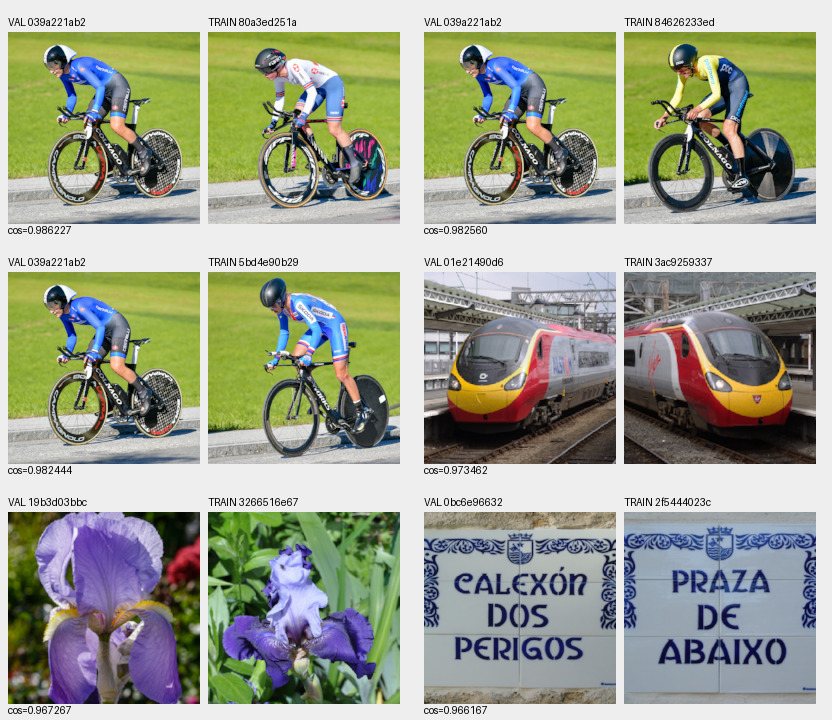
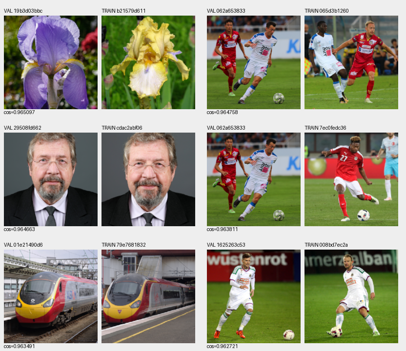
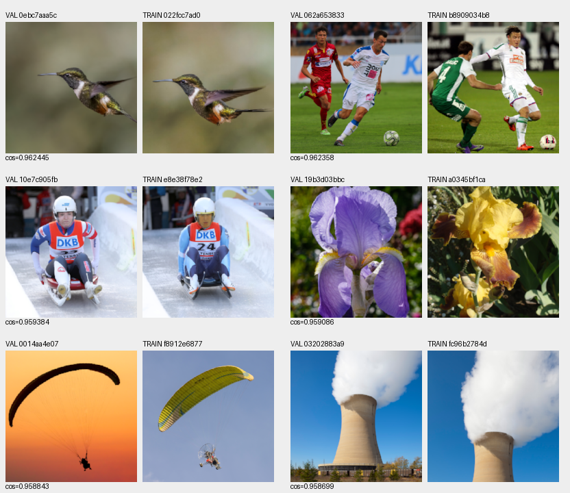
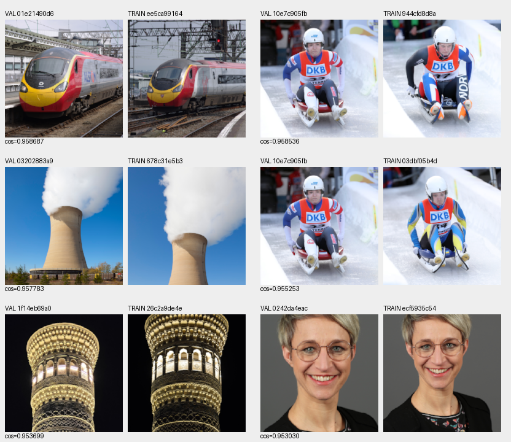

# Commons content audit: related series cross the development split

The completed CPU DINO screen finds related named capture/event series and
shared sites across training and development. Manual review of the prescribed
24 pairs supports 13 named-series/event pairs and 3 shared-site pairs; 8 are only
similar subjects or different captures. These are not claims of exact image
duplicates. Separate future manifests quarantine 181 training files, retaining
**84,867**; all original holdouts and running recipes remain fixed.

[Full execution, independent math, actual views, source credits, quarantine and frozen cohorts](results/commons-content-overlap-CPU-review.json).
[Original genuine pilot and launch](results/commons-content-overlap-CPU-launch.json).
[Known-series policy](../configs/commons-development-series-exclusions-20261017.json).

## Actual full screen and numerical audit

All 85,048 future training files and 427 existing development photos are encoded
from the existing SSD 8× linear uint16 caches. Each uses a center-square crop,
linear area reduction to 192×192, sRGB transfer and ImageNet normalization. Genuine pinned DINOv3
ConvNeXt-tiny produces one normalized 768-vector per source. The backbone hash remains
`370a84c2d9e1d216757422c0a25ceb82a0a106083ba8ca545d9b267e704540fd`.
Model revision is `10d30274b4d445111e2d5bf75ac93bbd94db274b`.
This is a content encoder, not restoration or quality scoring.

The actual full job completes 10,722 neural batches/85,547 image evaluations
(including its 72-evaluation pilot) in 5,435.33 seconds. CPU FP32/B8/two threads,
nice +10; no CUDA, originals, test caches or protected camera captures opened.
The actual owner 82634 / creation 1792241147.48 exits successfully; session 42199 closes
with exit 0. No restart is needed. Execution sources, input identities and vectors
remain under `/mnt/external/demosaic/benchmarks/commons-DINO-overlap-CPU-v1/`.

Each source cache hash/header is checked when the actual encoder reads it.
Independent closure verifies all 85,475 row identities/order, vector dtype/shape,
finite values and norm range [.9999997225,1.0000002502]. The 32 genuine-pilot
vectors/IDs match their full-run positions bitwise. All stored vectors differ;
that does not establish distinct images or scenes. Independent scalar math.fsum
rebuilds all 3,843 reported cosines, maximum difference 1.34e-15.

The declared search retrieves 16 candidates in F32 and reranks in F64, keeping
three neighbors per query for original 40,170 / expanded 66,934 / future 85,048 train
memberships. An independent exhaustive F64 search matches every ordered top-three
group: 1,281/1,281. Source/cohort identities and all four sheet hashes/dimensions/
selection orders pass. It does not prove other crops/views are unmatched.

## Actual visual and metadata findings

All four original sheets were opened and all 24 pairs reviewed, with their source
records. Named series include dated cycling/football/luge events, a generating
station series, a named hummingbird flight series and dated portrait title
groups. Portrait grouping uses the dates/title stems/photographer in source
records. Separate-site examples include Manchester Piccadilly and the Kalan
minaret; different captures of a landmark are not exact duplicate images.

False positives matter: different irises, different football fixtures/years,
Manchester versus Birmingham stations, and Swiss paragliding versus a Laos
paramotor have high feature similarity without a demonstrated shared capture.
No similarity threshold automatically excludes files.

Of the 24 reviewed pairs, 22 already belong to original 40,170 training and all 24
to expanded 66,934. The hummingbird and one dated portrait pair enter only the
expanded membership. These 24 pairs provide no finding unique to the latest corpus; they do not
establish scene independence for its 85,048 files. Existing development results hold out image
files, while complete capture/site independence is unproven.

## Separate future metadata quarantine

The new [quarantine operator](../scripts/quarantine_commons_series.py) applies ten
manually supported title-prefix groups using NFC/casefold matching. Eight are
named capture/event series; two are shared sites with explicit known title
aliases. It removes matching training rows into separate quarantine files.
It preserves every retained JSONL record, cache path/checksum and all nontraining
lines byte-for-byte, including the parent's extra reserved/excluded 8× records.
It never changes original manifests, cache pixels or active training configs.

| Metadata group | Training files quarantined |
| --- | ---: |
|innsbruck-women-itt-20180925|60|
|wiener-neustadt-st-poelten-20180531|5|
|dated-portrait-session-20171116|2|
|mattersburg-rapid-20151121|42|
|woodstar-flight-las-tangaras|1|
|altenberg-female-luge-20180202|31|
|michigan-city-generator-20121020|4|
|dated-portrait-session-20200214|3|
|manchester-piccadilly-mmb|32|
|kalan-minaret-title-aliases|1|

Both new versions retain 84,867 training files; validation 2,303 / test 2,255 remain
unchanged. The 8× version also retains all 4,998 reserved / 32 excluded records.
An independent full literal-subset audit verifies both versions, identical 181
removal IDs/reasons and all unchanged nontraining bytes. Eight focused tests
pass, including Unicode, relocation and mismatched-source rejection. Three
actual retained 4× caches also pass the native 256×256 geometry/PSF→area2 loader;
no training or neural forward occurs in that smoke.

Future manifests:

- `/mnt/external/demosaic/commons-known-series-quarantine-20261017-v6/manifest4.jsonl`
- `/mnt/external/demosaic/commons-known-series-quarantine-20261017-v6/manifest8.jsonl`

Parent cache audits remain the pixel evidence; this exact metadata subset does
not reread/reprocess all images. Narrow title rules can miss aliases and renamed
views. These files remove the identified groups, not all possible shared scenes.

Reproduce with the same completed parents and a new destination:

```bash
source scripts/env.sh
uv run --no-sync python scripts/quarantine_commons_series.py \
  --manifest8 /mnt/external/demosaic/commons-incoming-20261017-v5-quarantine/reviewed8/manifest.jsonl \
  --manifest4 /mnt/external/demosaic/commons-incoming-20261017-v5-quarantine/reviewed4/manifest.jsonl \
  --policy configs/commons-development-series-exclusions-20261017.json \
  --output /mnt/external/demosaic/commons-known-series-quarantine-reproduction
```

## Frozen prospective development sensitivities

The same policy matches nine of the 427 source records for named capture series,
or eleven including the two shared sites. All retained/excluded IDs are frozen
in the receipt **before either original 20k full 427-photo panel runs**, independently of
model error values. Additional subsets have 418 and 416 sources respectively
(11,704/11,648 photo cases per method at seven conditions/four CFAs).

The original 427-source evaluation and queued operators remain unchanged. After the
actual original20k results close, report additional source-level sensitivities
using these fixed IDs and the existing prediction/case logs. Those statistics
have not run. Neither subset is certified scene-independent; protected-final
camera scoring remains untouched. No content result proves trained quality,
SOTA, broad RawNIND superiority or the 10-second target.

## Reviewed data-audit previews and credits

These are resized 192px center-scene thumbnails for source review, **not native
100% performance crop triplets**. VAL is left and TRAIN right in each pair;
each sheet has six pairs in row order. Source photos retain their listed
CC BY-SA 3.0/4.0 or CC0 terms. Modifications are 8× binning, center crop, linear
area reduction, sRGB display and sheet composition. Full source/credit/license/
attribution metadata for all 37 unique images is retained in the receipt.









| Pair | Source IDs(query →train) | Review |
| --- | --- | --- |
|1|`039a221ab2` →`80a3ed251a`|Named series/event|
|2|`039a221ab2` →`84626233ed`|Named series/event|
|3|`039a221ab2` →`5bd4e90b29`|Named series/event|
|4|`01e21490d6` →`3ac9259337`|Shared site only|
|5|`19b3d03bbc` →`3266516e67`|Similar subject/different capture|
|6|`0bc6e96632` →`2f5444023c`|Similar subject/different capture|
|7|`19b3d03bbc` →`b21579d611`|Similar subject/different capture|
|8|`062a653833` →`065d3b1260`|Named series/event|
|9|`29508fd662` →`cdac2abf06`|Named series/event|
|10|`062a653833` →`7ec0fedc36`|Similar subject/different capture|
|11|`01e21490d6` →`79e7681832`|Similar subject/different capture|
|12|`1625263c53` →`008bd7ec2a`|Named series/event|
|13|`0ebc7aaa5c` →`022fcc7ad0`|Named series/event|
|14|`062a653833` →`b8909034b8`|Similar subject/different capture|
|15|`10e7c905fb` →`e8e38f78e2`|Named series/event|
|16|`19b3d03bbc` →`a0345bf1ca`|Similar subject/different capture|
|17|`0014aa4e07` →`f8912e6877`|Similar subject/different capture|
|18|`03202883a9` →`fc96b2784d`|Named series/event|
|19|`01e21490d6` →`ee5ca99164`|Shared site only|
|20|`10e7c905fb` →`944cfd8d8a`|Named series/event|
|21|`03202883a9` →`678c31e5b3`|Named series/event|
|22|`10e7c905fb` →`03dbf05b4d`|Named series/event|
|23|`1f14eb69a0` →`26c2a9de4e`|Shared site only|
|24|`0242da4eac` →`ecf5935c54`|Named series/event|

One different-fixture training match is still quarantined because it independently
belongs to another reviewed query's fixture group. Grouping follows the explicit
metadata policy, not an assumption that every high-scoring pair shares a scene.

| Image ID/source page | Attribution/author | License |
| --- | --- | --- |
|[0014aa4e07](https://commons.wikimedia.org/wiki/File:CH.VD.Villeneuve_2007-08-25_Vertigo-Swiss-Riviera_2392_3x2-R_4K.jpg)|Roy Egloff|[CC BY-SA 4.0](https://creativecommons.org/licenses/by-sa/4.0)|
|[008bd7ec2a](https://commons.wikimedia.org/wiki/File:SV_Mattersburg_vs._SK_Rapid_Wien_2015-11-21_(012).jpg)|Steindy|[CC BY-SA 3.0](https://creativecommons.org/licenses/by-sa/3.0)|
|[01e21490d6](https://commons.wikimedia.org/wiki/File:Manchester_Piccadilly_station_MMB_57_390054.jpg)|mattbuck|[CC BY-SA 3.0](https://creativecommons.org/licenses/by-sa/3.0)|
|[022fcc7ad0](https://commons.wikimedia.org/wiki/File:Purple-throated_woodstar_(Philodice_mitchellii)_male_in_flight_Las_Tangaras_2.jpg)|Charles J. Sharp|[CC BY-SA 4.0](https://creativecommons.org/licenses/by-sa/4.0)|
|[0242da4eac](https://commons.wikimedia.org/wiki/File:2020-02-14_Nadine_Sch%C3%B6n_(Bundestagsprojekt_2020)_by_Sandro_Halank%E2%80%935.jpg)|Sandro Halank, Wikimedia Commons, CC BY-SA 4.0|[CC BY-SA 4.0](https://creativecommons.org/licenses/by-sa/4.0)|
|[03202883a9](https://commons.wikimedia.org/wiki/File:Estaci%C3%B3n_generadora,_Michigan_City,_Indiana,_Estados_Unidos,_2012-10-20,_DD_02.jpg)|Diego Delso|[CC BY-SA 3.0](https://creativecommons.org/licenses/by-sa/3.0)|
|[039a221ab2](https://commons.wikimedia.org/wiki/File:20180925_UCI_Road_World_Championships_Innsbruck_Women_Elite_ITT_Elisa_Longo_Borghini_850_8800.jpg)|Granada|[CC BY-SA 4.0](https://creativecommons.org/licenses/by-sa/4.0)|
|[03dbf05b4d](https://commons.wikimedia.org/wiki/File:2018-02-02_Junior_World_Championships_Luge_Altenberg_2018_%E2%80%93_Female_by_Sandro_Halank%E2%80%93010.jpg)|Sandro Halank, Wikimedia Commons, CC BY-SA 3.0|[CC BY-SA 3.0](https://creativecommons.org/licenses/by-sa/3.0)|
|[062a653833](https://commons.wikimedia.org/wiki/File:SC_Wiener_Neustadt_vs._SKN_St._P%C3%B6lten_2018-05-31_(017).jpg)|Steindy|[CC BY-SA 4.0](https://creativecommons.org/licenses/by-sa/4.0)|
|[065d3b1260](https://commons.wikimedia.org/wiki/File:SC_Wiener_Neustadt_vs._SKN_St._P%C3%B6lten_2018-05-31_(014).jpg)|Steindy|[CC BY-SA 4.0](https://creativecommons.org/licenses/by-sa/4.0)|
|[0bc6e96632](https://commons.wikimedia.org/wiki/File:Calex%C3%B3n_dos_Perigos.001_-_Ribadeo.jpg)|Fernando Losada Rodríguez|[CC BY-SA 4.0](https://creativecommons.org/licenses/by-sa/4.0)|
|[0ebc7aaa5c](https://commons.wikimedia.org/wiki/File:Purple-throated_woodstar_(Philodice_mitchellii)_male_in_flight_Las_Tangaras.jpg)|Charles J. Sharp|[CC BY-SA 4.0](https://creativecommons.org/licenses/by-sa/4.0)|
|[10e7c905fb](https://commons.wikimedia.org/wiki/File:2018-02-02_Junior_World_Championships_Luge_Altenberg_2018_%E2%80%93_Female_by_Sandro_Halank%E2%80%93077.jpg)|Sandro Halank, Wikimedia Commons, CC BY-SA 3.0|[CC BY-SA 3.0](https://creativecommons.org/licenses/by-sa/3.0)|
|[1625263c53](https://commons.wikimedia.org/wiki/File:SV_Mattersburg_vs._SK_Rapid_Wien_2015-11-21_(078).jpg)|Steindy|[CC BY-SA 3.0](https://creativecommons.org/licenses/by-sa/3.0)|
|[19b3d03bbc](https://commons.wikimedia.org/wiki/File:003_2020_05_08_Gegenlicht.jpg)|Friedrich Haag|[CC BY-SA 4.0](https://creativecommons.org/licenses/by-sa/4.0)|
|[1f14eb69a0](https://commons.wikimedia.org/wiki/File:Kalan_Minaret_04.jpg)|Bgag|[CC0](http://creativecommons.org/publicdomain/zero/1.0/deed.en)|
|[26c2a9de4e](https://commons.wikimedia.org/wiki/File:Minorai_Kalon_tungi_ko%CA%BBrinishi_03.jpg)|Panpanchik|[CC BY-SA 4.0](https://creativecommons.org/licenses/by-sa/4.0)|
|[29508fd662](https://commons.wikimedia.org/wiki/File:2017-11-16_Andreas_Statzkowski_by_Sandro_Halank%E2%80%931.jpg)|Sandro Halank, Wikimedia Commons, CC-BY-SA 3.0|[CC BY-SA 3.0](https://creativecommons.org/licenses/by-sa/3.0)|
|[2f5444023c](https://commons.wikimedia.org/wiki/File:Praza_de_Abaixo.001_-_Ribadeo.jpg)|Fernando Losada Rodríguez|[CC BY-SA 4.0](https://creativecommons.org/licenses/by-sa/4.0)|
|[3266516e67](https://commons.wikimedia.org/wiki/File:Iris_germanica_'Best_Bet'_001.jpg)|Moonik|[CC BY-SA 3.0](https://creativecommons.org/licenses/by-sa/3.0)|
|[3ac9259337](https://commons.wikimedia.org/wiki/File:Manchester_Piccadilly_station_MMB_16_390046.jpg)|mattbuck|[CC BY-SA 3.0](https://creativecommons.org/licenses/by-sa/3.0)|
|[5bd4e90b29](https://commons.wikimedia.org/wiki/File:20180925_UCI_Road_World_Championships_Innsbruck_Women_Elite_ITT_Tereza_Korvasova_(CZE)_850_8975.jpg)|Granada|[CC BY-SA 4.0](https://creativecommons.org/licenses/by-sa/4.0)|
|[678c31e5b3](https://commons.wikimedia.org/wiki/File:Estaci%C3%B3n_generadora,_Michigan_City,_Indiana,_Estados_Unidos,_2012-10-20,_DD_01.jpg)|Diego Delso|[CC BY-SA 3.0](https://creativecommons.org/licenses/by-sa/3.0)|
|[79e7681832](https://commons.wikimedia.org/wiki/File:Birmingham_International_railway_station_MMB_03_390035.jpg)|mattbuck|[CC BY-SA 3.0](https://creativecommons.org/licenses/by-sa/3.0)|
|[7ec0fedc36](https://commons.wikimedia.org/wiki/File:AUT_vs._TUR_2016-03-29_(151).jpg)|Steindy|[CC BY-SA 3.0](https://creativecommons.org/licenses/by-sa/3.0)|
|[80a3ed251a](https://commons.wikimedia.org/wiki/File:20180925_UCI_Road_World_Championships_Innsbruck_Women_Elite_ITT_Alice_Barnes_850_8701.jpg)|Granada|[CC BY-SA 4.0](https://creativecommons.org/licenses/by-sa/4.0)|
|[84626233ed](https://commons.wikimedia.org/wiki/File:20180925_UCI_Road_World_Championships_Innsbruck_Women_Elite_ITT_Emilia_Fahlin_850_9011.jpg)|Granada|[CC BY-SA 4.0](https://creativecommons.org/licenses/by-sa/4.0)|
|[944cfd8d8a](https://commons.wikimedia.org/wiki/File:2018-02-02_Junior_World_Championships_Luge_Altenberg_2018_%E2%80%93_Female_by_Sandro_Halank%E2%80%93053.jpg)|Sandro Halank, Wikimedia Commons, CC BY-SA 3.0|[CC BY-SA 3.0](https://creativecommons.org/licenses/by-sa/3.0)|
|[a0345bf1ca](https://commons.wikimedia.org/wiki/File:Iris_'Sig._Na._Chiara_B.'.jpg)|Jebulon|[CC BY-SA 3.0](https://creativecommons.org/licenses/by-sa/3.0)|
|[b21579d611](https://commons.wikimedia.org/wiki/File:Iris_'Songbird'_01.JPG)|Kor!An (Андрей Корзун)|[CC BY-SA 3.0](https://creativecommons.org/licenses/by-sa/3.0)|
|[b8909034b8](https://commons.wikimedia.org/wiki/File:SV_Mattersburg_vs._SK_Rapid_Wien_2015-11-21_(030).jpg)|Steindy|[CC BY-SA 3.0](https://creativecommons.org/licenses/by-sa/3.0)|
|[cdac2abf06](https://commons.wikimedia.org/wiki/File:2017-11-16_Andreas_Statzkowski_by_Sandro_Halank.jpg)|Sandro Halank, Wikimedia Commons, CC-BY-SA 3.0|[CC BY-SA 3.0](https://creativecommons.org/licenses/by-sa/3.0)|
|[e8e38f78e2](https://commons.wikimedia.org/wiki/File:2018-02-02_Junior_World_Championships_Luge_Altenberg_2018_%E2%80%93_Female_by_Sandro_Halank%E2%80%93050.jpg)|Sandro Halank, Wikimedia Commons, CC BY-SA 3.0|[CC BY-SA 3.0](https://creativecommons.org/licenses/by-sa/3.0)|
|[ecf5935c54](https://commons.wikimedia.org/wiki/File:2020-02-14_Nadine_Sch%C3%B6n_(Bundestagsprojekt_2020)_by_Sandro_Halank%E2%80%933.jpg)|Sandro Halank, Wikimedia Commons, CC BY-SA 4.0|[CC BY-SA 4.0](https://creativecommons.org/licenses/by-sa/4.0)|
|[ee5ca99164](https://commons.wikimedia.org/wiki/File:Manchester_Piccadilly_station_MMB_25_390026.jpg)|mattbuck|[CC BY-SA 3.0](https://creativecommons.org/licenses/by-sa/3.0)|
|[f8912e6877](https://commons.wikimedia.org/wiki/File:Two-seater_paramotor_-_Powered_paragliding_in_flight_-_rear_3_quarter_view_a_sunny_afternoon_in_Don_Det_Laos.jpg)|Basile Morin|[CC BY-SA 4.0](https://creativecommons.org/licenses/by-sa/4.0)|
|[fc96b2784d](https://commons.wikimedia.org/wiki/File:Estaci%C3%B3n_generadora,_Michigan_City,_Indiana,_Estados_Unidos,_2012-10-20,_DD_03.jpg)|Diego Delso|[CC BY-SA 3.0](https://creativecommons.org/licenses/by-sa/3.0)|
