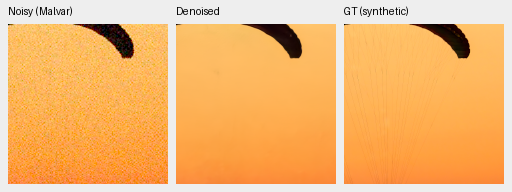
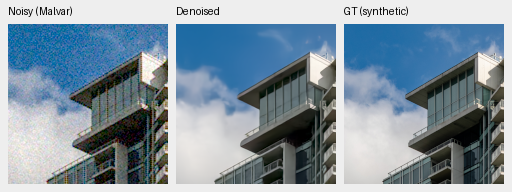
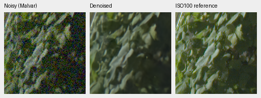
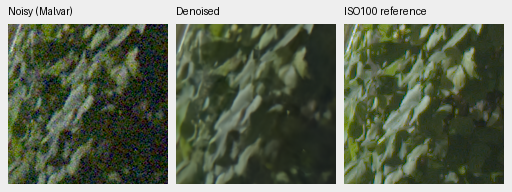
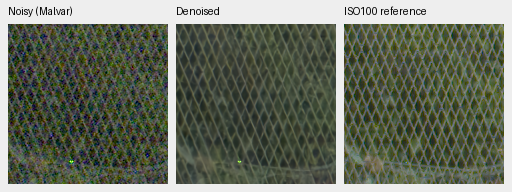

# Larger Commons corpus: first matched quality gate

Current architecture and recommendations: [current model guide](current-model.md).
The versioned study below retains its measured results and original protocol.

**Stop this V50 gate at1000; do not promote the checkpoint.** Known primary
and full-photo PSNR fall with negative source-bootstrap intervals. Unseen and
procedural means also fall, with intervals including zero. This early one-seed
result does not prove that more data is generally harmful or either corpus has
converged. The separately frozen extension remains available for later trials.
V43 step2000 was the photographic comparator for this study.

[Complete matched results and20 native comparisons](results/commons-expanded-v50-review.json).
[V50](commons-v50-trial.md) changes only the Commons training membership:
40,170→52,536 images, including the preceding1,808-image extension and10,558
newly reviewed sources. All44,728 old active4× records and validation/test
membership are exact. All10,558 new cache SHA256s verify before training.
The [admission/cache receipt](results/commons-incoming-v2-complete4.json) retains
protected/duplicate quarantine, reserved buckets and finite-screen limitations.

V47/V50 share immutable V43 first1000 EMA, fresh AdamW/EMA, seed50, batch16,
LR3e-5/planned3000 and1000 updates. Native128/paired32,25/25/50 mix, original8×
validation, pre-reduction geometry/PSF, pinned frozen DINO-S, camera projection,
full-resolution CNN and original precision remain fixed. No low-rank or
matrix-centering change. This is a data-only comparison, not a larger model.
Both optimizers reach1000 and training source bundles match exactly.

All41 logged steps retain the domain schedule. All
22 logged paired/native input/target
hashes match; 17 Commons batches change.
The sampler intentionally changes photographic draws, with the same synthetic/
flat branch rules and independent per-step degradation RNG. Matching old
samples can still produce unchanged Commons batches.

| Panel | Model | Measured-CFA PSNR | AHD RGB PSNR | AHD SSIM |
| --- | --- | ---: | ---: | ---: |
| Known4 | V47 Commons40170 | 54.25486 | 40.01602 | 0.930912 |
| Known4 | V50 Commons52536 | 54.23749 | 40.00684 | 0.930846 |
| Unseen5 | V47 Commons40170 | 53.73204 | 38.49569 | 0.920479 |
| Unseen5 | V50 Commons52536 | 53.70546 | 38.44743 | 0.920131 |

V50−V47 primary PSNR: known **-0.01737 [-0.03137, -0.00337]**;
unseen **-0.02658 [-0.04664, +0.00079]** dB. Known4 has8 pairs/72 crops;
unseen5 has10 pairs/90 crops. Registered low-noise measured CFA is primary.
Independent AHD RGB is auxiliary, **not exact RGB GT**. Protected-final model
scoring remains untouched.

| Model | 427-photo PSNR | SSIM | 16-procedural PSNR | SSIM |
| --- | ---: | ---: | ---: | ---: |
| V47 Commons40170 | 34.91128 | 0.956664 | 33.56462 | 0.965209 |
| V50 Commons52536 | 34.85264 | 0.956709 | 33.22869 | 0.964305 |

V50−V47 photo **-0.05864 [-0.08377, -0.03608]** dB;
procedural **-0.33593 [-0.86330, +0.01388]** dB. Brackets are95%
source-bootstrap intervals from one training seed, not training-seed uncertainty.
More sources change the draw distribution; equal1000-update budgets do not
mean equal exposure to every source or converged training on either corpus.
There are443 evaluation sources, seven conditions/four CFAs and62,020 combined
cases across two neural/three classical methods.

Only V50 is recomputed. Cached V47 reuse verifies complete evaluator source
identity and protocol/data/render/metric metadata, exact equality of24 known/
30 unseen classical pair summaries and all37,212 classical synthetic records.
Original report/case/checkpoint hashes remain in the receipt. No bitwise neural
re-execution claim is made. V43 step2000 is the separately trained photographic study comparator: known54.23332/unseen53.80606 primary, photo34.89934/
.957126, procedural33.28537/.966604; its optimizer history/seed differ.
See its [review](native-corpus-2k-review.md).

V47 SHA256 `ebfe1cc8af4a2dbfd83105b82da81b782c46007282a4de50a0be0215ab5238c4`.
V50 SHA256 `54f8169c10c33c97f7eb5707c5f3d95a4e588c4c8d7d3af315f0640bcc322304`.
Exact training/validation manifests, source/checkpoint snapshots, crop ROI,
conditioning/display values and PNG hashes are recorded. No private-photo
source or protected test is admitted to the training extension.

## Native exact-GT crops

Noisy Malvar → restored → exact synthetic GT; native160×160 panels, no resizing.
Shared ROI[48,48,160,160], RGGB/ISO12800 prior `shot=.00256`,
`read=.0000262144`, display×1, WB[2,1,1.5] and fixed protocol camera matrix.
Noisy/reference panel pixels and metadata verify identical between methods.
PNGs are8-bit previews; metrics use unquantized outputs.

Sources: [Roy Egloff](https://commons.wikimedia.org/wiki/File:CH.VD.Villeneuve_2007-08-25_Vertigo-Swiss-Riviera_2392_3x2-R_4K.jpg)
and [Dietmar Rabich](https://commons.wikimedia.org/wiki/File:Vancouver_(BC,_Canada),_Coal_Harbour_Seaside_Park,_Blick_in_den_Himmel_--_2022_--_2158.jpg),
[CC BY-SA4.0](https://creativecommons.org/licenses/by-sa/4.0/). Modified by binning,
crop, noise, restoration and rendering; previews retain that license. Paired
images: Benoit Brummer and Christophe De Vleeschouwer,
[RawNIND](https://doi.org/10.14428/DVN/DEQCIM), per-scene credits in source receipts.
GFX images by the project owner.

## Standing GFX test

Full102MP DSCF3879 ISO6400 → restored → separate DSCF3880 ISO100 f/5.6.
Native160px foliage[8890,5570], fence[2240,6000] (reference x2241), plus
sky/building in the receipt. Shared+2EV/WB/matrix, input-only
`shot=.0014635775921166604`, `read=.0000010715704128646712`.
Time/aperture/motion differ: the last panel is a qualitative reference,
**not GT**. No reference fitting/warping or pixelwise GFX reference score.

Native inspection finds no decisive gain. Fine fabric strands remain smoothed,
building/sky detail looks close, and the GFX foliage/fence remain soft beside
the separate ISO100 reference. Irregular fence intersections and colored points
remain visible. These examples do not establish the requested RawNIND margin.

All20 triplets verify source/ROI/noise/display metadata, dimensions and matched
noisy/reference panel bytes. Both full8746×11662×3 RGB16 TIFFs verify complete
SHA/size/dtype/dimensions/16-bit tags and>256 sampled codes; sRGB carries ICC.
GFX restoration took33.47s with512px tiles,64px overlap,batch4, excluding decode/load/render/
encoding. This successive shared-machine observation is not a repeated speed
benchmark or10-second result. Full outputs remain under
`/mnt/external/demosaic/evaluation/gfx-3879-3880-commons-expanded-v50-1k-full/`.
