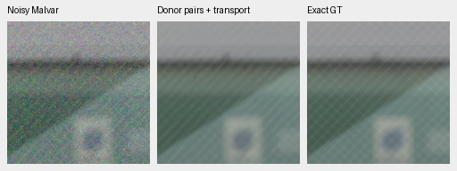
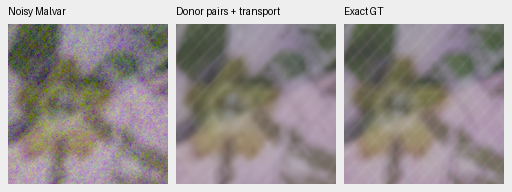

# Faster Bayer phase refinement and separate neighbor checks

Indexed real Fourier extraction cuts the median witness feature time
from **52.6 ms to 30.7 ms** on a fine GFX100S cab query. Across 384
retained synthetic queries, it reproduces every selected frequency,
feature and transported-phase prediction bit for bit. All eight real
display crops also match pixel for pixel. Training additional checks
between neighboring pairs gives a small reduction in gap error at
comparable texture. Fine cab crossings remain incomplete.
[Checkpoint and evidence](results/compact-spectral-witness-v1/publication.json) ·
[Shipped extractor](../src/demosaic/phase_witness.py).

## Compact extraction and timing

The [refined witness](subbin-spectral-witness.md) checks 2,150 candidate
positions shared across 86 output bins. They occupy 1,477 distinct
Fourier coordinates. The indexed extractor computes a real FFT, shares
the green transport across identical coordinates, and gathers red and
blue only at the selected frequency and original bin. Signed frequencies
with negative horizontal components use conjugate reflection in both
axes. The experimental CPU function is `demosaic.phase_witness.measure_witnesses`.

The initial indexed implementation grouped horizontal and vertical sums.
That changed one frequency in 7,430,400 decisions on the retained replay,
with a difference of up to three rounded camera RGB16 codes. The final
extractor preserves the original addition and normalization order.
It has zero changed selections, zero feature difference and zero
transported-head output difference across the 192 wire and 192 natural
queries. The natural subset selects every fourth photo ID before
comparison and includes both ISO profiles and both noise laws. The
eight real GFX boards reproduce the earlier transported-phase arrays.
A separate replay confirms that the shipped module gives identical
arrays on the same 384 synthetic and eight real queries.
[Timing and replay receipts](results/compact-spectral-witness-v1/evidence.tar.xz) ·
[Initial indexed replay](results/compact-spectral-witness-v1/initial-indexed-replay.tar.xz).

| Native 256-pixel query | Dense FFT | Indexed real FFT | Indexed with additional pair checks |
| --- | ---: | ---: | ---: |
| Synthetic contrast step, ISO400 | 60.9 ms | 34.6 ms | 49.5 ms |
| Synthetic railway gap, ISO6400 | 65.5 ms | 44.6 ms | 67.5 ms |
| Synthetic flower dip, ISO6400 | 65.4 ms | 39.6 ms | 66.4 ms |
| Real right cab, transferred prior | 52.6 ms | 30.7 ms | 47.7 ms |

Each median uses 20 interleaved warm timings on the same pinned GB10 CPU
core. Times cover the CPU feature stage. The speedup ranges from **1.47×
to 1.76×** across these queries. The separate pair checks add their own
search and measurement cost.

## Training on reciprocal neighbor checks

The new heads nominate a frequency and phase from the two vertical
green windows and check it on the horizontal pair, then reverse those
roles. The eight additional features include the two signed reciprocal
scores, the strengths and phase agreement at the common frequency,
the two-dimensional offset disagreement and the complex difference
between pairs. The discovery pair, the confirming pair and the center
window use disjoint samples. A replay rolls the pair features vertically
by five witness windows while keeping the same weights and original
sub-bin measurements.

All three heads reuse the 448 source photos, four Bayer layouts,
ISO400 and ISO6400 conditions, conditioning arrays and sampling from the
[refined witness study](subbin-spectral-witness.md#matched-training).
These data exclude the standing captures and their families. The
matched heads use the refined, refined-gap and transported objectives
with the additional pair features and zero initial weights on those
inputs. Each trains **672 updates**, six passes, four photos per update,
2,688 photo visits and 8,064 role queries. FP32 optimization uses the
same AdamW schedule and EMA 0.99. Joint training takes **23.89 s**,
separate from pair-feature assembly and inference.

The joint checkpoint is
`6e6d8d896bee656c3b3e97b3f5bea8a1594206bd76a572c96fecfa97218910ee`.
The matched refined-head control is
`61984f51d596a0534c6b93d5221bb14879742b7c955e9d8b732dc434254f901d`.
Both operate above frozen Corpus 100k EMA
`87b96f3c487b9edaf1c477742b6c38f2a82cc6b20a94716d51cc8cf46a17a760`.
The V120 EMA comparison uses
`a9d9b6b4f974e24a6b11e5e740aab32314233a7f53c056cf37c7d2aac1c589fb`.
The table and native views use EMA. The archive also scores raw weights.
[Training and source bindings](results/compact-spectral-witness-v1/evidence.tar.xz).

## Held-out reconstruction

There are 24 held-out photo backgrounds with exact planted wires at
each of the two noise profiles. A separate 24-photo panel calibrates
one multiplier per matched earlier head to target the same added
luminance RMS in 12 known gaps. All error columns use scene-luminance
DN16. Absolute gap RMS measures reconstructed error against the
known gap pixels.

| ISO6400 EMA | Intact response | Intact RMS | Added gap RMS | Absolute gap RMS |
| --- | ---: | ---: | ---: | ---: |
| V120 | 31.61% | 207.41 | 21.80 | 154.01 |
| Corpus 100k | 33.66% | 207.82 | 0.00 | 152.65 |
| Previous transported phase | 42.42% | 213.33 | 21.64 | 151.97 |
| Donor pairs | 41.79% | 213.38 | 20.77 | 152.34 |
| Donor pairs with gap loss | 31.37% | 202.09 | 13.45 | 151.41 |
| Donor pairs with transport | 42.81% | 213.56 | 22.80 | 151.82 |
| Previous transport scaled to similar gap change | 42.89% | 213.72 | 22.81 | 152.02 |

At comparable gap change, donor pairs with transport lower absolute
gap RMS by **0.20 DN16** [0.13, 0.28], intact RMS by 0.16 DN16
[0.08, 0.23] and added exact-flat RMS by 0.51 DN16 [0.47, 0.56].
The intact-response difference is −0.08 points [−0.19, +0.01].
Rolling the pair features changes the unscaled 42.81% response to
42.70%. On 48 independent ISO6400 natural photo observations, donor
pairs with transport track the previous transport within 0.03 DN16
for fine-increment and flat RMS. Corpus 100k retains lower error on
both measures. Trained donor pairs yield a small wire fidelity change
at added extraction cost.
[Matched controls and intervals](results/compact-spectral-witness-v1/evidence.tar.xz).

## Exact native crops

The views retain 160 × 160 pixels at `[48,48,160,160]` within a
256-pixel query at `[128,128,256,256]`. They use ISO6400 shot/read
`0.00128/6.5536e-6`, capture exposure 0.33, black level 0.03,
16-bit ADC, display exposure ×2 and contrast 1.0. The native
coordinates and display transform match across each row. The
denoised panels use the bound EMA checkpoint above.
[Crop provenance](images/compact-spectral-witness-v1/manifest.json).

**St. Valentin railway**, GT1976, CC BY-SA 4.0. RGGB, source scene
`[376,16,512,512]`. The exact target shows a clearer opening and
finer diagonals than all restored crops.
[Photo](https://commons.wikimedia.org/wiki/File:2018-05-04_(217)_33_53_9332_586-5_at_Bahnhof_St._Valentin.jpg) ·
[All methods](images/compact-spectral-witness-v1/exact/012-iso6400-comparison.png) ·
[Donor pairs triplet](images/compact-spectral-witness-v1/exact/012-iso6400-paired-refined-triplet.png) ·
[Gap-loss triplet](images/compact-spectral-witness-v1/exact/012-iso6400-paired-gap-triplet.png).

**Dianthus superbus**, Uoaei1, CC BY-SA 4.0. GRBG, source scene
`[66,32,512,512]`. Faint diagonal modulation over the petals
remains below the exact continuous-dip target.
[Photo](https://commons.wikimedia.org/wiki/File:Dianthus_superbus_Auernig_01.jpg) ·
[License for both photo crops](https://creativecommons.org/licenses/by-sa/4.0/) ·
[All methods](images/compact-spectral-witness-v1/exact/014-iso6400-comparison.png) ·
[Donor pairs triplet](images/compact-spectral-witness-v1/exact/014-iso6400-paired-refined-triplet.png) ·
[Gap-loss triplet](images/compact-spectral-witness-v1/exact/014-iso6400-paired-gap-triplet.png).

## Standing GFX100S comparisons

All eight boards were inspected. Each new component follows Corpus 100k
EMA directly. The sky stays smooth and the coarse crossings remain
coherent. Fine building wires and foliage stay soft. In the cab the left
diagonals remain diffuse and the right crossings remain patchy under
both conditioned noise profiles. The two independent ISO100 AHD views
and both camera JPEGs supply qualitative references with differences
in capture time, aperture and exposure.
[Native coordinates, noise and exposures](images/compact-spectral-witness-v1/manifest.json).

| Fixed scene and conditioning | Native boards |
| --- | --- |
| DSCF3879/3880 main, nominal | [Sky](images/compact-spectral-witness-v1/standing/main-overcast-sky-main-overcast-sky.png) · [Building](images/compact-spectral-witness-v1/standing/main-building-detail-main-building-detail.png) · [Foliage](images/compact-spectral-witness-v1/standing/main-foliage-main-foliage.png) · [Coarse fence](images/compact-spectral-witness-v1/standing/main-chain-link-fence-main-chain-link-fence.png) |
| DSCF3842/3835 cab, nominal | [Left](images/compact-spectral-witness-v1/standing/mesh-nominal-fine-green-mesh-left.png) · [Right](images/compact-spectral-witness-v1/standing/mesh-nominal-fine-green-mesh-right.png) |
| DSCF3842/3835 cab, transferred DSCF3879 prior | [Left](images/compact-spectral-witness-v1/standing/mesh-profile3879-fine-green-mesh-left.png) · [Right](images/compact-spectral-witness-v1/standing/mesh-profile3879-fine-green-mesh-right.png) |

Training, scoped numerical evaluation and native viewing are complete.
The timing applies to the extractor. Broad photo and camera scores
remain outside this component study.
[Model guide](current-model.md) · [Comparable PSNR history](performance-history.md).
