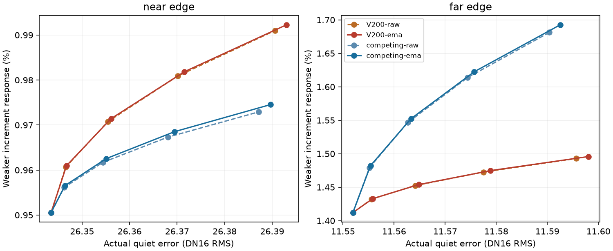
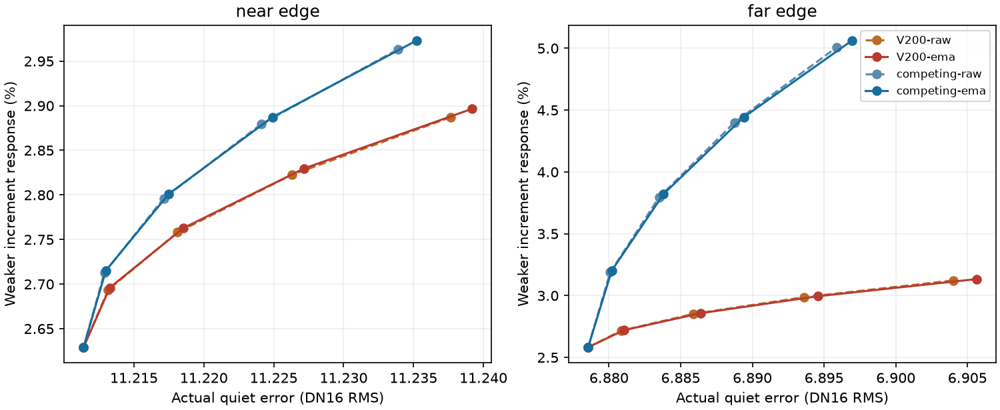
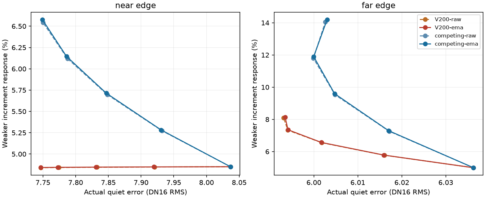
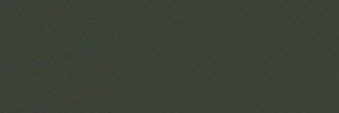

# More weaker-increment response, with strong-direction losses

The competing-orientation model completes its matched review on all three
[fresh-noise finite-wire caches](edge-snr-ladder.md): **1,152 observations of the
same eight sources**, both endpoints and five correction gains. Far from the
edge, EMA weaker-increment response improves at all three priors. Near-edge
response improves at the two clearer priors but remains poor at the noisiest.
Strong response falls throughout, and all six full-image RMS means increase.

This is a useful weak-detail/strong-detail tradeoff, with limited absolute
recovery. It complements the [complete ordinary/native quality review](competing-orientation-comparison.md);
V120 remains the general recommendation. These development results do not
establish broad camera quality or calibrated false-detail risk.

## Actual conditional increments

Methods use identical noisy observations. Background-only, one-direction and
two-direction roles have independent sensor noise. Weak response projects
`output(two) - output(one)` onto the actual clean weaker increment, so recovering
the common edge or stronger wires cannot substitute for it. All four Bayer
layouts, both noise draws and both placements remain present.

Full correction, **V200 EMA → competing EMA**; response is percent of the actual
increment, quiet error is camera-RGB DN16 RMS:

| Prior / placement | Strong response | Weaker response | Actual quiet error |
| --- | ---: | ---: | ---: |
| 6400 / near | 8.477→7.870% | 0.992→0.975% | 26.39302→26.38962 |
| 6400 / far | 24.181→21.065% | 1.496→1.693% | 11.59803→11.59253 |
| 1600 / near | 31.848→25.895% | 2.896→2.973% | 11.23918→11.23523 |
| 1600 / far | 60.637→46.336% | **3.133→5.063%** | **6.90562→6.89694** |
| 400 / near | 55.556→48.339% | 4.842→6.578% | 7.74646→7.74917 |
| 400 / far | 86.741→70.832% | **8.140→14.199%** | 5.99346→6.00302 |

At the 1600 prior/far placement, weak response improves **1.930 percentage
points**, with a paired source-bootstrap interval **[0.185, 4.477]**; quiet error
falls **0.00868 DN16**, interval **[−0.01169, −0.00603]**. Weak increment error
falls 15.11652→15.03832 DN16. Strong response loses 14.301 points and full-image
RMS rises 24.28959→24.33010 DN16.

At 400/far, the weak gain is **6.059 points [1.600, 11.016]**, with increment
error 10.51200→10.45593 DN16. Quiet error increases **0.00956 DN16**, interval
**[−0.00314, +0.02701]**; its interval including zero does not establish no harm.
Strong response loses 15.909 points; full-image RMS rises 20.27253→20.28314 DN16.
Near-edge 6400 weak-response differences include zero, and the mean declines.

Intervals use 5,000 paired source-cluster percentile draws. CFA/repeat views are
averaged within each of eight sources; profiles do not create new independent
sources. These are exploratory intervals on an informed development panel,
not formal risk control or a blind generalization test. Raw endpoints and every
source/condition/error metric remain in the [exact analysis](results/competing-edge-response-v1/analysis.json.gz).

## Response versus actual quiet error

Each curve scales only the delivered correction above the identical V195 anchor
by 0, 0.25, 0.5, 0.75 and 1. The y axes are zoomed; exact incremental amplitude
would be **100%**. The 1600/far endpoint improves both weak response and actual
quiet error. The 400 endpoints have higher quiet RMS; their gains are not
presented as matching V200's best endpoint error. Strong-direction losses remain
part of every comparison, including where the weak/quiet curve improves.

## Native pixels and verified delivery

Noisy Malvar → **competing EMA** → exact procedural GT, 400 prior. Each cell is
160×160 unchanged pixels from native512 RGGB context, repeat 0, ROI
`[176,176,160,160]`, shot 0.00008/read 2.56e−8, display exposure 2/contrast 1,
shared source-specific WB/matrix/sRGB display.

The reviewed views still largely show one direction and incomplete crossings.
The dominant modulation is weaker than V200 in these examples. Aggregate
weak-increment gains do not make these images close to complete reconstruction.
All 12 ordinary comparison boards were inspected. Their five native columns are
noisy, V195 EMA, V200 EMA, competing EMA and exact GT:
[400 far0](images/competing-edge-response-v1/iso400-source0-far-comparison.png) /
[far1](images/competing-edge-response-v1/iso400-source1-far-comparison.png),
[1600 far0](images/competing-edge-response-v1/iso1600-source0-far-comparison.png) /
[far1](images/competing-edge-response-v1/iso1600-source1-far-comparison.png).

EMA checkpoint SHA256:
`d4261136f71e888637cbfdc43dbe973f8c12488d6544e3482c852332c1ca102e`.
Native/source/noise/display details are retained in the
[manifest](images/competing-edge-response-v1/manifest.json) and exact triplet
metadata. Real GFX ISO100 references remain independent qualitative references
in the [full real-photo review](competing-orientation-comparison.md#protected-real-photo-and-false-detail-checks).

The changed selector's contexts were recomputed. Across every batch,
**905,969,664 anchor RGB channels match saved V195 exactly**. Actual full
forwards verify **14,155,776 delivered RGB channels** before cached readout/gain
reuse. Both readouts, the frozen anchor and CPU/CUDA RNG remain unchanged.
All zero-gain metrics match the controls exactly; paired identities and noise
conditions are checked. No new parent/DINO forward, source/noise draw or
training update occurs. Public native cells and compressed receipt bytes are
also checked. [Publication evidence](results/competing-edge-response-v1/publication.json).

The next architectural question is how to retain this added weak-family evidence
without spending useful carriers from an already effective direction. A fixed
equal quota does not solve that allocation problem across scenes.
