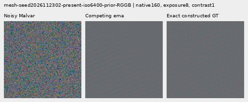
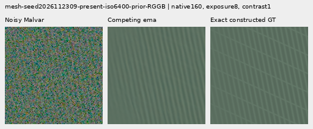
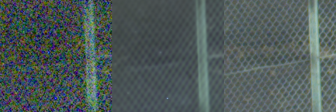
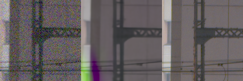

# Competing orientations: a local directional gain with lower overall response

The matched selector trial is complete: **900 noisy updates, 100 ADC skips,
both endpoints on all 822 inputs, and all 60 native boards/12 triplets inspected**.
Allocating four carriers to each of two angular proposals improves the weaker
orientation in one fixed mesh example. Another fixed mesh gets worse, aggregate
mesh response falls, and the real building/flat-region artifacts remain.
Small quiet/flat gains are retained alongside that directional improvement.

V120 remains the general recommendation. This component is a useful measured
carrier-allocation experiment, with no broad replacement claim. Its
[input-only proposal result and matched recipe](competing-wave-candidates.md)
remain separate from actual reconstruction quality.

## Same training observations, different allocation

Only the selector changes: the same budget of eight measured carriers occupies two
20° angular neighborhoods, four per proposal. Physical CFA fits, local contexts,
36 readout coordinates, four trainable tensors/643 parameters, V195 initializer,
seed, V200 data cache/pair units, optimizer, objective and complete LR schedule
remain fixed. Unlike the earlier shared-edge trial, this experiment uses the
original V200 observations. Allocation also changes which local contexts/waves
are measured; the trial does not isolate one scalar score.

All 1,000 committed rows passed the checkpoint/Adam/EMA/frozen-state audit.
Review reuses the exact cached present/absent meshes, quiet regions, flat and
photo cohorts, ADC controls and both standing real-photo families. No new
parent/DINO forward, source or noise draw occurs during training or this review.
Protected captures/siblings remain outside training; originals were not read.

## Gains and losses across the suite

Errors are camera-RGB DN16 RMS; lower is better. Template projection is signed
amplitude relative to constructed GT, not an overall quality score. These are
descriptive development-suite means; they do not establish population improvement
or controlled false-detail risk.

| Metric | V200 raw | Competing raw | V200 EMA | Competing EMA |
| --- | ---: | ---: | ---: | ---: |
| Present-mesh template amplitude | 11.00297% | 10.51141% | 11.10184% | 10.60738% |
| Present-mesh full error | 8.24445 | 8.26490 | 8.24012 | 8.25960 |
| Present-mesh blank-region error | 5.66489 | 5.66086 | 5.66747 | 5.66351 |
| Absent-mesh full error | 5.36923 | 5.36161 | 5.37199 | 5.36421 |
| Quiet regions, 6400 prior | 4.10535 | 4.10466 | 4.10703 | 4.10652 |
| Quiet regions, 12800 prior | 6.43845 | 6.43539 | 6.44237 | 6.43961 |
| Cached fresh-flat cohort, 6400 prior | 18.72472 | 18.71310 | 18.72981 | 18.71824 |
| Cached fresh-flat cohort, 12800 prior | 24.36499 | 24.34792 | 24.37343 | 24.35647 |

EMA quiet means fall 0.012–0.043%; fresh-flat means fall 0.062–0.070%.
This does not improve every case: present-mesh full-error differences have
p95 **+0.20890 DN16** and maximum **+1.58101 DN16**. Quiet-region maximum
increases are +0.02984/+0.09194 DN16 at the two priors. All paired identities,
conditions, signed tails and worst case IDs are retained in the
[full result](results/competing-orientation-v1/result.json.gz).

Natural-photo relative band errors decline very slightly, while band gains have
mixed signs. Duck/butterfly/bird detail stays soft; faint ribbing remains in
backgrounds. All 32 ADC metric groups are exactly equal to V200 at both states.

## The directional improvement and its counterexample

In the two predeclared native512 RGGB examples, full-template Fourier sectors
change as follows. These are recipe-normal sectors with finite-mask/harmonic/
intersection leakage, **not isolated wire-family amplitudes** or independent
population replications. The separate finite-wire test measures actual conditional
increments.

| Case / sector, EMA | V200 | Competing |
| --- | ---: | ---: |
| Mesh2302: weaker orientation | 28.412% | **33.551%** |
| Mesh2302: stronger orientation | 57.873% | 51.106% |
| Mesh2309: weaker orientation | 17.272% | 15.881% |
| Mesh2309: stronger orientation | 92.005% | 92.005% |

Raw endpoints show the same direction: mesh2302 weak sector 28.077%→33.167%,
mesh2309 17.046%→15.679%. All four whole projections match the existing metrics;
48 sector scalars pass independent real-spatial projection checks.
[Directional receipt](results/competing-orientation-v1/directional.json).

Noisy Malvar → **competing EMA** → exact constructed GT. Each cell retains
160×160 pixels, native512 RGGB context, ROI `[176,176,160,160]`, shot
0.00128/read 6.5536e−6, display exposure 8/contrast 1, shared WB/matrix/sRGB.

The first view shows a somewhat clearer second direction with weaker dominant
modulation; rounded/merged segments and incomplete crossings remain. The second
still predominantly recovers one family. Matched ordinary/amplified boards:
[mesh2302](images/competing-orientation-v1/comparison-00.png) /
[contrast40](images/competing-orientation-v1/comparison-03.png),
[mesh2309](images/competing-orientation-v1/comparison-04.png) /
[contrast40](images/competing-orientation-v1/comparison-07.png).

EMA checkpoint SHA256:
`d4261136f71e888637cbfdc43dbe973f8c12488d6544e3482c852332c1ca102e`.
Raw checkpoint SHA256:
`098cb3b5e3d090bd924dc40a832443d570fbad1b1825ecd25fcba31e787f1d4a`.
These are component exports above the V143 restoration/frozen V195 anchor.
[Every source/ROI/noise/display/checkpoint binding](images/competing-orientation-v1/manifest.json).

## Protected real-photo and false-detail checks

Noisy → **competing EMA** → independent ISO100/AHD qualitative reference:

The building's green/magenta fringes persist. Cab modulation remains visible,
without a decisive complete-crossing gain over V200 in either retained profile.
Sky is smooth at ordinary exposure, foliage soft, and coarse fence geometry
aligned. Both original-pixel JPEGs were reviewed with the cab boards.

Main DSCF3879/3880 retains display exposure 4/contrast 1 and the central native160
ROI: [sky](images/competing-orientation-v1/comparison-09.png),
[building](images/competing-orientation-v1/comparison-10.png),
[foliage](images/competing-orientation-v1/comparison-11.png),
[chain-link fence](images/competing-orientation-v1/comparison-12.png).

Cab DSCF3842/3835 retains left `[206,229,160,160]` and right
`[426,189,160,160]` ROIs, native768 context, exposure 16/contrast 1:
[nominal left](images/competing-orientation-v1/comparison-13.png) /
[right](images/competing-orientation-v1/comparison-14.png),
[nearby-capture profile left](images/competing-orientation-v1/comparison-15.png) /
[right](images/competing-orientation-v1/comparison-16.png).
Shot/read are 0.00128/6.5536e−6 nominal and
0.0014635775921166604/1.0715704128646712e−6 for the retained DSCF3879 profile.
These are priors, not a dedicated mesh-scene dark/flat calibration.

All real AHD/JPEG references are **independent qualitative references, not exact
GT or scoring targets**. Aperture, exposure, motion and processing differ.
[Complete small-triplet provenance](results/competing-orientation-v1/representative-real.json).

Amplified [absent mesh](images/competing-orientation-v1/comparison-08.png),
[gray flat](images/competing-orientation-v1/comparison-23.png),
[12800-prior flat](images/competing-orientation-v1/comparison-26.png),
[blue flat](images/competing-orientation-v1/comparison-29.png) and
[quiet step](images/competing-orientation-v1/comparison-34.png) retain false
waves/mottle, sometimes with changed orientations. Ordinary steps/bars and coarse
patterns retain their geometry; ADC bark/fur/plane appearance stays inherited.

## Fresh independent-noise follow-up

The queued candidate review is now running on all three immutable
[finite-wire noise caches](edge-snr-ladder.md), reusing the exact observations
for matched strong/weak incremental response versus actual quiet error.
It recomputes contexts for the changed selector and checks actual anchor/full
forward delivery before gain sweeps. This comparison remains pending here;
carrier proximity and the mesh2302 sector gain cannot substitute for it.

All 8,294,400 newly displayed RGB channels match saved native predictions;
20,889,600 retained comparison channels match their original source panels.
All 15 sheets/60 boards/12 triplets were actually inspected. Receipt archives
preserve original bytes. [Publication evidence](results/competing-orientation-v1/publication.json).
