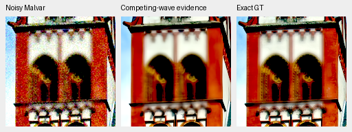
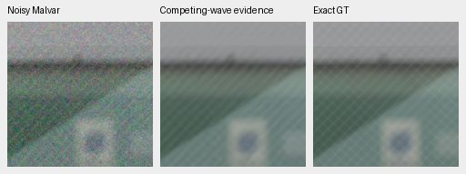

# Validating a weak wave beside a stronger one

The new router uses reserved Bayer evidence after fitting out a separate
strong wave. Against the previous directional router, it loses **0.31
percentage points** of held-out ISO6400 wire response and raises absolute
gap RMS by **0.18 DN16**. It reduces natural-photo flat RMS by **0.060 DN16**,
with little change in response. Shifting the new evidence spatially
reduces wire response by only **0.020 points**. The real fine cab
crossings remain incomplete.

[Machine results](results/competing-wave-validation-v1/publication.json) ·
[Frozen drivers, weights and receipts](results/competing-wave-validation-v1/evidence.tar.xz) ·
[Native provenance](images/competing-wave-validation-v1/manifest.json).

## Matched training

The new EMA artifact is
`4eacc8dc584404da06039e827d71818b756bf0b6578773103252a69d7b9eb44d`.
The frozen base is the local-only 20k EMA
`b892a08c8ebbccb05c000e4f42d1f86c3a7d1d5870721ccd6e1c8fe9e82c3889`
and Bayer phase EMA
`069de3a3d3f18ab0f32cf9b242daa1fb859d03762086ee27244557aced803e54`.
The control reproduces the prior directional raw and EMA tensors bit for
bit. Both arms see the same 448 sources, six epochs, 672 optimizer steps
and 8,064 role queries per arm. The two-arm update loop takes **23.68 s**.
Preparing the additional evidence takes **61.45 s** separately.
[Directional training recipe](directional-gap-training.md).

Each 32-pixel window tests exterior-nominated waveforms on two disjoint
green Bayer folds. One fold selects the strongest competing sinusoid
after fitting tone and a possible edge. The opposite fold projects the
competing sine and cosine off its own observations and candidate waveform.
Only bands at least 0.052 cycles per pixel away from the selected wave
are projected. Five new features give the router the resulting evidence,
the difference made by projection and the strength and overlap of the
competing wave. The original four correction experts, loss, coordinate
grid and training draw order are shared. In inference, neither the
competitor nor the candidate uses target pixels.

A direct check of 114 frequencies agrees with the FFT-based implementation
within 1.85 × 10⁻⁶ for amplitude and 1.67 × 10⁻⁵ for projected energy.
Changing reserved samples leaves the center nomination and discovery-fold
competitor unchanged.

## Held-out reconstruction

| ISO6400 wires, 24 sources | Intact response | Intact weak-band RMS, DN16 | Absolute gap RMS, DN16 | Weak-band gap RMS, DN16 | Added gap RMS, DN16 |
| --- | ---: | ---: | ---: | ---: | ---: |
| Local-only 20k | 33.413% | 84.771 | 151.803 | 7.087 | 0 |
| V120 | 31.605% | 86.701 | 154.013 | 7.179 | 25.077 |
| Corpus 100k | 33.657% | 84.945 | 152.650 | 7.198 | 16.700 |
| Previous conditional | 39.854% | 79.336 | 148.218 | 7.104 | 20.713 |
| Directional | 40.331% | 78.981 | 147.833 | 7.087 | 22.252 |
| Directional, scaled on calibration | 39.862% | 79.354 | 147.995 | 7.085 | 20.743 |
| Competing-wave evidence, neutralized | 39.967% | 79.273 | 148.031 | 7.086 | 21.135 |
| Competing-wave evidence, shifted | 40.001% | 79.243 | 148.010 | 7.084 | 21.196 |
| Competing-wave evidence | 40.021% | 79.224 | 148.014 | 7.084 | 21.229 |

Scaling on 24 separate calibration backgrounds puts the directional
control near the competing-wave arm's added gap RMS. On the 12 held-out
true gaps, the new arm adds **0.486 DN16** more change and the difference
in absolute gap RMS spans −0.020 to +0.063 DN16. Weak-band gap error
barely changes. The 0.159-point intact-response gain over this scaled
control spans +0.064 to +0.256 points. Matching the evidence spatially
improves intact weak-band RMS by 0.019 DN16 versus shifting it, with
similar weak-band gap RMS.

On 48 independent ISO6400 natural backgrounds, the new arm versus the
prior directional arm changes response by +0.005 points [−0.001, +0.011]
and flat RMS by −0.060 DN16 [−0.078, −0.044]. After matching on 16 separate
natural calibration sources, it gains 0.043 response points and adds
0.016 DN16 of fine-increment error. Shifting the evidence accounts for
just 0.014 points of response and lowers increment error by 0.009 DN16.
Reconstruction results are crop-level. Fixed427 and measured-camera scores
remain outside this component study.
[Comparable model history](performance-history.md).

## Exterior nomination

With the weak phase supplied to both methods in a controlled two-wave
test, projecting the competing wave raises ISO6400 detection AUC
from **0.841 to 0.918** for a weak amplitude of 0.002. Fully automatic
nomination on the first fixture selects near the stronger wave in the
base bin targeted by the test. Both folds leave out the competing-wave
projection in that fixture, and weak detection stays near chance.
This motivates changing the exterior frequency and phase candidate as
well as testing the evidence inside the query.

The donor replay fits the dominant sinusoid separately on each disjoint
green window, then nominates far-band candidates from the cleaned donor
spectra. The local reserved test still uses the original samples. In the
aligned synthetic fixture, the fully automatic combination moves weak
ISO6400 detection AUC from 0.849 to 0.863. The fixed 48 wire observations
give little support for this change. In intact ISO6400 regions, the
fraction of automatic candidates within 0.015625 cycles per pixel of the
planted carrier falls from **83.06% to 81.39%**. The fraction that also
passes the local validation threshold drops from **61.27% to 58.74%**,
a difference with a 95% interval of −6.06 to +0.27 points. At ISO400,
validated matches fall from **84.08% to 79.22%** [−7.41, −2.53 points].
ISO6400 true-gap matches with positive evidence stay near 9.1%. This
screen changes nomination only for the detector and is separate from
the trained router and rendered outputs.

## Native exact-target comparisons

Each cell shows 160 × 160 unchanged pixels at `[48,48,160,160]` within
the native query. Both use independent ISO6400 shot/read
`0.00128/6.5536e-6`, acquisition exposure 0.33, 16-bit ADC, black 0.03
and the competing-wave EMA in the center.

**Limburg Cathedral**, Berthold Werner, public domain. BGGR query
`[22,250,256,256]`, display ×3.0303 and contrast ×2. The arches stay
clear and the fine brick and molding remain soft.
[Source](https://commons.wikimedia.org/wiki/File:Limburger_Dom_BW_1.jpg) ·
[All methods](images/competing-wave-validation-v1/exact/001-iso6400-independent-comparison.png) ·
[Exact-flat comparison](images/competing-wave-validation-v1/flat/001-iso6400-independent-flat-comparison.png).

**St Valentin railway**, GT1976, CC BY-SA 4.0. RGGB query
`[128,128,256,256]` within source field `[376,16,512,512]`,
display ×2. Fine crossings around the planted gap remain soft.
[Source](https://commons.wikimedia.org/wiki/File:2018-05-04_%28217%29_33_53_9332_586-5_at_Bahnhof_St._Valentin.jpg) ·
[All methods](images/competing-wave-validation-v1/exact/012-iso6400-comparison.png).

## Standing GFX100S comparisons

The DSCF3879 sky looks smooth at display ×4. The coarse fence retains
coherent crossings, and the foliage and thin building lines remain soft.
In DSCF3842 at display ×16, the nominal right diagonals are slightly
softer than with directional training. The left patch stays diffuse.
Transferred conditioning retains more fragments and some background
mottling, with incomplete fine crossings. We viewed both real families,
including the two cab JPEGs and ISO100 AHD. These qualitative references
differ in aperture, exposure time and subject motion.

[Sky](images/competing-wave-validation-v1/standing/main-overcast-sky-main-overcast-sky.png) ·
[Building](images/competing-wave-validation-v1/standing/main-building-detail-main-building-detail.png) ·
[Foliage](images/competing-wave-validation-v1/standing/main-foliage-main-foliage.png) ·
[Coarse fence](images/competing-wave-validation-v1/standing/main-chain-link-fence-main-chain-link-fence.png).

| Cab conditioning | Left and right native crops |
| --- | --- |
| Nominal `0.00128/6.5536e-6` | [Left](images/competing-wave-validation-v1/standing/mesh-nominal-fine-green-mesh-left.png) · [Right](images/competing-wave-validation-v1/standing/mesh-nominal-fine-green-mesh-right.png) |
| Transferred `0.0014635775921166604/1.0715704128646712e-6` | [Left](images/competing-wave-validation-v1/standing/mesh-profile3879-fine-green-mesh-left.png) · [Right](images/competing-wave-validation-v1/standing/mesh-profile3879-fine-green-mesh-right.png) |
