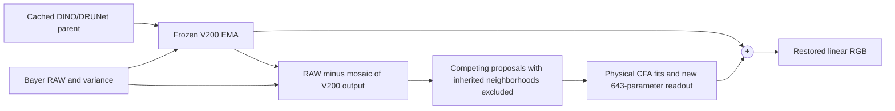

# Add weak-family proposals without replacing the trained V200 bank

The next trial keeps the complete **V200 EMA path frozen** and learns a fresh
643-parameter correction from additional CFA proposals. It follows the
[measured competing-orientation tradeoff](competing-edge-response.md): higher
weak-increment response came with lower strong response and higher full-image
RMS in every tested condition. Training and its 1,000-row audit are complete;
the [complete raw/EMA/native review](complementary-comparison.md) finds only a tiny
aggregate mesh gain, essentially unchanged weaker sectors and slightly higher
quiet/flat error. The fresh-noise follow-up is running.

This expands capacity and adds training. It is a combined stage intervention,
with a different residual field and additional carriers, rather than an isolated
test of an equal-budget allocation rule. V120 remains the general recommendation;
the previous model's measured gains and failures remain available.

## What changes

V200's original eight-carrier CFA bank and its trained readout remain intact.
The new bank proposes up to eight more carriers on `RAW - mosaic(V200 EMA)`.
The same two angular families receive four proposal slots each. A proposal is
discarded within one bin on each packed DFT axis of any inherited carrier or its conjugate,
using the periodic sensor-coordinate lattice. Discarded slots are not refilled.
The result has at most 16 CFA carriers across these two stages, plus the
unchanged earlier matching/pooled-wave stages.

The added head uses the same actual per-color CFA fits, native phase transport,
cross-scale support and 36 context coordinates. Its zero final layer initially
preserves the entire trained V200 output exactly. There are 201 serialized
tensors: 197 inherited tensors, all frozen, and four new trainable tensors/643
parameters. No optimizer/EMA clock is inherited by the new head.

This retains the old carrier path, **not a mathematical guarantee of final strong
response**. Spatially modulated waves can overlap even with different carrier
bins, and a signed learned correction can change apparent strong detail.
The parent uses all RAW samples, so residual scores and cross-scale features are
empirical evidence rather than independent validation or calibrated confidence.

## Admission and matched inputs

The [recipe](../configs/experiments/complementary.json) keeps the V200 cache,
pair units, seed, domain weights, objective, optimizer and 1,000-row schedule.
The initializer is the scored V200 EMA export, SHA256
`2bb4a05943b6e9c1eb31877d19058ca4a3fea723666510fbaa133554d6ef7d22`.
This adds 900 new noisy updates and 100 ADC skips above that already trained
component; earlier anchor/readout training history remains separate.
No training sources/noise are regenerated, and protected GFX captures/siblings
remain outside training. Original media remain read-only and are not accessed.

Actual CUDA admission checks all 197 inherited tensors and 393,216 exact output
channels across four CFAs. The fresh head has zero output on noisy inputs;
ADC routing remains exact even with a nonzero test head. A real training-only
batch supplies finite gradients on exactly the four new tensors and none on
the frozen path. The admission probe takes zero optimizer steps and is never
used as an initializer. Peak CUDA allocation is 11.04 GB in this check.
[Exact admission/source receipt](results/complementary-preparation-v1/admission.json).

The shared physical-measurement helper retains existing model behavior; focused
tests compare historical/composed outputs, auxiliary fields and gradients on
all four CFAs. Existing checkpoint layouts remain intact; the extra stage uses
an explicit `complement_readout` tensor prefix.

## Input-only proposal check

All 384 new selections close before target-geometry scoring. The original bank
comes from the earlier closed input-only selections, with its input/field
fingerprints checked. Cached V200 outputs supply the new residual. No neural
forward or new source/noise draw is needed; three CPU/GPU bridges reproduce the
integer proposals and exclusion masks exactly.

Weaker-fundamental proximity within three native DFT bins, two-direction roles:

| Prior / placement | Original eight | Inherited plus additional bank |
| --- | ---: | ---: |
| 6400 / near | 0% | 0% |
| 6400 / far | 1.5625% | 4.6875% |
| 1600 / near | 4.6875% | 7.8125% |
| 1600 / far | 6.2500% | 25.0000% |
| 400 / near | 0% | 35.9375% |
| 400 / far | 26.5625% | 76.5625% |

Inherited strong/weak proximity never falls, by construction, in any scored role
or condition. Added valid carriers average 3.82/4.89/5.60 per input at the three
priors, ranging from one to eight on this panel. These counts do not detect
structures. Each entry contains 64 related CFA/repeat views from eight sources;
native-bin proximity is not a reconstruction bound. The training recipe was
already frozen when this diagnostic ran; it does not change the live trial.
[Exact selections, geometry scoring and source copies](results/complementary-preparation-v1/proposal-publication.json).

## Complete training and quality review

All 900 new updates and 100 ADC skips completed. The complete row/Adam/EMA audit
passes, with the frozen hash identical to admission. Final checkpoint SHA256:
`07d6344285465f177a54b205911d0e8293e71f2fbe09e715e2b3960890a11640`.

Both new raw/EMA endpoints were compared with the **same V200 EMA control**.
The controller binds that export's scored checkpoint, endpoint, training plan
and V195 history. Training data and other recipe settings stay fixed. This
explicit extension mode does not relax the earlier same-initializer model-test
mode or permit silent data changes.

The standard review covers all 822 inputs and all 60 native boards/12
triplets, including both protected GFX families, sky/building/foliage/chain-link,
both cab ROIs/profiles and both JPEGs. In each actual forward it also checked
every retained original V200 scalar and available native baseline array against
the frozen anchor, without an extra forward. Independent ISO100/AHD/JPEG
references remain qualitative, not exact GT or scoring targets.

The second worker is evaluating the same three finite-wire caches,
checking all saved V200 EMA anchor pixels and actual full-forward delivery.
Gain zero now means **full V200 EMA**, not the earlier V195 anchor. Both endpoint
differences use that fixed EMA control; plotted V200 gain curves retain their
original V195-based definition. These references are explicit in the machine
plan and paired reporter, including tests that reject the wrong zero point.
[Actual live launch identities, exact plans and validation](results/complementary-preparation-v1/launch.json).

Initial implementation/review validation passed 61 focused tests and Ruff. Actual
trained strengths, error tails and all native views are now documented in the
[full comparison](complementary-comparison.md).

The initial evaluator stopped before publishing any prediction because it treated
legacy receipt fields as ordinary image metrics. Those rows also contain an
observation index, array fingerprints, intermediate replay flags and wave RMS.
The corrected evaluator verifies these fields explicitly, including complete
output hashes and actual intermediate tensors. Its real cached-case preflight
passes; it does not skip unknown scalar fields or weaken numerical tolerances.

The corrected review uses the original training package with **only the evaluator
replaced**; 147 other Python files match exactly. The trained checkpoint and
original failed prefixes remain untouched. Its raw export is byte-identical to
the first export. The corrected main review is complete and the fresh-noise worker is live;
validation passes
**64 focused tests** and Ruff. The initial launch receipt above is retained
unchanged. [Completion, failure and recovery evidence](results/complementary-preparation-v1/training-completed-and-review-recovery.json).
