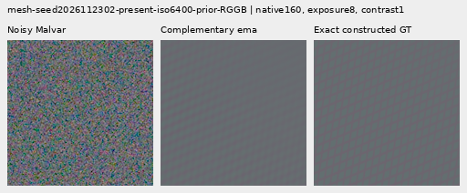
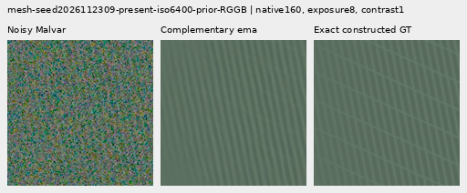
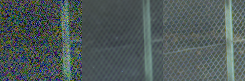
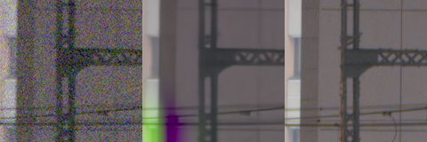

# Additional CFA carriers retain V200 but recover little extra detail

The complementary branch completed **900 noisy updates, 100 ADC skips, both
822-input endpoints and all 60 native boards/12 triplets**. Keeping the complete
V200 EMA path while adding a learned correction avoids the competing selector's
large aggregate response loss. It provides almost no extra weaker-direction
reconstruction in the two fixed meshes. Quiet/flat error increases slightly,
and the real building fringes and incomplete fence crossings remain.

V120 remains the general recommendation. This is an additional-capacity and
additional-training intervention, not an equal-compute selector comparison.
[Architecture, matched observations and admission](complementary-cfa-branch.md).
The [completed fresh-noise follow-up](complementary-edge-response.md) retains a
small lower-noise gain: far-edge weak response 8.14%→9.43% at the400 prior,
with mean strong response retained and slightly lower quiet error.

## Full-suite changes against the same V200 EMA control

Both candidate states use the **same original V200 EMA** control. The original
197 tensors remain frozen; only the four-tensor/643-parameter complementary
readout trains. Its proposals come from RAW minus the full V200 result and
exclude inherited carrier neighborhoods. More input-only weak-frequency coverage
does not establish recovered detail.

Errors below are camera-RGB DN16 RMS; lower is better. Template amplitude is a
signed projection relative to constructed GT, not a complete quality measure.
These development-suite means are descriptive.

| Metric | V200 EMA control | Complementary raw | Complementary EMA |
| --- | ---: | ---: | ---: |
| Present-mesh template amplitude | 11.10184% | 11.11979% | 11.12091% |
| Present-mesh full error | 8.24012 | 8.23809 | 8.23799 |
| Present-mesh blank-region error | 5.66747 | 5.66823 | 5.66830 |
| Absent-mesh full error | 5.37199 | 5.37273 | 5.37281 |
| Quiet regions, 6400 prior | 4.10703 | 4.10780 | 4.10787 |
| Quiet regions, 12800 prior | 6.44237 | 6.44321 | 6.44327 |
| Cached fresh-flat cohort, 6400 prior | 18.72981 | 18.73151 | 18.73168 |
| Cached fresh-flat cohort, 12800 prior | 24.37343 | 24.37615 | 24.37647 |

EMA present-mesh mean error falls 0.026%, while its median paired difference
is **+0.000481 DN16** and p95 is +0.001645 DN16. Absent-mesh mean error rises
0.015%; its p95/max increases are +0.001801/+0.002876 DN16. The fresh-flat
6400/12800 maxima increase +0.011741/+0.009055 DN16. The small average gain
does not describe all cases, and the aggregate amplitude gain of 0.01907
percentage points is not evidence of new second-family recovery.

Natural-photo full-error means increase by only 0.000048–0.000162 DN16 across
the four cohorts. Band-error differences have mixed signs, mostly worse for
the faint cohorts. Duck/butterfly/bird detail remains soft. All 32 ADC metric
groups are exactly equal at both endpoints.
[Every signed tail and paired identity](results/complementary-v1/result.json.gz).

## The fixed weaker directions barely change

The independently checked directional projections are full-template Fourier
sectors, with finite-mask/harmonic/intersection leakage. They are not isolated
wire-family increments or independent population replications.

| Case / sector, EMA | V200 EMA | Complementary EMA |
| --- | ---: | ---: |
| Mesh2302: weaker orientation | 28.412378% | 28.412292% |
| Mesh2302: stronger orientation | 57.873382% | 57.920031% |
| Mesh2309: weaker orientation | 17.271605% | 17.271609% |
| Mesh2309: stronger orientation | 92.005145% | 92.005191% |

Raw has the same practical outcome. All four whole projections bridge to the
existing metrics; 48 sector scalars pass independent real-spatial checks.
[Directional receipt](results/complementary-v1/directional.json).

Noisy Malvar → **complementary EMA** → exact constructed GT. Every cell retains
160×160 pixels, native512 RGGB context, ROI `[176,176,160,160]`, shot
0.00128/read 6.5536e−6, exposure 8/contrast 1, shared WB/matrix/sRGB.

Rounded/merged segments and incomplete crossings remain in the first example;
the second predominantly recovers one family. Ordinary/amplified comparisons:
[mesh2302](images/complementary-v1/comparison-00.png) /
[contrast40](images/complementary-v1/comparison-03.png),
[mesh2309](images/complementary-v1/comparison-04.png) /
[contrast40](images/complementary-v1/comparison-07.png).

EMA export SHA256:
`0d87687b7224d40c7d0de998efc1aafc3f4a3016fe77b9d1dc91666007a3083b`.
Raw export SHA256:
`d189c957d267a4208b75fb94bc2ec743e52b8452ff1ac7fd89efcd40343af5dc`.
Final training checkpoint SHA256:
`07d6344285465f177a54b205911d0e8293e71f2fbe09e715e2b3960890a11640`.
[Every source/ROI/noise/display/checkpoint binding](images/complementary-v1/manifest.json).

## Protected real captures and false-detail checks

Noisy → **complementary EMA** → independent ISO100/AHD qualitative reference:

Cab modulation and incomplete crossings remain very close to V200 in both
retained profiles. The building's green/magenta fringes persist. Sky is smooth
at ordinary exposure, foliage soft, and the coarse fence remains aligned.
Both original-pixel camera JPEGs were inspected with the cab comparisons.

Main DSCF3879/3880 retains the central native160 ROI, exposure 4/contrast 1:
[sky](images/complementary-v1/comparison-09.png),
[building](images/complementary-v1/comparison-10.png),
[foliage](images/complementary-v1/comparison-11.png),
[chain-link fence](images/complementary-v1/comparison-12.png).

Cab DSCF3842/3835 retains native768 context and left `[206,229,160,160]` /
right `[426,189,160,160]` ROIs, exposure 16/contrast 1:
[nominal left](images/complementary-v1/comparison-13.png) /
[right](images/complementary-v1/comparison-14.png),
[nearby-capture profile left](images/complementary-v1/comparison-15.png) /
[right](images/complementary-v1/comparison-16.png).
Nominal shot/read are 0.00128/6.5536e−6; the retained DSCF3879 profile uses
0.0014635775921166604/1.0715704128646712e−6. These are priors, not a dedicated
mesh-scene dark/flat calibration.

All real AHD/JPEG references are **independent qualitative references, not exact
GT or scoring targets**. Aperture, exposure, motion and processing differ.
Protected captures/JPEGs/siblings remain excluded from training; original media
were not accessed. [Small-triplet provenance](results/complementary-v1/representative-real.json).

Amplified [absent mesh](images/complementary-v1/comparison-08.png),
[gray flat](images/complementary-v1/comparison-23.png),
[12800-prior flat](images/complementary-v1/comparison-26.png),
[blue flat](images/complementary-v1/comparison-29.png) and
[quiet step](images/complementary-v1/comparison-34.png) retain waves/mottle.
Ordinary step/bar geometry and ADC bark/fur/plane appearance remain inherited.

## Replay and publication coverage

For each endpoint, the original anchor passes 822 exact output-array fingerprints,
14,342 scalar checks and 26,886,144 retained native RGB channel comparisons.
These checks observe the frozen V200 path inside each actual candidate forward;
they require no extra anchor inference. The original failed evaluator prefixes
and original training source remain preserved; the corrected review changes
only the evaluator. [Recovery evidence](results/complementary-preparation-v1/training-completed-and-review-recovery.json).

All 8,294,400 newly displayed RGB channels match saved candidate predictions;
17,203,200 retained comparison channels match their original panels. All 15
sheets/60 boards/12 triplets were actually inspected, with no pixel resizing.
Archives preserve original receipt bytes. No new parent forward, source or
noise draw occurs in this review/publication.
[Publication receipt](results/complementary-v1/publication.json).
