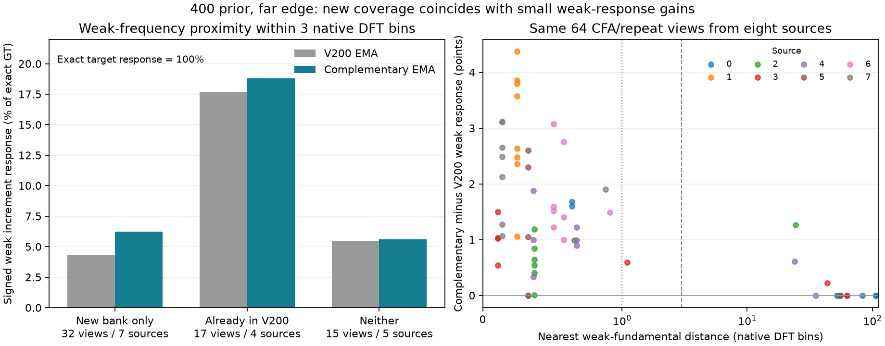
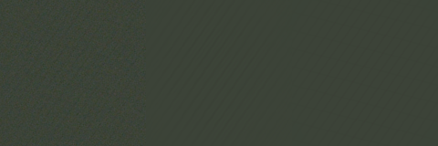

# Nearby weak-frequency proposals coincide with small response gains

The complementary branch's extra carrier coverage is associated with most of its
small lower-noise weak-response gain. **Large attenuation remains even among
views with a carrier very close to the weak fundamental.** This joins the
[closed input-only proposals](complementary-cfa-branch.md) with the
[completed actual-increment evaluation](complementary-edge-response.md);
it does not train or change a model.

The association is descriptive. Groups contain different source geometries and
noise/CFA views, so they do not isolate a causal effect of carrier allocation.
V120 remains the general recommendation. The full-model attention comparison
continues separately with its [matched endpoint review queued](raw-spatial-endpoint-review.md).

## What the extra coverage contributes

At the 400 prior, far from the strong edge, classify the two-direction input by
whether its nearest weak-fundamental carrier is within three native DFT bins.
“New bank only” means the inherited bank misses this neighborhood and the
additional bank reaches it. “Already in V200” takes priority when both do.
Each mean is over the listed views, without reweighting partially represented
sources.

| Closed coverage group | Views / sources | V200 EMA weak response | Complementary EMA | Paired change |
| --- | ---: | ---: | ---: | ---: |
| New bank only | 32 / 7 | 4.318% | 6.252% | +1.934 points |
| Already in V200 | 17 / 4 | 17.694% | 18.800% | +1.107 points |
| Neither | 15 / 5 | 5.467% | 5.606% | +0.139 points |

Weighting these paired changes by 32/64, 17/64 and 15/64 exactly recovers the overall
**+1.2935-point** weak-response gain. The newly covered group contributes
0.9669 points, about 75% of that aggregate change. This is an arithmetic
decomposition, not an estimated effect of assigning a carrier to a random view.
The source groups overlap and differ in difficulty.

At 1600/far, 12 newly covered views from four sources improve 3.007%→4.450%,
versus 2.753%→2.906% in 48 views still outside the neighborhood. Quiet error rises
slightly in both groups. At 400/far, the newly covered group's quiet difference
is −0.01745 DN16 RMS, while the “neither” difference is +0.000183 DN16. These
conditional means do not establish a calibrated false-detail bound.

The right panel shows all 64 paired differences, colored by the eight underlying
sources; dotted/dashed lines mark one/three native DFT bins. Different CFA/noise
views of one source are related observations. No significance inference is made
from their apparent number.

## Closer frequency matches still leave most of the weak increment missing

Using the stricter one-bin threshold already present in the original diagnostic:

| Prior / placement | Close views /64 | Sources represented | Complementary EMA weak response within this subset |
| --- | ---: | ---: | ---: |
| 6400 / near | 0 | 0 | — |
| 6400 / far | 0 | 0 | — |
| 1600 / near | 2 | 2 | 4.335% |
| 1600 / far | 12 | 5 | 5.866% |
| 400 / near | 21 | 5 | 7.724% |
| 400 / far | 48 | 8 | 10.704% |

The last subset includes all eight sources, yet averages only 10.7% of the exact
weak increment. This does **not** prove that the same measured-wave basis could
reconstruct it well: finite support, local phase/color fits, coefficient
modulation and learned shrinkage still matter. A close global carrier is not a
representation bound or an independent confidence measure.

This favors checking physical wave fits and learned attenuation with carriers
held fixed before concluding that another frequency selector alone will solve
the failure. A useful next diagnostic would compare the same measured basis's
known-target fit against its learned correction, with explicit oracle labeling;
the target must never enter an inference proposal or confidence score.

## The native views remain the same

Noisy Malvar → **complementary EMA** → exact constructed GT, source0/source1
far from the edge at 400. Every cell is an unchanged 160×160 crop from native 512
RGGB, ROI `[176,176,160,160]`, shot 0.00008/read 2.56e−8, black level 0.03,
16-bit ADC, exposure 2/contrast 1 and shared WB/matrix/sRGB.

EMA checkpoint SHA256:
`0d87687b7224d40c7d0de998efc1aafc3f4a3016fe77b9d1dc91666007a3083b`.
[Full crop/noise/display/source bindings](images/complementary-edge-response-v1/manifest.json).
These previously inspected pixels are reused unchanged. The
[full model report](complementary-comparison.md) retains both protected GFX
families, both cab ROIs/profiles/JPEGs, foliage, chain-link, sky/building, and
flat/color failures. Real ISO100 references remain qualitative, not exact GT.

## Exact joins and complete CUDA verification

All 384 previously closed batches were checked on CUDA using the exact frozen
package used for trained evaluation: 768 selector calls, 36,864 integer coordinates,
18,432 validity values and 603,979,776 measurement-field channels match exactly.
This constructs no neural module and performs no model/readout/parent/DINO
forward, new source/noise draw or optimizer update. RNG remains unchanged.
The check follows existing scoring; it is a backend verification of fixed
choices, not a new independent discovery experiment.

A CPU-only analysis independently recomputes all 6,912 native geometry distances
(maximum discrepancy 2.84e−14 bins), checks 9,984 exact zero-gain metrics against
the full V200 EMA control, and verifies every observation/condition and inherited-
plus-additional bank concatenation. Both raw/EMA endpoints, all three profiles,
near/far placements, and both original 1/3-bin thresholds are retained. Fixed
weak-frequency coincidences in absent roles remain in the archive; they are not
the false-activation rate of the complete selection procedure.

All 17 focused join/geometry/zero-anchor/partition tests pass and Ruff passes.
Two stopped preparation/launch prefixes performed zero CUDA selector or neural
calls and remain preserved. No training job was signalled or restarted.
[Analysis and exact verification archives](results/complementary-coverage-quality-v1/publication.json).
