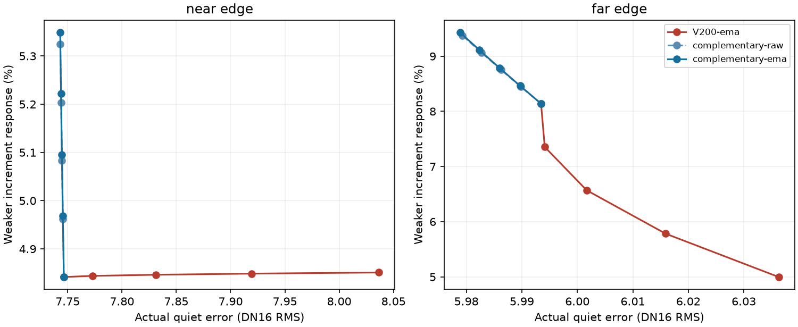
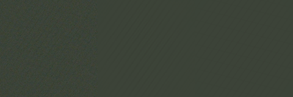
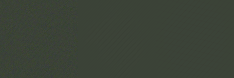

# Complementary carriers improve some lower-noise weak increments

The three-noise review is complete: **1,152 cached observations, both endpoints,
five gains, all 12 native comparisons/12 triplets and three curves inspected**.
The added branch improves far-edge weak response at the 1600 and 400 priors,
while retaining the mean strong response. At 400, near/far quiet means also
fall slightly. This is a useful conditional gain over V200 EMA, alongside the
[almost unchanged fixed meshes and persistent real-photo failures](complementary-comparison.md).

V120 remains the general recommendation. The added branch has extra capacity
and 900 additional training updates; this does not isolate carrier allocation
at equal compute. Its [input-only proposal coverage](complementary-cfa-branch.md)
is a separate diagnostic.

## Actual increments on the same observations

The existing panel contains eight finite-wire sources, near/far strong edges,
zero/one/two-direction roles, four CFAs and two independent noise repeats.
The strong increment compares one direction against zero; the weak increment
compares two directions against one. These differences use the actual neural
outputs with their respective noise, not a Fourier-sector surrogate. The
projection templates and targets enter evaluation, not model inference.

All cases reuse the closed three-profile cache and saved V200 controls.
No source/noise is generated, no parent/DINO inference runs, and no weights
change. All 905,969,664 anchor RGB channels are exact; actual full-forward
delivery bridges cover 14,155,776 channels. Weight and RNG snapshots remain
unchanged. [Exact evaluation receipt](results/complementary-edge-response-v1/scores.json.gz).

Both complementary raw/EMA states compare with **the same V200 EMA control**.
Candidate gain zero is the complete V200 EMA output. The red V200 curve still
scales its original correction above V195, so the red gain-one endpoint equals
the candidate gain-zero point. Equal gain labels along those two paths have
different definitions; all reported paired endpoint differences use gain one.

## Lower-noise gains and remaining costs

EMA signed conditional response is percent of the exact increment. Quiet error
is actual camera-RGB DN16 RMS. Higher response alone does not imply a correct
complete reconstruction.

| Prior / placement | Strong: V200 → complementary | Weak: V200 → complementary | Quiet RMS: V200 → complementary |
| --- | ---: | ---: | ---: |
| 6400 / near | 8.477% → 8.545% | 0.992% → 0.985% | 26.393020 → 26.393793 |
| 6400 / far | 24.181% → 24.204% | 1.496% → 1.529% | 11.598030 → 11.598777 |
| 1600 / near | 31.848% → 31.864% | 2.896% → 2.954% | 11.239177 → 11.239578 |
| 1600 / far | 60.637% → 60.723% | 3.133% → 3.525% | 6.905623 → 6.906101 |
| 400 / near | 55.556% → 55.671% | 4.842% → 5.349% | 7.746460 → 7.743103 |
| 400 / far | 86.741% → 86.882% | 8.140% → 9.434% | 5.993460 → 5.978843 |

At 400/far, the weak response increases **1.2935 percentage points**; the
exploratory paired source-bootstrap 95% interval is +0.7433 to +1.9473 points.
The quiet mean falls 0.014617 DN16, with an interval of −0.043907 to +0.000166
DN16, so that quiet improvement is uncertain across these eight sources.
At 400/near, weak response rises 0.5075 points and quiet error falls 0.003357
DN16; their intervals are +0.2000 to +0.8617 points and −0.006500 to −0.000813
DN16. Full-image RMS falls 0.010441/0.012916 DN16 near/far.

At 1600/far, weak response rises 0.3913 points (interval +0.0890 to +0.8216),
with slightly higher quiet error and 0.001589 DN16 lower full-image RMS.
At 6400/near the weak response declines, and quiet means rise at both 6400
and 1600 placements. Full-image error is slightly higher in three of six
conditions. Raw shows the same practical pattern.

Intervals use 5,000 paired source-cluster resamples after averaging CFA/repeat
views within each source. There are **eight sources**, reused across noise
profiles, rather than 1,152 independent scenes. This proposal-informed
development panel is exploratory, with no calibrated false-detail guarantee.
[All means, increments, orthogonal errors and intervals](results/complementary-edge-response-v1/analysis.json.gz).

[1600 curve](images/complementary-edge-response-v1/iso1600-curve.png) ·
[6400 curve](images/complementary-edge-response-v1/iso6400-curve.png).

## Native pixels still show substantial attenuation

Noisy Malvar → **complementary EMA** → exact procedural GT, source0 and source1
far from the edge at the 400 prior. Every cell retains 160×160 pixels from
native512 RGGB context, ROI `[176,176,160,160]`, shot 0.00008/read 2.56e−8,
black level 0.03/16-bit ADC, exposure 2/contrast 1, shared WB/matrix/sRGB.

The gain remains small compared with the missing weaker direction. The selected
views remain predominantly single-family, especially near strong edges. At
6400/1600 the candidate looks extremely close to V200; there is no clear new
complete-crossing recovery. Ordinary strong-edge shape remains intact.

EMA checkpoint SHA256:
`0d87687b7224d40c7d0de998efc1aafc3f4a3016fe77b9d1dc91666007a3083b`.
The 1600 profile uses shot/read 0.00032/4.096e−7; 6400 uses
0.00128/6.5536e−6. All display coordinates/transforms stay fixed across methods.
[Every source/ROI/checkpoint/noise/display binding](images/complementary-edge-response-v1/manifest.json).
The `complementary` preset exposes this component with an explicit checkpoint;
it consumes cached parent RGB and RAW, as the other experimental wave stages do.

All 921,600 newly displayed candidate RGB channels and 3,686,400 retained
comparison channels match their saved predictions/inputs. All 2,764,800 triplet
channels match the corresponding comparison cells, without resizing. The
[publication evidence](results/complementary-edge-response-v1/publication.json)
preserves original receipt bytes and frozen analysis sources. Both protected GFX
families, foliage, chain-link, sky/building, cab profiles/JPEGs and high-noise
flat failures remain part of the [full main report](complementary-comparison.md).
