# Local phase fitting makes the crossing mesh more visible

The later [TV phase envelope](edge-phase-envelope.md) gives clearer real mesh and
less average blank spill, with texture/highlight costs. It is now the optional
stage's default; use `--phase-harmonic-envelope complex` to reproduce this report.

**Letting wave phase vary locally improves the real fine-mesh lattice while
preserving every pixel in the tested wider sky.** This is the current experimental
`--phase-harmonic-envelope complex` mode, with scalar and TV retained explicitly.
Recovery stays soft and incomplete. Fresh procedural results show less average
blank-region spill, slightly weaker texture recovery, and a blank-region
regression in one of the two active recipes.

[Implementation](../src/demosaic/phase_envelope.py) ·
[Actual execution](results/complex-phase-envelope-publication-v1.json) ·
[Locked 64-recipe results](results/complex-phase-envelope-prospective-v1.json) ·
[Independent metrics and port audit](results/complex-phase-envelope-independent-audit-v1.json) ·
[Source/ROI/noise/display metadata](images/complex-phase-envelope-v1/manifest.json).

## What changes

The [scalar implementation](phase-harmonic-inference.md) fits a global harmonic
phase, then estimates a nonnegative local amplitude. Perspective, wire curvature
or an imperfect FFT-bin frequency can leave a real local component out of phase
with that template. An amplitude multiplier cannot repair that mismatch.

The new mode fits local cosine and sine coefficients jointly to both measured
green phases. A Gaussian of native sigma 32 uses each phase's physical position.
For design vector `t`, weights `k/variance`,
`G=sum(k*t*t'/variance)` and `H=sum(k²*t*t'/variance)`, the fixed-fit noise proxy is
`G⁻¹HG⁻¹`. Local coefficients define a complex ratio to the global green phasor;
that ratio rotates and scales the three global RGB phasors together. Shrink is
`max(0,1−9/power)`, magnitude is capped at 3, and the existing global gate 9 and
32-pixel output aprons remain. The same even-origin 256px grid and overlap blending
work on complete images. Neither references, GT nor RNG enter correction.

The frequency selector is unchanged: at most four peaks, radial 0.03–0.22,
positive signed green coherence>0.8 and cross/noise>5. Both fence directions were
already detected in centred patches. A separate higher-band check found too
little evidence for most higher harmonics; those bands were not added. Local
phase flexibility, rather than a lower selection threshold, produces this change.

Selection, affine fitting and observed variance reuse the same input. The noise
proxy omits that uncertainty and **is not calibrated confidence**. Nine is a
fixed shrink setting, not a validated false-positive probability.

## Running either mode

```bash
source scripts/env.sh
uv run demosaic infer /mnt/external/demosaic/models/v143-final5000.pt photo.raf \
  /mnt/external/demosaic/output/photo-complex-linear.tiff \
  --preview /mnt/external/demosaic/output/photo-complex-srgb.tiff \
  --shot 0.00128 --read 0.0000065536 --precision float 32 \
  --tile 512 --overlap 64 --batch-size 4 \
  --phase-harmonic --phase-harmonic-envelope complex
```

Select `--phase-harmonic-envelope complex` for this version; use
`--phase-harmonic-envelope scalar` to reproduce the earlier amplitude-only
correction. Ordinary inference keeps the stage disabled. Noise coefficients above
are the tested nominal prior, not universal camera calibration. The sidecar
records envelope, method version, time and active windows. No learned weights change.

## Fresh locked validation: benefits and costs

The setting was chosen on the standing development scenes and previously used
16 recipes, then frozen **before generating or inspecting 64 fresh recipes**.
Each has present/absent states, four CFAs and nominal ISO6400 conditioning:
512 actual V143 root/DINO calls, zero new V120-control calls. Native256 inputs
retain the original continuous 512→geometry→area2 generator, scene level 0.02,
shot 0.00128/read variance 6.5536×10⁻⁶, ADC16/black0.03. GT enters scoring only.
Checkpoint SHA256:
`96d146d017c54196288c585f8b7eddcf030e8a235061049c31e985b9380b7ce4`.

Only two of 64 present recipes activate, across four CFAs each. The other 62
remain unchanged. **All 256 absent inputs retain every parent value.** Values
below are means of per-case quantities across all 256 present cases; RMS means
are not pooled-pixel RMS or independent training-run statistics.

| Fresh dark present cases | V143 parent | Scalar | Complex |
| --- | ---: | ---: | ---: |
| Known-template gain, ideal1 | .00297 | .00862 | .00803 |
| Native 160 spatial error,RMS DN16 | 10.39057 | 10.25068 | 10.25911 |
| Complete256 error,RMS DN16 | 9.16873 | 9.08186 | 9.08741 |
| Added field in complete-patch exact-blank pixels,RMS DN16 | 0 | .02624 | .02095 |
| Error in those blank pixels,RMS DN16 | 6.44637 | 6.45012 | 6.44823 |
| Worst per-case added blank-region RMS,DN16 | 0 | 2.61196 | 1.53815 |

Complex reduces mean added blank structure 20.13% and the worst per-case value
41.11% versus scalar. Scalar retains slightly more procedural texture and lower
error. The blank benefit is **not uniform**:

| Active recipe, mean of four CFAs | Scalar added blank RMS,DN16 | Complex added blank RMS,DN16 | Scalar blank error,DN16 | Complex blank error,DN16 |
| --- | ---: | ---: | ---: | ---: |
| 2026110260 | .26744 | .57292 | 7.19233 | 7.22912 |
| 2026110273 | 1.41170 | .76813 | 6.72395 | 6.56592 |

The first recipe gets worse in blank regions. Both modes still exceed the parent
blank error, and most very weak meshes remain undetected. This is a useful
real-photo tradeoff, not uniformly better demosaicing or a solution to flat-region
hallucination. The earlier 16 development recipes show lower complete-patch error
and 43% less added blank structure on their active recipe; they are not fresh
validation for this setting.

## Native exact-GT examples

Noisy Malvar → complex correction on V143 → **exact procedural GT**.
The two active recipes and first inactive recipe are shown after the full
evaluation. Cells are unchanged 160×160 pixels at ROI `[48,48,160,160]`, with common
WB/matrix/+3EV display. Full parent/scalar/complex comparisons and all recipe
metadata remain in the manifest. Example selection is disclosed, not blind.

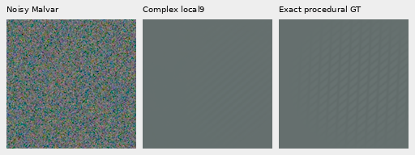

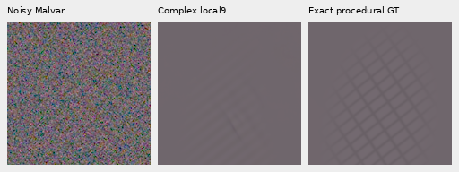

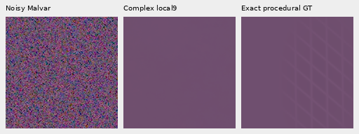

## Complete GFX frames

The same three complete 101.996MP V143 FP32 parents, normalized RAW arrays and
scalar results from the [earlier full-frame execution](phase-harmonic-inference.md)
are reused exactly: main DSCF3879 fixed historical Haar; extra DSCF3842 nominal
and nearby-Haar priors. This adds **zero neural calls, RAW decodes or noise draws**.
All 71 current package modules match the frozen execution; the earlier 70-module
and 69-module snapshots and receipts remain preserved. The parent model equations
and old scalar functions are unchanged.

Main rows: noisy → V120 → V143 → scalar → complex → independent DSCF3880 ISO100,
**not GT**. Native 160 cells retain the original ROIs/shared+2EV and camera transform.
The sky stays quiet, foliage stays painterly, and changes in building/fence
detail remain small.

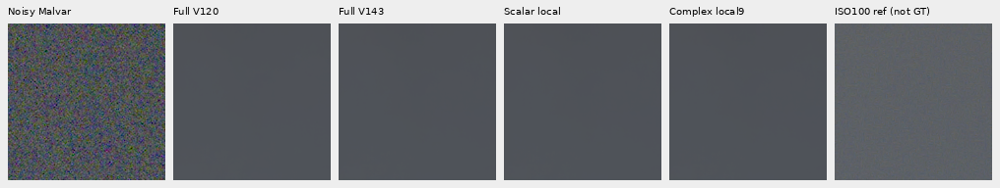

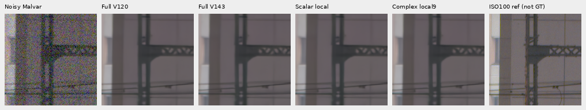

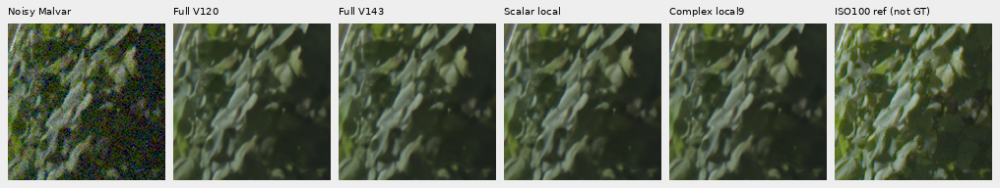

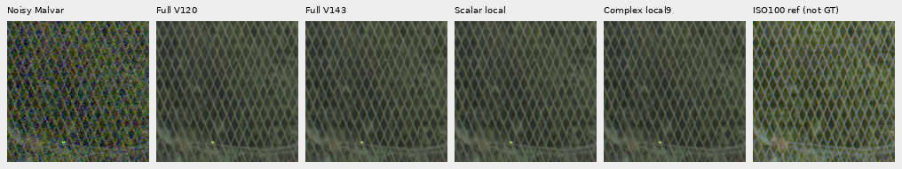

Fine mesh rows: noisy → V143 → scalar → complex → independent DSCF3835 ISO100,
**not GT**. Left/right native ROIs begin `[806,6489]`/`[1026,6449]`; common+4EV,
original reference integer shift, WB/matrix and coordinates are unchanged.
Nominal prior is shot 0.00128/read variance 6.5536×10⁻⁶. Nearby prior is
shot 0.0014635775921166604/read variance 1.0715704128646712×10⁻⁶, fixed from DSCF3879
rather than calibrated to this capture. Aperture, exposure time and motion differ.

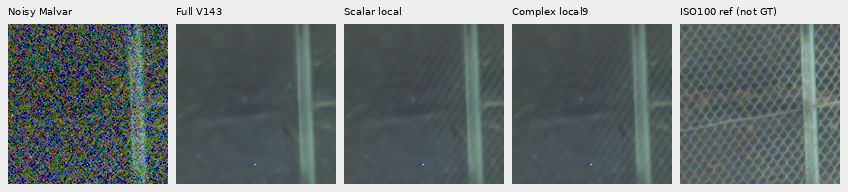

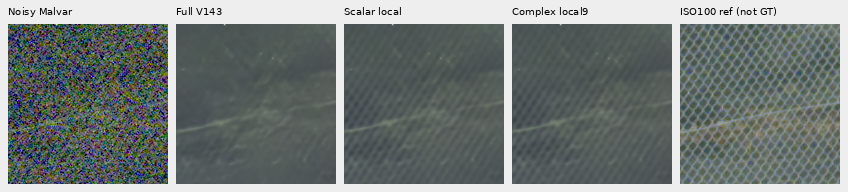

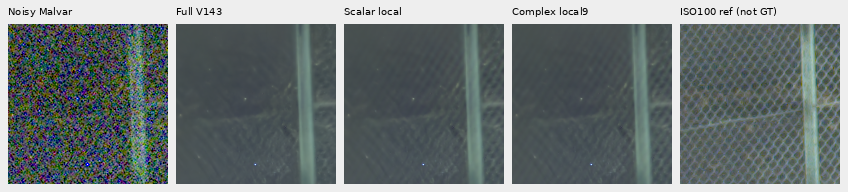

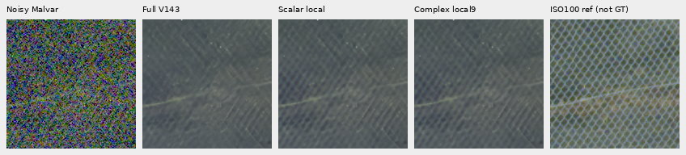

Both directions become more visible, especially on the right, but remain soft,
uneven and weaker than ISO100. Centred256 windows show a stronger difference
than some regular-grid locations. This is still dependent on window placement.
Both camera JPEGs are preserved below: noisy → V143 → complex → ISO6400 JPEG →
independent ISO100 AHD → ISO100 JPEG. JPEG processing and capture differences
prevent exact-GT interpretation.

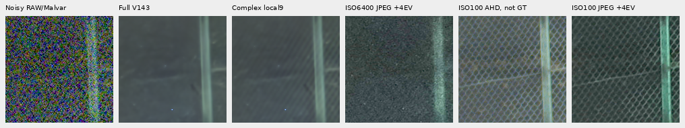

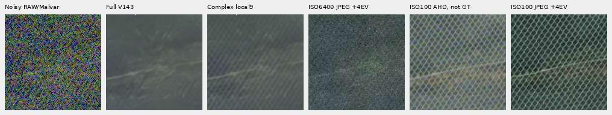

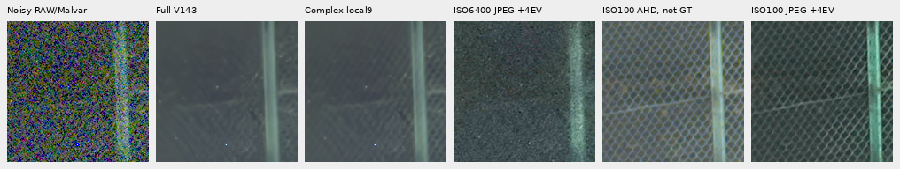


## Flat support, stronger changes and cost

The previously input-selected 2.88MP sky box `[5200,200,2400,1200]` retains every
parent pixel under complex correction. The three native sky views are in the
manifest. On existing fixed support, all 96 photographic and 48 exact-uniform
inputs per parent retain their V120/V143 values, preserving the earlier faint
gains and costs. The earlier 924-window large-flat check selected zero peaks;
unchanged selection therefore gives the same exact bypass, derived from its
receipt rather than presented as a fresh execution.

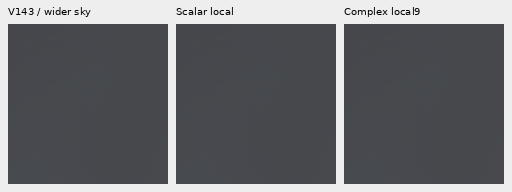

The largest added fields remain around a bright sign. At the outcome-selected
160px regions, complex versus scalar RGB RMS is 1098/678 DN16 in the main scene,
1844/920 nominal mesh scene and1585/799 nearby scene. Max individual complex
changes reach 9038 DN16. The common−2EV views below reveal unclipped highlights:
noisy → V143 → scalar → complex. Lettering remains soft; stronger edge/color
changes do not establish correct recovery. These are added-field magnitudes,
not exact-GT improvement scores.

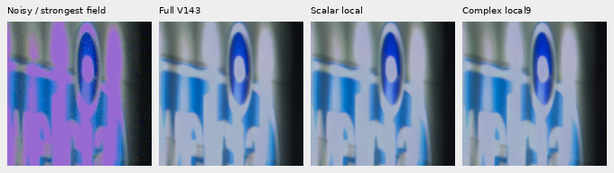

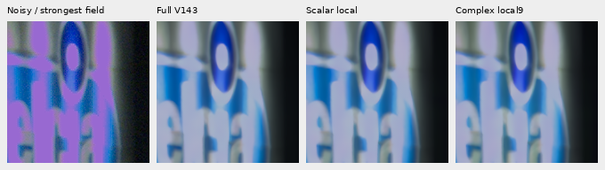


CPU correction takes 134.18/103.55/126.64s for main/nominal/nearby on three
concurrent CPU jobs with one BLAS/Torch thread each. These contended observations
are not a speed comparison with the older sequential timings; 100MP/10s remains
open. All outputs retain linear camera RGB until final rendering and RGB16 export.

## Verification and remaining work

Independent 10-column affine/template solves check all 1,536 fresh metric rows,
maximum gain difference 7.41×10⁻¹⁵. Public code matches 201,326,592 private prototype
values from 1,024 fresh/reused patches exactly. Twelve whole-context scalar
compatibility checks agree within float 32 rounding. Dense physical-coordinate
WLS/covariance tests cover all four CFAs; known bending-phase tests verify the
new capability, and an actual CLI/export test uses a declared neural stub.
All 55 relevant tests pass. The fresh 512 real neural calls independently retain
complete model/backbone/input/RNG integrity.

Full-stage receipts retain the original parent invocation metadata; their separate
`refinement` field describes the new complex envelope and measured timing.

All 917,962,668 linear RGB16 channels verify exactly against saved FP32
clip/round/orientation. Complete sRGB16 previews agree with independent float64
rendering within one output DN16; 16-bit/ICC tags verify. Independent direct
rendering and unchanged-native-cell checks cover 8,678,400 PNG channels across
all 24 actually viewed boards. No crop pixels resize.
[Complete export/native audit](results/complex-phase-envelope-native-audit-v1.json).

Stronger fine mesh with quieter average blank spill is useful, while incomplete
weak-detail recovery, the per-recipe blank regression, uncalibrated confidence,
large changes near highlights, window sensitivity and speed remain unresolved.
Full427/camera quality for V143 remains unmeasured; V120 stays the validated
general recommendation. The improvement goal remains active.
