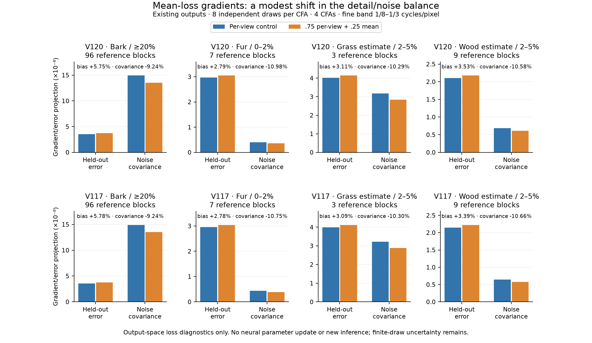

# What the mean-loss term changes

**The .25 mean-loss term gives a modest shift toward persistent detail error
on the saved V120/V117 outputs.** On the selected weak fur, grass and wood
bands, V120's error-correcting gradient projection rises by 2.8–3.5%, while
its noise-associated projection falls by 10–11%. This supports the
[queued V124/V125 comparison](conditional-mean-training.md). It is a loss
diagnostic; the predictions are unchanged and trained quality is unmeasured.

The existing camera, display, edge and CFA terms already support correction:
all 480 tested component/CFA/contrast-stratum projections are positive.
The highlight term has zero projection in these fine-band strata. This gives
no reason to remove an existing loss component on these examples.

[Standalone SVG](images/conditional-loss-gradients-v1/gradient-projections.svg) ·
[All 912 projection rows and 228 CFA averages](results/conditional-loss-gradients-v1.json) ·
[Execution, hashes, independent verification and actual plot review](results/conditional-loss-gradient-review-v1.json).
The units are the same within each axis; axes have separate scales.

## Fixed comparisons

Each row uses the same reference-selected band as the
[independent-noise diagnostic](conditional-noise-response.md): orthonormal
16-pixel DCT blocks, radial frequencies 1/8–1/3 cycles/pixel, reference linear
luma .02–.9 and minimum band RMS 1e-5. Contrast is band RMS divided by block
mean. The projections use camera-RGB coefficients; rendered luma selects the
blocks. No mask or loss weight was selected from these gradient results.

The table gives percentage changes in **loss-gradient projections** for
.75 per-view + .25 mean loss versus the per-view control:

| Reference / contrast / unique blocks | V120: bias / noise covariance | V117: bias / noise covariance |
| --- | ---: | ---: |
| Bark, ≥20%, 96 blocks | +5.75% / −9.24% | +5.78% / −9.24% |
| Fur, 0–2%, 7 blocks | +2.79% / −10.98% | +2.78% / −10.75% |
| Grass estimate, 2–5%, 3 blocks | +3.11% / −10.29% | +3.09% / −10.30% |
| Wood estimate, 2–5%, 9 blocks | +3.53% / −10.58% | +3.39% / −10.66% |

Strong bark gets a larger relative bias-projection change than the weak
examples. The term changes the general detail/noise balance; it does not
specifically select faint photographic detail. Full trained comparisons must
still assess grain, color, camera consistency and the difficult real mesh.
The bank of twenty reviewed regions and zero-PSF recipe remain unchanged.

## What the projections mean

For eight independent outputs of one fixed scene/CFA, the collector computes
the complete reconstruction loss gradient for each output and all 28 pair
means. For a pair, the six unused outputs estimate its target error without
sharing the two noise draws used to form that pair's gradient.

The **bias projection** is the inner product of the pair's common gradient
and this held-out mean error. Positive values mean a negative output-gradient
step would oppose the persistent error. The **noise covariance projection**
is its same-view error projection minus the held-out projection: it measures
gradient response associated with input-noise variation. It is not a measured
change in the denoised output's variance.

For gradients normalized to a single image, with pair mean m:

~~~text
g_i = d loss(p_i) / d p_i
h_ij = d loss(m) / d m
g_mixture_i = .75 g_i + .25 h_ij
~~~

For squared error, the held-out bias projection is unchanged and noise
covariance is multiplied by .875. The actual Charbonnier/rendered/edge loss
has the modest additional bias response measured above. Signed finite-draw
estimates are retained; eight draws and four deliberately selected targets
do not establish population or training-seed uncertainty.

These are **output-space gradients**. A neural parameter update also contains
the model's Jacobian, and can behave differently. Positive component
projections do not establish that neural parameter gradients never conflict,
that the missing structure is identifiable, or that V125 will improve PSNR.

## Complete loss replay and checks

For this pretrained-RGB architecture, the auxiliary prediction is exactly the
Bayer sampling of the final RGB output. The saved RGB predictions therefore
suffice to replay all five weighted terms, including CFA supervision, with no
new neural execution. The clean camera target stays unchanged. A reference-white
display target is derived using the current training convention only for the
loss replay; it does not replace the archived evaluation target.

The replay uses sensor-valid supervision, epsilon .0003, camera/display/edge/
highlight/CFA weights 1/.5/.1/.1/.1, and zero normalized/interval/band weights.
Both checkpoint configurations confirm sensor-valid/.0003 training. The same
full objective is applied to both endpoints. Each group uses one fixed target;
a heterogeneous training batch can change masked-term normalization.

There are 32 scene/model/CFA groups: four targets, two models and four Bayer
layouts. Each group contains eight saved outputs and 28 mathematical pair
means, giving 1,152 output states, 160 component-gradient calls and 64 direct
replays of the planned control/mean-loss wrapper. Autograd is CPU-only; every
neural Module call is forbidden. Torch RNG is unchanged and CUDA uninitialized.
There are **zero new model/encoder calls, noise observations, RAW decodes or
optimizer updates**.

Independent NumPy formulas check both physical sensor derivatives; maximum
relative error is 2.45e-7. Reconstructed component gradients match direct
planned-wrapper gradients within 3.14e-7 relative error. A separate NumPy-only
implementation, using explicit block extraction and cross-product matrices,
reproduces 16,416 scalar fields across all 912 rows within 6.08e-18 and checks
all 228 CFA averages. Reference contrast strata match the original diagnostic.
Thirteen focused tests cover the squared-error identity, signed estimates,
nonlinear held-out products, component additivity and full-wrapper replay.

[Collector/analyzer](../scripts/analyze_conditional_loss_gradients.py) ·
[Projection implementation](../src/demosaic/conditional_gradient.py) ·
[Plot source](../scripts/plot_conditional_loss_gradients.py).
Executed sources, gradients and receipts are retained under
.cache/current-quality-20261023-v1/conditional-loss-gradients-v1.

## Existing native scene examples

These unchanged triplets supply scene context: noisy → V120 single draw0 →
exact synthetic target. Each cell is native160 at ROI [48,48,160,160] of the
256-pixel context; shared WB [2,1,1.5], matrix and exposure ×1, with no resizing.
The synthetic ISO12800 prior is shot .00256/read variance 2.62144e-5,
ADC16/black .03. The gradient study produces no new denoised images.

V120 SHA256: a9d9b6b4f974e24a6b11e5e740aab32314233a7f53c056cf37c7d2aac1c589fb.
[Source/ROI/checkpoint/noise/display metadata](images/conditional-noise-response-v1/manifest.json).
Bark is by [Derek Ramsey](https://commons.wikimedia.org/wiki/File:Kentucky_Coffee-tree_Gymnocladus_dioicus_3264px.jpg),
[CC BY-SA2.5](https://creativecommons.org/licenses/by-sa/2.5/);
fur is by [Korall](https://commons.wikimedia.org/wiki/File:Racoon_clinging_to_a_tree.JPG),
[CC BY3.0](https://creativecommons.org/licenses/by/3.0/).
Both were modified by binning, synthetic noise, restoration and display conversion.
The two native camera targets in the numerical study are binned low-noise
reference estimates that retain source noise/optics, **not exact GT**.
