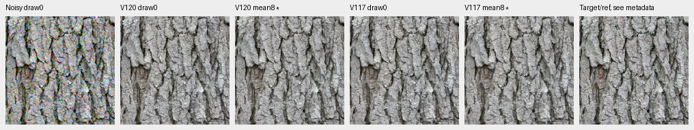
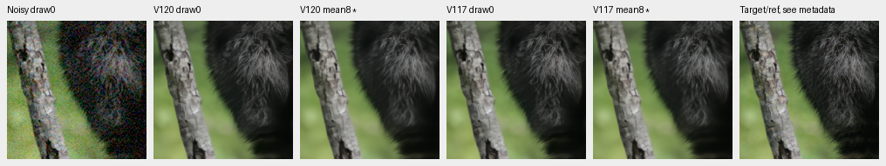
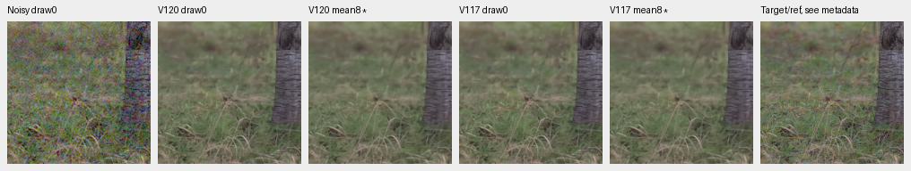
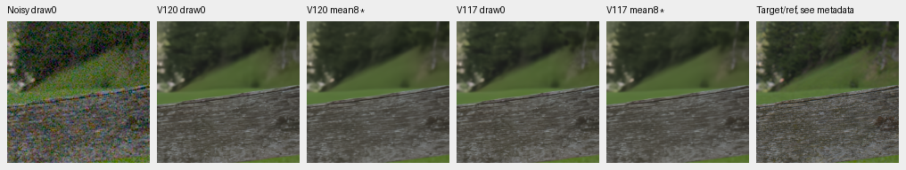
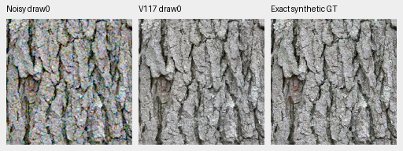
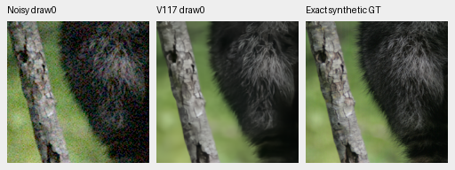

# Persistent detail error across independent noise

**Faint fur and wood detail remain biased after averaging independent V120
restorations.** Eight noise realizations per Bayer layout separate persistent
error from output variance on four fixed photographic targets. V117 behaves
similarly. Strong bark detail is mainly variance-limited instead. This supports
testing a conditional-mean training loss; it does not identify a cause or prove
that reducing bias will improve the single-capture noise/detail balance.

[Full inputs, checkpoints, per-layout moments and actual native review](results/conditional-noise-response-v1.json).
This is a new diagnostic with128 new shared observations and256 root/encoder
forwards, with no reference-network call, RAW decode or training. Existing
primary, camera, GFX and mesh results are preserved.

## What the decomposition measures

For one fixed target and CFA, let `e[k] = prediction[k] - target`, with eight
independent input-noise draws. All operations below use unclipped linear values.
The squared sample mean error includes residual variance from its finite sample:

```text
sample_variance = sum((e[k] - mean(e))²) / (K - 1)
estimated_squared_bias = mean(e)² - sample_variance / K
empirical_mean_squared_error = estimated_squared_bias + sample_variance
```

Spatial/coefficient averages follow these elementwise operations. The corrected
bias estimate can be negative and is retained without clipping. Four CFAs are
analyzed separately, then averaged; they are not additional noise realizations
of one layout. Eight draws do not establish population or training-seed
uncertainty, and these deliberately selected sources are not a full benchmark.

Independent pairwise cross-error products reproduce all32 camera-RGB group
estimates within5.43e−20. The maximum decomposition identity error is2.17e−19.
Eight focused tests cover cross-draw equivalence, negative finite-sample bias
estimates, deterministic bias and invalid groups. Implementation:
[conditional_bias.py](../src/demosaic/conditional_bias.py).

## Where error persists

The local band uses orthonormal16px DCT blocks, radial frequencies1/8–1/3
cycles/pixel, reference luma.02–.9 and band RMS≥1e−5. Contrast is reference
band RMS divided by block mean, selected without model outputs. Values below
are V120 averages over all four CFAs; the selected group is stated explicitly.

| Target / reference | Contrast group | Unique blocks | Mean projected gain | Estimated bias share of band MSE |
| --- | --- | ---: | ---: | ---: |
| Bark, exact synthetic target | ≥20% | 96 | .97095 | 12.11% |
| Raccoon fur, exact synthetic target | 0–2% | 7 | .31704 | 84.56% |
| GFX50S II grass/root reference estimate | 2–5% | 3 | .59263 | 42.34% |
| Leica SL wood-rail reference estimate | 2–5% | 9 | .63563 | 69.70% |

V117's corresponding gain/bias shares are.96863/12.52%,.31945/83.21%,
.59416/41.76% and.62425/71.71%. Differences between these versions are small.
Whole-ROI camera-RGB bias shares differ from these selected bands: V120 has
27.08% bark,45.89% fur,50.36% grass and46.69% wood. A whole-image score therefore
does not characterize every fine-detail region.

The native references retain reduced source noise and optics; their band
response is not exact noiseless scene-detail recovery. Bark/fur use the exact
prepared synthetic targets from the original held-out Commons panel, not a
claim that the source photographs themselves were noiseless.

## Native diagnostic comparisons

Every cell is unchanged160×160 at the8×-binned reference resolution, from the
central `[48,48,160,160]` of its256px context. Shared WB/matrix and exposure×1;
RGGB, ISO12800 prior shot.00256/read2.62144e−5, ADC16/black.03. Noise was
generated once on CPU with distinct recorded seeds, then reused across models.
Input/target/variance fingerprints and unchanged model/backbone hashes verify.

**`mean8*` is a diagnostic using eight independently noisy observations. It is
unavailable from a single capture and is not a new inference mode or quality
improvement claim.** Columns: noisy draw0, V120 draw0, V120 mean8*, V117 draw0,
V117 mean8*, target/reference. All four boards were actually viewed.









Mean8 reduces visible noise, but fine fur, background grass and some wood
irregularity remain soft. Strong bark retains coherent texture. The noisy
draw0 cell is one of the eight observations used by the diagnostic.

Two small **single-draw** noisy → V120 → exact synthetic GT triplets:


Same observations and transform, V117:





All3,686,400 published panel channels independently match the retained inputs,
predictions and computed means with explicit-channel NumPy64 display arithmetic.
[Source/ROI/checkpoint/conditioning/display and diagnostic metadata](images/conditional-noise-response-v1/manifest.json).

Sources: [Derek Ramsey, Kentucky Coffee-tree](https://commons.wikimedia.org/wiki/File:Kentucky_Coffee-tree_Gymnocladus_dioicus_3264px.jpg),
[CC BY-SA2.5](https://creativecommons.org/licenses/by-sa/2.5/), and
[Korall, Racoon clinging to a tree](https://commons.wikimedia.org/wiki/File:Racoon_clinging_to_a_tree.JPG),
[CC BY-SA3.0](https://creativecommons.org/licenses/by-sa/3.0/); two per-file CC0
camera captures from the [existing source catalogue](native-camera-development.md).
Modified by binning/cropping, simulated noise, restoration and display conversion.

## Next controlled training change

Test a convex mixture of the existing per-view reconstruction loss and the same
loss applied to the mean restored signal from two independent corruptions of
one clean target. Proposed mean-loss weight.25 versus a matched zero-weight
control; both arms must use the same two noisy views and unique-target count.
For squared error, the mean term weights conditional bias more heavily relative
to variance. That identity alone does not establish the behavior of the actual
Charbonnier/rendered/edge objective or photographic quality.

Use the current V120 architecture/parent and prepared90784-source/twenty-region
data. Pair only simulated-noise Commons/native targets; keep real paired input
steps on their existing single-observation path. Avoid loading examples that
the paired-view layout would discard. Preserve the current zero-blur recipe,
and compare noise, camera color and real weak detail alongside photo PSNR.
This change is **proposed, not implemented or trained** here. The active
V123 run and original endpoint-review chain remain unchanged; no model choice,
noise estimator or inference strength changes from this diagnostic.
