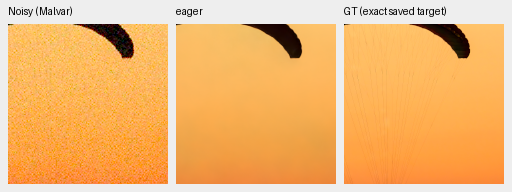
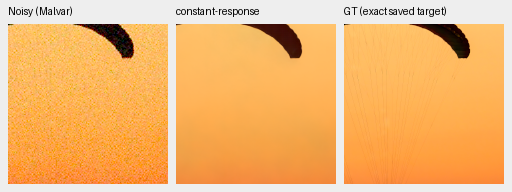
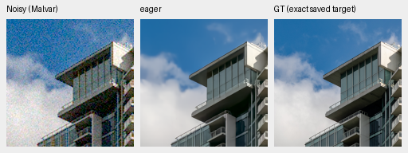
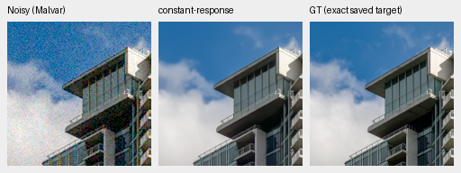

# Constant-response subtraction fails the small CPU gate

**Reject this fixed correction; leave production unchanged.** It improves one
saved photograph and some colors, but worsens the other photo, neutral and blue.
No training or parameter search follows this failure.
[Actual execution, input/checkpoint hashes, 24 independent camera metric checks and 12 actual native views](results/constant-response-CPU-v1.json).

The completed V67 review shows that a clean-constant invariant alone does not
prevent noisy-field bias or restore weak detail. V61/V62 already tried multiscale
CFA loss; this separate input-only test uses mature V60's unchanged RGB decoder.
For a fixed observation, compute its per-color sensor mean, counting both green
phases, and render that constant RAW field through the same complete model.
The hypothesis is `f(raw) − f(constant_mean_raw) + constant_mean_RGB`, using the
same variance/CFA/WB/matrix/noise inputs and two corresponding DINO forwards.
No target or low-ISO reference enters the correction. FP64 input averaging
preserves representable constants. There are no fitted coefficients/thresholds.

The plan was frozen before inference. It requires neither fixed photo nor any
selected uniform field to worsen in camera-RGB RMSE before considering broader
evaluation. It also checks a clean three-color constant on all four CFAs at
native64, with high-noise conditioning but no added noise. Those four outputs
are exact, yet the noisy-input rule fails. This is another example of why clean
invariance is insufficient. The second forward also increases computation.

V60 checkpoint SHA256:
`1e9812afcfaa5322593c9d2c2314fa0d8ae5458c4e116be0f516c992c880b47e`.
CPU FP32/contiguous/B1/native256/two threads, genuine frozen DINOv3, no CUDA.
All model/DINO state and Torch RNG stay unchanged. Six saved observations use
shot=.00256/read variance=.0000262144. These CPU draws differ from the full427
CUDA protocol and cannot be substituted for its scores.

| Saved input | Original camera-RGB RMSE | Corrected RMSE |
| --- | ---: | ---: |
| Photo0, fabric | .024072 | .017364 |
| Photo1, sky/building | .009393 | .009456 |
| Neutral | .000735 | .002631 |
| Orange | .036633 | .027874 |
| Cyclic magenta | .020477 | .003536 |
| Cyclic blue | .002786 | .036835 |

Photo0 sRGB PSNR changes32.048→32.825dB, while photo1 falls35.258→34.782dB.
This six-input/one-draw diagnostic is neither a general ranking nor training
evidence. It rejects the specific correction before a costly experiment.

Native160×160 panels, ROI `[48,48,160,160]`, display×1/0EV, identical WB/matrix,
no resizing: noisy Malvar → method → exact saved simulated target. PNGs are
8-bit previews. Complete CFA/WB/matrix/source metadata accompany the images.

Original V60 fabric:

Corrected:

Original V60 building/sky:

Corrected:

Sources: [Roy Egloff](https://commons.wikimedia.org/wiki/File:CH.VD.Villeneuve_2007-08-25_Vertigo-Swiss-Riviera_2392_3x2-R_4K.jpg)
and [Dietmar Rabich](https://commons.wikimedia.org/wiki/File:Vancouver_(BC,_Canada),_Coal_Harbour_Seaside_Park,_Blick_in_den_Himmel_--_2022_--_2158.jpg),
[CC BY-SA4.0](https://creativecommons.org/licenses/by-sa/4.0/); binning/crop/
simulated noise/restoration/correction modifications. Cords remain missing and
building/cloud edges do not improve. The 12 actual views and identical noisy/GT
panels agree with rejecting the method. No inference option or model promotion
is added.
