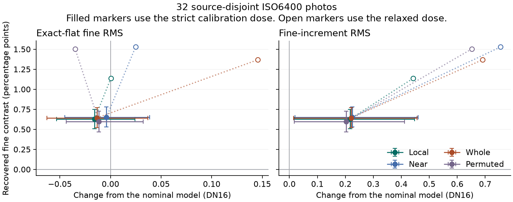
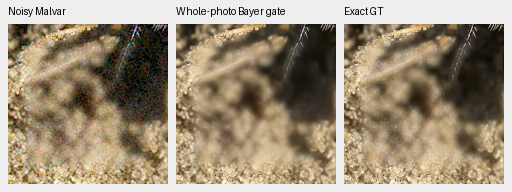
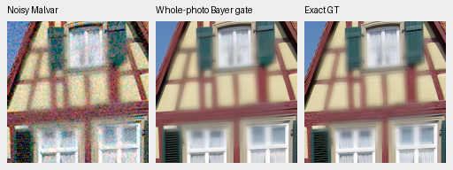

# Using scene context to choose how much fine detail to retain

Running Local 50k with 65% of the physical noise variance makes its
fine response stronger and leaves heavy false texture in exact-flat
cores. A milder, bounded luminance correction recovers **0.645
percentage points** more fine contrast on 32 separate ISO6400 photos,
with **0.013 DN16 lower** mean flat fine RMS and **0.220 DN16 higher**
paired fine-increment RMS. Supplying whole-photo Bayer context adds
only **0.016 points** over the local Bayer gate. The fine cab crossings
remain incomplete. Both routes remain experimental.

## Same RAW, different conditioning

All branches use Local 50k EMA SHA256
`62f4e9ce84075c8df1a254a1889033b5787133e8c98c63e0ec3d174a94734959`
and CUDA IEEE FP32. The first sweep supplies **0.65×, 1× and 1.45×**
of the physical shot coefficient, read variance and variance map.
Sensor samples and clean targets stay fixed. On the 32 transfer photos,
full 0.65× raises fine response from 63.612% to 78.084%. Exact-flat
fine RMS rises from 4.117 to 140.223 DN16, and fine-increment RMS rises
from 153.071 to 258.502 DN16. Full 1.45× lowers flat fine RMS to 3.953
DN16 and lowers fine response to 49.484%. The calibration selects
zero correction for every mixture of these two branches under the
flat and increment error limits below.

This branch can reproduce the noise that drives its own prediction.
Against the observed green RAW, the full 0.65× branch appears to
improve error at every sampled present location on the transfer
photos. Against exact clean greens, it makes every one of those
288 band-limited comparisons worse. An approximate Gaussian
risk correction estimates the model's response to two pairs of
small opposite perturbations of the observed Bayer data. It adds
the covariance of the resulting directional derivatives with the
probe back to the observed error difference. Estimated sign
agreement rises from 0% to 46.9% and correlation with the measured
clean risk difference rises from −0.955 to +0.792 on those present
locations. The correction still underestimates the risk of lowering
the conditioning. The Poisson, read-noise, clipping and plug-in
variance recipe make this an empirical diagnostic. A separate
linear Gaussian check recovers the exact risk direction and agrees
within 1% in magnitude.

## Bounded correction with local or whole-photo evidence

A second sweep forwards at **0.90× and 1.15×** variance and
keeps only a native luminance-band difference from nominal.
It tapers the Fourier passband from 0.094 to 0.125 cycles per pixel
at the low end and from 0.260 to 0.304 at the high end. A local
amplitude cap limits the pre-delivery difference to 24 DN16 RMS.
The correction is camera-neutral under the input's color transform.
The two branch doses are set independently. The smoother branch
acts in locally quiet regions.

The sharper branch needs positive power shared by both green
lattices in the query. The fit corrects for their physical
Bayer offsets and measures frequency power in 32×32 patches. A
second version supplements the local score with nearby patches
matched by coarse color, level and structure. A third searches the
whole photo using the same descriptors. Exterior patches skip the
query and its 32-pixel halo. Permuting the exterior powers while
retaining the descriptors and coordinates tests whether the match
carries useful scene information. The exterior contributes an
amount of support. Query pixels still determine the correction's
phase and color delivery.

The 32 calibration photos, 32 natural transfer photos and
24 planted-wire backgrounds are pairwise source-disjoint. The
calibration and transfers reuse exact observations from prior
controlled studies. The natural roles are present, attenuated and
exact-flat with independent Bayer noise. Calibration allows at most
+0.05 DN16 fine-flat RMS and +0.10 DN16 each for fine-increment and
present-image RMS, then maximizes aligned response. All three
local/scene fits select a 25% sharper dose with 50–75% smoother dose.
The uniform alternative selects zero. The thresholds and doses are
fixed before scoring the source-disjoint natural transfer. The
estimator reads the full packed scene for the texture atlas and
forwards 256-pixel native queries.

| 32 separate ISO6400 photos | Fine response | Fine-increment RMS, DN16 | Exact-flat fine RMS, DN16 |
| --- | ---: | ---: | ---: |
| Local 50k, nominal | 63.612% | 153.071 | 4.117 |
| Local Bayer gate | 64.241% | 153.288 | 4.101 |
| Nearby Bayer gate | 64.266% | 153.296 | 4.113 |
| Whole-photo Bayer gate | 64.257% | 153.291 | 4.104 |
| Permuted exterior powers | 64.208% | 153.274 | 4.106 |

For whole-photo conditioning the paired changes are **+0.645
points** `[+0.523,+0.774]` of response, **+0.220 DN16**
`[+0.015,+0.456]` fine-increment RMS and **−0.013 DN16**
`[−0.063,+0.037]` flat fine RMS. Present-image fine RMS changes
by −0.018 DN16 with an interval spanning zero. Against the local
gate, whole-photo response rises 0.016 points `[+0.001,+0.031]`,
with +0.004 DN16 fine-increment RMS and a paired interval spanning
zero. Intervals resample entire source photos.

The whole-photo gate also raises planted weak-wire response from
32.377% to 32.733% on 24 other backgrounds. Intact increment RMS
rises from 188.074 to 188.806 DN16. Exact-flat RMS rises from 20.490
to 20.607 DN16. In the twelve true gaps, residual weak-direction
RMS rises from 9.615 to 9.695 DN16. The permuted-context wire response
is 32.758% with higher intact and flat error. The added natural
response transfers to these wires with more error, including in
known gaps.

## Native exact comparisons

Both triplets show noisy Malvar, the locked whole-photo gate above
Local 50k EMA and exact GT. Pixels are native 160×160 at
`[48,48,160,160]` within the listed 256×256 query, GBRG, physical
shot/read `0.00128/6.5536e-6`, capture exposure ×0.33, ADC16 and
black level 0.03. Display exposure is ×3.0303 followed by sRGB, with
the same transform across each board. The examples show the largest
reduction and increase in fine-increment error from the locked
whole-photo gate across the 32 transfer photos.

Hans Hillewaert, *Cicindela campestris (mating)*, query
`[8,240,256,256]`. Fine-increment RMS falls 0.731 DN16.
The thin strands and sandy ground remain softer than the exact target.
[Full board](assets/context-conditioned-detail-v1/fresh-27-present-comparison.png) ·
[Exact-flat board](assets/context-conditioned-detail-v1/fresh-27-flat-comparison.png) ·
[Source](https://commons.wikimedia.org/wiki/File:Cicindela_campestris_(mating).jpg) ·
[CC BY-SA 4.0](https://creativecommons.org/licenses/by-sa/4.0/).

Berthold Werner, *Marktbreit BW 9*, query `[486,104,256,256]`.
Fine-increment RMS rises 1.523 DN16. Window trim remains soft.
The 0.65× branch puts visible grain in the window and the exact
flat companion. Both photos are adapted by binning, local contrast
modification and simulated capture.
[Full board](assets/context-conditioned-detail-v1/fresh-19-present-comparison.png) ·
[Exact-flat board](assets/context-conditioned-detail-v1/fresh-19-flat-comparison.png) ·
[Public domain source](https://commons.wikimedia.org/wiki/File:Marktbreit_BW_9.jpg).

## Standing GFX100S comparisons

The exterior atlas reads each entire cached ISO6400 RAF. The fixed
512×512 input contexts match the corresponding full-frame RAW samples
exactly. The 0.65× branch adds visible grain to the sky and brings
out diagonals on the right cab along with dense mottling and color
speckles. The bounded whole-photo gate changes the sky by just
0.172 DN16 RGB RMS and keeps it smooth. It changes the coarse fence
by 2.536 DN16 RGB RMS and keeps connected crossings. The fine cab
changes range from 0.211 to 2.308 DN16. Local, nearby and whole-photo
outputs look close, with soft leaves and incomplete fine crossings.

The main origins for sky, building, foliage and coarse wire are
`[5800,1400]`, `[5790,2690]`, `[8890,5570]` and `[2240,6000]`.
Cab origins are `[806,6489]` and `[1026,6449]`. Transferred noise is
shot/read `0.0014635775921166604/1.0715704128646712e-6`.
The comparison includes V120 EMA SHA256
`a9d9b6b4f974e24a6b11e5e740aab32314233a7f53c056cf37c7d2aac1c589fb`.
ISO100 AHD and camera JPEGs are qualitative references with different
aperture, exposure and motion.

| RAW and profile | Native boards |
| --- | --- |
| DSCF3879 nominal ×4 | [Sky](assets/context-conditioned-detail-v1/main-overcast-sky-main-overcast-sky-x4.png) · [Building](assets/context-conditioned-detail-v1/main-building-detail-main-building-detail-x4.png) · [Foliage](assets/context-conditioned-detail-v1/main-foliage-main-foliage-x4.png) · [Coarse fence](assets/context-conditioned-detail-v1/main-chain-link-fence-main-chain-link-fence-x4.png) |
| DSCF3842 nominal | [Left ×4](assets/context-conditioned-detail-v1/mesh-nominal-fine-green-mesh-left-x4.png) · [Right ×4](assets/context-conditioned-detail-v1/mesh-nominal-fine-green-mesh-right-x4.png) · [Left ×16](assets/context-conditioned-detail-v1/mesh-nominal-fine-green-mesh-left-x16.png) · [Right ×16](assets/context-conditioned-detail-v1/mesh-nominal-fine-green-mesh-right-x16.png) |
| DSCF3842 transferred | [Left ×4](assets/context-conditioned-detail-v1/mesh-profile3879-fine-green-mesh-left-x4.png) · [Right ×4](assets/context-conditioned-detail-v1/mesh-profile3879-fine-green-mesh-right-x4.png) · [Left ×16](assets/context-conditioned-detail-v1/mesh-profile3879-fine-green-mesh-left-x16.png) · [Right ×16](assets/context-conditioned-detail-v1/mesh-profile3879-fine-green-mesh-right-x16.png) |

This is an inference-only study. The bounded path uses three model
forwards per query. The numerical and native reviews are complete
for these exact targets and both standing families. The fixed 427-photo
and known/unseen camera panels are outside this comparison.
[Results](results/context-conditioned-detail-v1/summary.json) ·
[Native provenance](assets/context-conditioned-detail-v1/manifest.json) ·
[Publication and hashes](results/context-conditioned-detail-v1/publication.json) ·
[Executed sources and receipts](results/context-conditioned-detail-v1/evidence.tar.xz).
