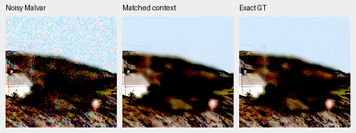
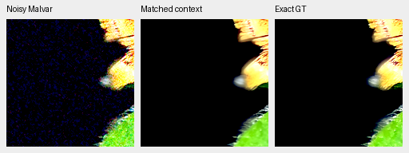

# Using surrounding RAW to set the strength of native detail

Whole-frame RAW statistics assign a higher fine-detail multiplier to the
coarse fence than to the overcast sky. On the held-out exact-target panel,
adding this information changes ISO6400 fine-increment error by less than
0.002 DN16 versus the matched local or uniform controls. Native GFX crops
retain the smooth sky and coarse crossings. The fine green cab crossings
remain incomplete.
[Metrics and native provenance](results/context-strength-v1/publication.json).

## Separate the gain from the native signal

The frozen paired head proposes a fine luminance correction above the
Corpus 100k EMA. The original smoothed-innovation path supplies the
correction in every arm. The common quiet path uses strength 0.15.
Uniform strength, local strength, matching context, and mirrored context
change only the magnitude of the proposed fine correction.

Each 16-native-pixel scene cell summarizes green power from three Haar
contrasts between 8-pixel quadrants. The estimator subtracts expected
noise power using the recorded shot/read prior. A local pool over a
3×3 grid of cells supplies the local gain. The matching policy averages
power from surrounding cells of similar camera brightness and color
with a distance weight. The mirrored policy uses the same cell values
at reversed positions. Both policies omit the query and a 16-pixel
halo, including any cells that would enter from that region after
mirroring. The original native query, correction, and camera metadata
are identical. The procedure uses a noise model for its power estimate
and is evaluated empirically.

A simulated constant plus Gaussian noise gives 0.00525 mean signed
excess power over 8,192 cells. A planted stripe pattern reaches the
score cap. Replacing the query and halo with extreme values leaves
the surrounding estimate bit-identical. A scene with no exterior
cells gives the local-only result.
[Physical checks and source](results/context-strength-v1/evidence.tar.xz).

The component uses the paired EMA
`02f8d5e6664bd580bafe2abeb3b8584b070b60bfadfefaff587cadd8bd643d7f`
above Corpus 100k EMA
`87b96f3c487b9edaf1c477742b6c38f2a82cc6b20a94716d51cc8cf46a17a760`.
It reuses the verified parent RGB and full noisy scenes from the
[64-photo panel](scene-local-contrast-2400.md#held-out-test-for-true-detail-and-flat-regions).
There are 256 groups across two noise levels and both draw laws.
Each group contains present, absent-detail and exact-flat cases.
The first 32 photos fit one scalar per method and prior with coupled
noise, at the lowest of the four achieved aligned responses. The other
32 photos, eight per Bayer order, score both draw laws. Fine error
uses the native 1/8–1/3 cycles/pixel band. Intervals resample complete
photos. Component scoring took 37.16 seconds with saved parents.

## Reconstruction at similar response

Numbers are differences on the 32 held-out ISO6400 photos, in DN16
except for response. Negative RMS values mean lower error. Each interval
is a 95% paired source bootstrap.

| Draw and comparison | Fine-increment RMS | Exact-flat RMS | Aligned response, percentage points |
| --- | ---: | ---: | ---: |
| Coupled, matching vs uniform | +0.0000 [−0.0010, +0.0015] | −0.0021 | +0.0004 |
| Independent, matching vs uniform | −0.0000 [−0.0015, +0.0017] | −0.0023 | +0.0002 |
| Independent, matching vs local | −0.0001 [−0.0009, +0.0008] | +0.0004 | −0.0006 |
| Independent, matching vs mirrored | −0.0011 [−0.0034, +0.0001] | −0.0001 | +0.0004 |
| Coupled, matching vs Corpus 100k | −0.440 [−0.611, −0.278] | −0.153 | +0.212 |
| Independent, matching vs Corpus 100k | −0.047 [−0.136, +0.034] | −0.158 | +0.211 |

The quiet path and native fine lift account for nearly all of the gain
over the parent. ISO400 also gives small differences between the matched
strength policies. Among the 16 fainter ISO6400 photos, matching versus
uniform changes independent increment RMS by +0.0005 DN16.

An exact-target diagnostic measures what gain selection could achieve
for this frozen correction. It assigns a gain between zero and one
per photo or per 16×16 DCT block, shared across present, absent and
flat roles. It minimizes pooled fine-increment MSE while matching the
uniform policy's aligned response and keeping pooled exact-flat error
at or below the same limit. At ISO6400 the coupled pooled RMS is 121.478
DN16 uniform, 121.464 with exact-target per-photo gains and 121.426 with
per-block gains. The independent values are 147.471, 147.444 and 147.173
DN16. The most flexible tested oracle reduces pooled RMS by about 0.2%
with independent noise. It changes only the gain in this representation.
The small margin motivates changing the supplied fine correction.

## Native review

The two triplets show noisy Malvar, matched context, and exact GT.
They are the largest held-out negative and positive increment-error
differences versus the uniform policy on independent ISO6400 draws.
Every panel uses the native 160×160 ROI at `[48,48]` in the 256-pixel
query, shot/read `0.00128/6.5536e-6`, ADC16 black 0.03, capture
exposure 0.33, display exposure ×3.0303 and contrast ×2.

The sky remains smooth. Roof edges and the rough landscape remain
soft. Query origin `[450,188]`, GRBG. Petter Ulleland, CC BY-SA 4.0.
[Source photo](https://commons.wikimedia.org/wiki/File:Oks%C3%B8y_fyr_juni_2018_%284%29.jpg) ·
[Full comparison](images/context-strength-v1/046-iso6400-independent-role0-comparison.png).

The dark region stays quiet. The edge of the wing and fine leaf structure
remain soft. Query origin `[34,346]`, BGGR. Sandipoutsider, CC BY-SA 4.0.
[Source photo](https://commons.wikimedia.org/wiki/File:Close_wing_Basking_of_Ampittia_dioscorides_%28Fabricius,_1793%29_-_Bush_Hopper_%28Male%29_WLB_DSC_9116b.jpg) ·
[Full comparison](images/context-strength-v1/045-iso6400-independent-role0-comparison.png) ·
[Exact-flat control](images/context-strength-v1/061-iso6400-independent-role2-comparison.png).

### Standing GFX100S comparisons

Both cached full RAWs were decoded. All retained query Bayer values
match their saved native inputs exactly. On the main DSCF3879 scene,
the mean pre-calibration gain is 0.249 in the 512-pixel sky query and
0.942 on the coarse fence. Switching from matching to mirrored context
changes the rendered camera-linear RGB by at most 0.050 DN16 RMS
across the eight regions. The sky remains smooth. Thin building
cables and fine leaf boundaries stay soft. Both coarse-fence directions
remain visible. Fine cab crossings stay incomplete with both profiles.

The four main native crops retain ROI `[176,176,160,160]`, display
exposure ×4 and nominal shot/read `0.00128/6.5536e-6`. The left and
right cab ROIs in the fixed 768-pixel query retain `[206,229,160,160]`
and `[426,189,160,160]`, with display exposure ×16. The transferred
DSCF3879 shot/read is `0.0014635775921166604/1.0715704128646712e-6`.
The ISO100 AHD and camera JPEGs are independent qualitative references.
All eight native boards were inspected.
[Sky](images/context-strength-v1/main-overcast-sky-main-overcast-sky.png) ·
[Building](images/context-strength-v1/main-building-detail-main-building-detail.png) ·
[Foliage](images/context-strength-v1/main-foliage-main-foliage.png) ·
[Coarse fence](images/context-strength-v1/main-chain-link-fence-main-chain-link-fence.png) ·
[Nominal left cab](images/context-strength-v1/mesh-nominal-fine-green-mesh-left.png) ·
[Nominal right cab](images/context-strength-v1/mesh-nominal-fine-green-mesh-right.png) ·
[Transferred left cab](images/context-strength-v1/mesh-profile3879-fine-green-mesh-left.png) ·
[Transferred right cab](images/context-strength-v1/mesh-profile3879-fine-green-mesh-right.png).
