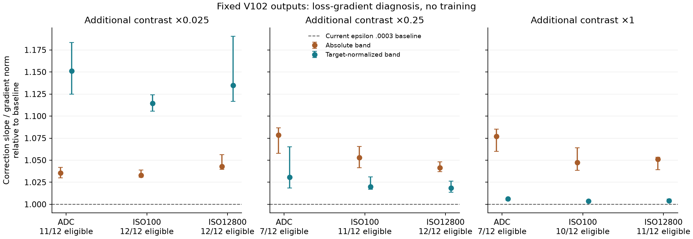

# Contrast-normalized band supervision diagnosis

**A target-normalized band term directs more of the output gradient toward
missing faint structure in these saved training examples.** At additional
contrast ×.025, its median corrective slope rises 17–19% while total gradient
norm rises 3–5%, relative to epsilon .0003. This is a loss diagnosis, with no
restored-quality claim. The [V117/V118 training pair](band-loss-training.md)
has passed actual CPU/CUDA checks and started its original20k schedule;
trained quality is pending. V114 is the current general baseline
after the [completed Tiny/Small comparison](v114-v115-quality.md). The term stays
off in the [completed V116 data trial](v116-quality.md).



[Standalone SVG](images/band-supervision-gradients/band-gradient-response.svg) ·
[Figure data/definitions](images/band-supervision-gradients/figure.json) ·
[Execution, all groups and secondary bands](results/band-supervision-output-gradients-v1.json) ·
[Prototype](../scripts/probe_band_supervision.py).
Points are medians with interquartile ranges over eligible selected training
sources, not confidence intervals. Eligibility counts are shown.

## Inputs and objective

The 108 native256 inputs, targets and predictions come from the
[earlier epsilon diagnosis](loss-smoothing-detail.md): 12 selected **training**
sources, additional contrast ×1/.25/.025, ADC-only/ISO100/ISO12800 and RGGB.
These are historical **V102** restorations, not new V112 predictions. Six sources
are reviewed photographic ROIs and six are newly eligible corpus photographs.
No validation/test/GFX targets enter this study.

The baseline uses the **current recipe's epsilon .0003**, retaining its original
linear/rendered/gradient/highlight/sensor coefficients. All 108 baseline gradient
norms and correction slopes reproduce saved values exactly. The two additions
are fixed before execution; combined gradients are baseline plus the new term's
gradient. All 324 output-gradient tensors are retained, with no network Jacobian
or optimizer update evaluated.
The auxiliary CFA term samples the restored output, matching the earlier
diagnostic; this is not the network's full parameter gradient.

Let `B` be reflected 3×3 mean minus 9×9 mean, and `e = B(prediction − target)`.
Only exact synthetic targets are considered. A 9×9 neighborhood must have all
camera RGB channels within [0,.98), and the outer eight pixels are omitted.

| Term | Additional penalty averaged over valid pixels/images |
| --- | --- |
| Absolute band | `.1 × (sqrt(e² + .0003²) − .0003)` |
| Target-normalized band | `.0003 × (sqrt((e/s)² + .1²) − .1)` |

Here `s` is each image's valid clean-target band RMS, floored at **.001** and
detached from backpropagation. Empty valid regions contribute zero. Targets
supply training supervision only; no target-dependent inference correction
is proposed. The original prototype remains isolated; a matching optional
trainer setting is now available below and defaults to zero.
The additions differ in effective weight and smoothing as well as normalization;
this comparison does not isolate normalization alone.

The analysis direction projects target-minus-prediction onto the exact target's
3–9 band. A negative derivative means that correcting this component lowers
the objective. Slope ratios require a positive missing coefficient and negative
baseline slope; gradient-norm and cosine summaries retain all 12 cases per group.

## Faint-contrast result

Median ratios for the normalized addition versus baseline at ×.025:

| Observation | Gradient norm | Corrective slope | Correction per gradient norm | Eligible |
| --- | ---: | ---: | ---: | ---: |
| ADC-only | 1.0411× | 1.1892× | 1.1510× | 11/12 |
| ISO100 | 1.0545× | 1.1744× | 1.1143× | 12/12 |
| ISO12800 | 1.0327× | 1.1729× | 1.1347× | 12/12 |

The absolute-band addition improves correction per gradient norm by only 3–4%
in these faint groups. At ordinary contrast it has more effect than the
normalized term. Normalization allocates extra pressure preferentially to faint
targets; this is not a uniform improvement across every type of detail.

The main direction shares the proposed loss's band, so improvement there is
expected. Separate, predeclared 1–5 and 5–17 mean-difference directions check
other scales. At ×.025, normalized correction per gradient norm rises only
**1.7/1.7/8.0%** in the finer 1–5 band for ADC/ISO100/ISO12800, and 9.7/7.2/6.8%
in the coarser 5–17 band. The finest-detail problem remains open. These
projections use the same selected sources, not independent generalization data.

Independent NumPy64 summed-area-table arithmetic checks all 216 new-term
directional derivatives; maximum absolute discrepancy is **6.2e-11**. Eight
tests cover independent values/derivatives, flat and invalid targets, camera
mean invariance, per-image batching and contrast normalization. The actual
study forbids module forwards, initializes no CUDA and preserves Torch RNG.
It performs zero new model/encoder calls, noise draws, RAW decodes or training
updates. Original sources and all completed receipts remain intact.

## Optional training implementation

New experiments can explicitly select:

```yaml
camera_supervision: sensor-valid-v1
reconstruct_highlights: true
normalized_band_weight: 0.0003
```

The [implementation](../src/demosaic/detail_loss.py) keeps the stated band,
scale floor, smoothing, validity neighborhood and border. It runs in FP32,
using the retained sensor target before reference-white display conversion.
Only Commons/native synthetic observations receive it; paired RAW references
retain their existing objective. The weight defaults to **zero**, skipping all
band work and keeping existing loss terms unchanged. Nonfinite/negative weights
and incompatible supervision fail explicitly. Legacy checkpoints with no field
mean zero; resume rejects a changed weight. No inference option or new model
parameters are introduced.

[Complete API/training/parameter evidence](results/normalized-band-integration-v1.json).
The API reproduces all 108 saved baseline losses and complete output gradients,
and all 108 normalized-band gradient tensors, **bit for bit**: 42,467,328 checked
gradient elements. A 109-test suite passes, followed by two strengthened
routing/resume tests. Actual mixed-data training resumes exactly for both zero
and nonzero weights, including legacy checkpoints without the field.

Eight discarded **V112** CPU64/B1/FP32 optimizer updates also pass. All 91 initial
EMA tensors match V112; all 89 fresh AdamW states reach step 8 and remain finite
alongside model/EMA. The official Tiny encoder stays frozen with no gradients.
All eight input/domain/step/LR rows match the original CPU control. Four paired
batches omit the term; four synthetic batches include it. First prediction and
paired loss match the original control exactly. No validation scoring or new
production run occurs.

The first discarded attempt omitted the explicit parent initializer and stopped
before its first forward. Its source, log, zero-forward/update receipt and
partial output remain preserved. A corrected explicit initializer in a fresh
output root passes; no successful neural work was repeated to fix bookkeeping.

## Actual V112 parameter response

A separate fixed-checkpoint check makes eight new native256 V112 forwards on
two deterministic training-source strata, ×.025/×1 contrast and ADC/ISO12800.
Its three backward passes per case measure baseline, added band and the
Jacobian-transposed missing-detail direction. Weights stay fixed. Unlike the
earlier output-space study, this includes the learned network's parameter
coupling and actual auxiliary output.

Cosine of the negative parameter gradient with the corrective direction at ×.025:

| Training source stratum | Observation | Baseline | Added band |
| --- | --- | ---: | ---: |
| New photograph | ADC-only | .177224 | .196157 |
| New photograph | ISO12800 | −.404351 | −.405093 |
| Reviewed ROI | ADC-only | .257024 | .272298 |
| Reviewed ROI | ISO12800 | .163447 | .149787 |

Alignment rises in five of eight cases and falls in three, including **both
faint high-noise cases**. Negative cosine means the objective descent direction
opposes this particular correction. Better output-space alignment therefore
does not imply better parameter-space alignment or a useful optimizer update.
This small engineering check does not rank restored image quality.

All per-parameter Gram entries are independently checked with NumPy64 and
Torch64 (maximum absolute discrepancy 1.8e-11). Full gradients on the two
predeclared faint/high-noise cases are reopened and checked: 534 FP32 tensors,
shapes, hashes and Gram entries. Other cases retain streamed per-layer hashes
and Gram entries. The checkpoint, official encoder, configuration and Torch RNG
stay unchanged. No noise is regenerated, no RAW is decoded and no CUDA is used
in this fixed-weight check.

## Fresh Adam response from retained gradients

The raw-gradient cosines above do not directly describe an Adam step. A separate
[saved-gradient check](results/saved-Adam-band-response-v1.json) reopens the two
previously retained faint/high-noise examples, with no new model call or backward
pass. Both baseline/candidate gradient norms are below the production clipping
limit. The first bias-corrected Adam **gradient component**, per unit learning
rate, is `u(g) = -g / (abs(g) + 1e-8)`. This omits common weight decay and has no
accumulated optimizer moments. It is a counterfactual local response at V112,
not a production update or a measurement of current V114.

Cosine with the saved Jacobian-transposed missing-detail direction:

| Retained training example, contrast×.025 / ISO12800 | Baseline Adam component | With band addition |
| --- | ---: | ---: |
| New photograph | −.023574 | −.024727 |
| Reviewed ROI | +.014318 | +.011085 |

Negative values oppose this particular correction at first order. Adam changes
the magnitudes substantially, but does not reverse the earlier signs; the added
term reduces alignment in both cases. The largest adverse incremental module
contribution comes from the fine decoder in the first case and deeper downsampling/
bottleneck blocks in the second. This does not identify one consistently safe
module to modify, or prove a quality effect.

All534 stored FP32 gradient arrays pass hashes/shapes and reproduce their
per-parameter Gram values. Two independent Torch64 AdamW fixtures, using unrelated
zero-valued dummy parameters, check clipping and near-epsilon values against the
formula with maximum discrepancy2.22e-16. There are **zero restoration-model
updates**, zero model/encoder forwards, no new observations or RAW decodes, no
CUDA, and unchanged Torch RNG. The two fixture optimizer steps are recorded
separately. [Reproducible helper](../scripts/probe_saved_adam_response.py).

These two retained examples were selected by the earlier study, not an independent
generalization set. This first-step calculation does not include mixed batches,
late Adam moments, parameter rounding, finite-step network changes or trained
image quality. It gives no reason to assume that Adam automatically repairs the
observed raw-gradient concern.

## Next quality question

The normalized term is now selected by the [V117/V118 matched training comparison](band-loss-training.md).
Both start from V114 with the same corrected data and seed64; only the band
coefficient0/.0003 differs. Four actual eight-update checks pass at CPU64/B1/FP32
and CUDA256/B16/BF16. Initial predictions/physical inputs agree, all optimizer
states remain finite, default-off does no band work and paired RAW omits the term.
V117's original20k control is complete; the fresh V118 production arm is running.
The [completed V116 trial](v116-quality.md) separately tests data coverage and
reviewed masks. Its analytic gain did not transfer to broader weak material.
This diagnosis does not show how network gradients, generalization, flat-field
artifacts, color tails or real foliage would change. Any trained comparison
still needs complete matched panels, native noisy / restored / GT triplets and
standing GFX foliage/fence and other regions. Paired/noisy references are outside
this prototype's exact-target supervision.
