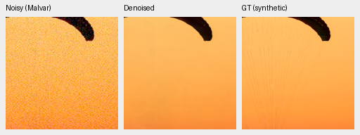
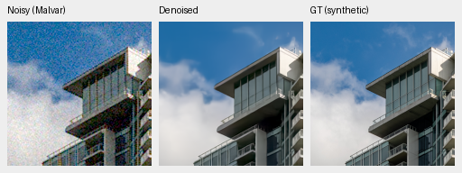
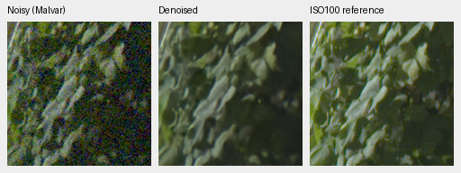
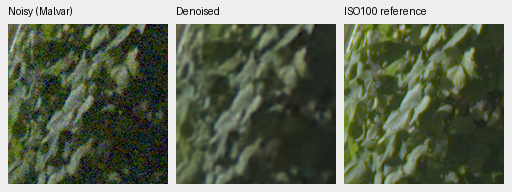
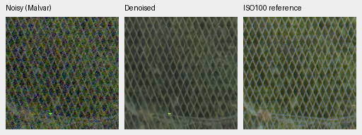

# Unchanged V54 training replay: V57 review

**The configured training procedure does not reproduce identical learned results.**
V57 uses V54's original source, seed, initializer, data, optimizer recipe and
schedule, yet loses 0.04346 dB on 427 photos and 0.05946 dB on known-camera
primary. Unseen primary is nearly unchanged; procedural PSNR falls while SSIM
rises. This is one descriptive replay, not a variance estimate or an isolated
explanation of prior candidate differences. No new recipe or model is promoted.
[Complete results, hashes and 46 native triplets](results/control-replay-v57-review.json).

## What repeats

Frozen `b62c996`, identical retained V43 step 2,000 EMA, fresh AdamW/EMA,
seed 52, batch 16, LR 3e-5, 100 warmup updates and planned 4,000-step schedule.
Only run directory and notes change. Commons40170/native128/paired83, domain
mix, geometry/PSF before final 2× reduction, original 8× validation, physical
noise, model/loss/precision and frozen genuine DINO-S remain fixed. No weak
source or input adapter is introduced. Both checkpoints are at 1,000 updates.
[Recipe and rationale](control-training-repeatability.md).

All 41 logged observations match. Source bundle/model configuration and final
Python/Torch/CUDA RNG states match. Both checkpoint records use PyTorch
2.14.1+cu130; optimizer update counts are 1,000. Of 71 portable restoration-state
tensors, only two are identical in model/EMA; frozen pretrained encoder tensors
are excluded from these portable counts. Complete state/snapshots remain intact.
Matching inputs and RNG do not establish identical floating-point computation.

The original trainer enables cuDNN benchmarking. [PyTorch's reproducibility
notes](https://docs.pytorch.org/docs/2.14/notes/randomness.html#cuda-convolution-benchmarking)
explain that benchmarking can select different convolution algorithms across
runs. That is a plausible contributor, **not an isolated cause here**. The
replay preserves the original compute policy. Source-bootstrap intervals below
condition on the trained weights; they do not estimate training uncertainty.

Checkpoint SHA256:

- V54 original: `975d47ffbd0cedc6ba2fa307d96265f1f3406d96bbeed6657bc32b44b37346d1`.
- V57 replay: `ace880de143572e4509b31e868447db77a869555450992909b46a9ab275f9f63`.
- Shared V43 parent: `0d74cf31fb1c7e3f97fc692c855a2ca0ee3ebf562b454e4f8b135c28fc0aa5c5`.

## Development results

| Panel | Model | Measured-CFA PSNR | AHD RGB PSNR | AHD SSIM |
| --- | --- | ---: | ---: | ---: |
| Known4 | V54 matched control | 54.30450 | 40.09109 | 0.931471 |
| Known4 | V57 unchanged replay | 54.24504 | 40.03631 | 0.931290 |
| Known4 | RawNIND global CFA-LS | 54.06860 | 39.67805 | 0.928811 |
| Known4 | RawNIND channel CFA-LS | 54.08474 | 39.71710 | 0.928831 |
| Unseen5 | V54 matched control | 53.64388 | 38.30980 | 0.917275 |
| Unseen5 | V57 unchanged replay | 53.64718 | 38.30446 | 0.917062 |
| Unseen5 | RawNIND global CFA-LS | 53.56220 | 38.14484 | 0.918380 |
| Unseen5 | RawNIND channel CFA-LS | 53.76822 | 38.56191 | 0.922127 |

Known4 has 8 pairs/72 crops; unseen5 has 10 pairs/90 crops. Primary references
are registered low-noise measured CFA; auxiliary AHD RGB is independently
demosaiced, **not exact GT**. RawNIND uses publisher normalization and observed-CFA
global/channel gains without reference fitting. Protected-final scoring stays closed.

| Model | 427-photo PSNR | SSIM | 16-procedural PSNR | SSIM |
| --- | ---: | ---: | ---: | ---: |
| V54 matched control | 35.050344 | 0.957604 | 33.894886 | 0.967828 |
| V57 unchanged replay | 35.006885 | 0.957469 | 33.617235 | 0.968766 |
| RawNIND global CFA-LS | 26.695781 | 0.790028 | 24.974265 | 0.720411 |
| RawNIND channel CFA-LS | 26.683573 | 0.789899 | 24.985678 | 0.720500 |

| V57 − V54 | dB [95% evaluation-source interval] |
| --- | ---: |
| Known primary | -0.059462 [-0.126466, -0.006172] |
| Unseen primary | +0.003304 [-0.018514, +0.025122] |
| 427-photo sRGB | -0.043459 [-0.068214, -0.019110] |
| 16-procedural sRGB | -0.277651 [-0.652778, -0.026769] |

The photo and known intervals can exclude zero even for the same configured
training recipe: they compare two fixed learned outputs, not repeated training
methods. All 86,828 suite method cases recompute. The 62,020 classical/RawNIND
and 12,404 V54 neural cases replay original metrics exactly. The analytic suite
has 1,344 method cases; its 448 Malvar cases are exact, and V54 neural analytic
replay is exact for all 448 cases.

| Other fixed trajectory, dB | Known primary | Unseen primary | Photo | Procedural |
| --- | ---: | ---: | ---: | ---: |
| V55 weak data − V57 | -0.005630 | +0.007595 | -0.027554 | -0.144758 |
| V56 input adapter − V57 | -0.010771 | +0.016819 | -0.082329 | -0.071722 |

These are descriptive differences against the second control, not new matched
training trials or corrected causal estimates. They do not establish V55/V56
benefit or prove that all their deficits come from numerical variation. Both
remain unpromoted, with single-seed limitations. Future small-gain claims need
stronger repeatability evidence. Keep V43 step 2,000 and its README crops.

At level 0.18, 2% peak contrast and ISO12800 prior, signed analytic carrier gain
averaged over four CFA layouts × four draws (1 is exact recovery):

| Period | V54 | V57 |
| --- | ---: | ---: |
| 4 px | 0.003324 | 0.002516 |
| 8 px | 0.012822 | 0.022727 |
| 16 px | 0.354528 | 0.430946 |

The unchanged replay recovers more 16 px carrier contrast. This also shows why
one trajectory's texture response cannot alone establish an intervention effect.
All flat DC/RGB-RMSE/spatial/band/peak metrics are in the receipt. They are not a
complete false-detail detector; luma band measures can miss chromatic patterns.

## Native comparisons

Every panel is native 160×160 with no resizing. Exact synthetic photos/analytic
examples share ROI [48,48,160,160], RGGB, shot=0.00256/read=0.0000262144,
WB [2,1,1.5], recorded fixed matrix and display ×1. Metrics use unquantized
predictions; PNGs are 8-bit display copies. Shared noisy/reference bytes and
ROI/noise/rendering metadata match across all methods.

GFX DSCF3879 ISO6400 → restored → separate DSCF3880 ISO100 f/5.6, shared +2 EV.
Foliage [8890,5570,160,160]; fence [2240,6000,160,160] (reference x=2241).
Input-only shot=0.0014635775921166604/read=0.0000010715704128646712.
Time/aperture/motion differ: ISO100 is a qualitative reference, **not GT**,
without warping or pixelwise scoring. Sky/building crops are also archived.

### Exact synthetic GT: 0014aa4e

### Exact synthetic GT: 002fc6ee

### Separate ISO100 reference: foliage

### Separate ISO100 reference: chain-link-fence

The original and replay controls look close, with no consistent native photographic advantage. Fine fabric strands remain largely lost, foliage waxy and fence wires soft. Neural fence geometry is more coherent than channel-RawNIND's colored grid. Analytic carriers remain attenuated, although the replay's 16 px response is stronger numerically. Fixed 8-bit flats show no obvious new structure, without excluding small residual errors. GFX ISO100 differs optically and in time and is not exact GT.

Thirty-six PNGs were visually inspected across ten standard subjects and six
neural analytic examples. All 46 PNGs verify hashes/geometry/metadata/shared
panels. Global-RawNIND variants are verified without separate visual judgments.
Eight complete 8746×11662×3 RGB16 TIFFs verify SHA/bytes/dtype/16-bit tags,
more than 256 sampled codes and sRGB ICC where applicable. Shared-machine
single observations: 0:dino-paired-expanded-b16-v54:step-1000: 33.86s; 1:dino-paired-replay-b16-v57:step-1000: 33.91s; RawNIND:CFA-LS: 17.46s; RawNIND:CFA-channel: 17.41s. These are not repeated speed measurements.
The requested broad real-photo/SOTA advantage and 100 MP/10 s remain unproven.

The next training work finishes the original no-context/ViT-S/ViT-B 10,000-step
schedules from their complete 3,000 states, without optimizer/EMA/RNG or LR reset.
A finite completed schedule still does not establish convergence or a universal
foundation-model effect. Source/config/runtime and full native-review gates remain.

Sources: [Roy Egloff](https://commons.wikimedia.org/wiki/File:CH.VD.Villeneuve_2007-08-25_Vertigo-Swiss-Riviera_2392_3x2-R_4K.jpg)
and [Dietmar Rabich](https://commons.wikimedia.org/wiki/File:Vancouver_(BC,_Canada),_Coal_Harbour_Seaside_Park,_Blick_in_den_Himmel_--_2022_--_2158.jpg),
[CC BY-SA 4.0](https://creativecommons.org/licenses/by-sa/4.0/); modified by binning,
crop, synthetic noise, restoration and rendering. Paired sources: Benoit Brummer/
Christophe De Vleeschouwer, [RawNIND](https://doi.org/10.14428/DVN/DEQCIM), per-scene
permissions in receipts. GFX by the project owner. Analytic targets generated locally.
