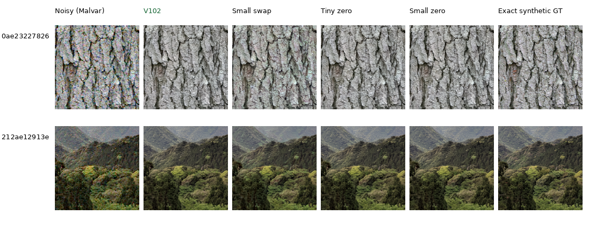
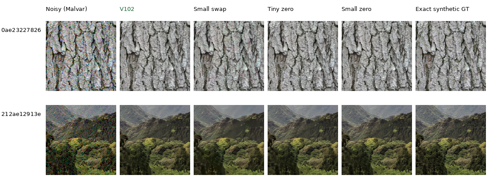
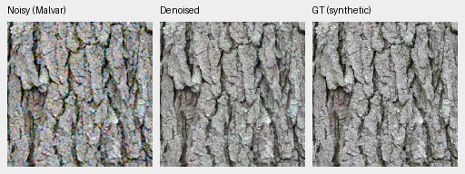
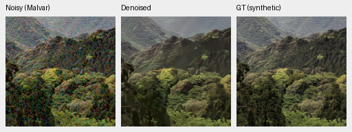

# Larger frozen ConvNeXt capacity: transfer and common initialization

**Official DINOv3 ConvNeXt-Small fits the existing feature pyramid, but its
fusion layers need adaptation.** Directly swapping it into V102 loses quality
on the four checked material cases. Resetting three fusion-gate tensors gives
Tiny and Small exactly matching initial outputs and a usable starting point
for a later trained comparison. V102 remains the current quality baseline;
V104 completed its larger-corpus run; selected material gains are published
and broader evaluation is active.

## Official weights and interface

Meta publishes both backbones in the [DINOv3 repository](https://github.com/facebookresearch/dinov3#pretrained-models)
and [official Small model card](https://huggingface.co/facebook/dinov3-convnext-small-pretrain-lvd1689m).
Their semantic/depth benchmarks do not establish RAW restoration quality.
The pinned configurations have the same stage widths 96/192/384/768 and depths
3/3/9/3 (Tiny) versus 3/3/27/3 (Small). Small revision is
`421020015aa4266363db803b6049a529999afb1e`.

The authenticated download verified the Small weight file against the published
LFS SHA256 `8182492b73345ceb449ed6be0de486d778a73afb273ba2684de785a71ef1da9d`.
Its license bytes match the project's existing DINOv3 license exactly.
A real odd-sized 97×131 CPU feature input produces the same native stage and
cropped offset shapes in both models, with finite FP32 fields and frozen encoders.
No pyramid implementation change is needed. [Configurations, weights, shapes and complete evidence](results/convnext-small-transfer-CPU-v1.json).

## What the fixed-weight transfer shows

Both use V102's exact 91 learned EMA tensors and the same four cached
bark/canopy observations: two sources at ISO100 and ISO12800 priors, RGGB.
The original Tiny result reproduces all four previous numerical scores and
noisy/restored/GT display panels exactly. Small changes only the frozen backbone
and its explicit configuration; the copied fusion layers have not been trained
for its feature basis.

| Variant / no new training | ISO100 PSNR | ISO12800 PSNR |
| --- | ---: | ---: |
| V102 original Tiny | 38.04559 | 30.47292 |
| Small backbone swap | 35.86885 | 29.90261 |
| Tiny with zero fusion gates | 38.05248 | 30.45362 |
| Small with zero fusion gates | 38.05248 | 30.45362 |

These are selected two-source means, not full 427-photo results. The direct swap loses
2.177dB at ISO100 and .570dB at high noise. Native canopy develops faceted/smeared
structure and bark has slight colored outlines. This exposes a transfer mismatch;
it does not measure the quality of a trained Small model.

Columns: noisy Malvar, V102, Small swap, Tiny zero, Small zero, exact synthetic GT.
Every cell is 160×160 native pixels at the 8×-binned evaluation resolution.
Shared coordinates, noise, WB, matrix and display exposure ×1 match exactly.
All 24 cells were actually viewed. PNGs are RGB8 previews; scores use float output.

[Low-noise source/ROI/checkpoint/backbone/noise/display metadata](images/convnext-small-transfer/iso100-prior/manifest.json).

[High-noise source/ROI/checkpoint/backbone/noise/display metadata](images/convnext-small-transfer/iso12800-prior/manifest.json).

Two high-noise Small-swap triplets show the same noisy/restored/exact-GT pixels
as the board above, at their native scale:

## Common initialization and actual training checks

The gate-zero pair changes only three inherited EMA tensors, containing
128/256/512 channel gates. The other 88 EMA tensors remain exact.
Both models then produce identical FP32 predictions on all four checked cases,
including low and high noise. Removing Tiny's learned offsets has a small,
mixed effect here: +.0069dB at ISO100 and −.0193dB at high noise.

Each pair member also completed eight discarded actual CPU 64/B1/FP32 optimizer
updates on the current zero-PSF mixed Commons/native/paired recipe. All 91 initial
EMA tensors match their declared derived initializer. The first real training
prediction and loss match exactly across backbones, as do all eight actual batch
hashes. All 89 Adam states and model/EMA tensors are finite; official frozen
backbone hashes remain unchanged. This verifies training integration from a
common function. Eight updates do not establish a trained capacity benefit.

The saved derived checkpoints record their exact file hashes, base V102 EMA,
backbone revision and gate changes. Their inherited 20k step describes the base
restoration weights; the transfer itself has zero training updates. Original
weights,production recipes and earlier machine receipts retain their bytes.

A later quality comparison can start from the best completed V84-family EMA
and final reviewed corpus,reset these gate tensors for both backbones, and train
fixed matched budgets. It should include photographic/camera metrics, native
material/color/weak-detail crops and the standing six-region GFX test. The [quality operators now support explicit per-model identities](training-execution.md#explicit-frozen-backbone-identities),
with 119 passing targeted tests and actual discarded CPU training, reporting and
RGB16 export checks. The shared Tiny expectation remains available for legacy
plans; only declared encoder model/revision differences are permitted. A trained
CUDA capacity comparison remains separate from these integration fixtures.
The current model/data experiment continues with its original queues.

## Prepared matched quality trial

The [V109 Tiny](../configs/quality-v102-backbone-tiny-v109.yaml) and
[V110 Small](../configs/quality-v102-backbone-small-v110.yaml) recipes freeze
the same V102-derived Tiny-zero initializer file and reviewed 90,864-source
corpus. Seed 62, 20,000 updates, batch 16, native 256-pixel patches, BF16,
learning rate 1e-5, 200 warmup updates and the original six
ROI objects match. Eight additional source-specific withholds relative to V104
remove three visibly degraded photo targets and five atlas reproductions.
Four atlas images were in the older V102 corpus. Current V104 data stays fixed.
All 50 Python modules match V104's frozen implementation.

Twelve actual source-reader checks repeat exactly with finite native256 output,
unchanged Torch RNG and no CUDA. They cover six remaining new arrivals and all
six original ROIs. The encoder model/revision/hash are the only arm differences
apart from run location. [Prepared plan, initializer/recipe/corpus hashes and
prospective source exposure](results/backbone-capacity-training-prepared-v2.json).
The completed [incoming source review](incoming-commons-quality.md) checks all
74 final ranking candidates at their scored native coordinates. The earlier
unlaunched V107/V108 preparation and its receipts remain preserved.

Fresh discarded eight-update CPU checks pass for both cleaned recipes at
native64/B1/FP32. Initial EMA and frozen-encoder identities match exactly,
model/EMA/Adam stay finite, and all eight observation fingerprints match across
arms through Commons/synthetic, native-RAW and paired-RAW domains.
[Actual cleaned-recipe CPU evidence](results/backbone-cleaned-recipes-CPU-v1.json).
Both cleaned recipes also pass eight discarded CUDA updates at native256,
batch16/BF16. All eight actual observations and the first loss match across
arms, with exact initial EMA/encoder identities and finite model/EMA/Adam.
Reported peak allocation is 6.95GB Tiny /7.04GB Small. These runs overlap V104;
their timings do not measure throughput. [Actual CUDA evidence](results/backbone-cleaned-recipes-CUDA-v1.json).
The production preparations remain unchanged and unlaunched.

The [explicit reference set](../configs/quality-v102-backbone-reference-checkpoints-v1.json)
now keeps original V102 separate from the `V102-zero` initializer in reports
and exports. Actual CPU reporting/export checks preserve earlier outputs,
and 146 targeted tests pass. [Reference handling and actual evidence](training-execution.md#fixed-references-alongside-derived-initializers).

These recipes have no production controller or quality scores. Review the
completed V104 checkpoint and its quality comparisons before launch. A better
initializer or further source decisions can supersede this prepared plan while
preserving it. The trained comparison will use original V102 as well as
its accurately labeled zero-gate derivative, both fixed endpoints, the standing
GFX scene and native crop triplets. No capacity benefit is established yet.

Photo sources: [Derek Ramsey, bark](https://commons.wikimedia.org/wiki/File:Kentucky_Coffee-tree_Gymnocladus_dioicus_3264px.jpg),
[CC BY-SA 2.5](https://creativecommons.org/licenses/by-sa/2.5/), and
[Grendelkhan, forest canopy](https://commons.wikimedia.org/wiki/File:Forest_covered_hills_on_Yakushima.jpg),
[CC BY-SA 4.0](https://creativecommons.org/licenses/by-sa/4.0/).
Modifications: binning, cropping, synthetic noise, restoration and shared display conversion.
