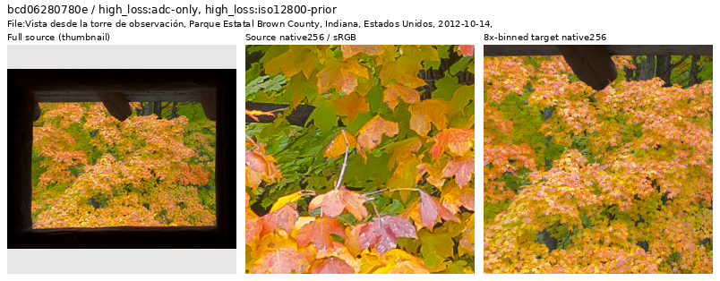
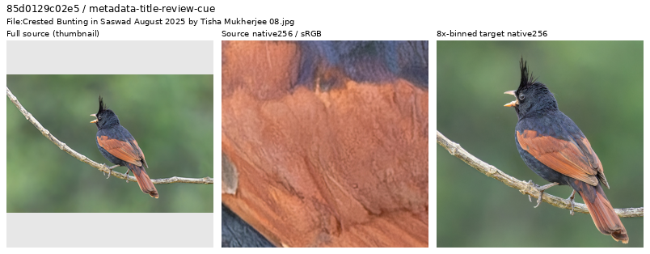
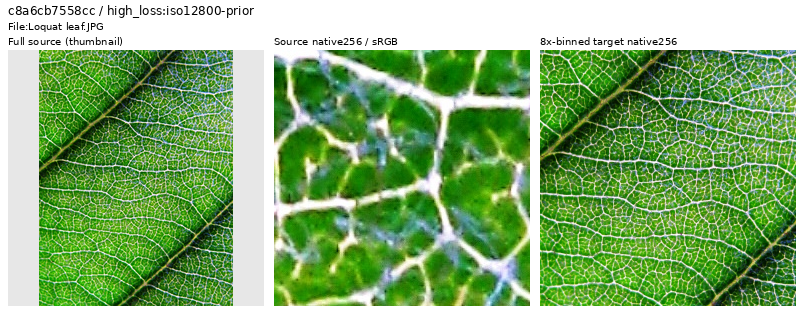
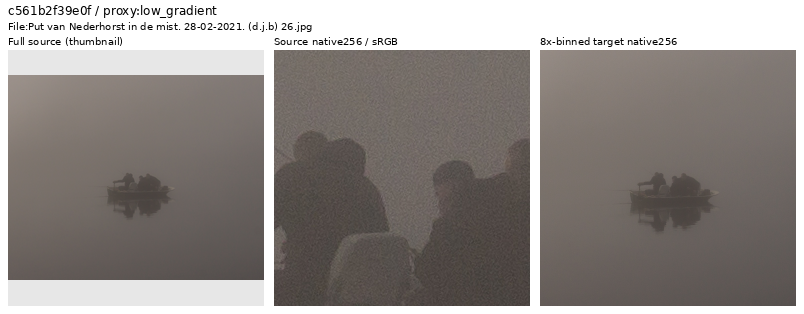

# Training-source quality review

Source quality decisions support the [matched V43 training study](quality-first-training.md).
Review the actual binned target and keep genuine difficult or weak detail.
Originals and historical manifests remain read-only.

The available reviewed Commons corpus contains 88,508 training images at 4×/8×,
versus V43's original 40,170. Original validation 2,303 / test 2,255 memberships stay
fixed. Archive discovery/attribution are complete; actual downloading stopped
at the reserve with 178,117 originals and 279,548 still pending.

## Full-corpus ranking

A source-frozen scan under
`.cache/quality-first-20261020/corpus-source-screen-v1/` uses the actual V43
step2000 checkpoint, IEEE FP32 and fixed ADC-only/ISO12800 conditions. It scores
a native 256 center crop from the 4× cache plus final area2, without geometric
or optical augmentation. Only training rows enter. A genuine four-source/native 64
CPU proof passes before GPU scoring; a separate unit check matches every
per-image loss term to V43's original training objective.

The original worker completed under an explicit supervision handoff at
`.cache/quality-first-20261020/corpus-source-screen-supervision-v2/status.json`.
Its projected duration was close to the first controller's six-hour bound;
the new ceiling is eight hours from the **original** worker start. The scoring
plan/source, PID, checkpoint, inputs and 24 GiB RAM / 64 GiB root / 500 GiB
external reserves are unchanged. The exact old supervisor exited; the worker
was neither stopped nor restarted. Both worker and new supervisor have now
exited. Use the new status path, since the old controller's preserved status is
historical. The completed receipt records 88,508 unique sources, 177,016 cases
and 22,128 actual neural/DINO forwards. An independent streaming audit checks
full training membership/condition coverage, finite scores, original loss
arithmetic, ROI bounds, file hashes and actual owner exit. The
[completion receipt](results/v43-quality-curation-and-training-plan-v1.json)
records those checks and their limits.

Rank high-loss images alongside low-gradient, high-frequency and bright/clipped
proxies. Inspect full-source context and native pixels for grain, blur,
oversharpening, processing artifacts and non-photographic content. **High loss
alone is not an exclusion rule**: fine foliage, textiles, fences and other useful
hard detail should remain. Record visual decisions by source ID and reason.
Use a new training manifest; preserve originals, historical manifests, protected
series and the GFX scene/siblings. This is targeted review, not a claim that
every corpus photo was manually viewed.

The [completed 371-source visual review](results/source-quality-visual-review-v17.json)
withholds twenty-four sources: a historic map scan, a photomontage, ten graphic-only
or flat document compositions, a predominantly
defocused station scene, and eleven images with visibly unreliable clean-target
texture/noise/edge quality. The other 347 remain, including fine
foliage, wheat, fur, coral, architectural grids and hazy/low-contrast landscapes.
Sixty-eight contact sheets and twenty-seven larger native 1024 crops were
actually inspected. This includes all 87 distinct required candidates from the
completed ranking. The final round adds a flat stippled turtle illustration to
the withheld set, while retaining physical tilework, stained glass, engraved
metal, sand, speaker mesh, weak skies and haze. Four early larger-view decisions
needed missing hash fields restored from their original render indexes; fresh
original/cache hashes verify that repair without changing any decision.
The final membership freeze is complete; these are source-quality decisions,
not a trained-model result or a full-corpus manual inspection.

## Native examples

Each image has a resized full-source thumbnail on the left, a native256 source
crop in the middle and a native256 8×-binned training target on the right.
The two native crops have different physical fields of view. Display exposure
is ×1.0; only the thumbnail is resized. These are source-quality views; sensor
noise and restoration are not applied. The [gallery metadata](results/source-quality-gallery-v1.json)
records source hashes, distinct ROIs, display transforms, decisions and credits.
Open the original PNG at 100% if the viewer scales it.

### Withhold: flattened foliage

One withheld foliage source has extensively flattened/patchy texture and stepped
color regions in a larger native view; those defects remain in the binned target.
This is a visual target-quality decision, without inferring a particular filter.
The context thumbnail is resized; the two 256-pixel crops retain their native
pixels. Source ROI `[1736,1340,256,256]`; bin4 target context
`[210,111,512,512]` followed by area2; display exposure ×1.0. The
[figure metadata](results/source-quality-flattened-foliage-example.json) records
source hashes, transforms, the V43 screening checkpoint and both noise conditions.

Source: [Diego Delso, Brown County State Park](https://commons.wikimedia.org/wiki/File:Vista_desde_la_torre_de_observaci%C3%B3n,_Parque_Estatal_Brown_County,_Indiana,_Estados_Unidos,_2012-10-14,_DD_08.jpg),
[CC BY-SA 3.0](https://creativecommons.org/licenses/by-sa/3.0/). Modified through
binning, cropping, display conversion and context-thumbnail creation.

### Withhold: altered feather texture

The larger native view shows strongly outlined, flattened and patchy blue/orange
plumage. Those local defects remain in the binned target. This is the recorded
visual judgment for this source; it does not infer a particular processing tool.
Other bird photographs with coherent fine feather detail remain eligible.

Source: [Tisha Mukherjee, Crested Bunting](https://commons.wikimedia.org/wiki/File:Crested_Bunting_in_Saswad_August_2025_by_Tisha_Mukherjee_08.jpg),
[CC BY-SA 4.0](https://creativecommons.org/licenses/by-sa/4.0/). Modified through
binning, cropping, display conversion and context-thumbnail creation.

### Retain: fine leaf veins

Dense real leaf veins remain useful hard detail even when V43 has high loss on
them. The visible material structure supplies a reason to keep this source.

Source: [Elucidate, Loquat leaf](https://commons.wikimedia.org/wiki/File:Loquat_leaf.JPG),
[CC BY 3.0](https://creativecommons.org/licenses/by/3.0/). Modified through
binning, cropping, display conversion and context-thumbnail creation.

### Retain: weak detail in fog

Native source grain falls substantially after binning. The faint boat/person
silhouettes and weak atmospheric contrast remain legitimate photographic detail
for the training pool. Low gradient alone does not establish a bad target.

Source: [Dominicus Johannes Bergsma, Put van Nederhorst in the mist](<https://commons.wikimedia.org/wiki/File:Put_van_Nederhorst_in_de_mist._28-02-2021._(d.j.b)_26.jpg>),
[CC BY-SA 4.0](https://creativecommons.org/licenses/by-sa/4.0/). Modified through
binning, cropping, display conversion and context-thumbnail creation.

## Additional selection cues and membership freeze

The expanded title-cue review withholds graphic-only letter/illustration and
textured tessellation compositions. The [Escher creator description](https://commons.wikimedia.org/wiki/File:Ambigram_tessellation_Escher.jpg)
corroborates its pattern-design intent; no particular pixel-generation pipeline
is inferred. Physical stamps, tattoos, carvings and the
[pencil/paper study](https://commons.wikimedia.org/wiki/File:Ambigram_Nothing_written.jpg)
remain eligible based on their visible material detail and context. All nine
inspected processing-title candidates remain, including a camcorder whose model
name contains HDR. Software/HDR/title tags alone never decide exclusion.

A [complete header inventory](results/source-capture-metadata-review-v1.json)
finds positive recorded ISO in 82,094 training sources, including 1,370 at ISO
3200 or above. It reads JPEG/MPO headers without pixel decoding or inference.
Eight highest-ISO sources plus eight deterministic high-ISO samples were
actually viewed. Four bird photos have heavily etched/flattened feather texture
and enhanced outlines that persist in the binned targets; withhold those.
Twelve remain, including other high-ISO wildlife, water drops, portraits,
architecture and fine lettering. ISO and software tags remain review cues only.
EXIF warnings are preserved; metadata does not prove capture provenance or
clean-target quality. This targeted sample is not a corpus defect-rate estimate.

A posthoc followup inspects the next 24 highest recorded-ISO sources not already
reviewed, using four more sheets and seven larger native crops. Two have strong
outlined/flattened feather texture that remains visibly altered after binning;
withhold them. The other 22 remain, including wildlife, action portraits, water
drops, architecture and HDR-labeled interiors. Across both ISO-targeted rounds,
40 sources were actually viewed and six withheld. These are selected extremes,
not a random sample. Native grain or edge emphasis alone is insufficient when
the binned target retains useful coherent detail.

Review now covers **all 74 training sources with recorded ISO ≥12800**: 66 retain,
eight withhold. Completing that group added 42 actual source views from seven
sheets and six larger native crops; two more showed unreliable feather texture.
Coherent fine feather barbs, real material patterns, mosaics, HDR-labeled
architecture and weak stone surfaces remain. The header-defined subgroup is
fully covered; this does not infer the defect rate of the broader corpus or
the true capture ISO from metadata alone.

The final membership freeze requires visual decisions for the top 32 sources
under each noise condition and the top 16 under each IQA proxy, plus all
additional sources already reviewed. `scripts/freeze_v43_curated_corpus.py
--help` describes the freeze; `--check` lists pending decisions without writing
training manifests. It checks the completed ranking receipt, source identities,
the exact original V43 cohort and unchanged holdout memberships. Exclusions
affect future training membership only. The completed freeze at
`.cache/quality-first-20261020/curated-corpus-v1/` contains 39,983 control and
88,484 larger training sources. The original V43 cohort had 40,170: 172 are
already ineligible under existing corpus policy and another 15 are among the
24 newly withheld sources. Both cohorts retain the same 2,303 validation and
2,255 test IDs; every selected row and full current holdout record matches its
input manifest. No original or historical manifest was rewritten.

An additional posthoc ADC-error/local-gradient ratio review retained all twelve
new selected sources: it mostly found legitimate smooth skies, saturated
gradients and bright boundaries. Small denominators and model error affect this
cue; it does not identify bad photographs reliably by itself. This reused partial
source scores, with no additional inference or automatic exclusions.

