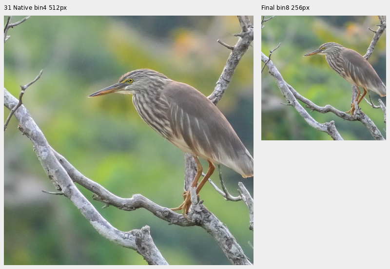
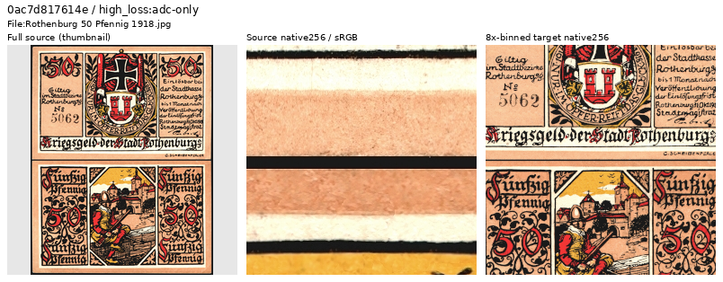
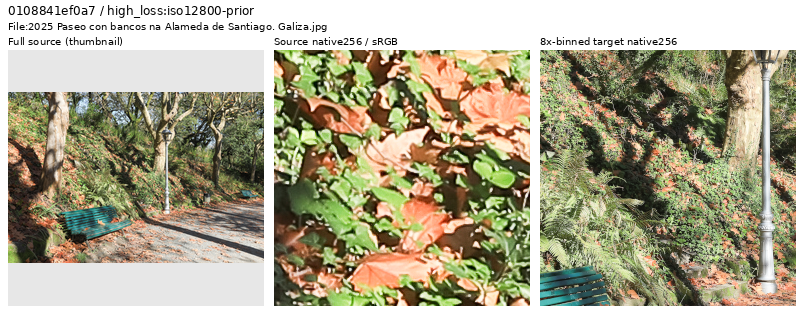
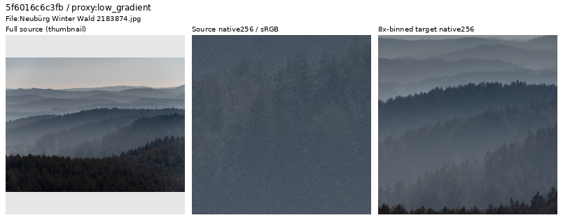
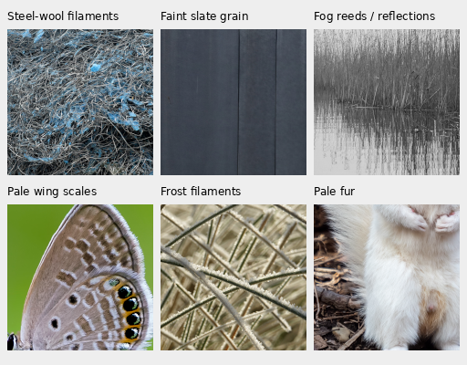

# Training-source quality review

Source quality decisions support the current [V84-based quality experiments](quality-first-training.md).
A [top512 source review](next-source-tail-review.md) inspects 290 more sources,
retains 279 and withholds 11, preparing a separate 90,791-source next cohort.
Four new withholds have unreliable clean-photo texture; seven are
reproduction/composite/visualization targets. Every active source in each
original global top512 loss list has been inspected.
The cumulative earlier-pool ledger covers 1,058 sources: 954 retained and 104
outside training. The current V117/V118 pair keeps its frozen
90,864-source cohort.

**An earlier review covered 570 training sources: 539 retained and 31
outside training.** The 31 include four earlier `exclude` decisions and 27
`withhold` decisions; their original ledger labels remain unchanged.
The completed V100/V101 runs keep their frozen 88,484-source cohort and 24
visual exclusions. Completed V102/V103 use the separate88,477-source cohort and six/32-region catalogues;
neither changes completed V100/V101 inputs.

| Cohort | Commons training sources | Validation / test | Visual exclusions |
| --- | ---: | ---: | ---: |
| Completed V100/V101 | 88,484 | 2,303 / 2,255 | 24 |
| Completed V102/V103 | 88,477 | Same exact records/order | 31 |
| Completed V104 20k | 90,872 | Same exact records/order | Prior31 plus four incoming quality withholds; duplicate/series/protected exclusions also apply |
| Completed V111/V112/V114/V115/V116/V117/V118 | 90,864 | Same exact records/order | Eight additional withholds relative to V104: three photo-quality cases and five atlas reproductions |
| Prepared next cohort | 90,791 | Same exact records/order | Prior passes withheld 62 relative to 90,864; latest 290-source pass retains 279 and withholds 11 |

[Earlier detailed catalogue and reader checks](results/source-quality-detail-catalogue-v3.json).
Originals, existing manifests and protected evaluation scenes remain read-only.
The GFX train/platform pair and siblings remain outside training.
The optional [source-sampling reference](next-source-tail-review.md#preserve-draws-for-a-matched-curation-comparison)
keeps unaffected photo/geometry draws exact when comparing a subset with its
original corpus. The latest 90,791 cohort passes full source-schedule accounting
and 107 actual native256 reader checks, including every changed draw; all six
ROI targets remain valid. [Current preflight](results/cleaned90791-source-reader-preflight-v1.json).
Current V117/V118 remain on their original frozen inputs.

The additional [3,809-source arrival batch](commons-download.md) has finalized3,807
valid caches at both4×/8×. All39 source sheets/3,807 thumbnail contexts and61
initial targeted native source identities were actually inspected. Completed
loss-tail follow-ups bring targeted native coverage to 153 unique arrival
identities, with new decisions applied to a separate future cohort. Four train
hashes and two already-reserved validation hashes receive visual quality
withholds. [New decisions and native examples](incoming-commons-quality.md).
Two malformed-ICC
side-by-side stereo composites were actually inspected and withheld through
an explicit failure ledger; their originals and error evidence remain intact.
These arrivals do not contribute to the earlier-pool review counts above.
The completed duplicate/title/content-series review admits2,395 additions to
a separately frozen90,872-source cohort now used by V104,with all existing
validation/test records preserved. Protected screening flags43 valid sources;
completed V102/V103 keep their original88,477-source inputs.
[Completed new corpus and actual CPU reader](results/commons-post4000-reviewed-v1.json).

## Incoming loss-tail follow-up

A CPU-only V102 source-difficulty scan has completed all 2,395 newly eligible
training IDs: 4,790 cases and 2,396 neural/DINO forwards. Independent rank and
input reconstruction verifies the complete screen. It uses native 256 targets
from fixed 512 centres in 4× caches followed by area2, ADC-only/high-noise
declared priors and two CPU threads. It ranks the
original reference-white screening objective; these are not actual stochastic
V104 training losses or a model comparison. High loss remains a review cue.
[Complete scan, hashes, source decisions and native coverage](results/incoming-source-loss-complete-v1.json).

All 74 unique sources in the final top32 loss lists and top12 proxy lists have
actually inspected native views at their scored coordinates. Targeted review
retains difficult natural texture and weak detail. A follow-up of atlas credits
finds five printed reproductions among training targets, while retaining two
real photographed-window controls. These and three earlier photo-quality
withholds enter the separate **90,864-source** future cohort. Completed V104
retains its original training inputs. [Current native examples, decisions and
prepared data](incoming-commons-quality.md).

## Selection and inspection

The prepared pool contains 88,508 eligible Commons training sources at 4×/8×
binning. The completed V43 scan scores all of them under ADC-only and ISO 12800
priors: 177,016 cases and 22,128 neural/DINO forwards. It uses IEEE FP32, a
native center crop and final area2 reduction, without geometric or optical
augmentation. Its [completion and original cohort freeze](results/v43-quality-curation-and-training-plan-v1.json)
retain source, loss, membership and owner checks. The older model's loss is a
review cue, rather than a current quality ranking or an exclusion rule.

All **319 unique candidates** in the saved top 128 per-condition loss lists,
lowest-gradient 64, highest-Laplacian 64 and brightest 32 lists now have actual
visual decisions. Other reviewed sources include title/metadata cues, all 74
training sources with recorded ISO ≥12800, and weak/fine material examples.
The preceding high-loss pass inspected 110 candidates on 19 source sheets and
six larger native 1024×1024 crops, retaining 104 and withholding 6. The current
input-only detail pass inspected 40 additional sources: 39 retained and 1 withheld,
with 26 new ROI admissions. This targeted
coverage does not estimate the defect rate of the full corpus.

Inspect source context, native pixels and the actual binned target for grain,
blur, flattened texture, exaggerated outlines and non-photographic compositions.
Keep genuine hard detail: foliage, textiles, fences, painted/glazed materials,
engraved lettering, weak fog and skies. Natural defocus or exposure-integrated
motion is not automatically a defect. Grain that largely disappears after
binning need not invalidate the target. White backgrounds, high ISO, HDR or
stacking tags alone do not decide exclusion.

The figures below show a resized full-source thumbnail, a native 256×256 source
crop and a native 256×256 8×-binned target. The native views have different physical
fields of view. Only the thumbnail is resized; exposure is ×1. These are
source-quality inspections, without simulated noise or model restoration.

## Illustrated exclusions

The new withheld clean target has residual fine grain in smooth bokeh and soft
plumage in the reviewed native views. This is a conservative choice for a clean
denoising target. No camera/ISO threshold or model loss selected its exclusion.

Both panels show the same physical ROI at different cache resolutions, each at
one image pixel per PNG pixel. No denoiser is applied. Source:
[Timothy A.Gonsalves, Pond Heron Sheikalmudi](https://commons.wikimedia.org/wiki/File:Pond_Heron_Sheikalmudi_Feb26_A7CR_10011.jpg),
[CC BY-SA 4.0](https://creativecommons.org/licenses/by-sa/4.0/), modified by binning,
cropping and display conversion. [Pixels, source/ROI and decision](images/training-detail-v3/withheld-clean-target-native.json).

Five sources are flat front/back banknote composites dominated by printed text
and illustration: Rothenburg, Berchtesgaden, Neustadt, Bad Oeynhausen and Berlin.
Their assembled document presentation falls outside the photographic target.
Photographs of actual mounted signs, engraved metal, book pages, stained glass
and mosaics remain eligible when their material and scene detail are coherent.

Source: [Christoph Scheibenberger, Rothenburg 50 Pfennig 1918](https://commons.wikimedia.org/wiki/File:Rothenburg_50_Pfennig_1918.jpg),
public domain. Modified through binning, cropping and context-thumbnail creation.
[Source hashes, ROIs and display metadata](results/source-quality-banknote-composite.json).

A separate withheld foliage source has flattened leaf surfaces and strongly edged, patchy
boundaries in the larger native view, with residual patchiness in the binned
target. Withholding it is a visual clean-target judgment; no particular
processing tool is inferred. Other fine foliage sources remain eligible.

[1024×1024 source crop, without resizing](images/source-quality-paseo-foliage-native1024.png).
Source: [Lmbuga, Paseo con bancos na Alameda de Santiago](https://commons.wikimedia.org/wiki/File:2025_Paseo_con_bancos_na_Alameda_de_Santiago._Galiza.jpg),
[CC BY-SA 4.0](https://creativecommons.org/licenses/by-sa/4.0/), modified through
binning, cropping, display conversion and context-thumbnail creation.
[Source hashes, ROIs and decision](results/source-quality-paseo-foliage.json).

Earlier exclusions include a map, non-photographic compositions, a predominantly
defocused scene and unreliable texture/edge targets. The illustrated
[flattened-foliage example](images/source-quality-flattened-foliage.png)
([metadata](results/source-quality-flattened-foliage-example.json)) and
[altered-feather example](images/source-quality-processed-feathers.png)
([metadata and credits](results/source-quality-gallery-v1.json)) retain their
original evidence.

## Retain weak and fine detail

The completed high-loss pass retains104 useful sources, including dense fish, leaves, mesh,
small circuitry, stained glass, weak cloud/sky boundaries and atmospheric scenes.
The larger forest view has visible native grain, but binning suppresses it
while retaining faint tree structure. Its low contrast is useful training data.

Source: [Ermell, Neubürg Winter Wald](https://commons.wikimedia.org/wiki/File:Neub%C3%BCrg_Winter_Wald_2183874.jpg),
[CC BY-SA 4.0](https://creativecommons.org/licenses/by-sa/4.0/), modified through
binning, cropping, display conversion and context-thumbnail creation.
[Source hashes, ROIs and decision](results/source-quality-retained-weak-forest.json).
Earlier [leaf-vein](images/source-quality-retained-leaf.png) and
[weak-fog](images/source-quality-retained-fog.png) examples also remain eligible;
the [gallery metadata](results/source-quality-gallery-v1.json) retains their
credits and native-view protocols.

## Cohort use

Completed V100/V101 use
`.cache/quality-first-20261020/curated-corpus-v1/manifest4-large.jsonl`.
The completed V102/V103 manifest is
`.cache/current-quality-20261022-v1/weak-detail-ROI-expansion-v1/future-cohort-v3/manifest4-large.jsonl`,
SHA256 `9b3a7e162910fd0d695c310da1cc985c0cf901a1a87949cc787492cea34aded8`.
It removes the newly withheld source from the earlier 88,478-source future
snapshot. Every remaining row is byte-identical; validation/test bytes and
order are unchanged. All 31 withheld/excluded IDs stay outside training.
Earlier manifests and model inputs remain intact.

Use the [32-region companion catalogue](../configs/low-contrast-training-rois-curated-v3.json)
with that exact manifest. The reader enforces its path/SHA, membership, cache
hashes and ROI/target bounds. Independent integer averaging reproduces all 32
float32 target hashes exactly. The actual clean reader visits all 32 regions
under the existing 5% conditional probability, seed 60 mixed-domain schedule and
zero-PSF geometry→area2 path, with finite native 256 outputs and no GPU/model.
[Full preparation/review/reader evidence](results/source-quality-detail-catalogue-v3.json).
V102/V103 completed20k updates on these frozen data. Their full427/camera
comparison and complete GFX exports are finished; V104 supplied that study's positive-noise baseline; [V114 is now current](v114-v115-quality.md).
The completed V104 90,872-source training cohort is documented in the [incoming review](incoming-commons-quality.md). [Recipes and current results](quality-first-training.md#current-matched-comparison-v102v103).

Source views use existing prepared caches. New downloads and decisions enter
a separate frozen cohort instead of changing an existing experiment's inputs.

## Reviewed weak and fine texture ROIs

The available expanded catalogue keeps the original six regions and adds 26
photographs:32 unique sources with exact 512×512 contexts in the 4× cache, giving
native 256×256 area2 targets. Whole contexts have mixed contrast; selected local
structures include weak veins, fibers, fur, reeds, grain and faint lines.

These are **clean training inputs**, with no noise simulation, denoising or
measured model gain. All 160×160 crop pixels are unchanged; exposure is ×1.
[Source/ROI/hash/display metadata](images/training-detail-v3/manifest.json).
Credits, in reading order:

| Detail | Source / author | License |
| --- | --- | --- |
| Steel wool | [Chris Woodrich](https://commons.wikimedia.org/wiki/File:SOS_brand_steel_wool_with_soap,_Canada,_2026-03-08.jpg) | CC BY-SA 4.0 |
| Slate grain | [Ingo Mehling](https://commons.wikimedia.org/wiki/File:Krakow_-_Concrete_bicycles_at_Museum_of_Modern_Art.jpg) | CC BY-SA 4.0 |
| Fog reeds | [Dominicus Johannes Bergsma](https://commons.wikimedia.org/wiki/File:Put_van_Nederhorst_in_de_mist._01-04-2026._(d.j.b)_20.jpg) | CC BY-SA 4.0 |
| Wing scales | [Anitava Roy](https://commons.wikimedia.org/wiki/File:Close_wing_Basking_of_Freyeria_putli_(Kollar,_1844)_-_Black-spotted_Grass_Jewel_WLB.jpg) | CC BY-SA 4.0 |
| Frost | [Hans Hillewaert](https://commons.wikimedia.org/wiki/File:Ammophila_arenaria_(frosted_leaves).jpg) | CC BY-SA 3.0 |
| Pale fur | [Rhododendrites](https://commons.wikimedia.org/wiki/File:Leucistic_squirrel_in_Prospect_Park_(85614).jpg) | CC BY-SA 4.0 |

License URLs and complete source metadata accompany every crop. Modifications
are binning, cropping and display conversion. Candidate ranking used
unquantized float32 display statistics; it did not automatically decide quality.
Actual inspection corrected three proposals that favored plain/background
areas. Naturally weak fog remains useful; blank or soft proposals need not be
oversampled simply because their global contrast is low.

The original six regions below remain byte-identical in the expanded catalogue.
Completed V101 used only those six at 5% conditional photographic sampling;
V100 left it off. Its [selected-detail improvement](heldout-detail.md) tests a
combined recipe package; the ROI-only effect is not isolated. The completed
V103 comparison uses the broader 32-region catalogue. It has nearly identical
photographic PSNR to V102, weaker tested fine detail and higher ADC flat-color
error, so current recipes retain the original six regions.
[Completed quality comparison](v102-v103-quality-review.md).

| Source ID prefix | Inspected structure | Bin4 context [x,y,w,h] |
| --- | --- | --- |
| `6aa3e94bda50` | Gray wool fibers and wrapped thread | [160,0,512,512] |
| `423c08bacc74` | Faint fishing-net lines; face outside this ROI | [288,256,512,512] |
| `7b56d20ffd21` | Fine gray wire braid grooves | [96,360,512,512] |
| `a4ae82e1e5b6` | Subtle grain on white-painted fence boards | [504,280,512,512] |
| `ed29eebff641` | Pale lichen filaments against bark | [96,8,512,512] |
| `9b4e6f950b1d` | Same-color cloth folds and crease edges, without claiming resolved fibers | [384,128,512,512] |

These are regions containing weak/fine structures, rather than global
low-contrast labels. The [source/ROI review](results/low-contrast-training-source-review-v1.json)
and [CPU reader validation](results/reviewed-ROI-loader-CPU-readiness-v1.json)
record actual views, hash checks, augmentation order and resume behavior.
