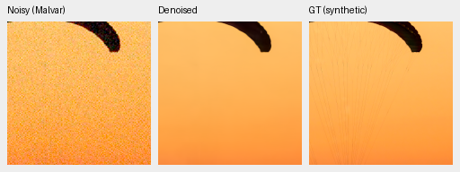
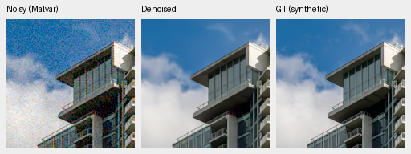
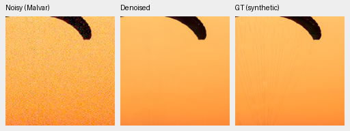
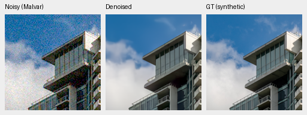
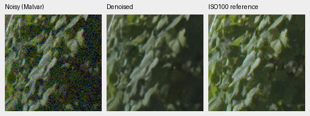
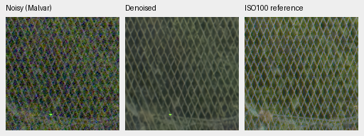
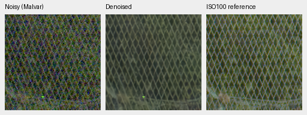

# Matched corpus continuation to step 2,000

V35's expanded Commons corpus improves known-camera measured-CFA PSNR by
**.04403 dB** over V32 at step 2000, but its unseen mean is **.06561 dB lower**.
Both stop at this review point. The extension has not established a broad
quality gain. [Complete metrics and native-crop receipt](results/corpus-v32-v35-2k-review.json).

Both resume their own step 1000 optimizer/EMA/RNG, retaining batch 16, seed 46,
LR 3e-5 / original planned 3,000 schedule, 25% paired / 25% native / 50% Commons
and original 8× augmentation. Only Commons membership differs, 40,170 versus 41,978
training sources. Across both segments, **all 51 logged paired/native hashes
match**, from 82 logged observations per arm. Validation, code and initializer
identities match. Commons assignments change with the corpus; this is one seed.

Step2000 checkpoint SHA256:

- V32: `d36c5c1a5af1c996d84641db568c6e768d10a759b4048acf5ef6ebc5f6f37ff8`
- V35: `5da06ebcac5986de11de941e8a1526ff17bae3e4a1357cecdd16d999b3d2256d`

| Panel | Method | Measured-CFA PSNR | AHD RGB PSNR | AHD SSIM |
| --- | --- | ---: | ---: | ---: |
| Known4 | V32 step 2000 | 54.25657 | 39.98450 | .930838 |
| Known4 | V35 step 2000 | 54.30060 | 40.03731 | .931114 |
| Known4 | RawNIND global CFA-LS | 54.06860 | 39.67805 | .928811 |
| Known4 | RawNIND channel CFA-LS | 54.08474 | 39.71710 | .928831 |
| Unseen5 | V32 step 2000 | 53.76436 | 38.47228 | .919339 |
| Unseen5 | V35 step 2000 | 53.69875 | 38.44141 | .919246 |
| Unseen5 | RawNIND global CFA-LS | 53.56220 | 38.14484 | .918380 |
| Unseen5 | RawNIND channel CFA-LS | 53.76822 | 38.56191 | .922127 |

Known: 8 pairs / 72 crops; unseen: 10 pairs / 90 crops. Means balance captures within
scenes. V35−V32 known primary 95% scene-bootstrap interval is
[+.03623,+.05304] dB; unseen is [−.18958,+.02444], crossing zero. V35's own
unseen primary falls .10983 dB versus step 1000 ([−.17761,−.04096]), reversing its
earlier advantage. Channel-calibrated RawNIND leads all three unseen means.
Primary references are registered measured low-noise CFA; independent AHD RGB
is auxiliary, **not exact RGB GT**. Input-only conditioning and both RawNIND
calibrations remain unchanged. No final-test scoring or GFX transform fitting.

| Model | 16-photo PSNR | SSIM | Four-procedural PSNR | SSIM |
| --- | ---: | ---: | ---: | ---: |
| V32 step 1000 | 35.15780 | .960329 | 33.09017 | .973720 |
| V35 step 1000 | 35.09675 | .960338 | 33.12291 | .973387 |
| V32 step 2000 | 35.00332 | .960308 | 33.41542 | .973978 |
| V35 step 2000 | 34.94856 | .960242 | 33.37152 | .973754 |

V35's photographic decline versus its first 1k has 95% source interval
[−.33226,−.00789] dB. Its 2k−V32-2k difference interval crosses zero. These are
small synthetic-noise screens. The completed full suite gives a different
continuation result:

| Model | 427-photo PSNR | SSIM | 16-procedural PSNR | SSIM |
| --- | ---: | ---: | ---: | ---: |
| V32 step1000 | 33.95672 | .950119 | 33.10339 | .962757 |
| V35 step1000 | 33.84007 | .949812 | 33.26958 | .962639 |
| V32 step2000 | **34.02439** | **.950653** | 33.53274 | .964413 |
| V35 step2000 | 33.90384 | .950506 | **33.63339** | **.964668** |

V32's full-photo gain over its first1k is **.06767dB**,95% source-bootstrap
interval[+.04810,+.08519]. V35's own gain is.06377dB[+.03578,+.08908]. Thus the
small screen's declines did not predict their full-photo changes. At2k, V35
trails V32 by.12055dB[.09661,.14739]. The first1k gap was.11665dB. All443 sources
share the seven conditions/four CFAs;111,636 rows include both RawNIND gain
variants and three classical methods. Source intervals cover evaluation-source
variability, not training-seed variability. V32-2k becomes the stronger full-photo
reference; this one-seed pilot does not show that adding data is generally harmful.

Noisy Malvar → restored → **exact synthetic GT**, native 160×160 panels, no
resizing. RGGB/nominal ISO12800 prior (`shot=.00256`,`read=.0000262144`), ROI
[48,48,160,160] in the same binned tile, ×1 display, WB [2,1,1.5] and fixed protocol
matrix. PNG previews are 8-bit sRGB; metrics use unquantized predictions. Full
source/cache/checkpoint/noise/ROI/display records are in the receipt.

V32 step 2000:

V35 step 2000:

Fine canopy texture remains missing and cloud edges soft. Sources:
[Roy Egloff](https://commons.wikimedia.org/wiki/File:CH.VD.Villeneuve_2007-08-25_Vertigo-Swiss-Riviera_2392_3x2-R_4K.jpg)
and [Dietmar Rabich](https://commons.wikimedia.org/wiki/File:Vancouver_(BC,_Canada),_Coal_Harbour_Seaside_Park,_Blick_in_den_Himmel_--_2022_--_2158.jpg),
[CC BY-SA 4.0](https://creativecommons.org/licenses/by-sa/4.0/). Modified by linear
binning, crop, Bayer/noise simulation, restoration and rendering; derivative
previews retain that license.

Standing GFX DSCF3879 ISO6400 → restored → separate DSCF3880 ISO100 f/5.6,
native 160px foliage [8890,5570] and fence [2240,6000] (reference fence x2241).
These come from blended full102MP output, with shared +2EV/WB/matrix and input-only prior
(`shot=.001463577592`,`read=.000001071570413`). Aperture, time and motion differ;
the final panel is a qualitative reference, **not GT**.

Foliage remains soft, mesh irregular and a colored point persists. No decisive
visual gain. All four regions and matched methods are retained. Native PNG
hashes/dimensions, shared source/ROI/noise/display metadata and identical
noisy/reference panel bytes were verified. Both full-frame RawNIND calibrations
and the separate512px-context diagnostic remain in the receipt. The README now
uses V32-2k full-frame examples.

Eight8746×11662×3 uint16 TIFFs passed full SHA/size,16-bit sample tags, actual
dtype/shape and >256 sampled-code checks. All sRGB files carry ICC profiles.
Outputs: `/mnt/external/demosaic/evaluation/gfx-3879-3880-corpus-v32-v35-2k-full/`,
`restored-{0,1,2,3}-{linear16,srgb16}.tiff`: respectively V32/V35/RawNIND-global/
RawNIND-channel. Restoration took **40.24/40.23/20.68/20.17s**, tile512/overlap64/
batch4, excluding decode/load/render/encoding. These are successive shared runs
with eight-worker preparation active, not an idle speed comparison or evidence
of a regression against prior timings. The10-second target remains unmet.

The augmentation pilot has started on complete verified4× data, using fresh
step1000 controls and the same original initializer, not these2k checkpoints.
Protected-final and standing sources remain outside training.
