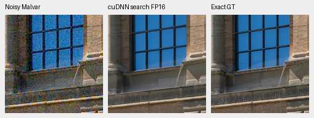
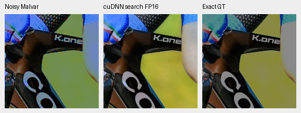

# Corpus 100k FP16 cuDNN tuning on GB10

**Standard FP16 remains the fast CUDA path for Corpus 100k.** In the
paired IEEE FP32 comparison it cuts 102 MP restoration from 287.38 to
53.40 seconds. Fresh cuDNN algorithm search gave one faster and one
slower first restore in the new full-frame comparison. Warm repeats
showed no speed gain across the two processes. The search changes
RGB16 output slightly. [FP16 quality and original timings](corpus100k-mixed-precision.md).

[Machine results](results/corpus100k-cudnn-fp16-v1/publication.json) ·
[Frozen drivers and receipts](results/corpus100k-cudnn-fp16-v1/evidence.tar.xz) ·
[Native crop provenance](images/corpus100k-cudnn-fp16-v1/manifest.json).

## Full-frame timing

Four fresh processes run two complete restores each, in heuristic, tuned,
tuned and heuristic order. Each loads the Corpus 100k EMA
`87b96f3c487b9edaf1c477742b6c38f2a82cc6b20a94716d51cc8cf46a17a760`
with pinned staging and restores cached DSCF3879, ISO6400. The 102 MP
frame uses 520 tiles at 512 / 64, batch four, with shot/read
`0.00128/6.5536e-6`. All runs use PyTorch 2.14.1+cu130, CUDA 13.0
and cuDNN 9.24 on a shared NVIDIA GB10. The search limit is ten and is
set before the first forward. The first restore includes convolution
selection and first-use initialization. The second reuses cached
engines in the same process. The restore timer includes tile packing,
transfers and FP32 blending. Decode, checkpoint setup and TIFF write
are measured separately. [PyTorch cuDNN settings](https://docs.pytorch.org/docs/2.14/backends.html#torch.backends.cudnn.benchmark_limit).

| Fresh process, in order | First restore | Warm restore | First RGB16 write | Peak PyTorch CUDA allocation during first restore |
| --- | ---: | ---: | ---: | ---: |
| Heuristic A | 36.60 s | 29.99 s | 0.77 s | 2.12 GB |
| Search A | 32.67 s | 35.64 s | 0.61 s | 2.19 GB |
| Search B | 43.10 s | 38.67 s | 0.77 s | 2.19 GB |
| Heuristic B | 41.65 s | 38.54 s | 0.85 s | 2.12 GB |

The first-restore means are 39.13 s for heuristic selection and
37.88 s for search. Warm means are 34.26 s and 37.16 s respectively.
Both spreads are large on the shared device. The earlier resident-batch
gain therefore has no repeatable full-frame timing confirmation.
Decode takes 0.49–0.95 s, checkpoint staging 1.79–2.40 s and
the first RGB16 write 0.61–0.85 s across the four processes.
[Resident-batch comparison](corpus100k-device-tiles.md#fresh-process-cudnn-fp16-search).

## Output fidelity

All four heuristic exports match the archived pinned-upload TIFF.
Each tuned process is byte-repeatable across its two passes. The two
search processes produce different RGB16 TIFFs. Their
outputs differ by **0.242 DN16 RMS** from each other. Each changes
the heuristic output by **0.259 DN16 RMS** across 305,987,556 codes.
**99.89%** of codes stay within one DN16. The 99.9th percentile is two
codes. The largest absolute differences are 43 and 44 codes. Overlap
midpoint bands have slightly smaller differences than tile interiors
(0.224–0.225 versus 0.262 DN16 RMS).
The two outlier crops show bright sign and reflected-light edges.
Their shapes and colors look alike at display ×1.
[Search A worst code](images/corpus100k-cudnn-fp16-v1/outlier-1.png) ·
[Search B worst code](images/corpus100k-cudnn-fp16-v1/outlier-2.png).

Six previously frozen exact-target contexts reproduce the earlier
Bayer observations across both policies. The largest absolute sRGB PSNR change is 0.00096 dB.
The clipped cyclist has 26.28 DN16 camera-RGB RMS difference in its
native crop, with a 273.21 DN16 peak. Its clipped yellow-green background
looks similar in both exports and remains brighter than the exact target. The new
test covers those six contexts and the two standing GFX families.
The fixed photo and camera scores refer to the existing
[heuristic FP16 comparison](corpus100k-mixed-precision.md#fixed-photo-and-measured-camera-panels)
and [TensorRT FP16 comparison](corpus100k-fp16-throughput.md#tensorrt-fp16-on-the-fixed-panels).

## Native exact-target triplets

Each cell is a 160 × 160 native crop at `[680,480,160,160]` in the
listed cache box. Noisy Malvar, the tuned restore and the exact
synthetic target use the same display transform. Both observations use
16-bit simulated ADC with black level 0.03.

**Alte Pinakothek**, AuHaidhausen, CC BY 4.0. Cache box
`[102,10,1536,1152]`, GBRG, shot/read `0.00256/2.62144e-5` and
display ×1. Window bars stay coherent and fine masonry remains soft.
[Source](https://commons.wikimedia.org/wiki/File:Alte_Pinakothek_lateral.jpg) ·
[Both FP16 paths](images/corpus100k-cudnn-fp16-v1/pinakothek-comparison.png).

**Elisa Longo Borghini time trial**, Granada, CC BY-SA 4.0. Cache box
`[264,112,1536,1152]`, RGGB, shot/read `8e-5/2.56e-8`, capture
exposure ×4 and display ×0.25. Both exports retain the clipping and color error in the background.
[Source](https://commons.wikimedia.org/wiki/File:20180925_UCI_Road_World_Championships_Innsbruck_Women_Elite_ITT_Elisa_Longo_Borghini_850_8800.jpg) ·
[Both FP16 paths](images/corpus100k-cudnn-fp16-v1/highlight-comparison.png).

## Standing GFX100S comparisons

Main camera-RGB RMS differences are 0.075–0.109 DN16. The sky
stays smooth and coarse crossings remain coherent. Fine wires and
leaves stay soft. In the cab the RMS differences are 0.031–0.037 DN16.
The transferred prior retains clearer right diagonals. The left
mottling and incomplete fine crossings remain visible. Both captures were viewed at native scale. The main scene
uses the complete restores and display ×4. The cab uses the fixed
768-pixel contexts and display ×16. The independent ISO100 AHD
captures and the two cab camera JPEGs provide qualitative references.
Aperture, exposure time and subject motion differ.

[Sky](images/corpus100k-cudnn-fp16-v1/overcast-sky.png) ·
[Building](images/corpus100k-cudnn-fp16-v1/building-detail.png) ·
[Foliage](images/corpus100k-cudnn-fp16-v1/foliage.png) ·
[Coarse fence](images/corpus100k-cudnn-fp16-v1/chain-link-fence.png).

| Cab shot/read | Left | Right |
| --- | --- | --- |
| Nominal `0.00128/6.5536e-6` | [Native board](images/corpus100k-cudnn-fp16-v1/mesh-nominal-fine-green-mesh-left.png) | [Native board](images/corpus100k-cudnn-fp16-v1/mesh-nominal-fine-green-mesh-right.png) |
| Transferred `0.0014635775921166604/1.0715704128646712e-6` | [Native board](images/corpus100k-cudnn-fp16-v1/mesh-profile3879-fine-green-mesh-left.png) | [Native board](images/corpus100k-cudnn-fp16-v1/mesh-profile3879-fine-green-mesh-right.png) |

Use `--precision float16 --tile 512 --overlap 64 --batch-size 4` in the
supported CLI. The separate TensorRT FP16 experiment remains the measured
incremental speedup, saving 11.9% of warm restore with nearly unchanged
panel means and a larger error on a near-white test crop. Selective FP8
increased quiet chroma variation. The 10-second target remains open.
[TensorRT timing](corpus100k-faster-inference.md#warm-tensorrt-comparison) ·
[TensorRT fixed-panel results](corpus100k-fp16-throughput.md#tensorrt-fp16-on-the-fixed-panels).
