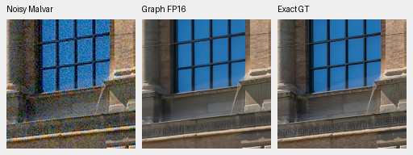
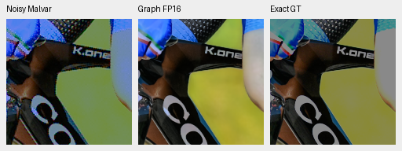

# Corpus 100k FP16 tile transport on GB10

**Use standard CUDA FP16 with 512-pixel tiles, overlap 64 and batch four.**
The [mixed-precision comparison](corpus100k-mixed-precision.md) measured
53.40 s versus 287.38 s in IEEE FP32 on the 102 MP GFX frame. The
[TensorRT FP16 follow-up](corpus100k-faster-inference.md) reduced warm
restoration from 42.04 s to 37.05 s in a separate paired test. This
study holds the model, precision and tile grid fixed and measures how
much remains in copying tiles, running blends and dispatching the model.

[Machine results](results/corpus100k-device-tiles-v1/publication.json) ·
[Frozen drivers and run receipts](results/corpus100k-device-tiles-v1/evidence.tar.xz) ·
[Native crop provenance](images/corpus100k-device-tiles-v1/manifest.json).

## Full 102 MP frame

Seven passes on cached DSCF3879 at ISO6400 use the Corpus 100k EMA
`87b96f3c487b9edaf1c477742b6c38f2a82cc6b20a94716d51cc8cf46a17a760`,
shot/read `0.00128/6.5536e-6`, PyTorch 2.14.1+cu130 and cuDNN 9.24
on the shared GB10. Each pass handles the same 520 tiles. The model is
loaded once. Restore timings include staging inputs, packing, model
forward, blending, final CPU availability and graph setup where used.
RGB16 TIFF time is measured separately. Peak allocation is PyTorch CUDA
memory during restoration and excludes pinned host staging and CPU buffers.

| FP16 policy | Passes | Restore | RGB16 write | Peak CUDA allocation |
| --- | ---: | ---: | ---: | ---: |
| Ordinary tile streaming | 3 | 39.91 s | 1.02 s | 2.12 GB |
| Device-resident RAW and blend | 1 | 41.01 s | 0.95 s | 4.18 GB |
| Ordinary streaming, cached Bayer kernels | 1 | 40.22 s | 0.60 s | 2.12 GB |
| Device-resident, cached Bayer kernels | 1 | 39.97 s | 0.85 s | 4.18 GB |
| Device-resident, CUDA Graph and cached Bayer kernels | 1 | 40.17 s | 0.81 s | 4.21 GB |

The three ordinary passes span **39.60–40.60 s**. Each prototype is tested
once and takes **39.97–41.01 s**. CUDA Graph capture itself takes 0.80 s
and returning the full RGB array takes another 0.77 s. In the ordinary
passes CPU blending takes 0.82–1.29 s. Device-resident variants roughly double
peak CUDA allocation for similar restore times.

All seven TIFFs have the same SHA256 and all **305,987,556** channel
codes match, including in overlap bands and around bright signage. The
TIFFs also match the earlier [pinned-upload export](corpus100k-faster-inference.md#cold-raw-to-rgb16).
Decode took 0.57 s and checkpoint setup took 2.31 s once before all seven passes.

The device-resident modes keep the full RAW, FP32 overlap accumulator and
normalization weights on CUDA and copy the complete FP32 RGB result back
once. The tile geometry, window, tile order and multiply/add order
are identical. Caching uses identical immutable Malvar and bilinear
kernels and makes the forward graph capturable. Graph capture includes
its two warm-up forwards. Without caching, PyTorch rejects the unpinned
CPU-to-CUDA coefficient copies during capture.

On a separate odd-sized 3.05 MP crop, all policies produce identical
FP32 values. The CPU-tiling control takes 1.18–1.33 s and the device-only
variant takes 1.12 s in all three passes. CUDA Graph takes 1.68–1.86 s
including capture. Its median capture alone takes 0.60 s. The small-region
speed gain disappears at full-frame scale. Three additional odd-sized
inputs end with batches of one, two and three tiles. Device blending and
graph replay reproduce the FP32 bits for each.

## Fresh-process cuDNN FP16 search

Two separate heuristic processes bracket an autotuned process. Each uses
the same four resident GFX tiles and enables its selection policy **before**
the first convolution. With a search limit of ten, warmed median forward
takes **276 ms**, versus **298 ms** and **331 ms** in the two controls.
First forward takes **10.48 s** with search and **6.69/1.96 s** in the
controls, including first-use setup. The tuned output changes by
**0.201 DN16 RMS** and up to **35.93 DN16** on these four tiles. The
two heuristic controls match exactly. Batch timings vary within each
process. This screen covers a single resident batch shape. The
[full-frame follow-up](corpus100k-cudnn-fp16.md) finds similar first-restore
times and slower warm means with search on the shared GB10.

## Exact native crops

The same held-out six long contexts as the [tile-geometry study](corpus100k-fp16-throughput.md#native-exact-targets)
cover four noise priors, including zero noise and a clipped exposure.
Each context keeps its 16-bit simulated ADC with black level 0.03, noise
draw, Bayer phase and white balance. All six restored arrays equal the
ordinary FP16 arrays at FP32 precision. Each policy scores 33.86014 dB
for the building and 27.75763 dB for the cyclist.

**Alte Pinakothek**, AuHaidhausen, CC BY 4.0. The 160 × 160 native crop
at `[680,480,160,160]` within cache crop `[102,10,1536,1152]` shows
retained window bars and the same remaining softness in fine masonry.
GBRG, shot/read `0.00256/2.62144e-5`, display ×1.
[Source](https://commons.wikimedia.org/wiki/File:Alte_Pinakothek_lateral.jpg) ·
[All policies](images/corpus100k-device-tiles-v1/pinakothek-comparison.png).

**Elisa Longo Borghini time trial**, Granada, CC BY-SA 4.0. The
`[680,480,160,160]` crop within `[264,112,1536,1152]` shows the
remaining color errors where the background saturates. RGGB, shot/read
`8e-5/2.56e-8`, capture exposure ×4, display ×0.25.
[Source](https://commons.wikimedia.org/wiki/File:20180925_UCI_Road_World_Championships_Innsbruck_Women_Elite_ITT_Elisa_Longo_Borghini_850_8800.jpg) ·
[All policies](images/corpus100k-device-tiles-v1/highlight-comparison.png).

## Standing GFX100S comparisons

All eight native boards were viewed. All previews reproduce the ordinary
FP16 camera RGB values at FP32 precision. The sky is smooth, coarse
fence crossings are coherent and the building wires and leaf texture
are soft. In the fine cab crops the transferred prior gives the clearest
right diagonals. Fine intersections are incomplete and the left crop
is mottled under both priors.

The two GFX100S views use their independently demosaiced ISO100 captures
as qualitative references. The fine cab boards also show both camera
JPEGs. Aperture, capture time and motion differ. Display exposure is ×4
for the main scene and ×16 for the cab. Main crops come from the full
restores. Cab crops use the fixed 768-pixel contexts under both profiles.

[Sky](images/corpus100k-device-tiles-v1/overcast-sky.png) ·
[Building](images/corpus100k-device-tiles-v1/building-detail.png) ·
[Foliage](images/corpus100k-device-tiles-v1/foliage.png) ·
[Coarse fence](images/corpus100k-device-tiles-v1/chain-link-fence.png).

| Cab conditioning, shot/read | Left | Right |
| --- | --- | --- |
| Nominal `0.00128/6.5536e-6` | [Native board](images/corpus100k-device-tiles-v1/mesh-nominal-fine-green-mesh-left.png) | [Native board](images/corpus100k-device-tiles-v1/mesh-nominal-fine-green-mesh-right.png) |
| Transferred `0.0014635775921166604/1.0715704128646712e-6` | [Native board](images/corpus100k-device-tiles-v1/mesh-profile3879-fine-green-mesh-left.png) | [Native board](images/corpus100k-device-tiles-v1/mesh-profile3879-fine-green-mesh-right.png) |

The fixed 427-photo and known/unseen measured-camera panels were
previously evaluated for [eager FP16](corpus100k-mixed-precision.md#fixed-photo-and-measured-camera-panels)
and [TensorRT FP16](corpus100k-fp16-throughput.md#tensorrt-fp16-on-the-fixed-panels).
This transport study covers the full GFX export, the two standing GFX
families, four odd-sized crops and six synthetic photo contexts using
the existing EMA.
