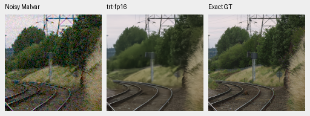
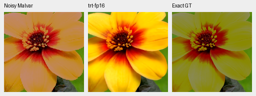

# Faster Corpus 100k startup and TensorRT on GB10

CUDA `demosaic infer` now prepares channels-last weights on the CPU and
uploads them from pinned host memory. This saves most of the cold checkpoint
setup time without changing the output arithmetic. The paired full-frame run
produces identical RGB16 pixels with the existing Corpus 100k FP16 option.
TensorRT FP16 also reduces warmed restoration by **11.9%** in a separate
test. Selective FP8 saves a further 1.44 s on that frame and raises
quiet-region chroma error. The 100 MP in 10 seconds target remains unmet.
[Machine results](results/corpus100k-faster-inference-v1/publication.json) ·
[Frozen drivers and receipts](results/corpus100k-faster-inference-v1/evidence.tar.xz). A
[paired 520-tile follow-up](corpus100k-trt-tactics.md) measures 12.4%
less forward time with the same TensorRT FP16 plan and finds similar
forward time after a wider fixed-batch search.

## Cold RAW to RGB16

The paired CLI runs use the Corpus 100k EMA
`87b96f3c487b9edaf1c477742b6c38f2a82cc6b20a94716d51cc8cf46a17a760`,
cached DSCF3879 at ISO6400, 520 tiles of 512 × 512, overlap 64 and batch
four. Shot/read are `0.00128/6.5536e-6`. Both use PyTorch 2.14.1+cu130
and cuDNN 9.24 on the shared NVIDIA GB10. Each CLI run starts a new process.
The code comparison covers all 305,987,556 RGB channel values after export,
with **zero differing codes**.

| Fresh CLI process | Previous transfer | Pinned transfer |
| --- | ---: | ---: |
| Checkpoint setup | 52.59 s | 2.52 s |
| Tiled restore and blend | 55.10 s | 45.52 s |
| Process launch through RGB16 TIFF | 111.16 s | 52.32 s |

Checkpoint setup saves **50.07 s**. The observed total is **2.12×**
faster. The GPU was shared and the two restoration times varied by
9.58 s. The weight transfer change accounts for the setup gain. TIFF
files have identical SHA256 hashes.

In separate startup probes, placing weights in channels-last layout on
the CPU takes about 0.01 s. Pageable upload still takes 34.23 s after
that layout change. Pinned per-tensor upload takes 0.75 s. A pinned bulk
copy takes 0.64 s and adds complexity for a small additional gain.
A cold CUDA context with a small tensor allocation takes about 0.51 s.
All four checkpoint staging variants reproduce the same native patch bit
for bit. The CLI uses the per-tensor path with ordinary transfers as a
fallback if host pinning is unavailable. The sidecar now reports
`checkpoint_setup_seconds` separately.

Run the existing `demosaic infer` command with `--device cuda --precision
float16` for Corpus 100k. Supply the sensor's actual shot/read profile.
The loader also supports the other CUDA inference precisions.
[Usage](usage.md#raw-and-tiff-conventions) · [Broad eager FP16 quality](corpus100k-mixed-precision.md).

## Warm TensorRT comparison

A strongly typed TensorRT 11.4.0 engine replaces only the hidden DRUNet
path. Bayer processing, camera transforms, native skip and RGB head and
tail, and overlap accumulation retain the established arithmetic. DINO
stays on eager FP16. FP8 uses per-output-channel weight scales and
per-tensor activation scales on 24 convolutions across the third
encoder group, bottleneck and third decoder group. Calibration uses 24
training photos at six noise/exposure conditions. The inspected engine
uses E4M3 convolutions in all 24 places. The engine builds take 35.52 s
for FP16 and 23.63 s for FP8. These one-time builds are outside the timings.
[NVIDIA TensorRT quantization schemes](https://docs.nvidia.com/deeplearning/tensorrt/11.4.1/inference-library/quantized-types-schemes.html).

| Warm full 102 MP | Restore and blend | RGB16 writer | RGB16 RMS difference vs eager FP16 | Exported codes within one |
| --- | ---: | ---: | ---: | ---: |
| Eager FP16, before / after | 41.33 / 42.75 s | 1.07 / 0.93 s | 0 | 100% |
| TensorRT FP16 | 37.05 s | 0.91 s | 0.552 DN16 | 99.34% |
| TensorRT selective FP8 | 35.61 s | 0.78 s | 3.768 DN16 | 77.55% |

TensorRT FP16 changes RGB16 by five codes or less at the 99.9th
percentile. Its worst code changes 216 DN16 on saturated magenta signage.
The FP8 tail reaches 32 DN16 at the 99.9th percentile and a worst change
of 1,532 DN16 in a bright orange sign. Both exported views retain similar
letter shapes. Differences are smaller near overlap midpoints than away
from them. The separate four-tile resident screen measures **196.2 ms
eager FP16**, **173.2 ms TensorRT FP16** and **166.0 ms selective FP8**.
[FP16 outlier crop](images/corpus100k-faster-inference-v1/trt-fp16-outlier.png) ·
[FP8 outlier crop](images/corpus100k-faster-inference-v1/trt-selective-fp8-outlier.png).

On 24 exact held-out wire backgrounds at ISO6400, TensorRT FP16 changes
mean weak response by −0.002 percentage points and raises flat chroma RMS
by 0.025 DN16 versus eager FP16. The largest per-case response change is
0.158 points. FP8 lowers mean weak response by **0.431 points** and raises
flat chroma RMS by **8.42 DN16**. The worst per-case chroma RMS increase
is 47.86 DN16. FP8 also raises flat chroma RMS by 2.33 DN16 on the 24
ISO400 cases. The small runtime increment and these differences favor FP16.

NVFP4 is limited to the two linear projections in one frozen ConvNeXt
block. The first engine build rejected half-output dequantization. With
float-output dequantization and a cast, the inspected engine runs native
block-scaled FP4 GEMMs. The pair takes 0.398 ms versus 0.389 ms for its
TensorRT FP16 control, including activation quantization and dispatch.
The full four-tile forward does not get faster in this pilot. Camera-RGB
RMS difference rises from 0.189 to 0.983 DN16 versus eager FP16.
A separate DRUNet-only CUDA graph replays bit-exact outputs and takes
292 ms versus 280 ms eager in that session. Keeping the autocast weight
cache across batches saves about 4% in its resident screen.

## Native exact-target comparisons

Each cell uses 160 × 160 unchanged pixels at `[48,48,160,160]` within the
original RGGB query. Noisy Malvar, TensorRT FP16 and the exact target share
the same display transform. The capture uses 16-bit ADC and a black level
of 0.03. Both retain the same fine-detail limits as the eager model.
[Native crop provenance](images/corpus100k-faster-inference-v1/manifest.json).

**Birmingham railway**, mattbuck, CC BY-SA 3.0. ISO12800 shot/read
`0.00256/2.62144e-5`, display ×1. The tracks and soft foliage look alike.
sRGB PSNR is 32.87158 dB eager FP16 and 32.87166 dB TensorRT FP16.
[Source](https://commons.wikimedia.org/wiki/File:Birmingham_MMB_07_Grand_Junction_43366.jpg) ·
[All arithmetic paths](images/corpus100k-faster-inference-v1/railway-comparison.png).

**Dahlia ‘Moonfire’**, Dominicus Johannes Bergsma, CC BY-SA 4.0. Shot/read
`8e-5/2.56e-8`, capture exposure 4, display ×0.25. Over-bright yellow
petals persist. sRGB PSNR is 23.70390 dB eager FP16 and 23.71277 dB
TensorRT FP16.
[Source](https://commons.wikimedia.org/wiki/File:Dahlia_%27Moonfire%27_005.JPG) ·
[All arithmetic paths](images/corpus100k-faster-inference-v1/dahlia-comparison.png).

## Standing GFX100S comparisons

The full DSCF3879 crops use display ×4. The sky stays smooth, the coarse
crossings stay coherent and foliage and fine building wires stay soft.
TensorRT FP16 differs from eager FP16 by 0.199–0.303 DN16 camera-RGB RMS
across the four crops. In the separate DSCF3842 cab at ×16, it differs by
0.080–0.108 DN16. The FP8 crops look similar at these display exposures.
The fine left and right lattice intersections remain incomplete. Both
ISO100 AHD views and the two cab JPEGs are qualitative references from
different aperture, exposure time and motion conditions.

[Sky](images/corpus100k-faster-inference-v1/overcast-sky.png) ·
[Building](images/corpus100k-faster-inference-v1/building-detail.png) ·
[Foliage](images/corpus100k-faster-inference-v1/foliage.png) ·
[Coarse fence](images/corpus100k-faster-inference-v1/chain-link-fence.png).

| Cab profile | Native crops with qualitative references |
| --- | --- |
| Nominal `0.00128/6.5536e-6` | [Left](images/corpus100k-faster-inference-v1/mesh-nominal-fine-green-mesh-left.png) · [Right](images/corpus100k-faster-inference-v1/mesh-nominal-fine-green-mesh-right.png) |
| Transferred `0.0014635775921166604/1.0715704128646712e-6` | [Left](images/corpus100k-faster-inference-v1/mesh-profile3879-fine-green-mesh-left.png) · [Right](images/corpus100k-faster-inference-v1/mesh-profile3879-fine-green-mesh-right.png) |

Both real scene families, both exact-target comparisons and both outliers
were viewed at native scale. The new production change is weight staging.
The TensorRT pilot covers these crops, the full GFX export and the wire
panel. A follow-up evaluates the same FP16 engines on all 427 fixed photos
and both measured-camera panels. The separate broad FP16 comparisons
include the largest photo differences.
[TensorRT FP16 fixed panels](corpus100k-fp16-throughput.md#tensorrt-fp16-on-the-fixed-panels) ·
[Eager FP16 fixed panels](corpus100k-mixed-precision.md#fixed-photo-and-measured-camera-panels).
