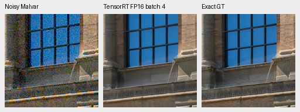
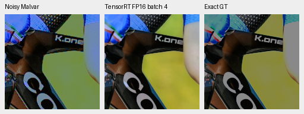

# Corpus 100k FP16 batch size at fixed tile geometry

November 19, 2026, NVIDIA GB10. **Batch four remains the fastest
tested setting on the production tile grid.** TensorRT FP16 on the
trunk and DINO cuts 15.8% from the paired 102 MP tile loop compared
with eager FP16. Eager batch eight ties batch four and uses 76% more
PyTorch CUDA memory. Compiled batch two saves memory and takes 3.7%
longer than compiled batch four. All use 512-pixel tiles with 64 pixels
of overlap. The earlier precision benchmark
cut the 102 MP tiled restore from 287.38 s in IEEE FP32 to 53.40 s in
eager FP16. [Original FP16 timings and quality](corpus100k-mixed-precision.md) ·
[Compiled DINO benchmark](corpus100k-trt-dino.md).

[Machine results](results/corpus100k-batch-v1/publication.json) ·
[Frozen drivers and receipts](results/corpus100k-batch-v1/evidence.tar.xz) ·
[Native crop provenance](images/corpus100k-batch-v1/manifest.json).

## Full 102 MP tiled inference

The model is the Corpus 100k EMA at SHA256
`87b96f3c487b9edaf1c477742b6c38f2a82cc6b20a94716d51cc8cf46a17a760`.
The input is cached GFX100S DSCF3879, ISO6400, with shot/read
`0.00128/6.5536e-6`. Each policy uses all 520 tiles at exactly the
same origins, the same camera transforms and FP32 weighted blending,
and one RGB16 conversion. CUDA neural arithmetic uses FP16 with the
validated FP32 parts of the model retained. The shared GB10 runs PyTorch
2.14.1+cu130, cuDNN 9.24 and TensorRT 11.4.0.106.

Each shape is warmed once before timing. In a randomized order within
each block of eight consecutive tiles, every policy processes the same
eight tiles. The loop time includes packing, transfer, the model forward
and FP32 blending. That sum excludes creation of the common grid and
denominator, decode, checkpoint staging, engine load, normalization and
TIFF export. Peak allocation is from PyTorch CUDA and excludes TensorRT
workspace and host allocation. The timing interval resamples matched sets
of five consecutive eight-tile blocks.

| FP16 backend and batch | Paired 520-tile loop | Peak PyTorch CUDA allocation | RGB16 TIFF write |
| --- | ---: | ---: | ---: |
| Eager, four | 123.35 s | 2.31 GB | 3.39 s |
| Eager, eight | 123.26 s | 4.06 GB | 3.08 s |
| TensorRT trunk and DINO, four | 103.90 s | 2.05 GB | 3.65 s |
| TensorRT trunk and DINO, two | 107.76 s | 1.21 GB | 3.68 s |

The paired 95% interval for the compiled batch-four reduction is
14.26–17.20%. Eager batch eight changes elapsed time by −0.07%
[−1.34%, +1.38%]. Compiled batch two takes +3.72% [+0.67%, +6.56%]
and reduces peak PyTorch CUDA allocation by 41% within the benchmark
process. Three other demosaic evaluations shared the GPU throughout
the comparison. Decode took 2.28 s, checkpoint staging 3.69 s and
loading the existing plans 0.83 s once. FP32 normalization takes
0.19–0.25 s per arm. The [previous full-frame tests](corpus100k-trt-dino.md#precision-and-timing)
show how much absolute times vary with shared load.

A preliminary screen ran seven resident groups of eight positions twice,
without host transfer and blending. Median forward times for eager
batches of two, four and eight were 1.908, 1.873 and 1.893 s per group.
The compiled variants took 1.624 s at batch two and 1.567 s at batch four.

## Numerical fidelity

Both batch-four runs produce byte-identical TIFFs to their archived
same-checkpoint exports. The compiled batch-four export therefore
retains the previously measured 0.544 DN16 RGB16 RMS difference from
IEEE FP32. In that comparison, 99.37% of color-channel codes differ by
at most one, and the largest change is 163 codes at bright signage.
[Earlier full-frame audit](corpus100k-trt-dino.md#image-fidelity).

| New comparison | Full RGB16 RMS | Codes within one DN16 | 99.9th percentile | Maximum |
| --- | ---: | ---: | ---: | ---: |
| Eager batch eight vs four | 0.242 DN16 | 99.91% | 1 DN16 | [38 DN16](images/corpus100k-batch-v1/eager8-vs-eager4-outlier.png) |
| Compiled batch two vs four | 0.445 DN16 | 99.62% | 3 DN16 | [110 DN16](images/corpus100k-batch-v1/compiled2-vs-compiled4-outlier.png) |
| Compiled batch two vs IEEE FP32 | 0.544 DN16 | 99.37% | 5 DN16 | [187 DN16](images/corpus100k-batch-v1/compiled2-vs-ieee-outlier.png) |

The comparison covers 305,987,556 camera-RGB codes. Within six sensor
pixels of a Bayer measurement at or above 0.9995, compiled batch two
differs from batch four by 5.307 DN16 RMS, versus 0.344 DN16 elsewhere.
These near-saturation pixels cover 0.285% of the frame. At display ×1,
the highlighted platform strip and magenta sign retain their apparent
shape and color across the reviewed policies. The smaller batch has
less agreement around clipped lights than in the rest of the frame.

On the six exact-target photo contexts, the maximum absolute sRGB PSNR
change from rebatching is 0.00053 dB in eager and 0.00029 dB with the
compiled plans. Both occur on the clipped cyclist. At batch four,
compiling changes that photo's score by +0.04931 dB versus IEEE FP32
and changes the clipped Karajà statuette by −0.00776 dB.

The 24 controlled wire fields use twelve backgrounds per ISO,
isolated weak and strong directions, and exact empty gaps. Relative
to eager batch four, compiled batch four changes mean weak response
by −0.0015 percentage points at ISO400 and −0.0005 at ISO6400.
Mean quiet chroma RMS rises by 0.010 and 0.014 DN16. Mean false
weak projection in the true gaps changes by −0.001 and −0.005
DN16, respectively. Across both precisions, changing the batch size
moves the mean weak response by at most 0.0024 points, mean
quiet chroma RMS by 0.0087 DN16 and mean absolute gap luma RMS
by 0.0051 DN16.

## Native exact targets

The displays use native 160 × 160 cells at `[680,480,160,160]` in
the binned source extracts. Each triplet shows noisy Malvar, the compiled
FP16 batch-four policy and exact synthetic GT. The noise draws,
camera transforms and display exposure are identical across policies.
The Bayer simulation uses 16-bit ADC and black level 0.03.

**Alte Pinakothek**, AuHaidhausen, CC BY 4.0. The source extract is
`[102,10,1536,1152]`, GBRG, shot/read `0.00256/2.62144e-5`,
display ×1. The window bars stay crisp, with softer masonry and
thin horizontal lines in all restoration paths.
[Source](https://commons.wikimedia.org/wiki/File:Alte_Pinakothek_lateral.jpg) ·
[All batch policies](images/corpus100k-batch-v1/pinakothek-comparison.png).



**Elisa Longo Borghini time trial**, Granada, CC BY-SA 4.0. The source
extract is `[264,112,1536,1152]`, RGGB, shot/read `8e-5/2.56e-8`,
capture exposure ×4 and display ×0.25. The background stays too
yellow and bright in every precision, including IEEE FP32.
[Source](https://commons.wikimedia.org/wiki/File:20180925_UCI_Road_World_Championships_Innsbruck_Women_Elite_ITT_Elisa_Longo_Borghini_850_8800.jpg) ·
[All batch policies](images/corpus100k-batch-v1/highlight-comparison.png).



## Standing GFX100S comparisons

Main crops are taken from the full frame and displayed at ×4. The
separate cab mesh uses every original full-frame batch intersecting the
native left and right ROIs, including the original FP32 Hann weights and
accumulation order. The independent ISO100 AHD and camera JPEGs have
different aperture and exposure. They are qualitative references.

The main sky stays smooth and free of visible added texture, and the
coarse fence retains its diamond crossings. Fine building cables and
leaf subdivisions are similarly soft across the policies. Across the four
native crops, the eager batch change is 0.066–0.103 DN16 RGB RMS.
The compiled batch change is 0.128–0.306 DN16 RGB RMS.

On both cab ROIs and conditioning profiles, the eager batch change is
0.031–0.046 DN16 RGB RMS and the compiled batch change is 0.077–0.100.
All eight cab boards were viewed at ×4 and ×16 alongside both camera
JPEGs and the independent AHD reference. The nominal left remains
mottled and mostly unresolved. The transferred right still shows the
clearest diagonals, with fine crossings incomplete.

[Sky](images/corpus100k-batch-v1/overcast-sky.png) ·
[Building](images/corpus100k-batch-v1/building-detail.png) ·
[Foliage](images/corpus100k-batch-v1/foliage.png) ·
[Coarse fence](images/corpus100k-batch-v1/chain-link-fence.png).

| Cab conditioning, shot/read | Left ROI | Right ROI |
| --- | --- | --- |
| Nominal `0.00128/6.5536e-6` | [×4](images/corpus100k-batch-v1/mesh-nominal-fine-green-mesh-left-display4.png) · [×16](images/corpus100k-batch-v1/mesh-nominal-fine-green-mesh-left-display16.png) | [×4](images/corpus100k-batch-v1/mesh-nominal-fine-green-mesh-right-display4.png) · [×16](images/corpus100k-batch-v1/mesh-nominal-fine-green-mesh-right-display16.png) |
| Transferred `0.0014635775921166604/1.0715704128646712e-6` | [×4](images/corpus100k-batch-v1/mesh-profile3879-fine-green-mesh-left-display4.png) · [×16](images/corpus100k-batch-v1/mesh-profile3879-fine-green-mesh-left-display16.png) | [×4](images/corpus100k-batch-v1/mesh-profile3879-fine-green-mesh-right-display4.png) · [×16](images/corpus100k-batch-v1/mesh-profile3879-fine-green-mesh-right-display16.png) |

These are inference comparisons on frozen weights. The
[fixed panels](corpus100k-trt-dino.md#fixed-photo-and-camera-panels)
establish the batch-four precision comparison on the full 427-photo
and measured-camera suites. Changed batches are evaluated here on
the standing GFX scenes, six exact-target photo contexts and 24 wire
fields. The general model choice remains V120 Small. [Model choices](current-model.md).

## Reproduction

Restore the archived drivers to their matching experiment directories.
Use the existing Corpus 100k EMA, cached RAWs and TensorRT 11.4.0.106
plans bound in the machine results. The frozen driver uses prior
evaluation inputs and the published TensorRT Python runtime setup.

```bash
study=.cache/experiments/corpus100k-batch-v1
export PYTHONPATH="$PWD/src:$PWD/scripts:$PWD/.cache/experiments/corpus100k-faster-inference-v1/runtime"
export STUDY_REVISION="$(git rev-parse HEAD)"
.venv/bin/python "$study/screen.py"
.venv/bin/python "$study/benchmark_batches.py"
.venv/bin/python "$study/batch_fidelity.py" full
.venv/bin/python "$study/batch_fidelity.py" camera
.venv/bin/python "$study/batch_wires.py"
```

The CUDA CLI uses eager FP16 at the recommended geometry with
`--device cuda --precision float16 --tile 512 --overlap 64 --batch-size 4`.
The TensorRT timings use the experimental driver and prebuilt plans.
[Inference usage](usage.md#raw-and-tiff-conventions).
