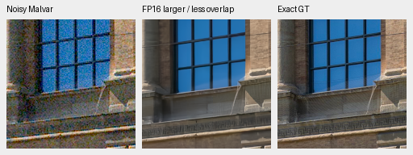
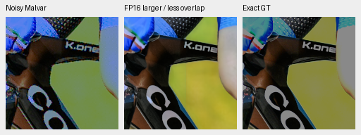

# Corpus 100k FP16 tile throughput and TensorRT quality

**Standard FP16 with 512-pixel tiles and 64 pixels of overlap remains the
supported fast path.** It previously cut 102 MP restoration from 287.38 s
to 53.40 s versus IEEE FP32. The existing TensorRT FP16 engine reduces warm
restore by a further 11.9% in its paired test. This follow-up evaluates that
same engine across all 427 fixed photos and both measured-camera panels.
The fastest eager geometry cuts a fresh paired restore from a 39.47 s
median to 31.79 s, with larger RGB16 differences near bright details and
blend bands. [Original FP16 benchmark](corpus100k-mixed-precision.md) ·
[Pinned startup and TensorRT timing](corpus100k-faster-inference.md).

[Machine results](results/corpus100k-fp16-throughput-v1/publication.json) ·
[Frozen drivers and case receipts](results/corpus100k-fp16-throughput-v1/evidence.tar.xz) ·
[Native crop provenance](images/corpus100k-fp16-throughput-v1/manifest.json).

## Tiled restore and export

All seven runs use the Corpus 100k EMA
`87b96f3c487b9edaf1c477742b6c38f2a82cc6b20a94716d51cc8cf46a17a760`
and cached DSCF3879 at ISO6400 with shot/read `0.00128/6.5536e-6`.
They use PyTorch 2.14.1+cu130 and cuDNN 9.24 on a shared GB10.
The model is resident and each shape gets a warm-up before timing. The
default geometry runs before, partway through, and after the four
single-pass variants. It returns exactly the same RGB16 TIFF in all three
passes and matches the archived pinned-transfer CLI output. Restore
includes per-batch packing, transfer and FP32 blending. RAW decode and
checkpoint staging take 0.93 s and 3.42 s once at the start of this
process. Export time covers the full linear-camera RGB16 TIFF.

| FP16 policy | Tiles | Restore | RGB16 write | Peak PyTorch CUDA allocation | Exported RGB RMS delta |
| --- | ---: | ---: | ---: | ---: | ---: |
| 512 / 64, batch 4, median of three | 520 | 39.47 s | 0.90 s | 2.12 GB | 0 DN16 |
| 512 / 64, batch 4, keep autocast cache | 520 | 40.18 s | 0.90 s | 2.12 GB | 0 DN16 |
| 512 / 64, batch 2 | 520 | 39.31 s | 0.87 s | 1.24 GB | 0.245 DN16 |
| 768 / 64, batch 4 | 221 | 38.87 s | 0.75 s | 4.32 GB | 9.82 DN16 |
| 768 / 32, batch 4 | 192 | 31.79 s | 0.74 s | 4.32 GB | 11.02 DN16 |

The three controls range from 35.70 to 41.97 s. The smaller batch cuts
peak allocation by 41% and preserves 99.90% of output codes within one
DN16. Its timing and the autocast-cache timing both fall within the
control range. The resident sweep tests 12 shapes and two cache scopes.
Toggling cuDNN benchmarking after warming the shapes does not show a
repeatable gain. The toggle may reuse cached algorithms.

The 768 / 32 run is 19.5% faster than the control median and 11.0% faster
than the fastest control. It uses roughly twice the peak CUDA allocation.
Absolute RGB16 differences are at most 83 codes at the 99.9th percentile.
RMS delta is 12.94 DN16 within eight pixels of a blend midpoint and
10.93 DN16 elsewhere. The largest single-channel change is 10,145 DN16
beside saturated signage. The rendered light retains the same general
shape, with small differences in the fringe. The 768 / 64 maximum is
5,396 DN16 on a small light behind dark fencing. [Reduced-overlap
outlier](images/corpus100k-fp16-throughput-v1/reduced-outlier.png) ·
[Larger-tile outlier](images/corpus100k-fp16-throughput-v1/larger-outlier.png) ·
[Batch-two outlier](images/corpus100k-fp16-throughput-v1/rebatch-outlier.png).

## Native exact targets

Each cell uses unchanged native 160 × 160 pixels from a held-out binned
linear photograph with a single simulated Bayer exposure at 16-bit ADC
and black level 0.03. Each mosaic is shared across all policies.
Source IDs and cached pixel hashes are checked against actual Corpus 100k
photo visits. Twelve 1152 × 1152 contexts test tile size and batch. The
768-pixel modes share tile origins on those short canvases. A second test
with a 1536-pixel axis puts overlap 32 and 64 on different grids.

The larger tiles average +0.039 dB across the twelve short canvases,
with a 0.141 dB loss on the clipped cycling photo. On six longer
contexts the 768 / 64 and 768 / 32 means move by −0.042 and −0.049 dB
versus 512 / 64. The clipped cycling photo loses 0.407 and 0.408 dB,
respectively. The narrower overlap loses up to another 0.024 dB
relative to 768 / 64 on these six contexts. The long-context triplets
show the fastest policy next to the same mosaic and exact target.

**Alte Pinakothek**, AuHaidhausen, CC BY 4.0. GBRG, shot/read
`0.00256/2.62144e-5`, display ×1. The window bars stay coherent
and the fine masonry stays smoother than the exact target. The controls
use `[680,480,160,160]` within a cache crop at `[102,10,1536,1152]`.
[Source](https://commons.wikimedia.org/wiki/File:Alte_Pinakothek_lateral.jpg) ·
[All tile settings](images/corpus100k-fp16-throughput-v1/wide-pinakothek-comparison.png).

**Elisa Longo Borghini time trial**, Granada, CC BY-SA 4.0. RGGB,
shot/read `8e-5/2.56e-8`, capture exposure ×4, display ×0.25.
The large-tile renders shift the yellow-green background and the
clipped color transitions. Scores are 27.75763 dB on 512 / 64 and
27.34970 dB on 768 / 32. The same native ROI is at
`[680,480,160,160]` within a cache crop at `[264,112,1536,1152]`.
[Source](https://commons.wikimedia.org/wiki/File:20180925_UCI_Road_World_Championships_Innsbruck_Women_Elite_ITT_Elisa_Longo_Borghini_850_8800.jpg) ·
[All tile settings](images/corpus100k-fp16-throughput-v1/wide-highlight-comparison.png).

[Short-context architecture](images/corpus100k-fp16-throughput-v1/pinakothek-comparison.png) ·
[Short-context still life](images/corpus100k-fp16-throughput-v1/cardoon-comparison.png).

## TensorRT FP16 on the fixed panels

The 256- and 512-pixel FP16 plans are the same inspected TensorRT
11.4.0 artifacts used in the earlier exact, wire and GFX comparisons.
Only the hidden DRUNet region uses TensorRT. The native head and tail, DINO,
Bayer processing, camera transforms and blending keep their eager policies.
All 3,162 frozen evaluation batches run, with identical inputs and crop
reductions as the earlier eager FP16 evaluation. The photo mean balances
427 sources. Sensor scores use measured CFA samples.
[Engine details and previous speed test](corpus100k-faster-inference.md#warm-tensorrt-comparison).

| Fixed panel | Coverage | Mean delta vs eager FP16 | Mean delta vs archived IEEE FP32 | Absolute per-case delta p95 vs eager FP16 |
| --- | ---: | ---: | ---: | ---: |
| Photographic sRGB | 427 sources, 11,956 cases | −0.000175 dB | −0.000213 dB | 0.001495 dB |
| Known measured CFA | 72 crops | −0.000110 dB | +0.000005 dB | 0.001180 dB |
| Unseen measured CFA | 90 crops | −0.000188 dB | +0.000047 dB | 0.001107 dB |

The largest photographic loss is **0.26947 dB** on the almost white
background of ROCKY's sickle image, CC BY-SA 4.0. The same-device
IEEE FP32, eager FP16 and TensorRT FP16 scores are 58.99574, 58.98236 and
58.71289 dB. TensorRT changes green by +174.92 DN16 on average in camera RGB
over the 256-pixel query. The displayed 160-pixel crop looks near-white in
all paths at ×1. The largest photographic gain, +0.07729 dB, is the
same photograph under GBRG. The loss case is RGGB at shot/read
`2e-5/1.6e-9` and both use 16-bit ADC black 0.03.
[Source](https://commons.wikimedia.org/wiki/File:Sickle_-_%E0%A6%95%E0%A6%BE%E0%A6%B8%E0%A7%8D%E0%A6%A4%E0%A7%87_-_DSC00435.jpg) ·
[Worst native case](images/corpus100k-fp16-throughput-v1/trt-worst-photo-comparison.png) ·
[Best native case](images/corpus100k-fp16-throughput-v1/trt-best-photo-comparison.png).

The previous warm full-frame comparison measures 37.05 s for TensorRT
FP16 and 42.04 s for the median eager FP16 control. Full RGB16 delta
is 0.552 DN16 RMS, with 99.34% of codes within one. Planted weak-wire
response moves −0.002 percentage points. Selective FP8 saves another
1.44 s in that run and adds 8.42 DN16 of mean quiet chroma RMS at
ISO6400. Two DINO NVFP4 projections gave no measured speed gain. The
engine remains a prototype. Use the ordinary CLI for the supported
FP16 path with pinned checkpoint staging. The 100 MP in 10 seconds
target remains unmet. [FP16 usage](corpus100k-mixed-precision.md#running-the-faster-path) ·
[Lower-bit tradeoffs](corpus100k-faster-inference.md#warm-tensorrt-comparison).

## Standing GFX100S comparisons

The four main crops come from full DSCF3879 restores at display ×4.
The sky stays smooth and the coarse weave remains coherent. Building
wires and foliage stay soft. The four DSCF3842 crops use the established
768-pixel native contexts at display ×16. Both larger-tile policies
use one tile on each cab context. The transferred right crop still has
the clearest diagonal fragments, with incomplete crossings and
slightly different background mottling. All eight crops were viewed
at native scale. The ISO100 AHD views and both cab camera JPEGs are
qualitative references with different aperture, exposure time and motion.

[Sky](images/corpus100k-fp16-throughput-v1/overcast-sky.png) ·
[Building](images/corpus100k-fp16-throughput-v1/building-detail.png) ·
[Foliage](images/corpus100k-fp16-throughput-v1/foliage.png) ·
[Coarse fence](images/corpus100k-fp16-throughput-v1/chain-link-fence.png).

| Cab conditioning, shot/read | Left ROI | Right ROI |
| --- | --- | --- |
| Nominal `0.00128/6.5536e-6` | [Native board](images/corpus100k-fp16-throughput-v1/mesh-nominal-fine-green-mesh-left.png) | [Native board](images/corpus100k-fp16-throughput-v1/mesh-nominal-fine-green-mesh-right.png) |
| Transferred `0.0014635775921166604/1.0715704128646712e-6` | [Native board](images/corpus100k-fp16-throughput-v1/mesh-profile3879-fine-green-mesh-left.png) | [Native board](images/corpus100k-fp16-throughput-v1/mesh-profile3879-fine-green-mesh-right.png) |

The 768 / 32 camera-RGB RMS differences versus the 512 / 64 baseline
are 5.82–8.98 DN16 in the main crops and 1.50–6.22 DN16 in the cab
crops. These qualitative comparisons use capture-specific references.
The tile geometry study's numerical coverage is the single full GFX
frame and the 12 short plus six longer exact contexts. The broad
results above use the fixed TensorRT engines with the earlier tile
geometry.
